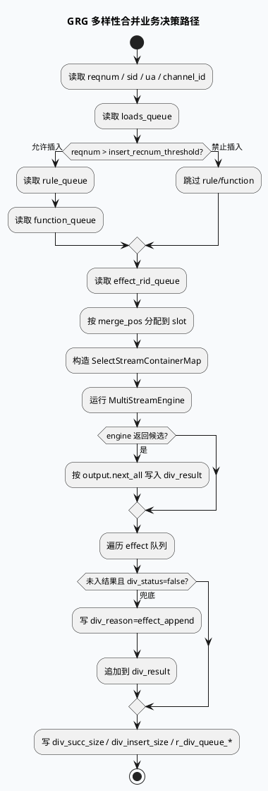

# GRG 多样性合并业务链路：loads/rule/function/effect 四队列如何决定最终结果（2026-06-24）

> 今日主题来源：本机未发现可用 `daily-plan` 文件；按周三 fallback 选择 GRG DiversityMerge 业务主题。已设置 `BAIDU_CC_USERNAME=hujiyang`；当前未提供 KU URL/doc-id，策略背景需人工补充，本文以代码库检索结果为准。

<style>.bizarch240624{font-family:-apple-system,BlinkMacSystemFont,"Segoe UI",sans-serif;background:#f8fafc;border:1px solid #d7dee8;border-radius:18px;padding:18px;margin:16px 0;color:#1f2937}.bizarch240624 .title{font-size:22px;font-weight:850;margin-bottom:5px}.bizarch240624 .sub{font-size:13px;color:#64748b;margin-bottom:14px}.bizarch240624 .cols{display:grid;grid-template-columns:1fr 1fr 1fr;gap:12px}.bizarch240624 .panel{background:white;border:1px solid #dbe4ef;border-radius:14px;padding:14px}.bizarch240624 h3{margin:0 0 10px;font-size:15px;color:#315072}.bizarch240624 .item{background:#eef6ff;border:1px solid #bfdbfe;border-radius:10px;padding:9px;margin:8px 0;font-size:13px;line-height:1.45}.bizarch240624 .hot{background:#fff7ed;border-color:#f59e0b}.bizarch240624 .warn{background:#fff1f2;border-color:#fda4af}.bizarch240624 .flow{text-align:center;color:#64748b;font-size:12px;font-weight:800;margin:8px 0}</style><div class="bizarch240624"><div class="title">架构全景：最终列表不是单路 rank 输出，而是四类队列竞争后的合并结果</div><div class="sub">loads 保底、rule 插入、function 功能、effect 效果候选进入同一 MultiStreamEngine；业务结果由插入阈值、stream 条件、去重和 effect 兜底共同决定。</div><div class="cols"><div class="panel"><h3>输入来源</h3><div class="item hot">loads_queue：保底/主结果</div><div class="item">rule_queue：规则插入</div><div class="item">function_queue：功能插入</div><div class="item">effect_rid_queue：效果候选</div></div><div class="panel"><h3>选择策略</h3><div class="item hot">RuleSelectOperator</div><div class="item">HardRuleOperator / EffectHardRuleOperator</div><div class="item">CostGenerator</div><div class="item warn">condition: ua、channel_id、is_open_dnn_soft_rule 等</div></div><div class="panel"><h3>结果语义</h3><div class="item hot">engine output → div_result</div><div class="item">effect_append 兜底</div><div class="item">_div_nid_set 去重</div><div class="item">queue_type: LOADS/RULE/FUNCTION/EFFECT</div></div></div></div>

## 核心结论

- 业务上看到的“多样性结果”由四类输入构成：`loads`、`rule`、`function`、`effect`，不是只看主 rank 或只看插入队列：`src/process/new_diversity_merge.cpp:203-220`。
- `rec_num > insert_recnum_threshold` 是 rule/function 插入生效的前置条件；否则日志会出现 `diversity no insert`，最终结果更偏向 loads/effect：`src/process/new_diversity_merge.cpp:214-219`。
- `multi_stream_diversity_new.conf` 明确了 stream 拓扑：`loads_select`、`rule_select`、`function_select`、`final_select`、`effect_pk`、`merge_pk`，业务规则通过 executor 下的 `RuleSelectOperator` 生效：`conf/plugins/exec_engine/multi_stream_diversity_new.conf:8-66`、`conf/plugins/exec_engine/multi_stream_diversity_new.conf:70-220`。
- 结果统计不是单一数量：`div_succ_size` 是最终结果数，`div_insert_size` 是 rule+function 插入数，`r_div_queue_*` 用于标识各队列贡献：`src/process/new_diversity_merge.cpp:292-320`、`src/process/new_diversity_merge.cpp:519-527`。
- 最终结果会追加 effect 队列中未被引擎选中且未 `div_status` 的候选，原因写为 `effect_append`：`src/process/new_diversity_merge.cpp:295-311`。

## 业务流程图



## 配置结构信息图

```infographic
infographic compare-hierarchy-left-right-circle-node-pill-badge
data
  title 四队列业务语义对比
  desc 排查结果异常时，应先判断是哪类队列贡献或缺失
  items
    - label 插入侧
      desc loads/rule/function 受 slot、阈值和硬规则影响
      children
        - label loads
          desc 保底/主结果，loads_select 选择符合规则的最小下标
        - label rule
          desc 规则插入，reqnum 达阈值后进入 rule_select
        - label function
          desc 功能插入，通常与 rule 一同受阈值控制
    - label 效果侧
      desc effect 既参与 final_select/effect_pk，也在末尾兜底追加
      children
        - label final_select
          desc 效果队列规则筛选和软打散打分
        - label effect_pk
          desc 提前并发分值 PK，减少候选集
        - label effect_append
          desc 未入结果且未标记 div_status 的候选会追加

theme
  palette #3D5A80 #F59E0B #2D6A4F
```

## 关键链路拆解

### 1. 插入是否生效，第一判断不是规则配置，而是 `reqnum` 阈值

`src/process/new_diversity_merge.cpp:214-219` 的分支会在 `rec_num <= _insert_recnum_threshold` 时跳过 rule/function。业务排查“为什么没有插入”时，先看请求 `reqnum` 与函数配置中的 `insert_recnum_threshold`，再看 `RuleSelectOperator`。

### 2. 队列贡献依赖 `div_reason`，不是来源队列名的直接透传

`src/process/new_diversity_merge.cpp:388-401` 根据 `div_reason` 推断 `queue_type`：包含 `loads` 记为 LOADS，`rule_select` 或 `ignore_rule_insert` 记为 RULE，`function_select` 记为 FUNCTION，其余记为 EFFECT。因此新增 operator 的 reason 命名会影响结果统计口径。

### 3. effect 队列有“双重身份”

`effect` 一方面进入配置中的 `final_select` 和 `effect_pk`，另一方面在 `src/process/new_diversity_merge.cpp:295-311` 作为兜底队列追加。表现为：即使 engine 没选中某些 effect 候选，它们仍可能以 `effect_append` 出现在结果末尾。

### 4. 配置条件来自代码注入，缺一个 condition 会让整段规则不生效

`src/process/new_diversity_merge.cpp:161-174` 注入 `ua/channel_id/is_open_dnn_soft_rule` 以及扩展 condition strategy；配置里 `RuleSelectOperator` 等节点可用 `condition` 控制生效。排查时要同时看代码注入值、实验 sid、配置 condition，而不能只看 operator 是否存在。

<style>.bizcard240624{font-family:-apple-system,BlinkMacSystemFont,"Segoe UI",sans-serif;background:#F4F3F0;border-radius:18px;padding:20px;margin:18px 0;border-top:8px solid #2D6A4F;color:#1f2937;box-shadow:0 10px 26px rgba(31,41,55,.08)}.bizcard240624 .meta{font-size:12px;letter-spacing:.08em;text-transform:uppercase;color:#64748b;font-weight:800}.bizcard240624 h3{font-size:24px;line-height:1.18;margin:8px 0 12px}.bizcard240624 .grid{display:grid;grid-template-columns:2fr 1fr;gap:14px}.bizcard240624 li{font-size:14px;line-height:1.65}.bizcard240624 ul{margin:0 0 0 18px}.bizcard240624 .side{border-left:3px solid #2D6A4F;padding-left:12px;color:#374151;font-size:14px;line-height:1.65}.bizcard240624 code{background:#e8edf3;border-radius:5px;padding:1px 5px}</style><div class="bizcard240624"><div class="meta">Pitfalls / Diversity Business</div><h3>列表异常最容易误判：只盯某个规则，却忽略队列阈值和 effect 兜底追加。</h3><div class="grid"><div><ul><li><b>无插入：</b>先看 <code>reqnum</code> 是否超过 <code>insert_recnum_threshold</code>。</li><li><b>条数偏多：</b>检查 <code>effect_append</code>，它可能把 engine 未选中的效果候选补回。</li><li><b>统计偏差：</b><code>queue_type</code> 由 <code>div_reason</code> 字符串推断，reason 命名会影响 r_div_queue_*。</li><li><b>规则未命中：</b>同时核对 condition、sid、依赖数据和 slot，而不是只检查 conf 是否有 rule。</li></ul></div><div class="side">定位建议：按 loads/rule/function/effect 四个输入数、engine output、effect append、最终去重数分段打点，避免把“候选未进入 engine”和“进入后未被选中”混在一起。</div></div></div>

## 调试 checklist

```infographic
infographic list-column-done-list
data
  title GRG 多样性结果排障 checklist
  desc 适用于结果条数不足、插入不生效、同质化或统计口径异常
  items
    - label 确认 reqnum 与阈值
      desc reqnum <= insert_recnum_threshold 会跳过 rule/function
      done true
    - label 确认四类输入数量
      desc loads_input_size、rule_input_size、function_input_size、effect_input_size
      done true
    - label 确认 merge_pos slot
      desc merge_pos 越界会导致候选不进入 SelectStreamContainerMap
      done true
    - label 确认 condition 与 sid
      desc ua、channel_id、is_open_dnn_soft_rule、实验 sid 与配置条件对齐
      done true
    - label 确认 engine output
      desc output.next_all 的候选是否有 div_reason/div_log
      done true
    - label 确认 effect append
      desc 未入结果的 effect 候选可能以 effect_append 追加
      done true
    - label 确认统计口径
      desc r_div_queue_*、div_insert_size、div_succ_size 与结果列表一致
      done true

theme
  palette #3D5A80 #F59E0B #2D6A4F
```

## 证据来源

- `src/main.cpp`：GRG 服务入口（本仓库入口为 `main.cpp`）。
- `src/process/new_diversity_merge.cpp:203-220`：四队列读取与插入阈值逻辑。
- `src/process/new_diversity_merge.cpp:247-275`：按 slot 构造引擎输入并运行 MultiStreamEngine。
- `src/process/new_diversity_merge.cpp:283-311`：引擎输出和 effect append。
- `src/process/new_diversity_merge.cpp:388-401`：由 `div_reason` 推断 queue_type。
- `src/process/new_diversity_merge.cpp:519-527`：`r_div_queue_*` SIA 统计。
- `conf/plugins/exec_engine/multi_stream_diversity_new.conf:8-66`：stream 拓扑。
- `conf/plugins/exec_engine/multi_stream_diversity_new.conf:70-220`：select executor、RuleSelectOperator 与依赖列表。
- `conf/plugins/exec_engine/multi_stream_diversity_new.conf:324-480`：effect_select executor 与效果队列规则入口。
