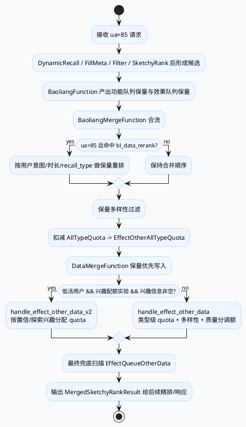

# 2026-06-26 业务库笔记：GRC 保量优先与低活兴趣配额业务链路

> 今日未发现 daily-plan 文件，按 Friday fallback 选题分析 GRC `DataMergeFunction` / `BaoliangMergeFunction` 的业务语义。内网/KU 补充资料未参与生成，业务背景需人工补充；以下结论来自代码库检索。

<div class="arch-wrap" style="font-family:-apple-system,BlinkMacSystemFont,'Segoe UI',sans-serif;background:#f8fafc;border:1px solid #d6e3f3;border-radius:18px;padding:18px;margin:16px 0;color:#1e293b;"><style>.arch-wrap .title{font-size:22px;font-weight:850;margin-bottom:4px}.arch-wrap .sub{font-size:13px;color:#64748b;margin-bottom:14px}.arch-wrap .lane{display:grid;grid-template-columns:1fr 1fr 1fr;gap:12px}.arch-wrap .col{background:#fff;border:1px solid #dbeafe;border-radius:14px;padding:12px}.arch-wrap .col h3{margin:0 0 10px;color:#1d4ed8;font-size:15px}.arch-wrap .item{border-radius:12px;padding:10px;margin:8px 0;font-size:13px;line-height:1.5;border:1px solid #bfdbfe;background:#eff6ff}.arch-wrap .bl{background:#fff7ed;border-color:#fed7aa}.arch-wrap .interest{background:#f0fdf4;border-color:#bbf7d0}.arch-wrap .guard{background:#fef2f2;border-color:#fecaca}</style><div class="title">业务视角：保量、效果队列与低活兴趣配额如何争夺 1400 窗口</div><div class="sub">核心不是排序模型本身，而是粗排后进入精排前的业务容量分配</div><div class="lane"><div class="col"><h3>保量优先</h3><div class="item bl">功能队列保量先合入，记录 `func_nid_set`</div><div class="item bl">效果队列保量随后合入，`nid_set` 去重</div><div class="item bl">保量数据经过重排与多样性过滤后占用类型 quota</div></div><div class="col"><h3>效果队列非保量</h3><div class="item">按 sv/mv/dj/heji 等类型构建候选上下文</div><div class="item">可按内容质量 Agent 分数惩罚低质类型 quota</div><div class="item">多类型并发选取，再统一写回输出</div></div><div class="col"><h3>低活兴趣策略</h3><div class="item interest">低活用户 + 实验命中 + 兴趣列表非空才走 v2</div><div class="item interest">置信兴趣与探索兴趣分别分配总 quota 占比</div><div class="item guard">最终兜底会突破类型 quota/多样性，但仍受 total_quota 与插入标记限制</div></div></div></div>

## 1. 业务结论

- `BaoliangMergeFunction` 是“保量资产的准入闸”：先把功能队列与效果队列的保量资源合并、去重、可选重排，再按类型 quota 裁剪。它决定保量能占多少精排前窗口。
- `DataMergeFunction` 是“精排前 1400 预算分配器”：保量先入，非保量按类型 quota 和多样性补充，最后兜底补满；它不只是拼接数组。
- 低活用户的兴趣配额是旁路业务逻辑：只有 `get_is_low_activity_user()`、`is_hit_interest_quota`、`VideoInterestInfo` 三个条件都满足时，才绕过常规 `handle_effect_other_data` 走 `handle_effect_other_data_v2`。

## 2. 业务调用链



## 3. 配置与业务开关信息图

```infographic compare-hierarchy-left-right-circle-node-pill-badge
data
  title 保量链路 vs 兴趣配额链路
  desc 两条业务链路在 DataMerge 前后交汇
  items
    - label 保量链路
      desc 功能/效果保量 → 合并去重 → 重排/多样性 → 占用类型 quota
      children
        - label bl_data_rerank
          desc ua=85 保量重排入口
        - label new_searchc_cp_new_baoliang
          desc recall_type 180 前置保护
        - label bl_jf_exp
          desc cate/subcate/author 阈值过滤
    - label 兴趣配额链路
      desc 低活用户 → 置信/探索兴趣 → 按 sub_cate 匹配候选 → 分配 quota
      children
        - label is_hit_interest_quota
          desc 实验命中门槛
        - label interest_quota_params_vec
          desc 单兴趣 quota 与总占比参数
        - label VideoInterestInfo
          desc confidence/exploration interest list
```

```infographic sequence-snake-steps-simple
data
  title 1400 输出窗口填充顺序
  desc 每一步都可能改变最终业务组成
  items
    - label Step 1 保量前缀
      desc `_merged_baoliang_data` 直接写入输出，记录 baoliang_count
      icon mdi/numeric-1-circle
    - label Step 2 非保量主选
      desc 类型级 quota、多样性、质量分调整或低活兴趣 quota
      icon mdi/numeric-2-circle
    - label Step 3 类型内兜底
      desc 类型还有 quota 时突破多样性补充
      icon mdi/numeric-3-circle
    - label Step 4 全局兜底
      desc 再扫 EffectQueueOtherData，直到 total_quota 或候选耗尽
      icon mdi/numeric-4-circle
```

## 4. 关键业务证据

### 4.1 保量合并顺序与去重

`src/processor/video_launch/baoliang_merge.cpp:24-28`：

- 先处理 `_function_queue_baoliang_data->queues_vec`，并用 `func_nid_set` 记录功能队列来源。
- 再处理 `_effect_queue_baoliang_data->queues_vec`。
- `merge_baoliang_data` 内部用 `nid_set` 避免同一 rid 重复进入输出。

这意味着功能保量在同等条件下优先占位，效果保量只能在未重复且 quota 未满时进入。

### 4.2 保量重排与特殊保护

- `src/processor/video_launch/baoliang_merge.cpp:56-108`：ua=85 且命中 `bl_data_rerank` 时，保量资源会按用户意图/短视频时长等比较器重排。
- `src/processor/video_launch/baoliang_merge.cpp:110-121`：命中 `new_searchc_cp_new_baoliang` 且首刷、`flow_loc=126` 时，`type_vec` 包含 180 的资源会被稳定排序到前面。
- `src/processor/video_launch/baoliang_merge.cpp:123-168`：多样性过滤后，保量再按 `AllTypeQuota` 扣减；类型 quota 不足的保量会被 erase。

### 4.3 非保量效果队列的常规路径

- `src/processor/video_launch/data_merge.cpp:369-423`：初始化类型级 merge context，若命中质量调额实验，会拉 `ContentAgentResult` 并调整 quota，然后对每个类型并发执行 `merge_effect_other_data`。
- `src/processor/video_launch/data_merge.cpp:425-444`：类型主选后还有 quota 时，会做“类型内兜底”，此处注释说明会突破多样性约束。
- `src/processor/video_launch/data_merge.cpp:829-947`：质量分调额使用用户历史平均质量分与候选质量均值的相对比例，最后用最大余额法保持整数总 quota。

### 4.4 低活兴趣配额路径

`src/processor/video_launch/data_merge.cpp:160-168` 的分支条件：

1. `get_is_low_activity_user()` 为真；
2. 实验 `is_hit_interest_quota` 命中；
3. `_video_interest_info` 存在且置信/探索兴趣列表至少一个非空。

进入 v2 后，`src/processor/video_launch/data_merge.cpp:447-560` 体现业务语义：

- 默认单个置信兴趣 quota 为 60，单个探索兴趣 quota 为 30；
- 默认置信兴趣总 quota 占比 0.6，探索兴趣总 quota 占比 0.3；
- 通过 `interest_quota_params_vec` 可覆盖这些参数；
- 候选资源按 `new_sub_cate_v2` 或 `new_sub_cate` 建索引，兴趣名匹配后写入输出。

## 5. Pitfalls 卡片

<div class="card-frame" style="font-family:-apple-system,BlinkMacSystemFont,'Segoe UI',sans-serif;background:#f4f3f0;border:1px solid #dedbd2;border-radius:18px;padding:18px;margin:16px 0;"><div style="font-size:12px;letter-spacing:.08em;text-transform:uppercase;color:#78716c;font-weight:800;">Business Pitfalls</div><div style="font-size:27px;font-weight:850;color:#1c1917;margin:4px 0 10px;">保量“多”不一定是 BaoliangFunction 产出多</div><div style="display:grid;grid-template-columns:1.2fr .8fr;gap:14px;"><div style="background:#fff;border-left:5px solid #c2410c;border-radius:12px;padding:13px;line-height:1.65;color:#44403c;">最终窗口里的保量占比同时受合并顺序、`nid_set` 去重、重排、`bl_jf_exp` 多样性阈值、`AllTypeQuota` 扣减和 `total_quota` 上限影响。只看上游保量队列大小会误判。</div><div style="background:#fff7ed;border:1px solid #fed7aa;border-radius:12px;padding:13px;color:#7c2d12;line-height:1.55;">排查顺序：先看输入队列 → 再看 merge 后保量 → 再看 quota 扣减 → 最后看 DataMerge 输出。</div></div></div>

```infographic list-column-done-list
data
  title 业务排查 Checklist
  desc 精排前窗口组成异常时建议按此顺序看日志和数据
  items
    - label baoliang_count 是否异常
      desc DataMerge 日志中的保量前缀大小是否符合预期
      done true
    - label sc_queue_180_num_in_1400 是否被保护
      desc 新搜C保量保护场景下 recall_type 180 是否前置
      done true
    - label effect_merge_count 是否偏低
      desc 类型级 quota、多样性或质量分惩罚是否过强
      done true
    - label final_doudi_count 是否过高
      desc 主选不足导致全局兜底过多，可能破坏业务比例
      done true
    - label 低活兴趣链路是否误触发
      desc 检查 video_wtype、is_hit_interest_quota、VideoInterestInfo 是否同时满足
      done true
```

## 6. 需人工补充

- `bl_data_rerank`、`user_intent_cp_*`、`bl_jf_exp`、`adjust_quota_by_quality_cupai_is_hit`、`is_hit_interest_quota` 的线上实验背景与生效人群需人工补充。
- `ContentAgentResult` 的 PCS 上游生产逻辑、质量分标定口径需人工补充。
- 低活用户 `video_wtype <= 2` 与实际业务人群定义需与策略 owner 校验。

## 证据来源

- `conf/plugins/graph/video_launch/strategy_graph.conf:373-488`：保量 merge 与 data merge 的图配置契约。
- `src/processor/video_launch/baoliang_merge.cpp:24-28`：功能/效果保量合并顺序。
- `src/processor/video_launch/baoliang_merge.cpp:56-121`：保量重排与 recall_type 180 特殊保护。
- `src/processor/video_launch/baoliang_merge.cpp:123-168`：保量多样性过滤与类型 quota 扣减。
- `src/processor/video_launch/data_merge.cpp:153-178`：保量优先、非保量、最终兜底顺序。
- `src/processor/video_launch/data_merge.cpp:369-444`：非保量常规路径与类型内兜底。
- `src/processor/video_launch/data_merge.cpp:447-560`：低活兴趣 quota v2 的核心逻辑。
- `src/processor/video_launch/data_merge.cpp:961-980`：低活用户判断逻辑。
