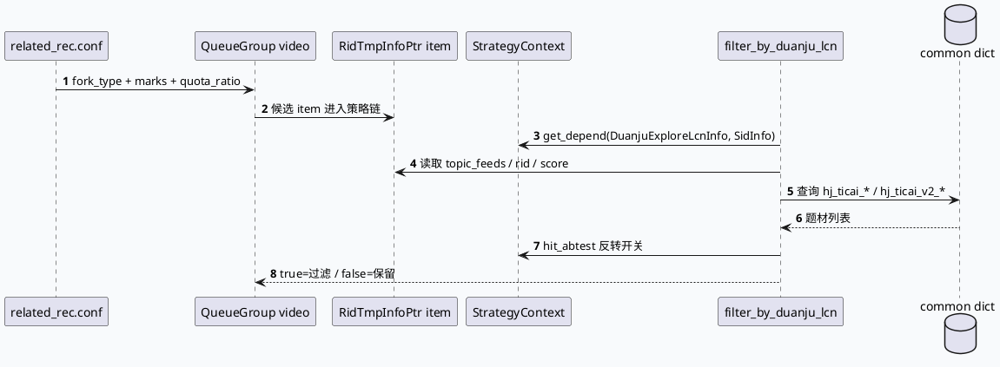

# Related 场景过滤链：合集/题材信号与队列配置的业务语义

> 日期：2026-06-30｜类型：业务库笔记｜主题来源：周二 fallback（daily-plan 未覆盖今日；内网文档检索不可用时以本地代码库检索替代）。原计划提到 UA=189 HejiLb/RelatedScene，当前代码证据中未找到 UA=189 与 HejiLb 字面量，因此本文聚焦可验证的 related_rec、合集 topic_feeds、退场/过滤回调链；UA=189 需人工补充确认。

<style>.arch{font-family:Inter,Arial,sans-serif;border:1px solid #d7e5dc;border-radius:16px;padding:18px;background:#f4f8f6;color:#17392c}.arch h3{margin:0 0 12px;font-size:20px}.arch-row{display:grid;grid-template-columns:1fr 1.1fr 1fr;gap:12px}.arch-layer{border-radius:14px;padding:12px;background:white;border-top:5px solid #2d6a4f;box-shadow:0 1px 4px rgba(30,80,50,.08)}.arch-layer b{display:block;color:#214c3b;margin-bottom:8px}.arch-box{padding:8px 10px;margin:7px 0;border-radius:10px;background:#edf7f1;border:1px solid #c8dfd1;font-size:13px}.arch-box.hot{background:#fff8e5;border-color:#e0b85f}.note{font-size:12px;color:#4c6d5d;margin-top:10px}</style><div class="arch"><h3>业务全景：Related 队列进入过滤/调权链</h3><div class="arch-row"><div class="arch-layer"><b>场景与队列</b><div class="arch-box hot">related_rec strategy</div><div class="arch-box">haokan_session_related_for_micro_short</div><div class="arch-box">haokan_cb_related_for_micro_short</div><div class="arch-box">haokan_ernie_related</div></div><div class="arch-layer"><b>内容与合集信号</b><div class="arch-box">RidTmpInfoPtr</div><div class="arch-box hot">gcms_data._video_info.article_collections_info.topic_feeds</div><div class="arch-box">d_mcv_heji_smfw_dict 字典</div><div class="arch-box">DuanjuExploreLcnInfo / SidInfo</div></div><div class="arch-layer"><b>业务决策</b><div class="arch-box hot">filter_by_duanju_lcn</div><div class="arch-box">题材退场 ticai_lcn_tuichang_flag</div><div class="arch-box">实验反转 hit_abtest</div><div class="arch-box">return true → 过滤</div></div></div><div class="note">核心语义：Related 不是单一 UA 字段决定，而是 strategy 队列 + 内容合集元数据 + 字典/实验参数共同决定过滤结果。</div></div>

## 1. 核心流程



## 2. Related 配置信息图

```infographic
infographic list-grid-badge-card
data
  title related_rec 关键队列
  desc 配置里显式出现多组 haokan related 队列，mark_base 与 quota_ratio 决定召回配额语义
  items
    - label session_related
      desc marks 219/235, mark_base 10000, quota 200/100
      icon mdi/vector-link
    - label session
      desc marks 236, mark_base 10000, quota 300
      icon mdi/link-box
    - label cb_related
      desc marks 260/299, mark_base 10000, quota 300/150
      icon mdi/chart-bubble
    - label ernie_related
      desc marks 281, quota 100
      icon mdi/brain
```

```infographic
infographic sequence-snake-steps-simple
data
  title 合集/题材过滤判定链
  items
    - label 依赖读取
      desc DuanjuExploreLcnInfo、SidInfo、CommonInfo 等从 StrategyContext 获取
      icon mdi/import
    - label 合集提取
      desc 从 article_collections_info.topic_feeds 拼 hj_ticai_* key
      icon mdi/folder-multiple
    - label 字典查询
      desc d_mcv_heji_smfw_dict 返回题材列表
      icon mdi/book-search
    - label 退场判定
      desc ticai_lcn_tuichang_flag 命中则过滤
      icon mdi/filter-remove
    - label 实验反转
      desc duanju_ticai_lcn_filter_reverse 可绕过部分过滤
      icon mdi/test-tube
```

## 3. 业务理解

- `conf/plugins/strategies/related_rec.conf:44-95` 明确包含“好看相关队列”，包括 `haokan_session_related_for_micro_short`、`haokan_cb_related_for_micro_short`、`haokan_ernie_related`。
- `strategy/queue_filter.cpp:80-132` 中 `filter_by_duanju_lcn` 处理短剧 LCN/题材退场：先读 `DuanjuExploreLcnInfo` 与 `SidInfo`，再检查合集 topic feeds。
- `strategy/queue_filter.cpp:100-113` 从 `item->gcms_data->_video_info.get_article_collections_info().topic_feeds` 拼出 `hj_ticai_*` 或 `hj_ticai_v2_*` key，并查询 `d_mcv_heji_smfw_dict`。
- `strategy/queue_filter.cpp:118-127` 一旦题材在 `ticai_lcn_tuichang_flag` 中命中，返回 `true`，即过滤该 item。
- `strategy/queue_filter.cpp:136-280` 的 quantile 过滤/调权逻辑显示：Related/队列业务规则还会叠加 CTR 排序结果、showlist 历史与实验字典阈值。

## 4. Pitfalls 卡片

<style>.card{font-family:Inter,Arial,sans-serif;background:#f7fbf8;border:1px solid #c7dfce;border-radius:18px;padding:18px;margin:16px 0;color:#1f3328}.card-title{font-size:22px;font-weight:800;letter-spacing:-.02em}.card-grid{display:grid;grid-template-columns:1.6fr 1fr;gap:14px;margin-top:12px}.card-panel{background:#fff;border-left:5px solid #2d6a4f;border-radius:12px;padding:12px}.card-panel b{color:#245942}.card-small{font-size:13px;line-height:1.65;color:#41584b}</style><div class="card"><div class="card-title">不要把 Related 问题简化成“查一个 UA”</div><div class="card-grid"><div class="card-panel"><b>实际决策面更宽</b><div class="card-small">队列 mark、mark_base、quota_ratio 决定候选来源；合集 topic_feeds 和字典决定题材；Sid 实验决定是否反转过滤。只看 UA 容易漏掉真正的过滤点。</div></div><div class="card-panel"><b>当前缺口</b><div class="card-small">UA=189 / HejiLb 字面量在当前源码检索中未命中，需人工补充对应分支或配置来源。</div></div></div></div>

## 5. 调试 checklist

```infographic
infographic list-column-done-list
data
  title Related 过滤排查清单
  items
    - label 先确认命中的 strategy 配置
      desc related_rec.conf 中 fork_type、queue_group、marks 是否符合请求场景
      done true
    - label 查候选 item 的 mark 与 mark_base
      desc 避免把不同 related 队列混在一起分析
      done true
    - label 检查 gcms_data 是否包含 topic_feeds
      desc 空合集会导致 hj_ticai key 生成失败或无字典命中
      done true
    - label 检查 d_mcv_heji_smfw_dict 返回结构
      desc vecVal 至少一项才进入题材比较
      done true
    - label 检查 Sid 实验反转开关
      desc duanju_lcn_filter_reverse / duanju_ticai_lcn_filter_reverse 改变过滤语义
      done true
    - label 牢记 FilterCb true 表示过滤
      desc 读日志时不要把 true 误解成保留
      done true
```

## 证据来源

- `conf/plugins/strategies/related_rec.conf:44-95`
- `src/strategy/queue_filter.cpp:80-132`
- `src/strategy/queue_filter.cpp:136-280`
- `src/service/grc_service.cpp:184-199`
