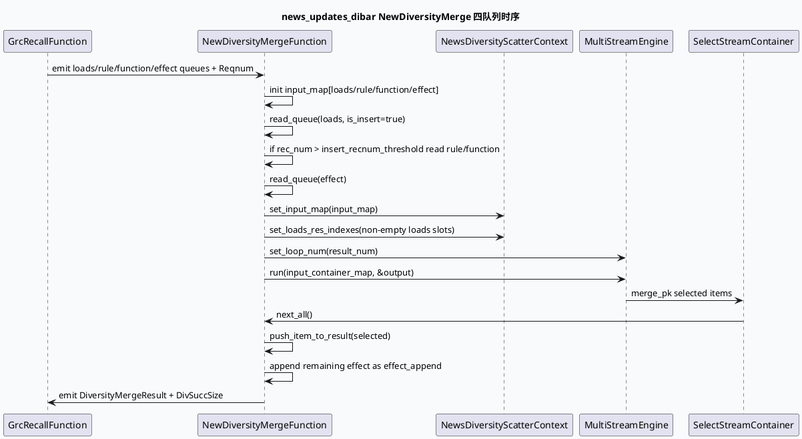

# news_updates_dibar 四队列业务流：loads / rule / function / effect 如何进入 NewDiversityMerge

> 日期：2026-07-01｜类型：业务库笔记｜主题来源：本机未发现可用 `daily-plan` 文件，按周三 fallback 选择 GRG DiversityMerge 四队列业务主题。已按任务要求设置 `BAIDU_CC_USERNAME=hujiyang`；当前未提供 KU URL/doc-id，内网策略口径需人工补充，本文以代码库检索结果为准。

## 1. 架构全景图：news_updates_dibar 从 GRC 召回到四队列打散
<style>.biz-arch{font-family:Inter,Arial,sans-serif;background:#f8fafc;border:1px solid #d7dee8;border-radius:18px;padding:18px;margin:16px 0;color:#1f2937}.biz-arch h3{font-size:21px;margin:0 0 12px}.biz-row{display:grid;grid-template-columns:1.1fr .9fr 1.2fr;gap:12px;margin:10px 0}.biz-panel{background:white;border:1px solid #cbd5e1;border-radius:12px;padding:12px;box-shadow:0 1px 4px rgba(15,23,42,.06)}.biz-panel b{display:block;color:#0f172a;margin-bottom:6px}.biz-queue{display:grid;grid-template-columns:repeat(4,1fr);gap:8px;margin-top:10px}.biz-q{border-radius:10px;padding:10px;border:1px solid #bfdbfe;background:#eff6ff}.biz-q:nth-child(2){background:#f0fdf4;border-color:#bbf7d0}.biz-q:nth-child(3){background:#fff7ed;border-color:#fed7aa}.biz-q:nth-child(4){background:#fef2f2;border-color:#fecaca}.biz-arrow{text-align:center;font-weight:800;color:#64748b;align-self:center}.biz-note{font-size:13px;color:#475569;margin-top:10px}</style><div class="biz-arch"><h3>news_updates_dibar 四队列合并业务全景</h3><div class="biz-row"><div class="biz-panel"><b>召回与队列源</b>GrcRecallFunction 产出 Reqnum、LoadsQueue、RuleQueue、FunctionQueue、EffectQueue、RecallNidVec，以及插入约束配置。</div><div class="biz-arrow">→</div><div class="biz-panel"><b>NewDiversityMergeFunction</b>读取 `news_diversity.conf`，创建 `NewsDiversityScatterContext`，把四类队列按 merge_pos 填入 input_map。</div></div><div class="biz-queue"><div class="biz-q"><b>loads</b>保量/强插资源，按 recnum 槽位组织</div><div class="biz-q"><b>rule</b>规则插入资源，受 insert_recnum_threshold 控制</div><div class="biz-q"><b>function</b>功能卡/特殊资源，单队列参与 score pk</div><div class="biz-q"><b>effect</b>效果队列兜底，先筛后 append 未命中资源</div></div><div class="biz-row"><div class="biz-panel"><b>engine stream</b>loads_select / rule_select / function_select / final_select / effect_pk / merge_pk</div><div class="biz-arrow">→</div><div class="biz-panel"><b>结果输出</b>output.next_all() 回写 DiversityMergeResult；effect_queue 中未入结果的资源以 `effect_append` 追加。</div></div><div class="biz-note">业务含义：四队列不是简单拼接，而是在同一 MultiStreamEngine 中按槽位、硬规则、打分 PK 与兜底 append 共同决策最终展示序。</div></div>

## 2. 核心流程：从 queue consumer 到 DiversityMergeResult



## 3. 四队列结构信息图

```infographic
infographic list-grid-badge-card
data
  title 四队列业务语义
  desc NewDiversityMergeFunction 内部固定构造 input_map，news_updates_dibar 通过 vertex.conf 接入对应队列数据
  items
    - label loads
      value 1
      desc `std::vector<RidInfoVec>(rec_num)`；保量/强插资源，参与 loads_select，再进入 merge_pk
      icon mdi/tray-arrow-down
    - label rule
      value 2
      desc `std::vector<RidInfoVec>(rec_num)`；只有 rec_num 大于 insert_recnum_threshold 才读取
      icon mdi/ruler
    - label function
      value 3
      desc `std::vector<RidInfoVec>(1)`；功能队列，以 score_pk 方式和其他 stream 竞争
      icon mdi/function-variant
    - label effect
      value 4
      desc `std::vector<RidInfoVec>(1)`；效果队列，engine 选择后仍会 append 未入选资源兜底
      icon mdi/chart-bell-curve
```

## 4. 业务关键点拆解

### 4.1 news_updates_dibar 明确使用 NewDiversityMergeFunction

`conf/plugins/graph/news_updates_dibar/vertex.conf:221-271` 声明 engine vertex：

- `function: NewDiversityMergeFunction`
- 依赖 `_loads_queue` / `_rule_queue` / `_function_queue` / `_effect_rid_queue`
- option 中指定 `plugin: multi_stream_engine_plugin`
- `conf: news_diversity.conf`
- `context_name: NewsDiversityScatterContext`
- `result_num: 4`
- `insert_recnum_threshold: 3`

这意味着 news 场景不是沿用 short_micro_video 的完整 `multi_stream_diversity.conf`，而是用更轻量、新闻专用的 `news_diversity.conf`：规则依赖集中在 `ShowItemListWithMeta`、`NewsReadlist`、`SidInfo`，硬规则配置是 `news_hard_rule.conf`。

### 4.2 GrcRecallFunction 是四队列上游业务源

同一个 `vertex.conf:49-176` 中，`GrcRecallFunction` emit 了四队列及相关配置：

- `_loads_insert_conf` → `LoadsInsertConf`
- `_rule_insert_conf` → `RuleInsertConf`
- `_loads_queue` → `LoadsQueue`
- `_rule_queue` → `RuleQueue`
- `_news_rule_queue` / `_news_queue` → 新闻业务侧队列
- `_function_queue` → `FunctionQueue`
- `_effect_queue` → `EffectQueue`
- `_recall_nid_vec` / `_recall_nid_map` → 召回资源集合

业务上，GRC 返回不只是“一个候选列表”，而是把不同业务目的拆成多个队列；GRG 侧再按槽位与规则合并。

### 4.3 `insert_recnum_threshold` 会直接关闭 rule/function 插入

`new_diversity_merge.cpp:203-220` 是本次最关键的业务分叉：

- `loads` 总会读取：`read_queue(_loads_queue, ..., true)`。
- `rule` 与 `function` 只有在 `rec_num > _insert_recnum_threshold` 时读取。
- news 场景配置 `insert_recnum_threshold: 3`，意味着小于等于 3 条目标结果时，规则/功能插入会被跳过，只留下 loads + effect。

这解释了线上“小请求结果里没有 rule/function 插入”的常见现象：可能不是队列为空，而是 `rec_num` 没跨过阈值。

### 4.4 slot_index 来自 `merge_pos()`，越界会静默跳过

`new_diversity_merge.cpp:343-371` 中，`data_prepare_for_engine()` 读取每个队列元素后：

1. 转换为 `DynamicStruct`。
2. 取 `item->_content_item.ext().merge_pos()` 作为 `slot_index`。
3. 如果 `slot_index >= input_vec.size()`，直接 `continue`。
4. 否则设置 `div_status=false`、`is_insert`、清空 div log，并放入对应槽位。

因此业务侧如果产出的 `merge_pos` 超过 `rec_num` 或超过单队列容量，资源会在进入 engine 之前被过滤掉。排查时要看队列大小、`merge_pos` 与 `_input_item_size`，不能只看 GRC 返回量。

### 4.5 effect 队列是兜底：未入结果会追加

`new_diversity_merge.cpp:280-312` 先遍历 `output.next_all()`，把 engine 选出的元素 `push_item_to_result()`；随后对 `_input_map["effect"][0]` 做兜底：

- 若打开 DNN soft rule，先按 `div_res_score` 降序排序。
- 对未入结果、未标记 `div_status` 的资源设置 `div_reason = "effect_append"`。
- 再 `push_item_to_result()`。

这说明 effect 并不是“只在 engine 选中时输出”，而是兼具打散候选与尾部补齐职责。

## 5. 配置到运行的业务映射

```infographic
infographic sequence-ascending-steps
data
  title news_updates_dibar 队列合并五步
  desc 从业务召回拆队列，到 MultiStreamEngine 输出最终结果
  items
    - label 1. 召回拆队列
      desc GrcRecallFunction emit loads/rule/function/effect 与插入配置
    - label 2. 阈值裁剪
      desc rec_num <= 3 时跳过 rule/function 插入
    - label 3. 槽位组织
      desc 按 merge_pos 写入 input_map 对应槽位
    - label 4. Stream PK
      desc news_diversity.conf 中 loads_select/rule_select/function_select/final_select/effect_pk/merge_pk 共同选择
    - label 5. 结果回填
      desc engine output 先入结果，effect 未入选资源再 effect_append
```

## 6. Pitfalls 卡片

<style>.biz-card{font-family:Inter,Arial,sans-serif;background:#f4f8f6;border-radius:16px;padding:18px;margin:16px 0;border:1px solid #cfe3d9;color:#1f2937;box-shadow:0 7px 24px rgba(45,106,79,.08)}.biz-card .k{font-size:12px;font-weight:800;letter-spacing:.1em;color:#2d6a4f;text-transform:uppercase}.biz-card h3{font-size:23px;margin:6px 0 8px;color:#18392b}.biz-card p{line-height:1.65;margin:8px 0}.biz-card .quote{border-left:4px solid #2d6a4f;padding-left:10px;background:#ffffffa8;border-radius:8px;margin-top:10px}</style><div class="biz-card"><div class="k">Business Pitfall</div><h3>看到队列有数据，不代表一定进入最终合并</h3><p>news_updates_dibar 的四队列至少会经历三道门：`insert_recnum_threshold`、`merge_pos` 槽位边界、MultiStreamEngine 规则/PK。rule/function 在小 recnum 下会被主动跳过；merge_pos 越界会在 `data_prepare_for_engine()` 静默 continue；effect 虽有兜底追加，但仍可能被去重或 div_status 拦截。</p><div class="quote">排查口径：先看 `loads_input_size/rule_input_size/function_input_size/effect_input_size`，再看 `div_succ_size` 和 `div_insert_size`，最后看 detail log 中的 reason。</div></div>

## 7. 调试 checklist

```infographic
infographic list-column-done-list
data
  title news_updates_dibar 四队列调试 checklist
  desc 面向线上“为什么某类资源没出”的最短路径
  items
    - label 确认场景配置
      desc vertex.conf 是否绑定 NewDiversityMergeFunction + news_diversity.conf
      done true
    - label 确认 Reqnum
      desc rec_num 是否大于 insert_recnum_threshold=3
      done true
    - label 确认四队列输入量
      desc 查看 loads/rule/function/effect input_size SIA 指标
      done true
    - label 确认 merge_pos
      desc 资源 merge_pos 是否小于对应 input_vec.size()
      done false
    - label 确认规则依赖
      desc news_hard_rule.conf 依赖的 ShowItemListWithMeta / NewsReadlist / SidInfo 是否可用
      done false
    - label 确认结果 reason
      desc loads_select、rule_select、function_select、effect_append 是否符合预期
      done false
```

## 8. 证据来源

- `conf/plugins/graph/news_updates_dibar/vertex.conf:49-176`：GrcRecallFunction emit 四队列与插入配置。
- `conf/plugins/graph/news_updates_dibar/vertex.conf:221-271`：NewDiversityMergeFunction 绑定 `news_diversity.conf`、`NewsDiversityScatterContext`、`insert_recnum_threshold: 3`。
- `src/process/new_diversity_merge.cpp:203-220`：构造 loads/rule/function/effect input_map，并按阈值控制 rule/function 读取。
- `src/process/new_diversity_merge.cpp:247-275`：转换为 SelectStreamContainerMap 并调用 `_diversity_engine->run()`。
- `src/process/new_diversity_merge.cpp:280-312`：engine 输出回写与 effect_append 兜底。
- `src/process/new_diversity_merge.cpp:343-371`：按 `merge_pos()` 写入槽位，越界跳过。
- `conf/plugins/exec_engine/news_diversity.conf:8-65`：news 场景 stream skeleton。
- `conf/plugins/exec_engine/news_diversity.conf:70-163`：select / loads / effect executor 与新闻硬规则依赖。
