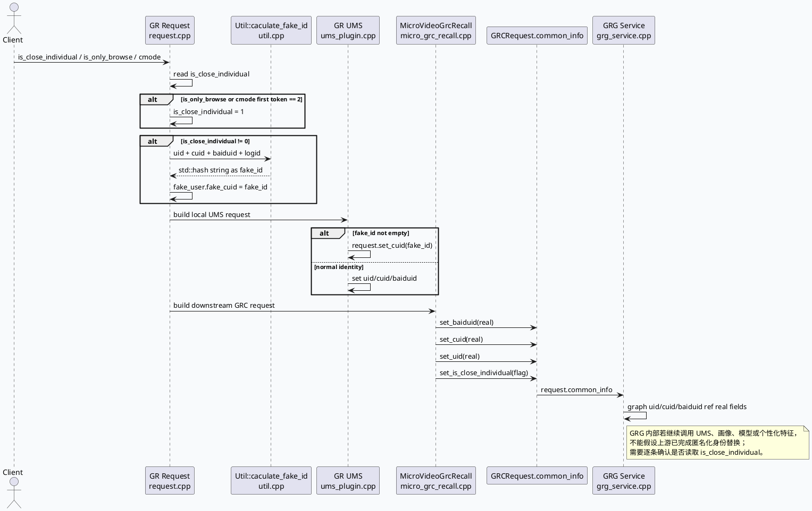

# 2026-07-04 业务库代码理解：关闭个性化 fake_id 跨服务责任边界

> 日期：2026-07-04｜类型：业务库笔记  
> 今日主题来源：本机未发现可用 `daily-plan` 文件；按周六 fallback 选择“关闭个性化推荐”业务链路，与今日基础库 DynamicTimeOut controller 生命周期主题配对。本篇聚焦 `is_close_individual`、`fake_id`、真实 uid/cuid/baiduid 在 GR 本地依赖、GR→GRC、GRG 图入口之间的责任边界。已按任务要求设置 `BAIDU_CC_USERNAME=hujiyang`；当前未提供 KU URL/doc-id，产品口径需人工补充，本文以代码库检索结果为准。

## 架构全景图
<style>.arch{font-family:-apple-system,BlinkMacSystemFont,"Segoe UI",sans-serif;background:#f8fafc;border:1px solid #dbe4ef;border-radius:18px;padding:18px;margin:16px 0;color:#1f2937}.arch-title{font-size:22px;font-weight:850;letter-spacing:-.02em;margin-bottom:12px}.lane{display:grid;grid-template-columns:repeat(4,1fr);gap:12px}.box{background:#fff;border:1px solid #e5e7eb;border-radius:14px;padding:12px;min-height:154px}.box h3{font-size:15px;margin:0 0 8px;color:#334155}.ok{border-left:5px solid #2d6a4f}.warn{border-left:5px solid #b45309}.risk{border-left:5px solid #b91c1c}.info{border-left:5px solid #3d5a80}.muted{font-size:12px;color:#64748b;line-height:1.55}.tag{display:inline-block;background:#e2e8f0;border-radius:999px;padding:2px 8px;font-size:12px;margin-top:6px}.arrow{color:#64748b;font-size:12px;margin-top:8px}</style><div class="arch"><div class="arch-title">关闭个性化链路：fake_id 在 GR 生成，跨服务主要透传语义标志</div><div class="lane"><div class="box ok"><h3>GR 请求解析</h3><div class="muted">读取 `is_close_individual`；`is_only_browse` 或 `cmode` 首段为 2 时强制置 1；非 0 计算 fake_id。</div><span class="tag">生成 fake_id</span><div class="arrow">request.cpp → util.cpp</div></div><div class="box ok"><h3>GR 本地依赖</h3><div class="muted">UMS 请求中 `fake_id` 非空时设置 `request.cuid=fake_id`；否则使用真实 uid/cuid/baiduid。</div><span class="tag">替换身份明确</span><div class="arrow">ums_plugin.cpp</div></div><div class="box warn"><h3>GR → GRC</h3><div class="muted">GRCRequest `common_info` 写入真实 baiduid/cuid/uid，同时单独写入 `is_close_individual`。</div><span class="tag">真实身份 + flag</span><div class="arrow">micro_grc_recall.cpp</div></div><div class="box risk"><h3>GRG 图入口</h3><div class="muted">Graph `uid/cuid/baiduid` 直接 ref 请求真实字段；后续个性化依赖需自行确认是否读取 flag。</div><span class="tag">责任边界</span><div class="arrow">grg_service.cpp</div></div></div></div>

## 核心调用链


## 字段责任信息图
```infographic
infographic compare-hierarchy-left-right-circle-node-pill-badge
data
  title 关闭个性化：字段、身份、服务责任要分开看
  desc fake_id 不是所有跨服务请求的协议级替代身份
  items
    - label GR 本地责任
      desc 解析关闭标志，生成请求级 fake_id，并在本服务 UMS 依赖中替换身份
      value 80
      icon mdi-check-circle
      children
        - label is_close_individual
          desc request 字段；代码语义为非 0 即关闭个性化
        - label is_only_browse/cmode
          desc 浏览模式或 cmode 首段为 2 会强制关闭个性化
        - label fake_id
          desc uid_cuid_baiduid_logid hash；随 logid 变化
        - label UMS
          desc fake_id 非空时只 set_cuid(fake_id)
    - label 下游服务责任
      desc 收到真实 ID + flag 后，按自身依赖决定是否禁用或替换个性化身份
      value 60
      icon mdi-alert-circle
      children
        - label GRCRequest.common_info
          desc baiduid/cuid/uid 仍为真实值
        - label is_close_individual
          desc 作为语义标志透传
        - label GRG Graph
          desc uid/cuid/baiduid ref 请求真实字段
        - label 内部 RPC
          desc 需逐条验证是否读取 flag
```

## 业务结论

1. **代码语义是“非 0 关闭个性化”**：入口读取 `is_close_individual` 后，只要值不为 0 就进入 fake_id 生成路径；`is_only_browse` 或 `cmode` 首段为 `2` 会强制置 1。
2. **fake_id 是请求级派生 ID**：生成逻辑是 `uid_cuid_baiduid_logid` 的 `std::hash`，同一用户在不同 logid 下会得到不同 fake_id，不能当作稳定用户标识。
3. **GR 本地 UMS 替换明确**：`ums_plugin.cpp` 在 `common_info.fake_id` 非空时只设置 `request.cuid=fake_id`；否则才写真实 uid/cuid/baiduid。
4. **GR→GRC 是“真实身份 + 关闭标志”**：`micro_grc_recall.cpp` 明确写真实 `baiduid/cuid/uid`，再单独写 `is_close_individual`。跨服务边界传递的是语义标志，不是已经替换后的身份。
5. **GRG 是需要重点复核的边界**：`grg_service.cpp` 将 request.common_info 的真实 uid/cuid/baiduid ref 到 Graph 数据。后续节点如访问 UMS、画像、模型或特征服务，需要逐条确认是否读取 `is_close_individual` 并落实关闭个性化语义。
6. **动态超时 scene 映射会影响同一业务排障**：GRG 中 `news_updates_dibar` 会映射到 `short_micro_video` 再设置动态超时。排查这条业务链路时，timeout 配置和 bvar 不一定挂在原 graph_name 下。

## 旁路流程图：news_updates_dibar 的动态超时 scene 映射
```plantuml
@startuml
skinparam handwritten false
skinparam backgroundColor #f8fafc
left to right direction
participant "GRG Request" as REQ
participant "GenericGRGService\nfill_basic_data_for_graph" as S
participant "DynamicTimeOutPlugin" as DT
participant "dynamic_timeout.conf" as CONF
REQ -> S: graph_name = news_updates_dibar
S -> S: scene = graph_name
alt scene == news_updates_dibar
  S -> S: scene = short_micro_video
end
S -> DT: set_request_timeout(dt_cntl, scene, timeout)
DT -> CONF: lookup scene short_micro_video
alt scene missing
  DT --> S: return 0 with DEBUG
else scene found
  DT --> S: bind controller and run algorithm
end
@enduml
```

## Pitfalls 卡片
<style>.card{font-family:-apple-system,BlinkMacSystemFont,"Segoe UI",sans-serif;background:#f4f3f0;border:1px solid #ded8cf;border-radius:18px;padding:18px;margin:16px 0;color:#1f2937}.meta{font-size:12px;letter-spacing:.08em;text-transform:uppercase;color:#7c4a1d;font-weight:800}.title{font-size:26px;font-weight:850;letter-spacing:-.02em;margin:6px 0 10px}.grid{display:grid;grid-template-columns:1.25fr 1fr;gap:12px}.panel{background:#fff;border-top:4px solid #b45309;border-radius:12px;padding:12px;font-size:14px;line-height:1.65}.panel strong{color:#7c2d12}.end{font-weight:800;color:#7c4a1d;margin-top:10px}</style><div class="card"><div class="meta">Pitfall / Privacy Semantics</div><div class="title">`is_close_individual` 是语义标志，不是匿名化完成证明</div><div class="grid"><div class="panel"><strong>误区：</strong>看到 GR 生成 fake_id，就认为 GRC/GRG 收到的 uid/cuid/baiduid 已经被替换。代码显示跨服务请求仍写真实身份，只是额外带关闭个性化标志。</div><div class="panel"><strong>正确做法：</strong>按服务边界逐段确认：谁生成 fake_id、谁替换身份、谁只透传标志、谁继续调用个性化依赖。每条下游 RPC 都要有日志或代码证据。</div></div><div class="end">∎ 隐私语义必须在每个边界重新落地。</div></div>

## 调试 checklist
```infographic
infographic list-column-done-list
data
  title is_close_individual / fake_id 生效性排查
  desc 从入口语义到下游 RPC 请求逐段留证
  items
    - label 入口字段解析
      desc request.cpp 是否读到 is_close_individual；is_only_browse/cmode 是否强制置 1
      done true
      icon mdi-form-textbox
    - label fake_id 生成
      desc hash 输入是否为 uid/cuid/baiduid/logid，并写入 common_info/fake_user
      done true
      icon mdi-fingerprint
    - label GR 本地 UMS
      desc ums_plugin 是否在 fake_id 非空时只 set_cuid(fake_id)
      done true
      icon mdi-account-switch
    - label GR 到 GRC
      desc micro_grc_recall 是否仍写真实 uid/cuid/baiduid，同时 set_is_close_individual
      done true
      icon mdi-transit-connection-variant
    - label GRG 图入口
      desc uid/cuid/baiduid 是否直接 ref request.common_info 真实字段
      done true
      icon mdi-graph
    - label GRG 内部依赖
      desc 继续搜 UMS/画像/模型请求是否读取 flag；本次需人工补齐线上证据
      done false
      icon mdi-alert-octagon
    - label 动态超时旁路
      desc news_updates_dibar 查 short_micro_video scene 和相关 bvar
      done true
      icon mdi-timer-cog
```

## 证据来源
- `feeda-mv-gr/src/processor/request.cpp:302-304`：读取 `is_close_individual`。
- `feeda-mv-gr/src/processor/request.cpp:348-358`：读取 `is_only_browse` / `cmode` 并强制关闭个性化。
- `feeda-mv-gr/src/processor/request.cpp:361-365`：`is_close_individual != 0` 时计算 fake_id 并写入 `fake_user.fake_cuid`。
- `feeda-mv-gr/src/util/util.cpp:563-570`：fake_id 由 `uid_cuid_baiduid_logid` hash 得到。
- `feeda-mv-gr/src/processor/ums_plugin.cpp:100-114`：GR 本地 UMS 请求在 fake_id 非空时设置 `cuid=fake_id`，否则写真实 uid/cuid/baiduid。
- `feeda-mv-gr/src/processor/micro_grc_recall.cpp:547-559`：GRCRequest 写入真实 baiduid/cuid/uid。
- `feeda-mv-gr/src/processor/micro_grc_recall.cpp:578`：GRCRequest 透传 `is_close_individual`。
- `feeda-mv-grg/src/service/grg_service.cpp:121-140`：GRG 图基础数据中 uid/cuid/baiduid 直接 ref 请求字段。
- `feeda-mv-grg/src/service/grg_service.cpp:177-199`：动态超时 controller 注入 Graph context。
- `feeda-mv-grg/src/service/grg_service.cpp:186-190`：`news_updates_dibar` scene 映射为 `short_micro_video`。
- `feeda-mv-grg/src/service/grg_service.cpp:218-221`：Graph run 后上报 request time。

## 需人工补充
- KU/产品文档中“关闭个性化”的 0/1 口径、适用场景和合规要求。
- GRG 内部所有 UMS/画像/模型/特征 RPC 是否已读取 `is_close_individual` 并替换或禁用个性化身份。
- `news_updates_dibar` 对应 `short_micro_video` 动态超时 scene 的线上 bvar、配置版本与发布记录。
