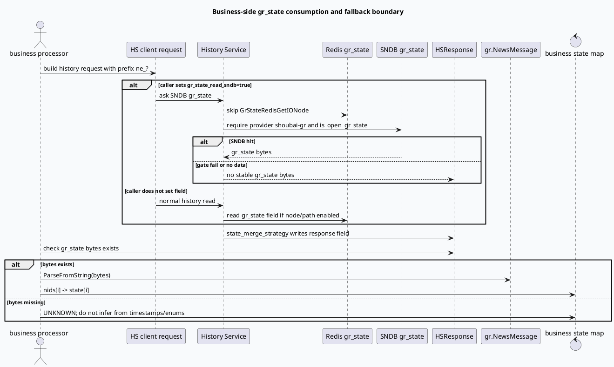

# 2026-07-05 业务库代码理解：gr_state 业务消费的读源降级边界

> 日期：2026-07-05｜类型：业务库笔记  
> 今日主题来源：本机未发现可用 `daily-plan` 文件；按周日 fallback 继续 History Service 点展状态主题，与今日基础库“`gr_state_read_sndb` 读源协商”配对。本篇聚焦业务侧消费 `gr_state` 时的降级边界：本地检索未发现 GRC/小视频 GRC 直接设置 `gr_state_read_sndb`，因此业务规则不能默认 SNDB 状态已被拉取。已按任务要求设置 `BAIDU_CC_USERNAME=hujiyang`；当前未提供 KU URL/doc-id，业务策略口径需人工补充，本文以本地代码库检索结果为准。

## 1. 架构全景图
<style>.biz0705{font-family:-apple-system,BlinkMacSystemFont,"Segoe UI",sans-serif;background:#f8fafc;border:1px solid #cbd5e1;border-radius:20px;padding:18px;margin:16px 0;color:#1f2937}.biz0705 .title{font-size:22px;font-weight:850;letter-spacing:-.02em;margin-bottom:6px}.biz0705 .sub{font-size:13px;color:#64748b;margin-bottom:14px}.biz0705 .grid{display:grid;grid-template-columns:1fr 1fr 1fr;gap:12px}.biz0705 .lane{background:#fff;border:1px solid #e5e7eb;border-radius:16px;padding:12px}.biz0705 h3{font-size:15px;color:#334155;margin:0 0 8px}.biz0705 .box{border-radius:12px;padding:10px;margin:8px 0;background:#f1f5f9;border-left:4px solid #3d5a80;font-size:13px;line-height:1.55}.biz0705 .ok{border-left-color:#2d6a4f;background:#eef7f2}.biz0705 .warn{border-left-color:#b45309;background:#fff7ed}.biz0705 .risk{border-left-color:#b91c1c;background:#fef2f2}.biz0705 .note{font-size:12px;color:#64748b;line-height:1.55;margin-top:10px}</style><div class="biz0705"><div class="title">业务消费 gr_state：不要把“基础库支持 SNDB 读”误当“业务请求一定读了 SNDB”</div><div class="sub">业务规则看到的是响应中的 bytes；响应 bytes 是否存在，取决于调用方是否携带 `gr_state_read_sndb`、HS 服务端门禁、Redis/SNDB 读源选择和最终合并策略。</div><div class="grid"><div class="lane"><h3>调用侧契约</h3><div class="box warn"><b>协议字段可选</b><br/>`HSRequest.gr_state_read_sndb` 是 optional bool；本地 GRC/小视频 GRC 检索未发现直接设置。</div><div class="box"><b>请求 prefix</b><br/>SNDB 读回要求请求中有 `prefix_key == "ne_"`，否则 HS 返回无稳定 gr_state。</div><div class="box"><b>provider</b><br/>HS 只允许 `shoubai-gr` provider 读取 SNDB gr_state。</div></div><div class="lane"><h3>基础库读源</h3><div class="box risk"><b>读 SNDB 会跳过 Redis gr_state 节点</b><br/>这意味着 SNDB 门禁失败时，不一定还有 Redis 兜底。</div><div class="box ok"><b>响应合并</b><br/>`state_merge_strategy` 将 `_gr_state_result_hc` 写入 `HistoryContent.gr_state` 或顶层 `HSResponse.gr_state`。</div><div class="box warn"><b>写读不同步</b><br/>当前配置 `is_open_gr_state=true` 但 `write_layout_sndb=false`，读到数据不代表本服务正在写入。</div></div><div class="lane"><h3>业务规则落点</h3><div class="box ok"><b>有 bytes 再 Parse</b><br/>只在响应明确包含 gr_state bytes 时解析 `gr.NewsMessage.state[]`。</div><div class="box risk"><b>无 bytes 不要猜状态</b><br/>不能用 `show_tss/click_tss/ShowClkState` 或普通 readlist 近似替代。</div><div class="box"><b>降级口径</b><br/>应把“无 gr_state”作为 UNKNOWN，而不是默认为未曝光或已下发。</div></div></div><div class="note">业务排查主线：先确认调用方是否请求 SNDB gr_state，再确认响应落点，最后才讨论 `NewsMessage.state[]` 的值域。</div></div>

## 2. 核心流程图


## 3. 业务结构信息图
```infographic
infographic compare-hierarchy-left-right-circle-node-pill-badge
data
  title gr_state 业务消费的两种路径
  desc “可解析状态”与“需降级 UNKNOWN”必须在入口就分开处理
  items
    - label 可解析路径
      desc 响应明确包含 gr_state bytes，且 ParseFromString 成功，nids/state 数组可建立状态 map
      value 75
      icon mdi/check-circle
      children
        - label HistoryContent.gr_state
          desc 普通响应模式下的状态 bytes
        - label HSResponse.gr_state
          desc `is_req_str=true` 时的顶层状态 bytes
        - label NewsMessage.state[]
          desc `0/1/2/3/4` 五值状态数组
    - label 降级路径
      desc 请求未携带读源开关、provider/prefix 不满足、SNDB miss 或响应未合并时，业务只能视为 UNKNOWN
      value 25
      icon mdi/alert-circle
      children
        - label no gr_state_read_sndb
          desc 本地 GRC/小视频 GRC 检索未发现直接设置
        - label no ne_ prefix
          desc HS 无法定位 news idx
        - label no response bytes
          desc 不能用时间戳或 ShowClkState 猜测状态
```

## 4. 关键结论

- 业务侧真正可依赖的是“响应中存在的 `gr_state` bytes”，不是基础库是否支持 SNDB、Redis 或某个可选协议字段。
- 本地检索 `feeda-mv-grc`、`code-read-grc`、history-service 调用侧代码，未发现业务侧直接设置 `set_gr_state_read_sndb()` 或 `gr_state_read_sndb` 的命中；因此业务文档中应把“SNDB gr_state 读取”标为需调用方显式确认。
- 一旦设置 `gr_state_read_sndb=true`，HS 的 `GrStateRedisGetIONode` 会被短路；如果 SNDB provider/prefix/开关不满足，业务侧可能拿不到 gr_state，不能假设 Redis 会兜底。
- 响应落点受 `is_req_str` 影响：普通业务通常检查 `history_contents[idx].gr_state`，bytes 响应模式应检查顶层 `response.gr_state`。
- 无 gr_state 的正确业务语义是 `UNKNOWN`，不是 `UNSHOW`、不是 `ISSUED`，也不是从 `show_tss/click_tss` 推断出的伪状态。

## 5. Pitfalls 卡片
<style>.bizcard0705{font-family:-apple-system,BlinkMacSystemFont,"Segoe UI",sans-serif;background:#f4f3f0;border:1px solid #ded8ce;border-radius:18px;padding:18px;margin:18px 0;color:#2f3437}.bizcard0705 .meta{font-size:12px;letter-spacing:.08em;text-transform:uppercase;color:#7c6f64;font-weight:700}.bizcard0705 .title{font-size:24px;font-weight:850;letter-spacing:-.02em;margin:6px 0 12px}.bizcard0705 .grid{display:grid;grid-template-columns:1.2fr 1fr;gap:14px}.bizcard0705 .panel{background:#fffdf8;border-top:4px solid #2d6a4f;border-radius:14px;padding:12px;font-size:13px;line-height:1.65}.bizcard0705 .panel b{color:#1f4f3b}.bizcard0705 .end{font-size:18px;color:#2d6a4f;margin-top:8px}</style><div class="bizcard0705"><div class="meta">Pitfalls · business semantics</div><div class="title">点展状态最危险的降级，是把“没拿到状态”解释成某个具体状态</div><div class="grid"><div class="panel"><b>不要把缺失当 UNSHOW。</b><br/>`UNSHOW=2` 是 `NewsMessage.state[]` 的明确值；没有 gr_state bytes 时没有证据支持这个结论。</div><div class="panel"><b>不要把基础库支持当业务接入完成。</b><br/>协议字段 optional，调用方未设置时不会自动读 SNDB。</div><div class="panel"><b>不要混用 ShowClkState。</b><br/>`ShowClkState.CLICKED=2` 与 `NewsMessage.state[].CLICKED=4` 值域不同。</div><div class="panel"><b>不要忽略响应模式。</b><br/>`is_req_str=true` 与普通响应的 gr_state 落点不同，排查脚本要同时覆盖。</div></div><div class="end">∎</div></div>

## 6. 调试 checklist
```infographic
infographic list-column-done-list
data
  title 业务侧 gr_state 排查 checklist
  desc 从请求构造到状态解释，逐步确认是否真的获得稳定状态
  items
    - label 查调用方是否设置 `gr_state_read_sndb`
      desc 未设置时不能假设 SNDB 已参与读取
      done true
    - label 查请求 prefix 是否包含 `ne_`
      desc HS SNDB 读回按 news idx 写结果
      done true
    - label 查 provider 是否 `shoubai-gr`
      desc provider 不匹配会被 HS 直接跳过
      done true
    - label 查响应落点
      desc 普通响应看 `HistoryContent.gr_state`，`is_req_str` 看 `HSResponse.gr_state`
      done true
    - label Parse 前判断 bytes 非空
      desc 空 bytes 不进入状态 map 构建
      done true
    - label 校验 nids/state 数组对齐
      desc 不对齐时应降级 UNKNOWN 并打监控
      done true
    - label 禁止用时间戳/ShowClkState 代替
      desc 它们不是同一套状态契约
      done true
```

## 7. 证据来源

- `history_service.proto:195-209`：`HSRequest.gr_state_read_sndb` 为 optional bool。
- `fhs.cc:137-139`：子请求仅在原请求 has 字段时透传 `gr_state_read_sndb`。
- `session_context.cc:178-180`：session 中 `_gr_state_read_sndb` 的初始化逻辑。
- `redis_handler.cc:33-36`：`gr_state_read_sndb` 会让 `GrStateRedisGetIONode` 跳过 Redis。
- `sndb_dao.cc:234-273`：SNDB gr_state 读取需要 `is_open_gr_state`、provider、`ne_` prefix，并写 `_gr_state_result_hc`。
- `strategy.cc:513-526`：`state_merge_strategy()` 决定 `gr_state` 的响应落点。
- `redisprotocol.proto:307`：`NewsMessage.state[]` 五值业务状态数组。
- `conf/gflags.conf:10,35`：当前配置读开关 true、写入 SNDB layout false。
- 本地检索：`feeda-mv-grc`、`code-read-grc`、`history-service` 中未发现 `set_gr_state_read_sndb` 调用命中。

## 8. 需人工补充

- 哪些线上业务请求已经显式设置 `gr_state_read_sndb=true`，以及灰度范围。
- `gr_state` 缺失时产品策略希望降级为“不做频控”还是“保守过滤”。
- KU/周报中的点展状态指标口径、监控面板与 owner。