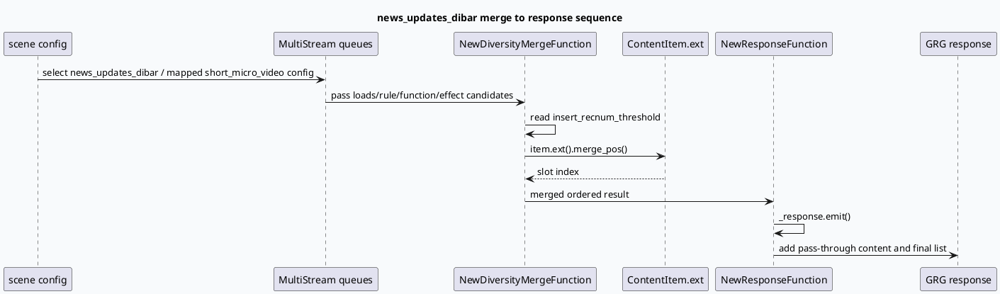

# news_updates_dibar NewDiversityMerge 到 NewResponseFunction 输出链

> 主题来源：未发现显式 daily-plan 文件，按周一兜底主题生成。内网 KU 检索未参与，本篇以代码库检索证据为准，需人工补充线上实验与配置覆盖情况。

## 架构全景

<style>.archbiz20260713{font-family:Inter,Arial,sans-serif;background:#f8fafc;border:1px solid #d6dee8;border-radius:8px;padding:18px;margin:16px 0;color:#1f2937}.archbiz20260713 .title{font-size:20px;font-weight:850;margin-bottom:12px}.archbiz20260713 .rail{display:grid;grid-template-columns:1fr 32px 1fr 32px 1fr;align-items:stretch;gap:8px}.archbiz20260713 .stage{background:#fff;border:1px solid #cbd5e1;border-radius:8px;padding:12px}.archbiz20260713 .stage h3{font-size:14px;margin:0 0 8px;color:#0f172a}.archbiz20260713 .stage p{font-size:13px;line-height:1.45;margin:0;color:#475569}.archbiz20260713 .arrow{display:flex;align-items:center;justify-content:center;color:#64748b;font-weight:900;font-size:20px}.archbiz20260713 .hot{border-color:#2d6a4f;background:#f1f8f4}.archbiz20260713 .tags{margin-top:10px;display:flex;flex-wrap:wrap;gap:6px}.archbiz20260713 .tag{font-size:12px;background:#eef2f7;border-radius:999px;padding:3px 8px;color:#334155}@media(max-width:760px){.archbiz20260713 .rail{grid-template-columns:1fr}.archbiz20260713 .arrow{transform:rotate(90deg);height:24px}}</style><div class="archbiz20260713"><div class="title">news_updates_dibar 输出链路全景</div><div class="rail"><div class="stage"><h3>MultiStream / Queues</h3><p>业务场景先通过多队列候选承载 loads、rule、function、effect 等流派结果。</p><div class="tags"><span class="tag">news_updates_dibar</span><span class="tag">short_micro_video</span></div></div><div class="arrow">→</div><div class="stage hot"><h3>NewDiversityMergeFunction</h3><p>读取 insert_recnum_threshold，按 rec_num 决定是否插入，并使用 merge_pos 作为 slot 级输出位置线索。</p><div class="tags"><span class="tag">threshold</span><span class="tag">merge_pos()</span></div></div><div class="arrow">→</div><div class="stage hot"><h3>NewResponseFunction</h3><p>emit response，写入透传 content key，并把归并后的结果组装为最终推荐响应。</p><div class="tags"><span class="tag">response_vertex</span><span class="tag">pass-through</span></div></div></div></div>

## 核心流程图



## 配置与运行时结构

```infographic
infographic sequence-ascending-steps
data
  title NewDiversityMerge to NewResponseFunction runtime contract
  items
    - label Scene config
      desc news_updates_dibar 可能复用 short_micro_video 配置，需要先确认场景映射
      icon mdi/map-marker-path
    - label Queue input
      desc 多队列候选进入 NewDiversityMergeFunction，按业务流派保留来源语义
      icon mdi/format-list-group
    - label Insert threshold
      desc insert_recnum_threshold 决定 rec_num 较小时是否跳过插入
      icon mdi/tune-variant
    - label Slot placement
      desc merge_pos() 提供 slot_index，是最终位置解释的关键字段
      icon mdi/grid
    - label Response emit
      desc NewResponseFunction 创建 response 并写入透传 content key
      icon mdi/export
```

## 关键理解

`NewDiversityMergeFunction` 是业务输出链的核心排序/插入边界。代码中通过配置读取 `_insert_recnum_threshold`，当 `rec_num` 不满足条件时会记录 `diversity no insert`，这意味着“没有插入”可能是配置阈值结果，而不是候选为空。

`merge_pos()` 是解释最终位置的重要证据。它来自 `ContentItem.ext()`，在归并后被用作 `slot_index`，因此排查线上位置异常时应同时检查候选 ext 字段、merge 阶段日志和 response 阶段输出，而不是只看最终列表。

`NewResponseFunction` 的职责是输出，不是重新做 diversity。它在 `response_vertex` 中 emit response，并添加 `SofaMicroVrIONode-microvideo_grc` 透传 content key，这说明上游 GRC/GRG 边界信息会保留到最终响应结构里。

## Pitfalls

<style>.bizpit20260713{font-family:Inter,Arial,sans-serif;background:#fff;border:1px solid #d9e2ec;border-radius:8px;margin:18px 0;padding:0;overflow:hidden;color:#1f2937}.bizpit20260713 .top{background:#f1f8f4;border-bottom:1px solid #d9e2ec;padding:14px 16px}.bizpit20260713 .top span{font-size:12px;font-weight:850;text-transform:uppercase;color:#2d6a4f}.bizpit20260713 .top h3{margin:4px 0 0;font-size:21px}.bizpit20260713 .body{display:grid;grid-template-columns:1fr 1fr;gap:0}.bizpit20260713 .cell{padding:14px 16px;border-right:1px solid #e5e7eb}.bizpit20260713 .cell:last-child{border-right:0}.bizpit20260713 .cell b{display:block;margin-bottom:6px}.bizpit20260713 p{font-size:14px;line-height:1.6;margin:0}@media(max-width:760px){.bizpit20260713 .body{grid-template-columns:1fr}.bizpit20260713 .cell{border-right:0;border-bottom:1px solid #e5e7eb}}</style><div class="bizpit20260713"><div class="top"><span>Pitfall</span><h3>把阈值跳过误判为候选缺失</h3></div><div class="body"><div class="cell"><b>错误读法</b><p>看到最终 response 数量不符合预期，就直接判断召回不足或队列为空。</p></div><div class="cell"><b>正确读法</b><p>先核对 <code>insert_recnum_threshold</code>、<code>rec_num</code> 和 <code>merge_pos()</code>，再进入 response 输出阶段确认透传字段。</p></div></div></div>

## 调试 checklist

```infographic
infographic list-column-done-list
data
  title news_updates_dibar response debugging checklist
  items
    - label 确认场景映射
      desc 检查 news_updates_dibar 是否复用 short_micro_video 配置
      done true
    - label 确认 Function 注册
      desc NewDiversityMergeFunction 需要 REGISTER_GRG_FUNCTION 注册生效
      done true
    - label 检查阈值
      desc insert_recnum_threshold 为 0 或较大值会改变插入行为
      done true
    - label 检查位置字段
      desc ContentItem.ext().merge_pos() 是 slot_index 关键来源
      done true
    - label 检查输出透传
      desc NewResponseFunction 是否写入 SofaMicroVrIONode-microvideo_grc content key
      done true
    - label 线上实验需人工确认
      desc KU/线上实验平台未检索，需人工补充最终生效配置
      done false
```

## 证据来源

- `src/process/new_diversity_merge.cpp:36`：定义 `NewDiversityMergeFunction`。
- `src/process/new_diversity_merge.cpp:59`：读取 `insert_recnum_threshold`。
- `src/process/new_diversity_merge.cpp:214-218`：`rec_num` 与阈值决定是否插入。
- `src/process/new_diversity_merge.cpp:359`：通过 `item->_content_item.ext().merge_pos()` 获得 slot 位置。
- `src/process/new_diversity_merge.cpp:663`：`REGISTER_GRG_FUNCTION(NewDiversityMergeFunction)`。
- `src/process/new_response_function.cpp:23-26`：定义新版响应函数并描述为构建最终推荐响应。
- `src/process/new_response_function.cpp:53-59`：`response_vertex` 中 emit response 并写入透传 content key。
