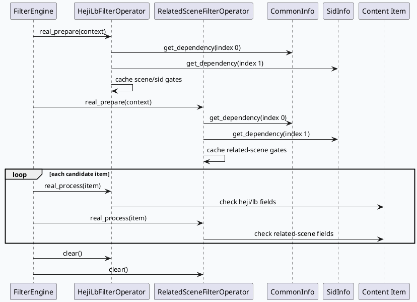
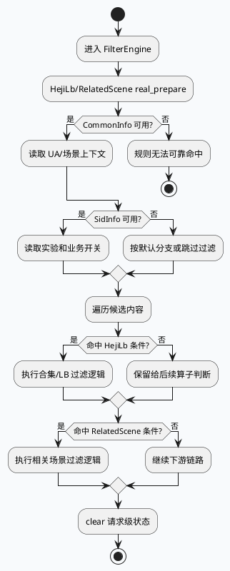

# UA=189 HejiLb 与 RelatedScene 业务过滤链路

> 主题来源：本机未发现可用 `daily-plan` 文件，按周二兜底主题生成。内网 KU 检索未参与，本篇以代码库检索证据为准，UA=189 线上实验、人群和策略口径需人工补充。

## 架构全景

<style>.biz20260714{font-family:Inter,Arial,sans-serif;background:#f8fafc;border:1px solid #d6dee8;border-radius:8px;padding:18px;margin:16px 0;color:#1f2937}.biz20260714 .title{font-size:20px;font-weight:850;margin-bottom:12px}.biz20260714 .grid{display:grid;grid-template-columns:1fr 1fr 1fr;gap:10px}.biz20260714 .box{background:#fff;border:1px solid #cbd5e1;border-radius:8px;padding:12px;min-height:112px}.biz20260714 .label{font-size:12px;font-weight:850;color:#475569;margin-bottom:6px}.biz20260714 .name{font-size:16px;font-weight:850;color:#0f172a;margin-bottom:6px}.biz20260714 .txt{font-size:13px;line-height:1.55;color:#334155}.biz20260714 .band{margin-top:12px;background:#eef6f3;border:1px solid #b7d6ca;border-radius:8px;padding:10px;font-size:13px;line-height:1.55}</style><div class="biz20260714"><div class="title">业务过滤是 CommonInfo/SidInfo 驱动的算子决策层</div><div class="grid"><div class="box"><div class="label">请求画像</div><div class="name">CommonInfo</div><div class="txt">提供 UA、场景、用户基础上下文，是判断是否命中特定业务过滤的第一层输入。</div></div><div class="box"><div class="label">策略开关</div><div class="name">SidInfo</div><div class="txt">承载 sid/实验开关，决定 HejiLb、RelatedScene 这类过滤是否启用或走分支。</div></div><div class="box"><div class="label">内容与队列</div><div class="name">VideoInfo / item</div><div class="txt">算子在 `real_process()` 阶段结合内容字段做最终保留、过滤或降级。</div></div></div><div class="band"><b>边界判断：</b>HejiLb 与 RelatedScene 都是 `GrcFilterOperator` 子类，业务问题通常不在 `FilterProcessor`，而在依赖读取、sid 开关、场景判断和内容字段是否齐全。</div></div>

## 调用时序



## 过滤决策结构

```infographic
infographic compare-hierarchy-left-right-circle-node-pill-badge
data
  title HejiLb 与 RelatedScene 关注点对比
  items
    - label HejiLbFilterOperator
      desc 面向合集/负载均衡相关过滤，先看 CommonInfo 与 SidInfo，再看内容是否满足 heji/lb 规则
      children
        - label real_prepare
          desc 读取 CommonInfo、SidInfo
        - label real_process
          desc 对候选内容做业务过滤
        - label clear
          desc 清理请求级缓存状态
    - label RelatedSceneFilterOperator
      desc 面向相关场景过滤，重点确认场景识别、sid 开关和内容相关性字段
      children
        - label real_prepare
          desc 读取 CommonInfo、SidInfo
        - label real_process
          desc 判断 related scene 规则
        - label clear
          desc 避免复用对象状态串扰
```

## 关键观察

1. `HejiLbFilterOperator` 和 `RelatedSceneFilterOperator` 都在 `real_prepare()` 中先通过 `_data_frame.get_dependency<CommonInfo>(context, 0)` 与 `_data_frame.get_dependency<SidInfo>(context, 1)` 读取依赖，说明业务开关判断先于单 item 处理。
2. 两个算子都继承 `GrcFilterOperator`，因此遵循同一套 `real_prepare()`、`real_process()`、`clear()` 生命周期；排查 UA=189 问题时可复用同一套断点和日志模板。
3. `HejiFilterOperator` 与 `HejiLbFilterOperator` 分属不同文件，命名接近但语义不同，检索时不能只搜 `heji` 后直接套用结论。
4. 当前配置关键字检索未直接命中 `HejiLb` 或 `RelatedScene`，更可能是注册名、条件配置或上游 graph 片段间接装配；需要人工补充线上配置路径或通过运行时日志确认实际命中链路。

## 业务活动图



## Pitfalls

<style>.bizpit20260714{font-family:Inter,Arial,sans-serif;background:#fff;border:1px solid #d6dee8;border-radius:8px;padding:16px;margin:16px 0;color:#1f2937}.bizpit20260714 .head{font-size:18px;font-weight:850;margin-bottom:10px}.bizpit20260714 .grid{display:grid;grid-template-columns:1.2fr .9fr .9fr;gap:10px}.bizpit20260714 .card{background:#f8fafc;border-left:5px solid #2d6a4f;border-radius:6px;padding:10px}.bizpit20260714 .k{font-size:13px;font-weight:850;margin-bottom:6px}.bizpit20260714 .v{font-size:12px;line-height:1.55;color:#475569}</style><div class="bizpit20260714"><div class="head">UA=189 过滤排查的高风险误区</div><div class="grid"><div class="card"><div class="k">把 prepare 问题误判成 item 问题</div><div class="v">如果 CommonInfo/SidInfo 依赖为空或 index 错位，后续 item 字段再完整也不会命中预期分支。</div></div><div class="card"><div class="k">混淆 Heji 与 HejiLb</div><div class="v">`heji_filter_operator.cc` 与 `heji_lb_filter_operator.cc` 是不同业务规则，日志和配置名必须对应。</div></div><div class="card"><div class="k">只看源码不看配置</div><div class="v">配置未装配、sid 未开或 UA 场景未覆盖时，源码逻辑存在也不会在线上生效。</div></div></div></div>

## 调试 Checklist

```infographic
infographic list-column-done-list
data
  title UA=189 HejiLb/RelatedScene 排查顺序
  items
    - label 确认请求是否真实进入 lite-grc 过滤链
      desc 从 FilterProcessor handle_name 与 filter_conf_name 开始查
      done true
    - label 打印 CommonInfo 的 UA 与场景字段
      desc UA=189 需要用请求级上下文确认，而不是只看最终结果
      done true
    - label 打印 SidInfo 中相关 sid/实验开关
      desc 开关未命中时业务算子可能自然跳过
      done true
    - label 分别给 HejiLb 和 RelatedScene 增加命中日志
      desc 避免 Heji、HejiLb、RelatedScene 多个算子混淆
      done true
    - label 检查 clear 后是否还有请求级缓存残留
      desc 对象池复用会放大状态串扰问题
      done true
```

## 证据来源

- `src/processor/filter/related_scene_filter_operator.cc:6-14`：`RelatedSceneFilterOperator` 继承 `GrcFilterOperator`，`real_prepare()` 读取 `CommonInfo` 与 `SidInfo`。
- `src/processor/filter/heji_lb_filter_operator.cc:6-14`：`HejiLbFilterOperator` 继承 `GrcFilterOperator`，同样先读取请求级依赖。
- `src/processor/filter/heji_filter_operator.cc:6-14`：`HejiFilterOperator` 是独立算子，需与 HejiLb 区分。
- `src/processor/filter/grc_filter_base.h:37-43`：业务过滤算子的共同基类与默认 `real_prepare()` 行为。
- `src/processor/filter.cpp:13-24`：过滤链路由 `handle_name` 与 `filter_conf_name` 驱动。
- `conf/plugins/graph/micro_frame/filter_main.conf:15-23`：主配置声明 generator，后续 filter 列表决定装配顺序。

## 需人工补充

- UA=189 对应的产品场景、sid 名称和线上实验开关。
- HejiLb/RelatedScene 在生产 graph 中的精确配置片段或注册名。
- 线上日志中单请求是否同时经过 HejiLb 与 RelatedScene，以及二者先后顺序。