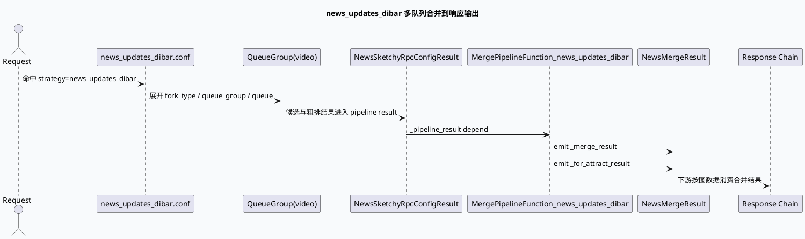

# 2026-07-15 业务库代码理解：news_updates_dibar 多队列合并与响应输出边界

> 日期：2026-07-15｜类型：业务库笔记  
> 今日主题来源：本机未发现可用 `daily-plan` 文件；按周三 fallback 与基础库 MultiStreamEngine 主题配对，选择 `news_updates_dibar` 的多队列合并与响应输出边界。  
> 内网 KU：本次任务未提供 KU URL/doc-id；如流知识库检索需人工补充。本文以本地代码库证据为准。  
> 范围：`news_updates_dibar` graph/vertex/strategy 配置，重点关注候选队列如何进入 merge 结果，以及 `_merge_result`、`_for_attract_result` 如何成为后续业务响应链的边界数据。

## 架构全景

<style>.arch20260715biz{font-family:Inter,Arial,sans-serif;background:#f8fafc;border:1px solid #d6dee8;border-radius:8px;padding:18px;margin:16px 0;color:#1f2937}.arch20260715biz .title{font-size:20px;font-weight:850;margin-bottom:12px}.arch20260715biz .lane{display:grid;grid-template-columns:1fr 32px 1fr 32px 1fr 32px 1fr;gap:8px;align-items:stretch}.arch20260715biz .stage{background:#fff;border:1px solid #cbd5e1;border-radius:8px;padding:12px;min-height:120px}.arch20260715biz .arrow{display:flex;align-items:center;justify-content:center;color:#64748b;font-weight:900}.arch20260715biz .label{font-size:12px;font-weight:850;color:#475569;text-transform:uppercase;margin-bottom:6px}.arch20260715biz .name{font-size:16px;font-weight:900;margin-bottom:8px}.arch20260715biz .desc{font-size:13px;line-height:1.55;color:#334155}.arch20260715biz .bottom{display:grid;grid-template-columns:repeat(3,1fr);gap:8px;margin-top:10px}.arch20260715biz .note{background:#eef6ff;border:1px solid #bfdbfe;border-radius:8px;padding:9px;font-size:12px;line-height:1.45;color:#1e3a5f}</style><div class="arch20260715biz"><div class="title">news_updates_dibar 业务合并链路</div><div class="lane"><div class="stage"><div class="label">Strategy</div><div class="name">多 fork_type</div><div class="desc">`news_updates_dibar.conf` 定义 short_micro_default_uniq_ucf_icf、video_micro_rec_new 等召回来源。</div></div><div class="arrow">→</div><div class="stage"><div class="label">Queue Group</div><div class="name">video 队列</div><div class="desc">每个 queue 通过 marks + quota_ratio 表达候选桶和分配权重。</div></div><div class="arrow">→</div><div class="stage"><div class="label">Merge Vertex</div><div class="name">MergePipelineFunction</div><div class="desc">读取 `_pipeline_result`，产出 `_merge_result` 与 `_for_attract_result` 两类图数据。</div></div><div class="arrow">→</div><div class="stage"><div class="label">Response Edge</div><div class="name">后续响应链</div><div class="desc">下游不应重新理解召回队列，而应消费 merge 后的结构化图数据。</div></div></div><div class="bottom"><div class="note">业务开关：由 strategy 名称和 fork_type 命中</div><div class="note">容量约束：由 max_len 与 quota_ratio 控制</div><div class="note">调试边界：以 emit 图数据为交接点</div></div></div>

## 核心流程



## 队列结构信息图

```infographic
infographic list-grid-badge-card
data
  title news_updates_dibar strategy 队列骨架
  desc 业务侧首先要确认目标候选是否进入正确 fork_type 和 queue_group
  items
    - label short_micro_default_uniq_ucf_icf
      desc type=1, queue_group=video, max_len=5000, 多个 marks 各 quota_ratio=500
      icon mdi/video-outline
    - label video_micro_rec_new
      desc type=1, queue_group=video，作为另一类视频召回入口
      icon mdi/source-branch
    - label marks
      desc marks 标识候选桶；排查时应先确认目标候选来源桶是否被配置覆盖
      icon mdi/tag-outline
    - label quota_ratio
      desc 控制桶内候选分配权重；误配会表现为候选存在但进入最终合并比例异常
      icon mdi/chart-donut
```

## 关键结论

<style>.card20260715biz{font-family:Inter,Arial,sans-serif;background:#fafafa;border:1px solid #d6dee8;border-radius:8px;padding:16px;margin:16px 0;color:#1f2937}.card20260715biz .meta{font-size:12px;font-weight:850;color:#52616f;text-transform:uppercase}.card20260715biz .headline{font-size:24px;font-weight:900;margin:6px 0 10px}.card20260715biz .grid{display:grid;grid-template-columns:1fr 1fr;gap:12px}.card20260715biz .panel{background:#fff;border-top:4px solid #2d6a4f;border-radius:6px;padding:12px;font-size:13px;line-height:1.6}.card20260715biz strong{color:#1f4d38}</style><div class="card20260715biz"><div class="meta">Pitfall Card</div><div class="headline">候选少，不一定是 Merge 函数的问题</div><div class="grid"><div class="panel"><strong>先查 strategy。</strong> 如果 fork_type、queue_group、marks 或 quota_ratio 没命中，候选可能在进入 MergePipelineFunction 前就已经被限制。此时盯着响应装配只会看到“结果少”，看不到根因。</div><div class="panel"><strong>再查 emit。</strong> `_merge_result` 和 `_for_attract_result` 是业务合并链路交接点。下游响应异常时，先确认这两个图数据是否存在、数量是否符合预期，再进入响应函数排查。</div></div></div>

## 调试 Checklist

```infographic
infographic sequence-ascending-steps
data
  title news_updates_dibar 异常排查顺序
  desc 从业务命中到响应输出，避免直接跳到末端排查
  items
    - label 命中场景
      desc graph name 是否为 news_updates_dibar，strategy 名称是否一致
      value 1
      icon mdi/numeric-1-circle
    - label 命中队列
      desc fork_type、queue_group、marks 是否覆盖目标候选来源
      value 2
      icon mdi/numeric-2-circle
    - label 配额合理
      desc max_len 与 quota_ratio 是否导致候选比例被压低
      value 3
      icon mdi/numeric-3-circle
    - label 合并输出
      desc _merge_result 与 _for_attract_result 是否成功 emit
      value 4
      icon mdi/numeric-4-circle
    - label 响应消费
      desc 下游响应链是否消费 merge 后图数据，而不是绕过合并结果
      value 5
      icon mdi/numeric-5-circle
```

## 业务边界说明

- `news_updates_dibar` 不是单一召回源，而是 strategy 下多 fork_type、多 queue_group、多 marks 的候选集合。
- `MergePipelineFunction_news_updates_dibar` 的输入是 `_pipeline_result`，配置注释说明该场景走粗排配置化框架，数据类型为 `NewsSketchyRpcConfigResult`。
- 合并后的输出被拆成 `_merge_result` 和 `_for_attract_result`，这两个名字是后续响应/吸引力相关链路的配置边界。
- 排查“候选存在但响应缺失”时，应先比较 queue 命中与 merge emit，再看响应函数是否消费对应图数据。

## 证据来源

- `conf/plugins/strategies/news_updates_dibar.conf:1-16`：strategy 名称、`short_micro_default_uniq_ucf_icf`、`queue_group=video`、`max_len=5000` 和 marks/quota_ratio 配置。
- `conf/plugins/strategies/news_updates_dibar.conf:30-34`：`video_micro_rec_new` fork_type 开始位置。
- `conf/plugins/graph/news_updates_dibar/news_updates_dibar_graph.conf:1-6`：图名 `news_updates_dibar` 和 pool bvar。
- `conf/plugins/graph/news_updates_dibar/news_updates_dibar_graph.conf:7-34`：请求上下文 global_depend 列表。
- `conf/plugins/graph/news_updates_dibar/news_updates_dibar_vertex.conf:6-22`：`MergePipelineFunction_news_updates_dibar` 的 depend/emit 关系。

## 需人工补充

- 线上 `news_updates_dibar` 的实验分桶、人群范围和 `marks` 业务含义需从 KU 或策略平台补充。
- 本文未使用内网检索，所有结论以本地代码库配置为准；若线上配置由发布系统覆盖，应以线上生效配置复核。
