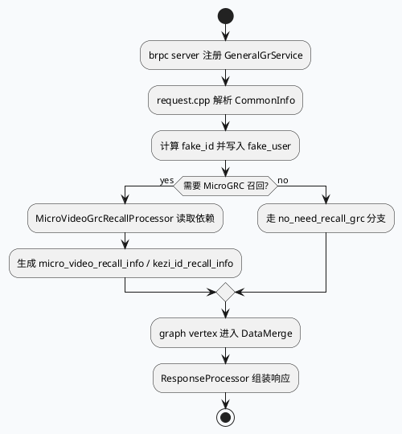

# 2026-07-16 业务库代码理解：video_launch 的 MicroGRC 召回与 DataMerge 响应链路

> 日期：2026-07-16｜类型：业务库笔记  
> 今日主题来源：本机未发现可用 `daily-plan` 文件；按周四 fallback 选择 MV-GR `video_launch` / MicroGRC recall / DataMerge 链路。  
> 内网 KU：本次任务未提供 KU URL/doc-id；如流知识库检索需人工补充。本文以本地代码库证据为准。  
> 范围：服务入口、请求归一化、fake_id 透传、MicroVideoGrcRecallProcessor、graph vertex 串联，以及响应处理边界。

## 架构全景

<style>.biz716{font-family:Inter,Arial,sans-serif;background:#f8fafc;border:1px solid #d9e2ec;border-radius:8px;padding:18px;color:#1f2937}.biz716 h3{margin:0 0 12px;font-size:20px;color:#1f344d}.biz716 .pipe{display:grid;grid-template-columns:repeat(5,1fr);gap:10px;align-items:stretch}.biz716 .node{background:#fff;border:1px solid #ccd8e6;border-radius:8px;padding:12px;min-height:104px}.biz716 .node b{display:block;color:#29415f;margin-bottom:8px}.biz716 .node.hot{border-color:#2d6a4f;background:#eef7f2}.biz716 .small{font-size:12px;line-height:1.45;color:#526070}.biz716 .foot{margin-top:12px;font-size:12px;color:#5b6878}</style><div class="biz716"><h3>video_launch 召回到响应的业务链路</h3><div class="pipe"><div class="node"><b>服务入口</b><div class="small">main.cpp 初始化 GlobalInitializer，并向 brpc server 注册 GeneralGrService。</div></div><div class="node hot"><b>请求归一化</b><div class="small">request.cpp 计算 fake_id，写入 fake_user 与日志字段，为隐私/个性化边界提供统一标识。</div></div><div class="node hot"><b>MicroGRC 召回</b><div class="small">MicroVideoGrcRecallProcessor 读取 graph dependency，生成 micro_video_recall_info 等召回数据。</div></div><div class="node"><b>DataMerge</b><div class="small">graph 配置把召回、过滤、merge 和 response processor 串成 vertex 流。</div></div><div class="node"><b>响应边界</b><div class="small">ResponseProcessor 汇总 ContentItem 输出，位置字段受上游 merge 结果影响。</div></div></div><div class="foot">核心判断：video_launch 排查不能只看单个召回函数，要沿 request identity、graph dependency、recall info、merge output 四段连续验证。</div></div>

## 核心流程图



## 配置/结构信息图

```infographic
infographic sequence-ascending-steps
data
  title video_launch 链路观察点
  desc 从入口到响应的四个可验证断点
  items
    - label Service
      desc main.cpp: GlobalInitializer 与 server.AddService 建立 RPC 入口
      value 1
      icon mdi/server
    - label Identity
      desc request.cpp: fake_id 计算后进入 fake_user 与 SIA 日志
      value 2
      icon mdi/fingerprint
    - label Recall
      desc micro_grc_recall.cpp: MicroVideoGrcRecallProcessor 绑定依赖并产出召回信息
      value 3
      icon mdi/source-branch
    - label Merge
      desc post_vertex.conf: graph vertex 串联 recall、merge、ResponseProcessor
      value 4
      icon mdi/merge
    - label Response
      desc 响应字段最终受 merge 位置和 processor 输出约束
      value 5
      icon mdi/file-export
theme
  palette #3D5A80 #2D6A4F #E07A5F
```

## 关键代码理解

`main.cpp` 是 MV-GR 服务入口：初始化全局组件后把 `GeneralGrService` 注册到 server。业务请求进入后，`request.cpp` 会计算 `fake_id`，并写入 `fake_user->fake_cuid` 与 SIA 日志字段。这说明 video_launch 的个性化、隐私或关闭个性化排查，第一步要确认请求身份是否按预期被归一化，而不是直接跳到召回结果。

`micro_grc_recall.cpp` 的 `MicroVideoGrcRecallProcessor` 定义了大量 graph dependency 和 graph data：例如 `is_recall_mgrc`、`is_recall_mgrg`、`no_need_recall_grc`、`micro_video_recall_info`、`kezi_id_recall_info`。这些名字反映出 MicroGRC 召回并不是一个纯函数，而是依赖 graph 运行时上下文决定是否召回、召回给谁、召回结果写到哪个数据槽。

`post_vertex.conf` 将 processor 挂到 graph vertex 中，后续由 DataMerge 和 ResponseProcessor 汇总。若线上出现“video_launch 召回日志存在但响应缺失”的问题，优先检查三类边界：请求 fake_id 是否正确；MicroGRC 召回 graph data 是否写入；DataMerge/ResponseProcessor 是否消费了该槽位。

## Pitfalls 卡片

<style>.bizcard716{font-family:Inter,Arial,sans-serif;background:#f4f7fa;border:1px solid #d8e1ea;border-radius:8px;padding:18px;margin-top:14px;color:#243142}.bizcard716 .meta{font-size:12px;text-transform:uppercase;letter-spacing:.06em;color:#5b6b7f;font-weight:700}.bizcard716 .title{font-size:24px;font-weight:800;margin:6px 0 12px;color:#1f344d}.bizcard716 .grid{display:grid;grid-template-columns:1fr 1fr 1fr;gap:12px}.bizcard716 .panel{background:#fff;border-top:4px solid #2d6a4f;border-radius:6px;padding:12px;font-size:13px;line-height:1.55}.bizcard716 b{color:#29415f}</style><div class="bizcard716"><div class="meta">Business Debug</div><div class="title">召回存在不等于响应可见</div><div class="grid"><div class="panel"><b>身份边界</b><br>fake_id 计算异常会让后续个性化、隐私或关闭个性化判断偏离真实用户。</div><div class="panel"><b>Graph 边界</b><br>MicroGRC 召回结果要写入约定 GraphData，单看 RPC 返回无法证明下游可消费。</div><div class="panel"><b>Merge 边界</b><br>DataMerge 和 ResponseProcessor 可能因为位置、配额、过滤条件让召回内容最终不可见。</div></div></div>

## 调试 Checklist

```infographic
infographic list-column-done-list
data
  title video_launch 召回问题排查
  desc 从请求身份到响应输出逐段确认
  items
    - label 服务入口已加载
      desc main.cpp 注册 GeneralGrService，确认请求进入目标服务
      done true
      icon mdi/server-network
    - label fake_id 已生成
      desc request.cpp 中 fake_user 与 SIA 日志均应出现 fake_id
      done true
      icon mdi/fingerprint
    - label 召回开关命中
      desc is_recall_mgrc / is_recall_mgrg / no_need_recall_grc 三类依赖要解释清楚
      done false
      icon mdi/toggle-switch
    - label GraphData 已写入
      desc micro_video_recall_info 与 kezi_id_recall_info 是下游消费断点
      done false
      icon mdi/database-check
    - label Merge 后仍保留
      desc DataMerge、过滤和 ResponseProcessor 共同决定响应可见性
      done false
      icon mdi/merge
theme
  palette #3D5A80 #2D6A4F #C05621
```

## 证据来源

- `src/main.cpp:61,80`：初始化全局组件并注册 `GeneralGrService`。
- `src/processor/request.cpp:362-365,369`：计算 `fake_id`，写入 `fake_user->fake_cuid` 和 SIA 日志。
- `src/processor/micro_grc_recall.cpp:64-82`：定义 `is_recall_mgrc`、`is_recall_mgrg`、`no_need_recall_grc` 等召回控制依赖。
- `src/processor/micro_grc_recall.cpp:94,112,120-129`：定义召回输出 GraphData，并在 `MicroVideoGrcRecallProcessor` 中绑定运行依赖。
- `output/conf/plugins/graph/post_vertex.conf:161,333`：graph 配置中存在响应 processor，说明召回结果还要经过响应组装边界。
