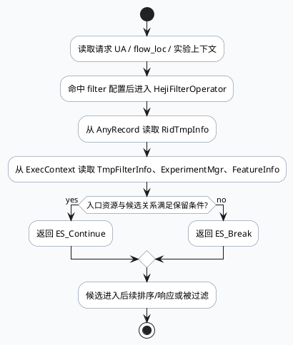

# UA=189 合集/相关推荐过滤：入口资源与场景边界

> 主题来源：本机未发现可用 `daily-plan` 文件，按周二 fallback 主题生成。已设置 `BAIDU_CC_USERNAME=hujiyang`；本次未依赖 KU 正文检索，产品策略口径需人工补充。本文以 lite-grc 代码库检索结果为准。

## 架构全景

<style>.bizarch20260721{font-family:Inter,Arial,sans-serif;background:#f8fafc;border:1px solid #d7dee8;border-radius:8px;padding:18px;margin:16px 0;color:#1f2937}.bizarch20260721 .title{font-size:20px;font-weight:850;margin-bottom:12px}.bizarch20260721 .lane{display:grid;grid-template-columns:1fr 1fr 1fr;gap:10px}.bizarch20260721 .box{background:#fff;border:1px solid #cbd5e1;border-radius:8px;padding:12px;min-height:118px}.bizarch20260721 .box:nth-child(2){border-top:4px solid #0f766e}.bizarch20260721 .box:nth-child(3){border-top:4px solid #f59e0b}.bizarch20260721 .tag{display:inline-block;font-size:11px;font-weight:800;background:#e2e8f0;color:#475569;border-radius:999px;padding:2px 8px;margin-bottom:8px}.bizarch20260721 h3{font-size:15px;margin:0 0 8px 0}.bizarch20260721 p{font-size:13px;line-height:1.55;margin:0;color:#475569}.bizarch20260721 .bottom{margin-top:10px;background:#eef6ff;border:1px solid #bfdbfe;border-radius:8px;padding:10px;font-size:13px;color:#334155}</style><div class="bizarch20260721"><div class="title">UA=189 过滤链路：请求场景、入口资源、候选动作</div><div class="lane"><div class="box"><span class="tag">request context</span><h3>UA / 场景 / 实验</h3><p>请求侧提供 UA、flow_loc、实验开关等上下文，决定 HejiFilter 是否进入业务判定。</p></div><div class="box"><span class="tag">entry resource</span><h3>入口资源队列</h3><p>队列配置将特定 rec_src 映射到业务来源。过滤逻辑用入口资源和候选资源关系判断是否保留。</p></div><div class="box"><span class="tag">candidate filter</span><h3>单候选 Break/Continue</h3><p>operator 读取 ridinfo 与请求级依赖，命中负向条件时返回 Break，否则 Continue。</p></div></div><div class="bottom">业务含义：UA=189 不是孤立魔法数，而是队列、场景条件和 filter operator 共同构成的边界。排查时要同时看配置命中与候选 item 字段。</div></div>

## 调用链



## 配置结构

```infographic
infographic list-grid-badge-card
data
  title UA=189 相关配置与代码面
  desc 过滤问题需要同时检查队列、filter 配置和 operator 实现
  items
    - label queue.conf
      desc rec_src=189 的请求队列来源，定义业务入口
      value 1
      icon mdi/playlist-check
    - label queue_name_id.conf
      desc 队列名与数字 id 映射，定位 rec_src 语义
      value 2
      icon mdi/identifier
    - label filter_passthrough_178.conf
      desc 透传过滤链配置，确认 operator 是否被装配
      value 3
      icon mdi/source-branch
    - label heji_filter.cc
      desc 单候选读取依赖并返回 Continue 或 Break
      value 4
      icon mdi/filter
```

## 关键结论

1. `queue.conf:1406-1415` 出现 `rec_src:189` 的 query_novel 队列配置，说明 UA=189 相关问题不能只看 filter 代码，也要确认请求实际落到哪条队列。
2. `queue_name_id.conf:102-105` 把 `ForkNewsHotIONode-news_newhot` 映射为 `189`，排查日志中的数字源时可回到该配置确认语义。
3. `heji_filter.cc:10-16` 说明业务过滤依赖请求级 `TmpFilterInfo`、`ExperimentMgr`、`FeatureInfo`，任何一个依赖缺失都会让最终过滤结果偏离预期。
4. `heji_filter.cc:7-10` 明确 `ES_Break` 是过滤动作；线上排查候选消失时，应记录返回码和触发条件，避免把过滤误判为召回未返回。

## Pitfalls

<style>.bizpit20260721{font-family:Inter,Arial,sans-serif;margin:16px 0;display:grid;grid-template-columns:1fr 1fr;gap:12px}.bizpit20260721 .card{background:#fff;border:1px solid #d7dee8;border-radius:8px;padding:14px;color:#1f2937}.bizpit20260721 .card:first-child{border-top:4px solid #dc2626}.bizpit20260721 .card:last-child{border-top:4px solid #0f766e}.bizpit20260721 .k{font-size:12px;font-weight:800;color:#475569;text-transform:uppercase;letter-spacing:.04em}.bizpit20260721 h3{font-size:17px;margin:6px 0 8px 0}.bizpit20260721 p{font-size:13px;line-height:1.6;margin:0;color:#475569}</style><div class="bizpit20260721"><div class="card"><div class="k">risk</div><h3>只按 UA 排查会漏掉队列语义</h3><p>同一个数字源既可能在请求队列中出现，也可能被 filter 配置复用。仅凭 UA 或 rec_src 字段判断业务场景，容易把 query_novel、news_newhot 等入口混在一起。</p></div><div class="card"><div class="k">practice</div><h3>用三段式证据闭环</h3><p>先用队列配置确认入口，再用 filter 配置确认 operator 装配，最后用 heji_filter 的 dependency 与返回码确认单候选动作。</p></div></div>

## 调试 checklist

```infographic
infographic list-column-done-list
data
  title UA=189 过滤排查顺序
  desc 从入口到候选动作逐层验证
  items
    - label 查请求落到的队列
      desc 对照 queue.conf 与 queue_name_id.conf，确认 rec_src=189 的业务语义
      done true
      icon mdi/playlist-search
    - label 查 filter 配置是否装配 operator
      desc 对照 filter_passthrough 或 video filter 配置，确认场景条件命中
      done true
      icon mdi/cog-check
    - label 查请求级依赖是否存在
      desc TmpFilterInfo、ExperimentMgr、FeatureInfo 任一缺失都可能造成误判
      done true
      icon mdi/database-eye
    - label 查候选 RidTmpInfo
      desc 候选 item 字段为空时，过滤行为可能只是上游字段缺失的表象
      done true
      icon mdi/card-bulleted-outline
    - label 记录 Continue/Break 与原因
      desc Break 才是过滤动作，需与日志、实验开关和入口资源一起看
      done true
      icon mdi/clipboard-text-search
```

## 证据来源

- `conf/queue.conf:1406-1415`：`rec_src:189` 的队列配置片段。
- `conf/queue_name_id.conf:102-105`：队列名到数字源的映射，其中 `news_newhot:189`。
- `conf/exec_engine/filter_video_178.conf:1-180`：视频过滤链配置入口，可用于确认 operator 装配范围。
- `conf/exec_engine/filter_passthrough_178.conf:1-180`：透传过滤链配置入口，可用于确认场景条件。
- `src/strategy/processor/filter/heji_filter.h:1-45`：HejiFilterOperator 声明与依赖头文件。
- `src/strategy/processor/filter/heji_filter.cc:7-16`：返回码语义与依赖读取。
- `src/strategy/processor/filter/heji_filter.cc:17-66`：业务过滤判断主体。

## 需人工补充

- 本次未读取 KU 主题正文，UA=189 在当前业务线的产品定义、实验 ID 和指标口径需人工补充。
- 若今日实际 daily-plan 指向其他业务主题，应以 daily-plan 为准重新生成。