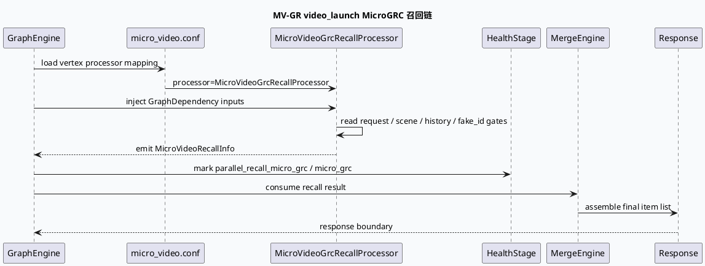

# 2026-07-23 业务库代码理解：video_launch 的 MicroGRC 召回与响应合流

> 日期：2026-07-23｜类型：业务库笔记  
> 今日主题来源：本机未发现可用 `daily-plan` 文件；按周四 fallback 选择 MV-GR `video_launch` / MicroGRC recall / DataMerge 链路。  
> 内网 KU：本次任务未提供 KU URL/doc-id；如流知识库检索需人工补充。本文以本地代码库证据为准。  
> 范围：`MicroVideoGrcRecallProcessor` 的 GraphDependency 输入、`micro_video.conf` 顶点声明、health stage 中 `parallel_recall_micro_grc` 分组，以及召回结果进入后续 merge/response 的业务边界。

## 架构全景

<style>.biz723{font-family:Inter,Arial,sans-serif;background:#f8fafc;border:1px solid #d9e2ec;border-radius:8px;padding:18px;color:#1f2937}.biz723 h3{margin:0 0 12px;font-size:18px}.biz723 .flow{display:grid;grid-template-columns:1fr .9fr 1.1fr 1fr;gap:10px;align-items:stretch}.biz723 .node{background:#fff;border:1px solid #d6dee8;border-radius:8px;padding:12px;min-height:110px}.biz723 .node b{display:block;color:#23415f;margin-bottom:8px}.biz723 .node span{display:block;font-size:13px;line-height:1.5;margin:5px 0}.biz723 .hot{border-color:#89a98d;background:#f4faf6}.biz723 .arrow{font-size:24px;color:#56708a;text-align:center;margin:10px 0}.biz723 .note{font-size:12px;color:#667085;margin-top:10px}</style>
<div class="biz723"><h3>video_launch MicroGRC 业务链路</h3><div class="flow"><div class="node"><b>请求上下文</b><span>request_feature</span><span>scene_info</span><span>device / refresh / history</span></div><div class="node hot"><b>MicroGRC 召回</b><span>MicroVideoGrcRecallProcessor</span><span>GraphDependency 输入</span><span>MicroVideoRecallInfo 输出</span></div><div class="node"><b>并行召回健康分组</b><span>parallel_recall_micro_grc</span><span>health stage: micro_grc</span><span>code: 2231</span></div><div class="node"><b>合流与响应</b><span>merge engine / graph merge</span><span>后处理与 response</span><span>业务结果边界</span></div></div><div class="arrow">Graph vertex -> recall processor -> health group -> merge / response</div><div class="note">关键点：video_launch 的业务判断不只在单个 processor；graph 配置决定顶点输出，health 配置决定并行召回观测口径。</div></div>

## 核心判断

`MicroVideoGrcRecallProcessor` 的构造体声明了大量 `GraphDependency*`，包括 request、scene、history、sid、close individual、disaster 等输入。这说明它处在业务召回的上下文汇聚点：是否召回、召回哪一路、如何识别用户状态，都依赖 GraphEngine 已经准备好的请求态数据，而不是 processor 内部临时拼装。

`conf/plugins/graph/micro_video.conf` 将 processor 声明为 graph vertex，并明确 emit `MicroVideoRecallInfo`。这条配置把 C++ processor 的产物注册进 graph 数据流，后续 merge/response 节点才能消费。`conf/plugins/health/global.conf` 又把 `parallel_recall_micro_grc` 和 `micro_grc` 放进健康 stage，说明这一路召回在运行时有独立观测维度。

## 调用链



## 配置结构信息图

```infographic
infographic sequence-timeline-simple
data
  title video_launch MicroGRC 配置到运行时
  items
    - time 1
      label graph vertex
      desc `conf/plugins/graph/micro_video.conf:1-4` 声明 MicroVideoGrcRecallProcessor 并 emit MicroVideoRecallInfo。
    - time 2
      label dependency injection
      desc `micro_grc_recall.cpp:43-82` 聚合 request、scene、history、sid、disaster、close individual 等依赖。
    - time 3
      label recall decision
      desc processor 内部按场景和用户状态执行 MicroGRC 召回，输出统一 recall info。
    - time 4
      label health observability
      desc `conf/plugins/health/global.conf:59-64` 建立 parallel_recall_micro_grc / micro_grc 观测分组。
    - time 5
      label merge response
      desc recall 结果进入后续 merge graph 与 response 处理边界。

theme
  palette #315f72 #5f8d73 #c17c2f
```

## 业务含义拆解

这条链路的业务重点是“召回与响应解耦”。MicroGRC processor 负责把短视频场景下的上下文和召回规则转换成 `MicroVideoRecallInfo`；是否进入最终展示、排序或补量，则留给 merge/response 链路继续裁决。排查线上问题时，如果 MicroGRC 有结果但最终无展示，不能只看召回 processor，还要追后续 merge graph 和 response 输出条件。

`fake_id`、`is_close_individual` 一类字段容易造成误判。它们不是普通 debug 字段，而可能影响个性化关闭、灾备或跨服务边界。分析时要把“字段是否存在”“依赖是否绑定”“业务 gate 是否命中”“结果是否被 merge 消费”拆开验证。

## Pitfalls

<style>.bizcard723{font-family:Inter,Arial,sans-serif;background:#fff;border:1px solid #d7dee8;border-radius:8px;padding:16px;margin-top:12px;color:#263238}.bizcard723 .meta{font-size:12px;font-weight:800;color:#315f72;text-transform:uppercase}.bizcard723 .title{font-size:22px;font-weight:800;margin:6px 0 10px}.bizcard723 .grid{display:grid;grid-template-columns:1fr 1fr 1fr;gap:10px}.bizcard723 .panel{border-top:4px solid #5f8d73;background:#f8fafc;border-radius:6px;padding:10px;font-size:13px;line-height:1.55}.bizcard723 code{background:#eef2f7;padding:1px 4px;border-radius:4px}</style>
<div class="bizcard723"><div class="meta">Pitfalls</div><div class="title">召回成功不等于最终出图</div><div class="grid"><div class="panel">先确认 graph vertex 是否 emit 了 <code>MicroVideoRecallInfo</code>，再看 merge/response 是否消费。</div><div class="panel">health stage 只能说明这一路被纳入观测，不代表业务 gate 一定放行。</div><div class="panel"><code>fake_id</code> 与关闭个性化字段要和 scene、disaster、sid 一起看，避免单字段归因。</div></div></div>

## 调试 checklist

```infographic
infographic list-column-done-list
data
  title MicroGRC 线上排障 checklist
  items
    - label 查 graph 顶点
      desc `conf/plugins/graph/micro_video.conf:1-4` 是否仍指向 MicroVideoGrcRecallProcessor。
      done true
    - label 查依赖绑定
      desc `micro_grc_recall.cpp:43-82` 中 request / scene / history / sid 等依赖是否有值。
      done true
    - label 查关闭个性化 gate
      desc 对 fake_id、is_close_individual、disaster 相关依赖分开打点。
      done false
    - label 查 health 分组
      desc `conf/plugins/health/global.conf:59-64` 是否覆盖 parallel_recall_micro_grc 与 micro_grc。
      done true
    - label 查 merge/response
      desc 召回结果存在但最终为空时，继续追 merge graph 和 response 输出条件。
      done false

theme
  palette #315f72 #5f8d73 #c17c2f
```

## 证据来源

- `feeda-mv-gr/src/processor/micro_grc_recall.cpp:43-82`：`MicroVideoGrcRecallProcessor` 的 GraphDependency 输入集合。
- `feeda-mv-gr/src/processor/micro_grc_recall.cpp:240-360`：MicroGRC 召回执行逻辑所在区域。
- `feeda-mv-gr/conf/plugins/graph/micro_video.conf:1-4`：graph vertex 声明 processor 和 `MicroVideoRecallInfo` 输出。
- `feeda-mv-gr/conf/plugins/health/global.conf:59-64`：`parallel_recall_micro_grc` / `micro_grc` 健康观测分组。
- `notes/business-lib/2026-07-16-video-launch-micro-grc-recall-datamerge-flow.md`：同主题历史笔记，用于对齐 fallback 主题和业务边界。
