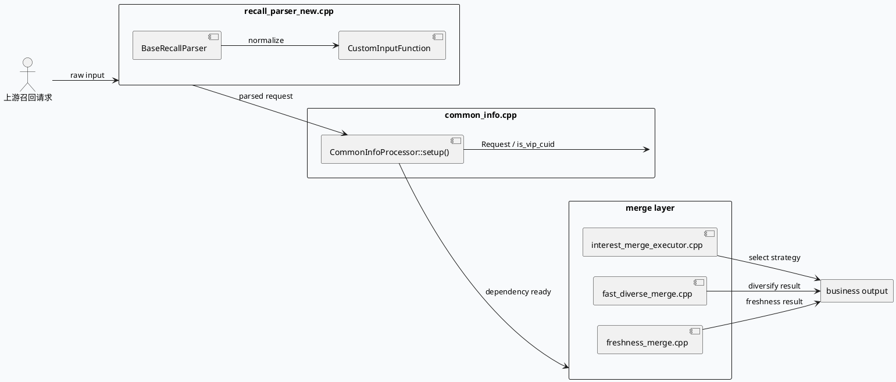

# news_updates_dibar 业务链路：回召解析、信息补全与多策略 merge

> 日期：2026-07-29  
> 类型：业务库笔记  
> 主题：`news_updates_dibar` 侧关注的是业务输入如何被解析、补全和分流到不同 merge 策略，再把结果汇合成最终召回/分发输出；今天重点看 `recall_parser_new.cpp`、`common_info.cpp` 和 merge executor 的边界。

<div class="arch-wrapper" style="font-family:Inter,Arial,sans-serif;border:1px solid #d8e0df;background:#f8fafc;border-radius:8px;padding:18px;margin:14px 0;color:#1f2937;"><style>.biz29-title{font-size:20px;font-weight:800;margin-bottom:12px}.biz29-grid{display:grid;grid-template-columns:1fr 1.15fr 1fr;gap:12px}.biz29-box{background:#fff;border:1px solid #d8e1e0;border-radius:7px;padding:12px}.biz29-box h3{margin:0 0 8px;font-size:14px}.biz29-chip{display:inline-block;padding:3px 8px;border-radius:999px;background:#e7f3ef;color:#285943;font-size:11px;font-weight:700;margin:0 6px 6px 0}.biz29-flow{display:grid;gap:8px}.biz29-step{padding:8px 10px;border:1px solid #d9e6e2;border-radius:6px;background:#f8fffc}.biz29-step strong{display:block;font-size:12px;margin-bottom:3px}.biz29-note{font-size:12px;line-height:1.55;color:#48615b}.biz29-arrow{font-size:18px;color:#6b7f7a;text-align:center;line-height:1}</style><div class="biz29-title">业务全景图：回召输入到 merge 输出</div><div class="biz29-grid"><div class="biz29-box"><h3>输入层</h3><div class="biz29-chip">recall parser</div><div class="biz29-chip">common info</div><div class="biz29-chip">request context</div><p class="biz29-note">`recall_parser_new.cpp` 负责把上游输入解析成业务可用对象，`common_info.cpp` 再从 `GraphVertex` 里补齐公共依赖，形成后续 merge 需要的上下文。</p></div><div class="biz29-box"><h3>主链路</h3><div class="biz29-flow"><div class="biz29-step"><strong>1. 解析</strong>`BaseRecallParser` 系列把输入变成结构化 recall 数据。</div><div class="biz29-arrow">↓</div><div class="biz29-step"><strong>2. 补全</strong>`CommonInfoProcessor::setup()` 绑定 `Request`、`is_vip_cuid` 等依赖。</div><div class="biz29-arrow">↓</div><div class="biz29-step"><strong>3. merge</strong>不同策略按场景分流，最终在 `news_updates_dibar` 的业务汇合点输出。</div></div></div><div class="biz29-box"><h3>结果</h3><div class="biz29-chip">strategy split</div><div class="biz29-chip">merge executor</div><div class="biz29-chip">final response</div><p class="biz29-note">这一层的关键不是单个算法，而是“解析、补全、合流”三段式业务管线的稳定边界。</p></div></div></div>

## 核心流程



## 配置与结构

```infographic
infographic list-grid-badge-card
data
  title news_updates_dibar 结构拆解
  items
    - label recall_parser_new.cpp
      desc 负责解析输入和构造 recall 上下文
      icon mdi:file-document-outline
    - label common_info.cpp
      desc 从 GraphVertex 取公共依赖并填充业务状态
      icon mdi:account-box-outline
    - label interest_merge_executor.cpp
      desc 按兴趣/召回逻辑挑选 merge 路径
      icon mdi:shuffle-variant
    - label fast_diverse_merge.cpp
      desc 多样性合流的快路径实现
      icon mdi:layers-triple
    - label freshness_merge.cpp
      desc 新鲜度相关的 merge 策略
      icon mdi:clock-outline
```

## 关键结论

<div style="border-left:4px solid #2d6a4f;background:#fff;padding:14px 14px 12px;border-radius:6px;border:1px solid #d8e1e0;margin:14px 0;"><div style="font-size:12px;font-weight:700;letter-spacing:0;text-transform:uppercase;color:#2d6a4f;margin-bottom:6px;">结论</div><div style="font-size:14px;line-height:1.7;color:#1f2937;">`news_updates_dibar` 的结构是标准的业务管线：先解析，再补全公共上下文，最后按策略拆分 merge。这样做的好处是 merge executor 不需要了解输入协议细节，只关心自己负责的合流规则。</div></div>

## Pitfalls

<div style="display:grid;grid-template-columns:repeat(2,minmax(0,1fr));gap:12px;margin:14px 0;"><div style="background:#fff;border:1px solid #d8e1e0;border-radius:7px;padding:12px;"><div style="font-weight:800;margin-bottom:6px;">上下文没补全</div><div style="font-size:13px;line-height:1.6;color:#48615b;">如果 `CommonInfoProcessor::setup()` 没把 `Request`、`is_vip_cuid` 这些依赖挂好，后面的 merge 分支会读到不完整状态。</div></div><div style="background:#fff;border:1px solid #d8e1e0;border-radius:7px;padding:12px;"><div style="font-weight:800;margin-bottom:6px;">merge 策略混用</div><div style="font-size:13px;line-height:1.6;color:#48615b;">`interest`、`diverse`、`freshness` 这几类策略目标不同，错误地串接会让输出语义变脏，最终看起来像召回问题，实际上是策略路由问题。</div></div></div>

## 调试 Checklist

```infographic
infographic sequence-ascending-steps
data
  title 调试检查顺序
  items
    - label 确认输入已解析
      desc 检查 `recall_parser_new.cpp` 是否完成结构化输出
    - label 确认公共依赖可取
      desc 验证 `CommonInfoProcessor::setup()` 中的 named_dependency
    - label 确认 merge 路由正确
      desc 看请求是否进入预期的 strategy 分支
    - label 确认输出没有被早退
      desc 观察合流点是否正常生成 response
    - label 确认策略边界清晰
      desc 不要把不同 merge 语义混成单一路径
```

## 证据来源

- `baidu/feed-gr/feeda-mv-grc/src/parser/recall_parser_new.cpp`
- `baidu/feed-gr/feeda-mv-grc/src/processor/common_info.cpp`
- `baidu/feed-gr/feeda-mv-grc/src/strategy/data_merge/dibar/fast_diverse_merge.cpp`
- `baidu/feed-gr/feeda-mv-grc/src/strategy/data_merge/dibar/freshness_merge.cpp`
- `baidu/feed-gr/feeda-mv-grc/src/strategy/data_merge/interest_merge_executor.cpp`
