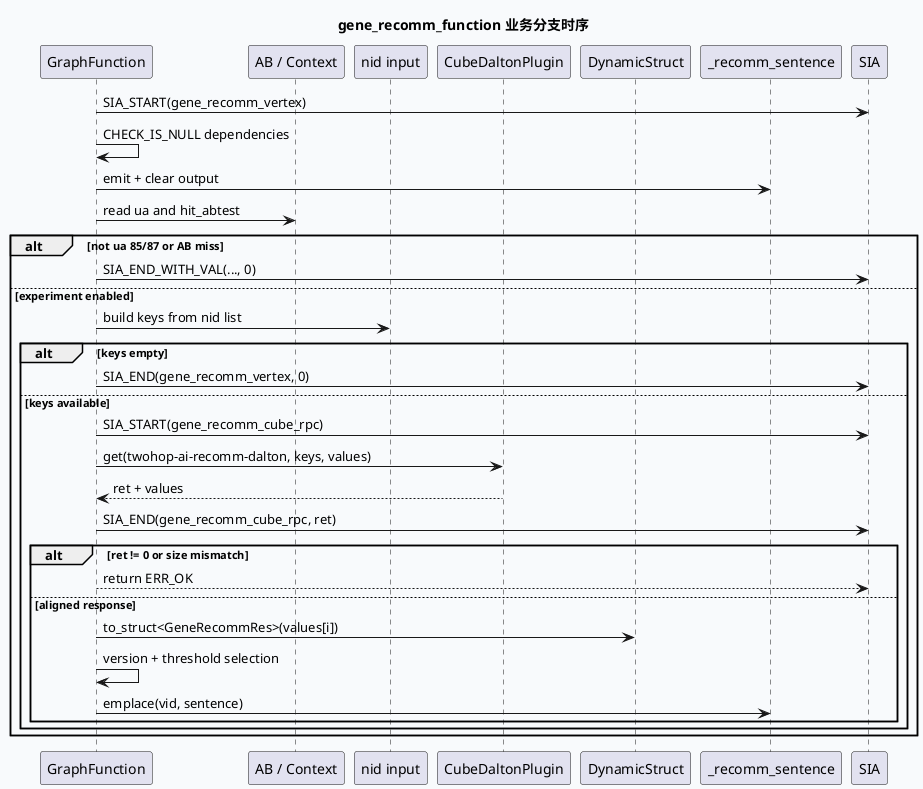

# 2026-10-01 业务代码理解：GRG gene_recomm Cube 特征生成与 SIA 观测边界

> 日期：2026-10-01（周四）
> 主题选择：当前快照没有当日 daily-plan；本地唯一可见的旧计划为 2026-05-29，且计划中的 adjuster 与根级 `src/` 证据路径不能在当前快照中直接核验。本次按同一快照回退到邻近未覆盖的业务合同：**GRG `gene_recomm_function` 的 AB 准入、Cube 批量取数、结果对齐与 emit**。KU 正文未读取，业务背景与线上收益需人工补充；本文只依据可核验代码证据。
> 配对关系：基础库笔记分析 GraphPool 的请求借用、运行、reset 与归还；本文只分析 Graph 内的一个业务 processor 分支和它的观测/数据输出合同。
> 范围：`baidu/feed-gr/feeda-mv-grg/src/process/gene_recomm_function.cpp`、`baidu/feed-gr/feeda-mv-grg/src/common/common.h`。

## 0. 架构全景图

<div style="font-family:system-ui,-apple-system,BlinkMacSystemFont,'Segoe UI',sans-serif;background:#f5f7fa;border:1px solid #d8e1ea;border-radius:8px;padding:16px;margin:16px 0;color:#243b53;line-height:1.45;"><div style="font-size:12px;font-weight:800;color:#52606d;text-transform:uppercase;letter-spacing:.05em;">gene_recomm 业务处理与数据流</div><div style="display:grid;grid-template-columns:1.05fr 24px 1.25fr 24px 1.25fr 24px 1.1fr;gap:8px;align-items:center;margin-top:12px;"><div style="background:#fff;border:1px solid #cbd5e1;border-left:4px solid #3d5a80;border-radius:6px;padding:11px;"><div style="font-size:15px;color:#102a43;font-weight:700;">依赖准入</div><div style="margin-top:7px;font-size:12px;color:#52606d;">检查 sid、nid 列表和 emit 容器，避免空依赖进入业务分支。</div></div><div style="text-align:center;color:#64748b;font-size:20px;">→</div><div style="background:#fff;border:1px solid #cbd5e1;border-left:4px solid #2d6a4f;border-radius:6px;padding:11px;"><div style="font-size:15px;color:#102a43;font-weight:700;">实验准入</div><div style="margin-top:7px;font-size:12px;color:#52606d;">仅在 UA=85/87 且命中指定 AB 实验时构造 Cube keys。</div></div><div style="text-align:center;color:#64748b;font-size:20px;">→</div><div style="background:#fff;border:1px solid #cbd5e1;border-left:4px solid #9a5b28;border-radius:6px;padding:11px;"><div style="font-size:15px;color:#102a43;font-weight:700;">Cube 批量取数</div><div style="margin-top:7px;font-size:12px;color:#52606d;">以 nid 列表调用 `twohop-ai-recomm-dalton`，采集 DynamicStruct 结果并记录 RPC SIA。</div></div><div style="text-align:center;color:#64748b;font-size:20px;">→</div><div style="background:#fff;border:1px solid #cbd5e1;border-left:4px solid #b8432f;border-radius:6px;padding:11px;"><div style="font-size:15px;color:#102a43;font-weight:700;">结果生成</div><div style="margin-top:7px;font-size:12px;color:#52606d;">校验 keys/values 对齐，按版本和阈值选择 sentence，写入 `_recomm_sentence`。</div></div></div><div style="margin-top:12px;padding-top:10px;border-top:1px solid #d8e1ea;font-size:12px;color:#52606d;">业务不变量：失败和空输入以 `ERR_OK` 短路；只有对齐且可解析的结果才进入 sentence 生成。</div></div>

## 1. 核心结论

1. **processor 先建立输入和输出容器，再进入实验分支。** `process` 用 `CHECK_IS_NULL` 检查 `_sid_info`、`_nid_vec` 和 `_recomm_sentence.emit()`，并清空输出映射；这是 graph function 的本轮状态准备（`src/process/gene_recomm_function.cpp:41-50`）。
2. **业务开关是 UA 与 AB 实验的组合，而不是单一 UA 判断。** 当前分支只接受 UA 85/87 且命中一组实验 ID，随后才检查 `_ua_str_contentcf_vec` 并从 `_nid_vec` 构造 Cube keys（`gene_recomm_function.cpp:52-65`）。
3. **空 keys、Cube 失败、返回数量不一致都会正常短路。** 空 keys 直接结束 SIA 并返回 `ERR_OK`；Cube 非零返回码或 `keys.size() != values.size()` 也记录日志并返回，避免把错位数据写入结果（`gene_recomm_function.cpp:76-99`）。
4. **结果对齐依赖索引关系和 DynamicStruct 可解析性。** 循环按 `i` 同时访问 `keys[i]` 与 `values[i]`，空 value 或转换失败会跳过；可解析的 `GeneRecommRes` 才会进入版本选择和 sentence 生成（`gene_recomm_function.cpp:103-115`）。
5. **SIA 是跨业务分支的观测合同。** `SIA_START` 获取采样对象，`SIA_END` 记录错误码与请求上下文，`SIA_END_WITH_VAL` 还可以记录结果值；Cube RPC 采用独立的 `gene_recomm_cube_rpc` 观测段（`src/common/common.h:79-93`；`gene_recomm_function.cpp:87-94`）。

## 2. 业务分支时序



```infographic
infographic sequence-snake-steps-simple
data
  title gene_recomm 分支检查链
  desc 每个 gate 都决定是否继续访问 Cube 或写出业务结果
  items
    - label dependency
      desc sid、nid_vec、输出 emit 容器非空
      icon mdi-shield-check
    - label experiment
      desc UA 85/87 且命中实验 ID 集合
      icon mdi-flask-outline
    - label keys
      desc 从 nid_vec 构造批量请求，空列表短路
      icon mdi-format-list-bulleted
    - label rpc
      desc 调用 twohop-ai-recomm-dalton 并记录 ret
      icon mdi-cloud-download
    - label alignment
      desc keys 与 values 数量一致，逐项解析 DynamicStruct
      icon mdi-link-variant
    - label emit
      desc 选择版本和阈值后写入 recomm_sentence
      icon mdi-message-text-outline
 theme
  palette #3d5a80 #2d6a4f #b56b32
```

## 3. 输入输出与失败语义

| 阶段 | 输入/条件 | 输出或动作 | 失败语义 |
|---|---|---|---|
| 依赖准备 | `_sid_info`、`_nid_vec` | 取得本轮上下文 | null 返回 `-1` |
| 输出初始化 | `_recomm_sentence.emit()` | 清空 sentence map | emit 为空返回 `-1` |
| 实验门控 | UA、AB ID | 决定是否进入 Cube | 未命中时保留空结果并正常结束 |
| keys 构造 | nid 列表 | `vector<uint64_t>` | 空列表 `ERR_OK` |
| Cube RPC | keys、context | `values` 与 ret | ret 非零 `ERR_OK` |
| 对齐解析 | keys[i]、values[i] | `GeneRecommRes` | 数量不等或单项不可解析则短路/跳过 |
| 结果写出 | version、threshold、sentence | `_recomm_sentence.emplace` | 无匹配句子时仍追加版本后缀 |

`GRAPH_FUNCTION_INTERFACE` 声明了 `_nid_vec`、`_ua_str_contentcf_vec`、`_sid_info` 三个依赖以及 `_recomm_sentence` 输出；同时通过 `BABYLON_MEMBER(CubeDaltonPlugin*, _cube_plugin)` 接入 Cube 组件（`gene_recomm_function.cpp:210-218`）。这组声明是 Graph 配置与 C++ 处理器之间的实际数据合同，新增字段或改名时应同时检查注册和配置侧连接。

## 4. 关键边界与性能观察

- **实验未命中不是错误。** 该函数的正常结果可能是空 map；排查时要区分“功能未开启”与“Cube 请求失败”。
- **数量对齐是强保护。** 当前逻辑不尝试用 map 或 nid 查找修复错位返回；如果 Cube 返回顺序合同变化，必须先更新处理器，而不是放宽 size 检查。
- **SIA 结束点要覆盖短路。** 空 keys 分支显式结束 vertex SIA；Cube 失败分支结束 RPC SIA 后返回，但最终 vertex SIA 由函数尾部承担。改动 early return 时需要复核每个计时段是否闭合。
- **版本选择带有实验配置。** `cur_version` 由多组 AB ID 覆盖，顺序决定最终版本；新增实验时不要只追加 ID 而忽略覆盖关系。
- **快照边界：** 本文没有读取 KU 正文，没有运行 Cube 或线上实验；数据 schema、调用耗时与业务收益需人工补充。

<div style="font-family:system-ui,-apple-system,BlinkMacSystemFont,'Segoe UI',sans-serif;background:#fffaf5;border:1px solid #ead7c0;border-left:5px solid #b56b32;border-radius:6px;padding:14px;margin:16px 0;color:#3d2b1f;"><div style="font-size:12px;font-weight:800;color:#8a4b20;text-transform:uppercase;letter-spacing:.05em;">Pitfalls / 调试卡片</div><div style="margin-top:9px;font-size:14px;line-height:1.65;"><strong>空结果：</strong>先查 UA/AB 是否命中，再查 Cube；空 map 可能是设计行为。<br><strong>数据错位：</strong>不要绕过 keys/values 数量校验，先确认 Cube 返回顺序合同。<br><strong>SIA 不闭合：</strong>新增 early return 必须配套对应的 `SIA_END`，否则观测数据会失真。<br><strong>版本覆盖：</strong>多个 AB 分支按顺序覆盖 `cur_version`，修改时要保留实验优先级。<br><strong>范围限制：</strong>本文未读取 KU 正文，schema、部署和收益需人工补充。</div></div>

```infographic
infographic list-column-done-list
data
  title gene_recomm 调试 checklist
  items
    - label 确认依赖指针与 emit 容器
      desc 检查 sid、nid_vec、ua_str_contentcf_vec 和 recomm_sentence
      done true
    - label 确认 UA 与 AB 命中
      desc 记录最终进入 Cube 的实验门控结果
      done false
    - label 确认 keys 数量与内容
      desc 对照请求 nid 列表，排除空输入和重复构造
      done false
    - label 确认 Cube ret 与 values size
      desc 分开记录 RPC 错误和返回数量不一致
      done false
    - label 确认 DynamicStruct 解析和版本选择
      desc 检查 null value、schema 字段、threshold 与 cur_version
      done false
    - label 确认 SIA 段闭合
      desc 检查 vertex 与 cube_rpc 的 start/end 配对和错误值
      done false
 theme
  palette #2d6a4f #3d5a80 #b8432f
```

## 5. 证据来源

- `baidu/feed-gr/feeda-mv-grg/src/process/gene_recomm_function.cpp:32-50`：GraphFunction 入口、依赖检查和输出初始化。
- `baidu/feed-gr/feeda-mv-grg/src/process/gene_recomm_function.cpp:52-99`：UA/AB 门控、keys 构造、Cube RPC、错误与数量对齐分支。
- `baidu/feed-gr/feeda-mv-grg/src/process/gene_recomm_function.cpp:103-115`、`:169-204`：DynamicStruct 解析、版本选择、sentence 生成和最终 emit。
- `baidu/feed-gr/feeda-mv-grg/src/process/gene_recomm_function.cpp:210-218`：GraphFunction 输入、输出和 Cube 组件接口。
- `baidu/feed-gr/feeda-mv-grg/src/common/common.h:74-93`：SIA add/start/end 宏和上下文打点语义。
