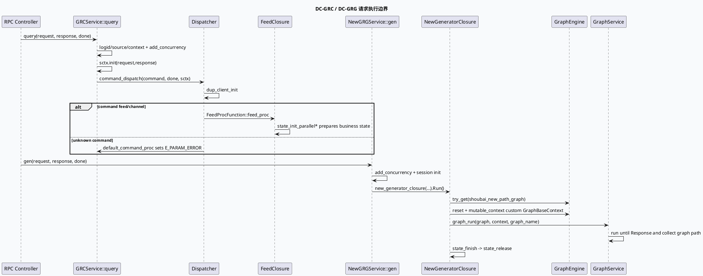

# 2026-10-02 业务库代码理解：DC-GRC Dispatcher 与 DC-GRG NewGeneratorClosure 请求执行边界

> 日期：2026-10-02（周五）
> 主题选择：canonical 笔记仓库未发现当日 daily-plan；本次按周五代码理解流程回退到同一快照中未充分展开的业务入口边界：**DC-GRC `GenericGRCService::query` 如何通过 Dispatcher 选择 feed/channel/default 分支，以及 DC-GRG `NewGRGServiceImpl::gen` 如何通过 NewGeneratorClosure 执行 `shoubai_new_path_graph`**。KU 业务背景未读取，线上策略口径需人工补充；本文只依据可核验代码证据。
> 配对关系：基础库笔记分析 brpc 启动、ReusableRPCProtocol、GraphInitializer 与 GraphView；本文分析请求进来后如何进入具体业务执行链。
> 范围：`feeda-dc-grc/src/service/grc_service.cc`、`feeda-dc-grc/src/service/dispatcher.cc`、`feeda-dc-grc/src/service/feed.cc`、`feeda-dc-grg/src/service/new_generator_service.cc`、`feeda-dc-grg/src/service/new_generator_closure.cc`、`feeda-dc-grg/src/service/graph_service.cc`。

## 0. 架构全景图

<div style="font-family:system-ui,-apple-system,BlinkMacSystemFont,'Segoe UI',sans-serif;background:#f4f8f6;border:1px solid #cfe4d6;border-radius:8px;padding:16px;margin:16px 0;color:#243b53;line-height:1.45;"><div style="font-size:12px;font-weight:800;color:#52606d;text-transform:uppercase;letter-spacing:.05em;">请求进入业务执行链</div><div style="display:grid;grid-template-columns:1fr 24px 1.25fr 24px 1.25fr 24px 1fr;gap:8px;align-items:stretch;margin-top:12px;"><div style="background:#fff;border:1px solid #cbd5e1;border-left:4px solid #3d5a80;border-radius:6px;padding:11px;"><div style="font-size:15px;color:#102a43;font-weight:700;">RPC 请求</div><div style="margin-top:7px;font-size:12px;color:#52606d;">GRC query / GRG gen 读取 logid、source、rpc context，并建立 session context。</div></div><div style="text-align:center;color:#64748b;font-size:20px;padding-top:34px;">→</div><div style="background:#fff;border:1px solid #cbd5e1;border-left:4px solid #2d6a4f;border-radius:6px;padding:11px;"><div style="font-size:15px;color:#102a43;font-weight:700;">并发与准入</div><div style="margin-top:7px;font-size:12px;color:#52606d;">FlowCtlConcurrency 是共同闸门；失败时设置响应错误并移除并发计数。</div></div><div style="text-align:center;color:#64748b;font-size:20px;padding-top:34px;">→</div><div style="background:#fff;border:1px solid #cbd5e1;border-left:4px solid #9a5b28;border-radius:6px;padding:11px;"><div style="font-size:15px;color:#102a43;font-weight:700;">业务分叉</div><div style="margin-top:7px;font-size:12px;color:#52606d;">GRC 按 command dispatch 到 feed/channel/default；GRG 创建 closure 并进入状态机。</div></div><div style="text-align:center;color:#64748b;font-size:20px;padding-top:34px;">→</div><div style="background:#fff;border:1px solid #cbd5e1;border-left:4px solid #b8432f;border-radius:6px;padding:11px;"><div style="font-size:15px;color:#102a43;font-weight:700;">执行与释放</div><div style="margin-top:7px;font-size:12px;color:#52606d;">GRC feed closure 处理大量初始化与后续链路；GRG graph_run 到 Response 并上传 critical path。</div></div></div><div style="margin-top:12px;padding-top:10px;border-top:1px solid #cfe4d6;font-size:12px;color:#52606d;">共同不变量：错误分支必须释放并发计数；成功分支把 closure 所有权交给后续执行链，不能提前触发 done。</div></div>

## 1. 核心结论

1. **GRC 请求入口先建立 session，再把控制权交给 Dispatcher。** `GenericGRCService::query` 读取 logid、时间戳和 source tag，创建 `GRCSessionContext`，通过 `FlowCtlConcurrency::add_concurrency()` 做并发闸门，`sctx->init(request, response)` 成功后调用 `Dispatcher::command_dispatch`（`feeda-dc-grc/src/service/grc_service.cc:30-48`、`:82-138`）。
2. **GRC 的 command 只有 feed/channel/default 三类注册分支。** Dispatcher 初始化时把 `channel` 和 `feed` 都映射到 `FeedProcFunction::feed_proc`，未知 command 进入 `DefaultProcFunction::default_command_proc`（`feeda-dc-grc/src/service/dispatcher.cc:31-35`、`:46-50`）。这说明新增 command 不注册会被正常拒绝，而不是落入 feed。
3. **GRC dispatch 前会初始化 dup client。** `command_dispatch` 在查表前调用 `sctx->dup_client_init(&error)`，即使失败也只是记录 warning 后继续走 command 分发（`feeda-dc-grc/src/service/dispatcher.cc:37-48`）。排查去重异常时不要假设它会阻断主链路。
4. **FeedClosure 的前置初始化是多组业务状态准备，不是单个 processor。** `feed.cc` 里多个 `state_init_parallel*` 分支准备动态请求、ratio、ionode、filter、history、canonical strategy、GCMS、quota 等状态（`feeda-dc-grc/src/service/feed.cc:97-168`）。这解释了 GRC 在 dispatch 后还有大量非图执行的请求准备。
5. **GRG 请求入口同样先做并发闸门和 session 初始化，但执行链由 closure 状态机接管。** `NewGRGServiceImpl::gen` 创建 `GRGSessionContext`，挂请求/响应/done 指针，`sctx->init` 成功后创建 `NewGeneratorClosure` 并立即 `Run()`（`feeda-dc-grg/src/service/new_generator_service.cc:31-83`、`:118-123`）。
6. **GRG 的主业务图名在 closure 中硬编码为 `shoubai_new_path_graph`。** `state_gen_list` 从 `ApplicationContext` 取 `GraphEngine`，`try_get("shoubai_new_path_graph")`，reset 后写入 `MutableFrameworkContext` 的 custom context，再调用 `GraphService::graph_run`（`feeda-dc-grg/src/service/new_generator_closure.cc:70-100`）。
7. **GraphService 的停止点是 `Response` 数据节点。** `graph_run` 设置 graph log info，`find_data("Response")` 后 `graph->run(target).wait()`，并回填 critical path、graph monitor 与全部 graph log（`feeda-dc-grg/src/service/graph_service.cc:23-46`）。这把业务图执行边界固定在 Response，而非某个召回中间节点。

## 2. GRC 与 GRG 请求时序



```infographic
infographic compare-binary-horizontal-underline-text-vs
data
  title 两条业务入口的分叉方式
  desc GRC 以 command 分发，GRG 以 closure 状态机固定进入新链路图
  items
    - label DC-GRC Dispatcher
      desc command=feed/channel 进入 FeedProcFunction；未知 command 返回参数错误
      value 1
    - label DC-GRG Closure
      desc NewGeneratorClosure 固定 try_get shoubai_new_path_graph 并运行到 Response
      value 1
theme
  palette #3d5a80 #2d6a4f #b56b32
```

## 3. 合同拆解

| 阶段 | GRC 行为 | GRG 行为 | 风险点 |
|---|---|---|---|
| source 读取 | 从 rpc propagated tags 取 `source` | 同样读取 `source` | tag 缺失时统一为 `unknow` |
| 并发闸门 | `add_concurrency()` 失败返回 `E_LIMIT` | 先保存 bool，再在 do-block 内判断 | 成功路径释放责任转移给 closure |
| session 初始化 | `GRCSessionContext::init` | `GRGSessionContext::init` | init 失败必须 SetFailed 并 remove concurrency |
| 分发方式 | command 查表 | closure 状态机 | 新 command / 新 graph 都要显式接线 |
| 图执行 | FeedClosure 前置状态多，后续链路在大文件中展开 | 固定 `shoubai_new_path_graph` 到 Response | 图名或 Response 数据节点变化会直接改变主链路 |
| 观测收口 | GRCLOG / monitor / concurrency | critical path / graph monitor / Dapper vertex | 新 early return 要检查观测闭合 |

```infographic
infographic sequence-snake-steps-simple
data
  title NewGeneratorClosure 三段状态机
  desc GRG 生成请求由 closure 接管所有权，并负责图运行、监控收口与释放
  items
    - label S_GEN_LIST
      desc 获取 graph_engine，try_get shoubai_new_path_graph，填 custom context
      icon mdi/graph-outline
    - label graph_run
      desc set_graph_log_info，run 到 Response，填充 critical path 和 graph monitor
      icon mdi/play-network
    - label S_FINISH
      desc 调整 graph_path，上传 Dapper，打印 vertex log 和耗时
      icon mdi/chart-timeline-variant
    - label S_RELEASE
      desc 释放 reusable RPC closure，并通过 deleter 移除并发计数
      icon mdi/lock-open-check
theme
  palette #2d6a4f #3d5a80 #b8432f
```

## 4. 关键边界与风险

- **GRC unknown command 是显式错误，不是兜底 feed。** Dispatcher 的 default 分支设置 `E_PARAM_ERROR` 并释放并发计数；新增 command 必须注册映射。
- **dup client 初始化失败不会阻断主链。** 当前代码只打 warning 后继续 dispatch；如果业务预期去重强依赖，需要额外确认下游是否有保护。
- **GRG graph 名称是代码内固定值。** `shoubai_new_path_graph` 不是从请求中动态读取；排查图未执行时先检查 graph_engine 是否装载该图。
- **GraphService 运行目标是 `Response`。** 如果图配置改名或拆分响应节点，`find_data("Response")` 会成为关键风险点。
- **释放路径依赖 closure 状态机。** `DeleteNewGeneratorClosure` 负责 `remove_concurrency()`；任何绕过 `S_RELEASE` 的新分支都会污染并发计数。
- **KU 背景缺失。** 本次没有读取 KU 正文；command 业务含义、图配置发布流程和 Dapper 看板需人工补充。

<div style="font-family:system-ui,-apple-system,BlinkMacSystemFont,'Segoe UI',sans-serif;background:#fffaf5;border:1px solid #ead7c0;border-left:5px solid #b56b32;border-radius:6px;padding:14px;margin:16px 0;color:#3d2b1f;"><div style="font-size:12px;font-weight:800;color:#8a4b20;text-transform:uppercase;letter-spacing:.05em;">Pitfalls / 调试卡片</div><div style="margin-top:9px;font-size:14px;line-height:1.65;"><strong>误把 default 当兜底业务：</strong>未知 command 会返回参数错误，不会进入 feed。<br><strong>忽略 dup_client_init 语义：</strong>失败只打日志，主链仍可能继续执行。<br><strong>图名不可配置误读：</strong>当前 GRG 主链硬编码 `shoubai_new_path_graph`，请求字段不能直接切图。<br><strong>Response 节点改名：</strong>GraphService 以 `find_data("Response")` 作为 run 目标，图配置变更要同步代码。<br><strong>并发计数泄漏：</strong>新增 early return 必须经过 error macro 或 closure release 路径。</div></div>

```infographic
infographic list-column-done-list
data
  title 请求执行链调试 checklist
  items
    - label 检查 source tag 与 logid
      desc 区分入口来源，避免所有错误聚合到 unknow
      done true
    - label 检查 FlowCtlConcurrency
      desc limit 错误先看 add/remove 是否成对
      done true
    - label 核对 GRC command 映射
      desc feed/channel/default 三类分支最先决定业务入口
      done true
    - label 核对 GRG graph_engine 与图名
      desc try_get shoubai_new_path_graph 为空会导致主链无图可跑
      done false
    - label 核对 Response 数据节点
      desc GraphService run 目标依赖 Response 节点存在
      done false
    - label 核对 closure release
      desc S_RELEASE 才负责 reusable RPC closure 和并发计数释放
      done false
theme
  palette #2d6a4f #3d5a80 #b8432f
```

## 5. 证据来源

- `feeda-dc-grc/src/service/grc_service.cc:30-48`：GRC query 读取 controller、logid、source tag 与并发监控。
- `feeda-dc-grc/src/service/grc_service.cc:82-138`：创建 GRCSessionContext、并发准入、sctx 初始化与 Dispatcher 分发。
- `feeda-dc-grc/src/service/dispatcher.cc:31-50`：command 映射表、dup client 初始化、未知 command 默认错误分支。
- `feeda-dc-grc/src/service/feed.cc:97-168`：FeedClosure 的四组并行初始化准备动态请求、队列、过滤、历史与 canonical strategy。
- `feeda-dc-grg/src/service/new_generator_service.cc:31-83`：GRG gen 入口建立 session、并发准入、绑定请求响应与 closure。
- `feeda-dc-grg/src/service/new_generator_service.cc:118-123`：sctx init 成功后创建 NewGeneratorClosure 并运行。
- `feeda-dc-grg/src/service/new_generator_closure.cc:70-100`：closure 获取 `shoubai_new_path_graph`、reset、填 custom context 并调用 graph_run。
- `feeda-dc-grg/src/service/new_generator_closure.cc:121-181`：finish 阶段收口 graph path / Dapper / vertex log，release 阶段释放 reusable RPC closure。
- `feeda-dc-grg/src/service/graph_service.cc:23-46`：GraphService 设置日志、运行到 `Response` 节点，并填充 critical path / graph monitor。

## 6. 验证说明

- 已用当前快照直接读取上述文件和行号；没有引用不可见的 KU 正文。
- 全文证据路径使用相对路径，不包含机器本地绝对路径。
- 本文包含 HTML 架构图、PlantUML、两个 infographic 和 Pitfalls infocard，满足至少两类可视化要求。
