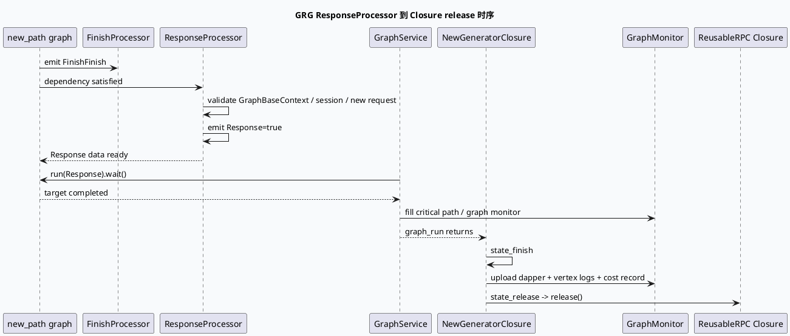

# 2026-10-03 业务库代码理解：GRG ResponseProcessor 与 FinishFinish 响应收口合同

> 日期：2026-10-03（周六）
> 主题选择：canonical 笔记仓库未发现 2026-10-03 daily-plan；本地唯一计划文件为过期快照，且近期笔记已覆盖 GRG 请求入口、GraphService 和 generator-service 的相邻主题。本次按同一 DC-GRG 快照回退到更窄的业务边界：**ResponseProcessor 如何把 Graph 依赖收束为 Response=true，以及 GraphService / NewGeneratorClosure 如何在该节点之后完成路径、Dapper、耗时和 reusable RPC release**。
> KU 状态：未读取 KU 正文，业务背景、线上收益和部署参数需人工补充；本文只依据当前代码快照。
> 配对关系：基础库笔记分析 GRGProtocol 的请求字段物化、实验参数和 cache access；本文只分析图尾部的完成信号、响应目标和观测收口。
> 范围：`feeda-dc-grg/src/processor/response_processor.cpp`、`feeda-dc-grg/src/service/graph_service.cc`、`feeda-dc-grg/src/service/new_generator_closure.cc`、`feeda-dc-grg/conf/graph/new_path.conf`。

## 0. 架构全景图

<div style="font-family:system-ui,-apple-system,BlinkMacSystemFont,'Segoe UI',sans-serif;background:#f4f8f6;border:1px solid #cfe4d6;border-radius:8px;padding:16px;margin:16px 0;color:#243b53;line-height:1.45;"><div style="font-size:12px;font-weight:800;color:#52606d;text-transform:uppercase;letter-spacing:.05em;">GRG response completion contract</div><div style="display:grid;grid-template-columns:1.05fr 24px 1.2fr 24px 1.2fr 24px 1.1fr;gap:8px;align-items:stretch;margin-top:12px;"><div style="background:#fff;border:1px solid #cbd5e1;border-left:4px solid #3d5a80;border-radius:6px;padding:11px;"><div style="font-size:15px;color:#102a43;font-weight:700;">图尾依赖</div><div style="margin-top:7px;font-size:12px;color:#52606d;">ResponseProcessor 同时依赖 GeneratorData 与 FinishFinish，避免在前置阶段提前宣告完成。</div></div><div style="text-align:center;color:#64748b;font-size:20px;padding-top:34px;">→</div><div style="background:#fff;border:1px solid #cbd5e1;border-left:4px solid #2d6a4f;border-radius:6px;padding:11px;"><div style="font-size:15px;color:#102a43;font-weight:700;">ResponseProcessor</div><div style="margin-top:7px;font-size:12px;color:#52606d;">setup 绑定名为 Response 的 GraphData；process 校验 session 并 emit true。</div></div><div style="text-align:center;color:#64748b;font-size:20px;padding-top:34px;">→</div><div style="background:#fff;border:1px solid #cbd5e1;border-left:4px solid #9a5b28;border-radius:6px;padding:11px;"><div style="font-size:15px;color:#102a43;font-weight:700;">GraphService</div><div style="margin-top:7px;font-size:12px;color:#52606d;">以 Response 数据节点为 run target，wait 后填 critical path 和 graph monitor。</div></div><div style="text-align:center;color:#64748b;font-size:20px;padding-top:34px;">→</div><div style="background:#fff;border:1px solid #cbd5e1;border-left:4px solid #b8432f;border-radius:6px;padding:11px;"><div style="font-size:15px;color:#102a43;font-weight:700;">Closure 收口</div><div style="margin-top:7px;font-size:12px;color:#52606d;">Finish 打印路径并上传 Dapper，Release 释放 reusable RPC closure。</div></div></div></div>

## 1. 核心结论

1. **ResponseProcessor 是一个完成信号节点，不是 response protobuf 组装器。** `setup` 通过 `vertex.named_emit("Response")` 保存输出 GraphData；`process` 只校验 framework context、GraphBaseContext、session 和 new request，随后 `emit<bool>()` 并写入 true（`response_processor.cpp:17-45`）。
2. **图配置把 ResponseProcessor 放在 FinishFinish 之后。** `new_path.conf` 中 ResponseProcessor emit `Response`，依赖 `GeneratorData` 和 `FinishFinish`（`conf/graph/new_path.conf:350-361`）。所以 Response=true 表示 Finish 阶段已经完成，而不是仅表示 GeneratorData 已经存在。
3. **GraphService 以 Response 数据节点作为图运行目标。** `graph_run` 找到 `Response`，调用 `graph->run(target).wait()`，再填 critical path、graph monitor 并打印全图日志（`graph_service.cc:23-46`）。Response 节点既是依赖图的终点，也是观测收口的同步点。
4. **Closure 的 finish 阶段晚于 GraphService 的 run wait。** `state_finish` 先进入 release 状态，再调整 graph path、上传 Dapper、打印 vertex log、记录耗时和业务 monitor，最后再次 `Run()` 进入 release（`new_generator_closure.cc:121-174`）。排查“客户端已返回但观测缺失”时，要区分 Response emit、state_finish 和 upload_dapper 三个时刻。
5. **Release 由 reusable RPC closure 接管。** `state_release` 使用 `DeleteNewGeneratorClosure` 的 self guard，并把 `_done` 转成 ReusableRPCProtocol closure 后调用 `release()`（`new_generator_closure.cc:176-181`）。新增 early return 时不能只设置 Response=true，还必须保证 closure release 与并发计数清理仍会发生。
6. **Response 节点完成不等于业务字段完整。** 当前 processor 没有写入 response message 的业务字段；它只把 GraphData 状态推进到 true。真实字段是否已写入，要回到前置 Generator/Finish processor 和 graph session response 指针检查。

## 2. Graph 尾部时序



## 3. 图尾结构信息图

```infographic
infographic sequence-snake-steps-simple
data
  title Response 完成链
  desc 图配置、processor、GraphService 和 closure 各自承担不同的收口责任
  items
    - label FinishFinish
      desc FinishProcessor 完成初始化/清理相关依赖，允许 Response 节点运行
      icon mdi-check-network
    - label ResponseProcessor setup
      desc named_emit Response，把输出 GraphData 保存进 processor context
      icon mdi-link-variant
    - label ResponseProcessor process
      desc 校验 framework/session/request，emit bool 并写 true
      icon mdi-check-circle-outline
    - label graph run wait
      desc GraphService 以 Response 为 target，同步等待依赖图完成
      icon mdi-play-circle-outline
    - label monitor close
      desc critical path、graph monitor、vertex log 和 Dapper 记录
      icon mdi-chart-timeline-variant
    - label reusable release
      desc Closure self guard 释放 reusable RPC 资源
      icon mdi-lock-open-check
theme
  palette #3d5a80 #2d6a4f #b56b32
```

## 4. 三层完成语义

| 层次 | 触发点 | 表示什么 | 不表示什么 |
|---|---|---|---|
| GraphData 完成 | `ResponseProcessor::process` 写 `true` | Response 节点的依赖执行完成 | 不保证所有业务字段语义正确 |
| GraphService 完成 | `graph->run(Response).wait()` 返回 | 图执行同步目标已完成，可收集路径和 monitor | 不等于 Dapper 上传已经成功 |
| Closure 完成 | `state_finish` 后进入 `state_release` | 观测收口和 RPC 资源释放开始 | 不应被提前调用来绕过图尾依赖 |

## 5. 关键边界与 Pitfalls 卡片

<div style="font-family:system-ui,-apple-system,BlinkMacSystemFont,'Segoe UI',sans-serif;background:#fffaf5;border:1px solid #ead7c0;border-left:5px solid #b56b32;border-radius:6px;padding:14px;margin:16px 0;color:#3d2b1f;"><div style="font-size:12px;font-weight:800;color:#8a4b20;text-transform:uppercase;letter-spacing:.05em;">Pitfalls / 响应收口卡片</div><div style="margin-top:9px;font-size:14px;line-height:1.65;"><strong>把 Response=true 当业务成功：</strong>它是 GraphData 完成信号，业务字段需回看前置 processor。<br><strong>忽略 FinishFinish 依赖：</strong>图配置明确要求 FinishFinish，单独运行 ResponseProcessor 不能代表完整链路。<br><strong>混淆 wait 与 Dapper：</strong>graph run 返回后才进入 closure finish，观测上传仍可能失败或延迟。<br><strong>提前释放 closure：</strong>绕过 S_RELEASE 会影响 reusable RPC 资源和并发计数闭合。<br><strong>Response 节点改名：</strong>GraphService 使用 find_data("Response")，配置改名必须同步服务代码。<br><strong>范围限制：</strong>KU 正文未读取，业务 response 字段语义、部署拓扑和线上收益需人工补充。</div></div>

```infographic
infographic list-column-done-list
data
  title 响应链调试 checklist
  items
    - label 检查 new_path.conf 的 Response 依赖
      desc 确认 GeneratorData 与 FinishFinish 都能 emit
      done true
    - label 检查 ResponseProcessor setup
      desc named_emit 的名称必须与 GraphService 的 Response target 一致
      done true
    - label 检查 process 前置指针
      desc framework context、GraphBaseContext、session 与 new request 逐层确认
      done true
    - label 检查 Response=true 的时间点
      desc 区分 GraphData 完成和客户端最终 response 字段完成
      done false
    - 检查 graph_run wait 后观测
      desc critical path、graph monitor、vertex log 是否都成功生成
      done false
    - label 检查 state_release
      desc reusable RPC closure 是否经过 release，避免资源与并发计数泄漏
      done false
theme
  palette #2d6a4f #3d5a80 #b8432f
```

## 6. 证据来源

- `feeda-dc-grg/src/processor/response_processor.cpp:17-48`：ResponseContext、named emit、session 校验和 `Response=true`。
- `feeda-dc-grg/conf/graph/new_path.conf:333-361`：FinishProcessor 的 FinishFinish 与 ResponseProcessor 的依赖关系。
- `feeda-dc-grg/src/service/graph_service.cc:23-46`：以 Response 为 graph run target，并填充路径/monitor。
- `feeda-dc-grg/src/service/new_generator_closure.cc:121-174`：finish 阶段的路径调整、Dapper/vertex 观测与耗时记录。
- `feeda-dc-grg/src/service/new_generator_closure.cc:176-198`：release guard、ReusableRPC closure release 与状态机分发。

## 7. 验证说明

- 今日 daily-plan 未找到；过期计划候选与近期笔记重复或证据路径不再可靠，因此按同快照未覆盖的响应收口边界回退。
- KU 正文未读取，文中已显式标注需人工补充。
- 全文证据路径使用相对路径，不包含机器本地绝对路径。
- 本文包含 HTML 架构图、PlantUML、两个 infographic 和 Pitfalls infocard。
