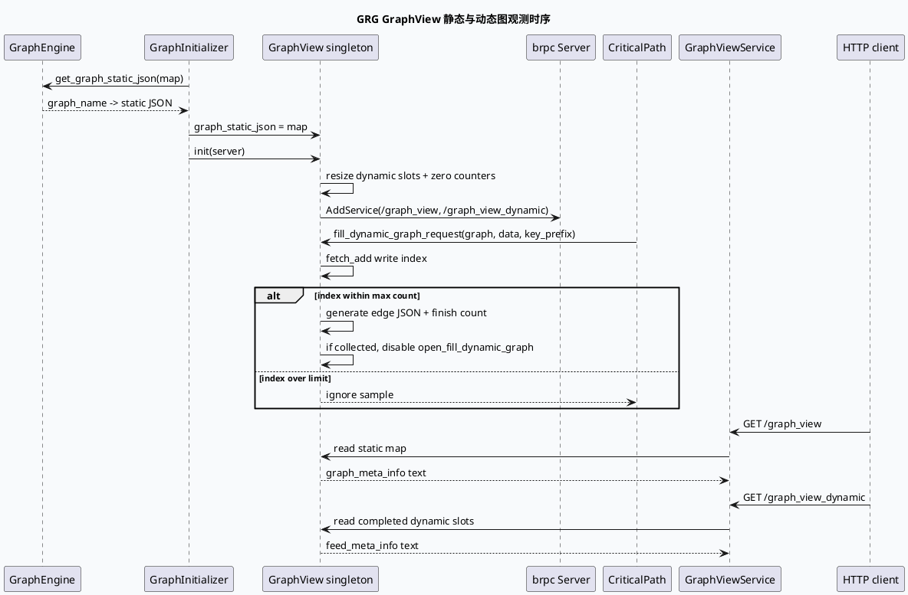

# 2026-10-04 业务库代码理解：GRG GraphView 静态图与动态图观测服务

> 日期：2026-10-04（周日）
> 主题选择：canonical 笔记仓库未发现 2026-10-04 daily-plan；本地唯一计划文件是过期快照，且近期笔记已覆盖 DC-GRG brpc 启动、请求协议解析和 ResponseProcessor 收口。本次按同一源码快照回退到相邻但未单独展开的业务观测边界：**GraphInitializer 如何把 GraphEngine 的静态 JSON 注入 GraphView，GraphView 如何通过 HTTP service 输出静态图、动态图和采样上限状态**。
> KU 状态：未读取 KU 正文，业务背景、线上收益和部署参数需人工补充；本文只依据当前代码快照。
> 配对关系：基础库笔记分析请求运行时 Graph reset 与 GraphBaseContext handoff；本文只分析 GraphView 的服务暴露、动态采样和观测输出。
> 范围：`feeda-dc-grg/src/initializer/graph_initializer.h`、`feed-general/framework/include/graph_view.h`、`feed-general/framework/src/graph_view.cpp`、`feed-general/framework/include/graph_view_service.h`、`feed-general/framework/src/graph_view_service.cpp`、`feeda-dc-grg/src/critical_path/critical_path.cc`。

## 0. 架构全景图

<div style="font-family:system-ui,-apple-system,BlinkMacSystemFont,'Segoe UI',sans-serif;background:#f4f8f6;border:1px solid #cfe4d6;border-radius:8px;padding:16px;margin:16px 0;color:#243b53;line-height:1.45;"><div style="font-size:12px;font-weight:800;color:#52606d;text-transform:uppercase;letter-spacing:.05em;">GRG GraphView observability service</div><div style="display:grid;grid-template-columns:1.05fr 24px 1.25fr 24px 1.35fr 24px 1.1fr;gap:8px;align-items:stretch;margin-top:12px;"><div style="background:#fff;border:1px solid #cbd5e1;border-left:4px solid #3d5a80;border-radius:6px;padding:11px;"><div style="font-size:15px;color:#102a43;font-weight:700;">GraphEngine</div><div style="margin-top:7px;font-size:12px;color:#52606d;">每个图持有静态 JSON；GraphEngine 可批量导出图名与结构。</div></div><div style="text-align:center;color:#64748b;font-size:20px;padding-top:34px;">→</div><div style="background:#fff;border:1px solid #cbd5e1;border-left:4px solid #2d6a4f;border-radius:6px;padding:11px;"><div style="font-size:15px;color:#102a43;font-weight:700;">GraphInitializer</div><div style="margin-top:7px;font-size:12px;color:#52606d;">先加载静态 JSON，再初始化 GraphView，并把两个 HTTP 路由挂入 brpc server。</div></div><div style="text-align:center;color:#64748b;font-size:20px;padding-top:34px;">→</div><div style="background:#fff;border:1px solid #cbd5e1;border-left:4px solid #9a5b28;border-radius:6px;padding:11px;"><div style="font-size:15px;color:#102a43;font-weight:700;">GraphView 单例</div><div style="margin-top:7px;font-size:12px;color:#52606d;">静态图 map、动态图槽位、写入计数和完成计数共同维护观测状态。</div></div><div style="text-align:center;color:#64748b;font-size:20px;padding-top:34px;">→</div><div style="background:#fff;border:1px solid #cbd5e1;border-left:4px solid #b8432f;border-radius:6px;padding:11px;"><div style="font-size:15px;color:#102a43;font-weight:700;">HTTP 输出</div><div style="margin-top:7px;font-size:12px;color:#52606d;">graph_view 输出静态元信息；graph_view_dynamic 输出受限动态请求 JSON。</div></div></div></div>

## 1. 核心结论

1. **GraphView 的启动前置是静态 JSON 完整加载。** `GraphInitializer::init` 从 ApplicationContext 取 GraphEngine，把 `get_graph_static_json` 写入 GraphView 单例，再调用 `init(server)`（`graph_initializer.h:33-48`）。静态查询服务依赖这一步，而不是请求到来后临时生成。
2. **GraphView 以每个 graph_name 建立动态采样槽位。** `init` 为静态图逐个 resize 动态 JSON vector，并初始化 `_json_cnt` 与 `_json_finish_cnt`（`graph_view.cpp:46-54`）。配置的最大采样数决定槽位容量和后续查询范围。
3. **动态图写入通过原子下标避免多个线程抢同一槽位。** `fill_dynamic_graph_request` 使用 `fetch_add` 获取 index，只有小于 `graph_dynamic_json_max_cnt` 才生成 key 和边 JSON，并增加完成计数（`graph_view.cpp:16-38`）。这是“有限样本采集”，不是无限日志缓存。
4. **动态采集完成后自动关闭 gflag。** 当每个图的完成计数都达到上限，`dynamic_graph_request_collected()` 返回 true，代码将 `FLAGS_open_fill_dynamic_graph` 设为 false（`graph_view.cpp:38-41`）。因此开关打开后会自动收敛，排查时要记录开关状态变化。
5. **静态和动态图是两个独立 RPC/HTTP 路由。** `GraphViewService` 定义 `graph_view` 与 `graph_view_dynamic` 两个方法；GraphView 初始化时将其映射到同名 HTTP 路径（`graph_view.proto:7-10`、`graph_view.cpp:56-62`）。
6. **静态输出是 text/plain 的指标式文本，动态图输出带请求上下文前缀。** 静态接口输出 `graph_meta_info`，动态图输出 `feed_meta_info`，动态 key 包含 logid、channel、refresh、data 和 graph_name（`graph_view_service.cpp:24-40`、`:55-79`）。这使观测数据既可被人读，也可被采集系统按标签解析。
7. **业务关键路径是否写入动态图由独立开关控制。** `CriticalPath::fill_graph_path` 只有在 `open_fill_dynamic_graph` 为真时才调用 GraphView 写入（`critical_path.cc:27-36`）。因此接口为空可能是采集开关关闭，也可能是采样已满或图名没有注册。

## 2. GraphView 服务时序



## 3. 观测数据流信息图

```infographic
infographic sequence-snake-steps-simple
data
  title GraphView 数据流
  desc 静态结构在启动时装载，动态图在请求运行期间按上限采样并通过独立接口查询
  items
    - label Static JSON
      desc GraphEngine 为每个图提供 graph_static_json
      icon mdi-file-tree
    - label GraphView init
      desc 建立动态 vector、写入计数和完成计数
      icon mdi-view-dashboard-outline
    - label Dynamic capture
      desc CriticalPath 在开关打开时提交当前 GraphData
      icon mdi-chart-timeline-variant
    - label Bounded slots
      desc fetch_add 分配独立下标，超过最大数的请求不再写入
      icon mdi-counter
    - label HTTP static
      desc graph_view 返回 graph_meta_info 文本
      icon mdi-api
    - label HTTP dynamic
      desc graph_view_dynamic 返回已完成的 feed_meta_info 文本
      icon mdi-transit-connection-variant
 theme
  palette #3d5a80 #2d6a4f #b56b32
```

## 4. 静态与动态图合同

| 维度 | 静态图 | 动态图 |
|---|---|---|
| 数据来源 | GraphEngine 初始化导出的 JSON | GraphData 运行时生成的边 JSON |
| 写入时机 | GraphInitializer 启动阶段 | CriticalPath 运行阶段 |
| 存储结构 | `graph_name -> static JSON` | `graph_name -> bounded vector of samples` |
| 路由 | `/graph_view` | `/graph_view_dynamic` |
| 输出标签 | `graph_meta_info` | `feed_meta_info` |
| 限制 | 受图注册结果影响 | 受 max count、计数器和开关影响 |
| 常见空结果原因 | GraphEngine 未导出或初始化失败 | 开关关闭、图名未注册、采样已满或尚未完成 |

## 5. 关键边界与 Pitfalls 卡片

<div style="font-family:system-ui,-apple-system,BlinkMacSystemFont,'Segoe UI',sans-serif;background:#fffaf5;border:1px solid #ead7c0;border-left:5px solid #b56b32;border-radius:6px;padding:14px;margin:16px 0;color:#3d2b1f;"><div style="font-size:12px;font-weight:800;color:#8a4b20;text-transform:uppercase;letter-spacing:.05em;">Pitfalls / GraphView 卡片</div><div style="margin-top:9px;font-size:14px;line-height:1.65;"><strong>只查动态接口：</strong>静态图未加载时，动态槽位也不会按图名初始化。<br><strong>把 max count 当日志保留期：</strong>它是每个图的样本上限，不是按时间滚动的缓存。<br><strong>忽略自动关开关：</strong>所有图采样完成后会自动关闭 `open_fill_dynamic_graph`，后续请求不会继续写入。<br><strong>混淆写入计数与完成计数：</strong>前者分配槽位，后者决定查询可见范围。<br><strong>忽略编译开关：</strong>动态图生成逻辑受 `USE_GRAPH_JSON_BUILDER_COMPONENT` 控制，运行时开关不能替代组件能力。<br><strong>范围限制：</strong>KU 正文未读取，接口发布方式、监控采集规则和线上收益需人工补充。</div></div>

```infographic
infographic list-column-done-list
data
  title GraphView 调试 checklist
  items
    - label 确认 GraphInitializer 成功
      desc GraphEngine 静态 JSON 已复制到 GraphView 单例
      done true
    - label 确认 HTTP service 注册
      desc graph_view 与 graph_view_dynamic 两个路由都要 AddService 成功
      done true
    - label 区分静态和动态图接口
      desc 静态看 graph_meta_info，动态图看 feed_meta_info
      done true
    - label 检查 open_fill_dynamic_graph
      desc CriticalPath 只有在开关打开时才提交动态图样本
      done false
    - label 检查 graph_name 注册
      desc _json_cnt 中没有图名时会记录 warning 并跳过
      done false
    - label 检查两个计数器
      desc 写入下标、完成数量与 max count 是否一致
      done false
    - label 检查编译能力
      desc USE_GRAPH_JSON_BUILDER_COMPONENT 是否启用动态图构建逻辑
      done false
 theme
  palette #2d6a4f #3d5a80 #b8432f
```

## 6. 证据来源

- `feeda-dc-grg/src/initializer/graph_initializer.h:33-48`：加载静态 JSON 并初始化 GraphView。
- `feed-general/framework/include/graph_view.h:12-45`：GraphView 单例、静态图 map、动态图容器和计数器合同。
- `feed-general/framework/src/graph_view.cpp:16-44`：动态图采样、原子下标、完成计数和自动关闭开关。
- `feed-general/framework/src/graph_view.cpp:46-67`：动态槽位初始化与两个 HTTP 路由注册。
- `feed-general/framework/src/graph_view_service.cpp:15-81`：静态/动态图查询输出和 text/plain attachment。
- `feed-general/framework/proto/graph_view.proto:7-10`：GraphViewService 的两个 RPC 定义。
- `feeda-dc-grg/src/critical_path/critical_path.cc:27-36`：由关键路径开关触发动态图写入。

## 7. 验证说明

- 今日 daily-plan 未找到；过期计划候选与近期笔记重复，因此按同快照回退到未单独展开的 GraphView 观测边界。
- KU 正文未读取，文中已显式标注需人工补充。
- 全文证据路径使用相对路径，不包含机器本地绝对路径。
- 本文包含 HTML 架构图、PlantUML、两个 infographic 和 Pitfalls infocard。
