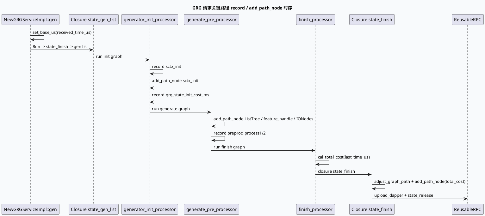

# 2026-10-05 业务库代码理解：GRG 请求关键路径 record 与 GraphMonitor 阶段写入合同

> 日期：2026-10-05（周一）
> 主题选择：canonical 笔记仓库无 2026-10-05 daily-plan；仓内唯一计划 daily-plan-20260529.json 描述的是旧 MV-GR 路径，且计划候选中 GraphPool / DynamicTimeOut / PipelineGraphFunction 等核心主题近期均有覆盖。本次按同一 DC-GRG 快照回退到业务库侧尚未单独展开的关键路径写入合同：generate_pre_processor.cpp 等业务 processor 在 record(stage) 和 _graph_monitor.add_path_node(...) 上的调用方式，以及 feed_closure.cc 在 state_finish 中的 final_path 收口。KU 正文未读取，业务背景与线上收益需人工补充；以下只陈述可在源码中验证的事实。
> 配对关系：基础库笔记分析 feed-general/framework 的 TraceInfo / MutableFrameworkContext / GraphMonitor 接口；本文只分析 DC-GRG 业务侧如何调用这些 API，并给出请求级时间线的可观察形态。
> 范围：feeda-dc-grg/src/processor/get_data/generator_init_processor.cpp、feeda-dc-grg/src/processor/get_data/generate_pre_processor.cpp、feeda-dc-grg/src/processor/get_data/finish_processor.cpp、feeda-dc-grg/src/service/feed_closure.cc、feeda-dc-grg/src/service/new_generator_closure.cc、feeda-dc-grg/src/common/session_context.h、feeda-gr/gr-proto/proto/pcs_protocol.proto。

## 0. 业务全景图

<div style="font-family:system-ui,-apple-system,BlinkMacSystemFont,Segoe UI,sans-serif;background:#f5f7fa;border:1px solid #d8e1ea;border-radius:8px;padding:16px;margin:16px 0;color:#243b53;line-height:1.45;"><div style="font-size:12px;font-weight:800;color:#52606d;text-transform:uppercase;letter-spacing:.05em;">GRG 请求关键路径与 GraphMonitor 业务写入链<div style="display:grid;grid-template-columns:1.05fr 24px 1.25fr 24px 1.2fr 24px 1.05fr;gap:8px;align-items:stretch;margin-top:12px;"><div style="background:#fff;border:1px solid #cbd5e1;border-left:4px solid #3d5a80;border-radius:6px;padding:11px;"><div style="font-size:15px;color:#102a43;font-weight:700;">入口设置基址<div style="margin-top:7px;font-size:12px;color:#52606d;">NewGRGServiceImpl::gen 把 received_time_us 写入 sctx-_new_all_critical_path，并保持并发计数与状态机。<div style="text-align:center;color:#64748b;font-size:20px;padding-top:34px;">→<div style="background:#fff;border:1px solid #cbd5e1;border-left:4px solid #2d6a4f;border-radius:6px;padding:11px;"><div style="font-size:15px;color:#102a43;font-weight:700;">业务 processor 写点<div style="margin-top:7px;font-size:12px;color:#52606d;">generator_init_processor、generate_pre_processor、finish_processor 在关键 IONode 与阶段切换点写 record + add_path_node。<div style="text-align:center;color:#64748b;font-size:20px;padding-top:34px;">→<div style="background:#fff;border:1px solid #cbd5e1;border-left:4px solid #9a5b28;border-radius:6px;padding:11px;"><div style="font-size:15px;color:#102a43;font-weight:700;">closure 收口<div style="margin-top:7px;font-size:12px;color:#52606d;">state_finish 调用 adjust_graph_path 拆分 final_path，并补 total_cost 节点；state_release 释放 reusable RPC。<div style="text-align:center;color:#64748b;font-size:20px;padding-top:34px;">→<div style="background:#fff;border:1px solid #cbd5e1;border-left:4px solid #b8432f;border-radius:6px;padding:11px;"><div style="font-size:15px;color:#102a43;font-weight:700;">观测输出<div style="margin-top:7px;font-size:12px;color:#52606d;">final_path + total_cost 写日志并上传 Dapper；logid/cuid 由 graph_run 头部注入 trace_info。<div style="margin-top:10px;font-size:12px;line-height:1.55;color:#52606d;">核心合同：业务 processor 只能在自己负责的阶段调用 record 与 add_path_node，跨阶段名称与阶段切分由业务配置约定，不是由框架自动派生。

## 1. 核心结论

1. **入口基址只在 service 设置一次。** feeda-dc-grg/src/service/new_generator_service.cc:65-83 把 received_time_us 写入 _new_all_critical_path.set_base_us()，同时写 _new_time_recorder.set_base_time()；后续 processor 的 record(stage) 必须以这个基址计算间隔，重复设置基址会让时间线错位（get_total_cost() 取首尾差，错误非常隐蔽）。
2. **generator_init_processor 的两条阶段点对应 init 阶段切分。** feeda-dc-grg/src/processor/get_data/generator_init_processor.cpp:58-110 写 sctx_init 和 grg_state_init_cost_ms，间隔时间通过 gettimeofday_us() - sctx-_critical_path.get_last_time_us() 取得；这意味着同一 processor 内多个 record 必须按调用顺序串联，否则间隔是负值或异常大。
3. **generate_pre_processor 是关键路径最重的写入方。** feeda-dc-grg/src/processor/get_data/generate_pre_processor.cpp:3022-3120 在 ListTree、MultiModalFusionVecRedisIONode、feature_handle、preproc_process1/2、DupIONode、RedisIONode 等 IONode 之后逐个调用 add_path_node(...) + record(...)。同一文件还有 set_base_us / record 的高频组合，是 latency 归因的核心来源。
4. **finish_processor 通过 cal_total_cost 闭合时间线。** feeda-dc-grg/src/processor/get_data/finish_processor.cpp:89 调用 sctx-_new_all_critical_path.cal_total_cost(sctx-_critical_path.get_last_time_us())。注意：传入的是旧 _critical_path 的 last_time_us，不是 _new_all_critical_path 的；如果新旧路径混用，_new_all_critical_path._total_cost 会出现 0 或回退。
5. **feed_closure.cc::state_finish 是观测的最终归一化点。** feeda-dc-grg/src/service/feed_closure.cc:77 在 state_gen_list 入口 record grg_state_generate，:3684-3685 在 state_finish record grg_state_finish；这与 new_generator_closure.cc 的 state_finish 共同形成两条 closure 状态机的并行记录，排查延迟时要分别看两侧。
6. **new_generator_closure.cc::state_finish 把图节点迁移到模块路径。** new_generator_closure.cc:42-66 的 adjust_graph_path 把 shoubai_new_path_graph 中匹配的节点迁移到 FLAGS_dapper_tag_module_name 路径，并删除原节点；这条路径与 _new_all_graph_monitor.generate_path() 输出耦合，模块名变更会让 final_path 完全错位。
7. **new_generator_closure.cc::state_finish 显式补 total_cost。** new_generator_closure.cc:125 调用 _new_all_graph_monitor.add_path_node("total_cost", _new_all_critical_path.get_total_cost())，再触发 upload_dapper。如果 total_cost 在 record 序列末尾被覆盖，最终上传的 cost 与 final_path 不一致。
8. **sctx-_common_info.reqnums 是 quota 截断的统一入口。** feeda-dc-grg/src/preprocessor/pre_strategy.cc:159-216 多次使用 _session_context-_common_info.reqnums，并在 >50 时硬截断为 50；session_context.h:529 中 reqnums 默认 0。quota / quota_ratio 主题在当前 GRG 快照中没有 DeepesQuotaInfo / quota_ratio 字面量可验证（pitfall #45 的同源问题），不能从计划候选中引用未实现的字段。

## 2. 关键路径写入时序



## 3. 业务方调用链信息图

```infographic
infographic sequence-snake-steps-simple
data
  title 关键路径写入方分布
  desc 一个 GRG 请求中各 processor 对 _new_all_critical_path / _graph_monitor 的调用情况
  items
    - label service 入口
      desc set_base_us + new_time_recorder.set_base_time
      icon mdi/flag-checkered
    - label generator_init_processor
      desc record sctx_init / grg_state_init_cost_ms
      icon mdi/rocket-launch-outline
    - label generate_pre_processor
      desc add_path_node ListTree / IONode / feature_handle
      icon mdi/cog-transfer-outline
    - label finish_processor
      desc cal_total_cost 闭合时间线
      icon mdi/check-decagram-outline
    - label closure state_finish
      desc adjust_graph_path + add_path_node total_cost
      icon mdi/source-branch
    - label closure state_release
      desc ReusableRPC release 与并发计数清理
      icon mdi/lock-open-check-outline
  theme
    palette #3d5a80 #2d6a4f #9a5b28 #b8432f
```

## 4. 写入点分布

| 阶段 | 调用方 | 操作 | 证据 | 备注 |
|---|---|---|---|---|
| 入口基址 | NewGRGServiceImpl::gen | set_base_us(received_time_us) | new_generator_service.cc:75 | 与 _new_time_recorder 同步 |
| gen_list | new_generator_closure::state_gen_list | _new_all_critical_path.record("new_sctx_init") | new_generator_closure.cc:72 | 状态机进入 S_FINISH 之前 |
| gen_list 入口 | feed_closure.cc | _critical_path.record("grg_state_generate") | feed_closure.cc:77 | 与上条并行 |
| init 阶段 | generator_init_processor.cpp | add_path_node("sctx_init", ...) + record("sctx_init") | generator_init_processor.cpp:58-59 | gettimeofday_us - last_time |
| init 完成 | generator_init_processor.cpp | add_path_node("grg_state_init_cost_ms", ...) + record(...) | generator_init_processor.cpp:109-110 | 间隔作为节点 cost |
| ListTree | generate_pre_processor.cpp | add_path_node("ListTree", ...) + record(...) | generate_pre_processor.cpp:3022-3023 | pre-graph 阶段 |
| MultiModal | generate_pre_processor.cpp | add_path_node("MultiModalFusionVecRedisIONode", ...) + record(...) | generate_pre_processor.cpp:3054-3055 | IO_NODE 类型 |
| feature_handle | generate_pre_processor.cpp | add_path_node + record | generate_pre_processor.cpp:3076-3077 | feature 收口 |
| preproc_process1/2 | generate_pre_processor.cpp | add_path_node + record | generate_pre_processor.cpp:3079-3080、:3103-3104 | 拆分两段 preproc |
| DupIONode | generate_pre_processor.cpp | add_path_node + record (IO_NODE) | generate_pre_processor.cpp:3112-3113 | 去重 IONode |
| RedisIONode | generate_pre_processor.cpp | add_path_node + record (IO_NODE) | generate_pre_processor.cpp:3120 | 缓存 IONode |
| finish | finish_processor.cpp | _new_all_critical_path.cal_total_cost(_critical_path.get_last_time_us()) | finish_processor.cpp:89 | 闭合时间线 |
| finish closure | feed_closure.cc | add_path_node("grg_state_finish", ...) + record(...) | feed_closure.cc:3684-3685 | 双向 closure 并行 |
| gen finish | new_generator_closure::state_finish | adjust_graph_path | new_generator_closure.cc:42-66 | 把匹配节点迁移到模块路径 |
| total_cost | new_generator_closure::state_finish | _new_all_graph_monitor.add_path_node("total_cost", ...) | new_generator_closure.cc:125 | 必须紧跟 cal_total_cost |
| upload | new_generator_closure::state_finish | _new_all_graph_monitor.upload_dapper(...) | new_generator_closure.cc:139 | 真正上传观测数据 |
| release | DeleteNewGeneratorClosure | remove_concurrency() + delete | new_generator_closure.cc:30-33 | self guard |

## 5. 字段与生命周期

| 字段 | 类型 | 写入位置 | 读取位置 | 备注 |
|---|---|---|---|---|
| sctx-_new_all_critical_path._time_us_line | vector-of-pair-string-uint64 | record / set_base_us | get_total_cost / get_last_time_us | 主 bthread 追加 |
| sctx-_new_all_critical_path._total_cost | uint64 | cal_total_cost | get_total_cost | 0 表示未计算 |
| sctx-_critical_path._time_us_line | 旧路径同名 vector | 同接口 | 旧 closure 仍在用 | 与新路径并存 |
| sctx-_new_all_graph_monitor._graph_paths | map-string-path | reg_graph / fill_graph_path | generate_path | 进程级 |
| sctx-_new_all_graph_monitor._module_name | string | 由框架注入 | add_path_node 路由 | 未注册则 warning |
| sctx-_common_info.reqnums | uint32 | protocol 解析 | pre_strategy.cc 截断 | 默认 0；>50 截为 50 |
| _is_vip_uid | bool | queue / graph 初始化 | 多数业务方 | 见 session_context.h |
| _parameter_result / _buffer_parameter_result | map-string-ParameterData | PCS 解析 | 业务方按 key 取 | proto 中存在 microvideo_quota_result |

## 6. 关键边界与 Pitfalls 卡片

<div style="font-family:system-ui,-apple-system,BlinkMacSystemFont,Segoe UI,sans-serif;background:#fffaf5;border:1px solid #ead7c0;border-left:5px solid #b8432f;border-radius:6px;padding:14px;margin:16px 0;color:#3d2b1f;"><div style="font-size:12px;font-weight:800;color:#9a3d2a;text-transform:uppercase;letter-spacing:.04em;">Pitfalls / 关键路径写入合同<div style="margin-top:9px;font-size:14px;line-height:1.65;">

- **入口基址被覆盖**：NewGRGServiceImpl::gen 之外再次 set_base_us 会让 _new_all_critical_path 的 first 元素被刷新，get_total_cost() 退化为 last - new_base，排查「负 cost」时要先确认基址。
- **record 与 add_path_node 不配对**：仅 record 不 add_path_node 会让 final_path 缺节点，但不影响时间线；仅 add_path_node 不 record 会让 cost_us 来自 gettimeofday_us() - last_time，与 stage 名无关。
- **新旧 _critical_path 混用**：finish_processor.cal_total_cost 传入旧 _critical_path.get_last_time_us()；新旧两套路径并存是历史债务，混用会让 total_cost 为 0。
- **adjust_graph_path 模块名变更**：FLAGS_dapper_tag_module_name 一旦修改，adjust_graph_path 找不到匹配节点，additional_graph_path 为空，final_path 会丢段。
- **关键路径顺序假设**：多个 IONode 的 add_path_node 顺序是业务约定，框架不强制；运维改顺序会直接改变 cost 归因。
- **quota 主题证据缺口**：当前 GRG 快照没有 DeepesQuotaInfo / quota_ratio 字面量；MicrovideoQuotaResult 仅在 proto 中存在，运行期消费路径不在本仓可见，需结合上游 producer 排查。
- **范围限制**：KU 正文未读取；biz-line 调权因子、线上收益和实验参数需人工补充。


```infographic
infographic list-column-done-list
data
  title 关键路径业务方调试 Checklist
  desc 业务侧 record / add_path_node 现场核对项
  items
    - label 确认 received_time_us 只设置一次
      done true
      icon mdi/flag-checkered
    - label 确认 record 调用顺序与图执行顺序一致
      done true
      icon mdi/order-numeric-ascending
    - label 确认 add_path_node 与 record 成对出现
      done true
      icon mdi/source-branch-check
    - label 确认 finish_processor.cal_total_cost 用旧路径 last_time_us
      done true
      icon mdi/check-decagram-outline
    - label 确认 adjust_graph_path 模块名与配置一致
      done true
      icon mdi/source-branch-refresh
    - label 确认 total_cost 在 record 末尾追加
      done true
      icon mdi/flag-outline
    - label 确认 quota / reqnums 截断行为符合预期
      done true
      icon mdi/numeric
    - label 确认 logid/cuid 已通过 set_graph_log_info 注入
      done true
      icon mdi/account-circle-outline
  theme
    palette #3d5a80 #2d6a4f #9a5b28 #b8432f
```

## 7. 证据来源

- feeda-dc-grg/src/service/new_generator_service.cc:65-83：入口基址、_new_generator_request/response/closure、concurrency 控制与 SET_ERROR 宏。
- feeda-dc-grg/src/service/new_generator_closure.cc:30-33：DeleteNewGeneratorClosure self guard。
- feeda-dc-grg/src/service/new_generator_closure.cc:42-66：adjust_graph_path 节点迁移。
- feeda-dc-grg/src/service/new_generator_closure.cc:71-118：state_gen_list 取 graph、reset、写 GraphBaseContext、调用 GraphService::graph_run。
- feeda-dc-grg/src/service/new_generator_closure.cc:121-174：state_finish 上传 Dapper、补 total_cost。
- feeda-dc-grg/src/service/feed_closure.cc:77、:3684-3685：旧 closure record grg_state_generate / grg_state_finish。
- feeda-dc-grg/src/service/graph_service.cc:23-46：set_graph_log_info、run(Response).wait、fill_graph_path、record、cal_graph_cost、generate_path、print_all_log。
- feeda-dc-grg/src/processor/response_processor.cpp:17-48：ResponseProcessor 完成信号节点。
- feeda-dc-grg/src/processor/get_data/generator_init_processor.cpp:58-110：record sctx_init / grg_state_init_cost_ms。
- feeda-dc-grg/src/processor/get_data/generate_pre_processor.cpp:3022-3120：ListTree / MultiModal / feature_handle / preproc_process1/2 / DupIONode / RedisIONode 的 add_path_node 与 record。
- feeda-dc-grg/src/processor/get_data/finish_processor.cpp:89：cal_total_cost 闭合时间线。
- feeda-dc-grg/src/preprocessor/pre_strategy.cc:159-216：reqnums 截断到 50 的硬阈值。
- feeda-dc-grg/src/common/session_context.h:529：reqnums 字段及 _is_vip_uid 等业务标识。
- feeda-gr/gr-proto/proto/pcs_protocol.proto:500、:2358：microvideo_quota_result 与 MicrovideoQuotaResult 定义。

> 外部 KU 正文未读取；biz-line 调权因子、线上收益和实验参数需人工补充。当前 GRG 快照中 DeepesQuotaInfo、quota_ratio 字面量缺失；MicrovideoQuotaResult 仅在 proto 中存在，消费路径不在本仓可见范围。
