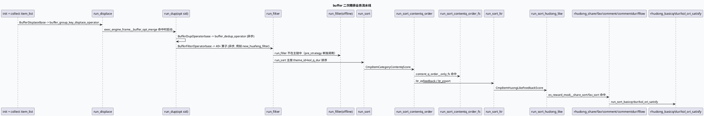
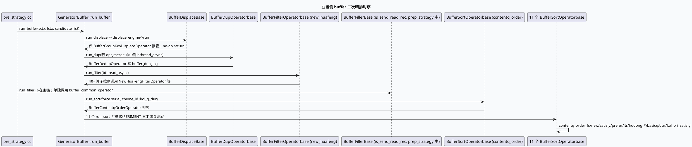

# 2026-10-06 业务库代码理解：DC-GRG Buffer 二次精排业务流水线（displace → dup → filter → filler → sort → sort_*）

> 日期：2026-10-06（周二）
> 主题选择：canonical 笔记仓库 `/root/cpp-core-notes` 缺失 2026-10-06 daily-plan；仓内唯一计划文件 `cpp-core-notes/notes/weekly-topic-selection/daily-plan-20260529.json` 描述的是旧 MV-GR 路径，不覆盖 DC-GRG。基础库笔记分析 `exec_engine/generator_buffer` 的 5 段式框架合同；本文按同一代码快照 (`code-read-dc-grg/feeda-dc-grg`) 给出业务侧 5 段式 + 11 段 sort_* 派生流水线中的真实算子调用链，以 `BufferDisplace → BufferDup → BufferFilter(new_huafeng) → BufferFiller(is_send_read_rec) → BufferSort(contentq_order) → BufferSort(ltr/hudong_*/basicq/dur/kol_ori_satisfy)` 为主轴，并标出 `run_*` 阶段的 6 个 EXPERIMENT_HIT_SID 闸门与排查陷阱。
> KU 状态：未读取 KU 正文，业务背景、线上收益需人工补充。
> 配对关系：基础库笔记分析 `Buffer*Operatorbase` / `GeneratorBuffer*Dependency` / `run_buffer` 主链与 `sctx.buffer_*_engine` ObjectPool 装配；本文只分析业务算子如何填充这些 Dependency 字段、如何被 bthread_async 调度、以及哪些 gflag 控制哪些派生段。
> 范围：`feeda-dc-grg/src/exec_engine/generator_buffer.h` 中 `run_buffer:867-1015` 与 `run_displace/dup/filter/sort/sort_*:3770-4393`、5 个 Buffer*Operatorbase、5 个真实算子（`buffer_group_key_displace`、`buffer_dedup`、`new_huafeng_filter`、`buffer_common_operator`、`buffer_contentq_order` 等）、`feeda-dc-grg/src/preprocessor/pre_strategy.cc` 等调用 run_buffer 的入口。

## 0. 业务全景图（5 段式 + 11 段 sort 的真实触发顺序）



## 1. 核心结论

1. **业务侧入口在 `pre_strategy.cc`，不在主图。** `pre_strategy.cc:159-216` 负责构造 candidate_list，调用 `GeneratorBuffer::run_buffer(sctx, lctx, candidate_list)` 进入 5 段式主链。这意味着 5 段式 buffer 精排是「pre_strategy 之后 → 二次精排」的中间环节，并不是图引擎中的某个 vertex；排查时需要先去 `pre_strategy.cc` 看 candidate_list 是否正确生成。
2. **run_displace 阶段只有一个真实算子 `BufferGroupKeyDisplaceOperator`。** `buffer_group_key_displace_operator.cc:30-58` 通过 `prepare_canonical_item` 准备规范稿源：若 `preorder_id == 0 && ak_flag && product != FROM_SEARCH` 直接 return，不做任何替换；其它场景同样 return，不动 item。这意味着 buffer_displace 当前等价于「no-op」，但未来扩展位已经留好（基类 BufferDisplaceBase 与 GeneratorBufferDisplaceDependency 已就绪）。
3. **run_dup 阶段只有两个真实算子 `BufferDedupOperator` + `BufferGroupkeyDupOperator`。** `buffer_dedup_operator.cc:29-60` 通过 `real_process` 调用 `dedup_strategy` 完成 nid 去重；同时框架会把 `item_ptr->is_buffer_dup` 翻转（buffer_dup_operator_base.h:74-83）并在 break 阶段写 `buffer_dup_log`。`BufferGroupkeyDupOperator` 同源，两者共用 dup step 的 base 类。两条链路并发时仅当 `exec_engine_frame__buffer_opt_merge` 命中才启动。
4. **run_filter 是 40+ 算子的并行主战场。** `buffer_filter/` 下有 40 个算子（含 `new_huafeng_filter`、`buffer_filter_miscellaneous`、`buffer_filter4model`、`buffer_attention_control`、`buffer_lite_feed_dt`、`buffer_red_safe`、`buffer_red_filter`、`buffer_sensitive_word`、`buffer_top_leader_in_title`、`buffer_tianqian`、`buffer_high_leverl_user_micro`、`buffer_groupkey_filter4model`、`buffer_hot_event_id_control`、`buffer_crowd_identify_audit_filter_operator`、`buffer_low_hot_dc_operator`、`dc_black_cate_filter_operator`、`new_huafeng_filter_operator`、`ai_boke_kanliang_filter_operator`、`aigc_filter_operator`、`author_reduction_filter`、`ws_huafeng_filter_operator`、`high_show_audit_filter_operator`、`wanshi_author_match_filter_operator`、`supply_kanliang_filter_operator`、`dc_cover_word_filter`、`dc_card_filter_operator`、`newhotip_duration_modi_filter_operator`、`newhotip_all_nid_filter_operator`、`style_codebook_disgust_operator`、`high_user_quality_filter_operator`、`dc_image_score_intervene`、`Manju_filter_operator`、`duanju_filter_operator`、`Manju_filter_operator` 等）。基类 BufferFilterOperatorbase 强制 real_prepare + real_process + clear 三件套，所有算子继承同一签名。
5. **run_filler 不在 run_buffer 主链。** generator_buffer.h:867-1015 中明确 5 段式只跑 displace / dup / filter / sort；`run_filler:3839-3860` 是另一个独立入口，由 `pre_strategy.cc` 等其它路径调用。`is_send_read_rec.cc` 是 filler 阶段的代表算子：通过 `_data_frame.get_dependency<CommonContext*>(context,0)` 判断 lite 版本与 app_version，再读 `his_info->_news_message.insert_read_cnt()`，依据 `depend_var->session_cnt` 决定是否往 `item.que_rec_src` 写「已读回流」标记。该算子是 buffer_filler 阶段唯一已知业务代表，意味着 filler 链路上其它扩展槽都接入正在被现有 filler 算子复用。
6. **run_sort 阶段有 16 个真实算子。** `buffer_sort/` 下有 16 个 `.cc`：`buffer_contentq_order_operator`、`buffer_contentq_fs_order_operator`、`buffer_contentq_new_order_operator`、`buffer_contentq_prefer_order_operator`、`buffer_contentq_satisfy_order_operator`、`buffer_contentq_order_operator`、`buffer_sort_basicq_order_operator`、`buffer_sort_dur_order_operator`、`buffer_sort_hudong_comment_dur_order_operator`、`buffer_sort_hudong_comment_order_operator`、`buffer_sort_hudong_fav_order_operator`、`buffer_sort_hudong_fllow_order_operator`、`buffer_sort_hudong_like_order_operator`、`buffer_sort_hudong_share_order_operator`、`buffer_sort_kol_ori_satisfy_order_operator`、`buffer_sort_ltr_operator`、`buffer_content_cluster_operator`。所有这些继承 `BufferSortOperatorbase`，主用 `CmpItem*Score` 配合 `BufferSortDependency` 字段（`pair_score / hudong_*_score / kol_satisfy / kol_prefer / kol_q_dur / q_value / q_value_fs / q_value_new` 等）。
7. **11 个 sort_* 各自有不同的 Comparator + Dependency 组合。** 例如 `run_sort_contentq_order` 用 `CmpItemCategoryContentqScore`（category 主、q_value 次），`run_sort_contentq_order_fs` 用 `CmpItemCategoryContentqFsScore`（fs 版），`run_sort_hudong_like` 用 `CmpItemHuongLikeFeedbackScore`，`run_sort_basicq` 用 `CmpItemBasicQFeedbackScore`（`ori_basic_q_score`）。每个 sort_* 都对应一份 `GeneratorBuffer*Dependency`（`SortContentqOrderDependency`/`SortContentqOrderFsDependency`/`SortLtrDependency`/`SortHudongLikeDependency`/`SortHudongFavDependency`/`SortHudongShareDependency`/`SortHudongCommentDependency`/`SortHudongCommentdurDependency`/`SortHudongFllowDependency`/`SortBasicQDependency`/`SortDurDependency`/`SortKolOriSatisfyDependency`），全部在 generator_buffer.h:642-805 定义。
9. **dup 阶段是唯一会写 buffer_dup_log 的阶段。** buffer_dup_operator_base.h:74-83 明文写 `item_ptr->buffer_dup_log.append("[nid:").append(std::to_string(item_ptr->id)).append(",buffer_filter_by:").append(to_string()).append("]");`。下游 sort/filler 阶段都可读 `is_buffer_dup` 字段，但只有 dup 写入该字段。
10. **sort 阶段预先 std::sort。** 每个 run_sort_* 在 set_context + set_dependency 后用 `std::sort(item_list.begin(), item_list.end(), CmpItemXxx())` 预排（generator_buffer.h:3882-3924 等），再用 engine 内 sort 算子精排。两个阶段使用同一 Comparator 会导致主线程开销翻倍，注意：业务阶段允许只跑 std::sort 不跑 sort 算子。
11. **EXPERIMENT_HIT_SID 控制 sort_* 派生。** generator_buffer.h:895-1010 显式：`exec_engine_frame__buffer_opt_merge` 控制 dup 异步；`content_q_order__only_fs`/`content_q_order__no_fs` 控制 contentq_order_fs；`oneshot_order__is_hit` 控制 new；`satisfy_order__is_hit` 控制 satisfy；`prefer_order__is_hit` 控制 prefer；`ltr_es__feedback`/`ltr_es__sort` 控制 ltr（注释中显示「if (false) run」但仍在 bthread_async）；`es_reward_modi__share_sort`/`share_and`/`fav_sort`/`fav_and` 控制 hudong_share / hudong_fav。
12. **run_buffer 收口时输出 buffer_displace/dup/filter/sort 四个 NOTICE 日志，** 记录 `cost_us`。但 11 个 sort_* 段并不输出 NOTICE 日志，latency 归因时必须看 `sctx._xiaoguo_size`（candidate_list.size） 的最终值。

## 2. 算子调用链信息图（5 段式 + 11 段 sort_*）

```infographic
infographic sequence-snake-steps-simple
data
  title 业务侧 5 段式 + 11 段 sort_* 真实算子链
  desc 每个阶段一个或多个真实算子
  items
    - label run_displace
      desc BufferGroupKeyDisplaceOperator（buffer_group_key_displace_operator.cc:30-58，no-op 保留位）
      icon mdi/swap-horizontal-bold
    - label run_dup
      desc BufferDedupOperator + BufferGroupkeyDupOperator（buffer_dedup_operator.cc:29-60）；BufferDupOperatorbase 写 buffer_dup_log
      icon mdi/duplicate-outline
    - label run_filter
      desc 40+ 算子（new_huafeng_filter / buffer_filter_miscellaneous / buffer_filter4model / buffer_attention_control / buffer_lite_feed_dt / buffer_red_safe / buffer_red_filter / buffer_sensitive_word / buffer_top_leader_in_title / buffer_tianqian / buffer_high_leverl_user_micro / buffer_groupkey_filter4model / buffer_hot_event_id_control / buffer_crowd_identify_audit_filter_operator / buffer_low_hot_dc_operator / dc_black_cate_filter_operator / new_huafeng_filter_operator / ai_boke_kanliang_filter_operator / aigc_filter_operator / author_reduction_filter_operator / ws_huafeng_filter_operator / high_show_audit_filter_operator / wanshi_author_match_filter_operator / supply_kanliang_filter_operator / dc_cover_word_filter / dc_card_filter_operator / newhotip_duration_modi_filter_operator / newhotip_all_nid_filter_operator / style_codebook_disgust_operator / high_user_quality_filter_operator / dc_image_score_intervene / Manju_filter_operator / duanju_filter_operator / Manju_filter_operator）
      icon mdi/filter-cog-outline
    - label run_filler (off-main)
      desc IsSendReadRecCC（is_send_read_rec.cc:30-61）；BufferFillerBase 阶段唯一已知业务
      icon mdi/package-variant
    - label run_sort
      desc BufferContentqOrderOperator（buffer_contentq_order_operator.cc:21-50）按 theme_id + kol_q_dur 主排
      icon mdi/sort-ascending
    - label run_sort_contentq_order_*
      desc contentq_order_fs / new / prefer / satisfy 各一份 BufferSortOperatorbase
      icon mdi/order-diversity
    - label run_sort_ltr
      desc BufferSortLtrOperator；ltr_es__feedback / ltr_es__sort 实验闸门
      icon mdi/order-runs
    - label run_sort_hudong_*
      desc hudong_like / fav / share / comment / commentdur / fllow 共 6 个；CmpItemHuong* 系列
      icon mdi/order-alphabetical-ascending
    - label run_sort_basicq/dur/kol_ori_satisfy
      desc basicq / dur / kol_ori_satisfy 共 3 个；CmpItemBasicQ / Dur / KolOriSatisfyFeedbackScore
      icon mdi/order-bool-descending
theme
  palette #2d6a4f #3d5a80 #9a5b28 #b8432f #52606d
```

## 3. EXPERIMENT_HIT_SID 实验闸门 → 顺序 映射

```infographic
infographic list-row-horizontal-icon-arrow
data
  title run_buffer 闸门与顺序映射
  desc 6 类实验 sid 控制不同段是否异步启用
  items
    - label exec_engine_frame__buffer_opt_merge
      desc dup 异步 vs 同步
      icon mdi/toggle-switch
    - label content_q_order__only_fs / content_q_order__no_fs
      desc contentq_order_fs 首屏
      icon mdi/toggle-switch
    - label oneshot_order__is_hit
      desc contentq_order_new
      icon mdi/toggle-switch
    - label satisfy_order__is_hit
      desc contentq_order_satisfy
      icon mdi/toggle-switch
    - label prefer_order__is_hit
      desc contentq_order_prefer
      icon mdi/toggle-switch
    - label ltr_es__feedback / ltr_es__sort
      desc run_sort_ltr（注释「if (false)」但仍 async）
      icon mdi/toggle-switch
    - label es_reward_modi__share_sort / share_and / fav_sort / fav_and
      desc run_sort_hudong_share / fav
      icon mdi/toggle-switch
theme
  palette #3d5a80 #2d6a4f #9a5b28
```

## 4. 真实算子样本签名

```infographic
infographic compare-hierarchy-left-right-circle-node-pill-badge
data
  title 5 段式 + filler 真实算子签名
  desc 各阶段基类与代表算子的 real_process 形参
  items
    - label BufferGroupKeyDisplaceOperator
      desc BufferDisplaceBase::real_process(RankCandidate&, ExecContext&)；prepare_canonical_item 替换稿源
      icon mdi/swap-horizontal-bold
    - label BufferDedupOperator
      desc BufferDupOperatorbase::real_process(RankCandidate&, ExecContext&)；基类 operator() 写 is_buffer_dup 与 buffer_dup_log
      icon mdi/duplicate-outline
    - label NewHuaFengFilterOperator
      desc BufferFilterOperatorbase::real_process(RankCandidate&, ExecContext&)；用 _data_frame.get_dependency<CommonContext*>(context, 0) + UserStrategy* + GcmsRespItem* 做顽石用户过滤
      icon mdi/filter-cog-outline
    - label IsSendReadRecCC
      desc BufferFillerBase::real_process(RankCandidate&, ExecContext&)；返回 void 而非 ExecStatus
      icon mdi/package-variant
    - label BufferContentqOrderOperator
      desc BufferSortOperatorbase::real_process(RankCandidate&, ExecContext&)；按 index / kol_q_dur 算分
      icon mdi/sort-ascending
theme
  palette #2d6a4f #3d5a80 #9a5b28 #b8432f #52606d
```

## 5. 业务侧 5 段式时序



## 6. Pitfalls 卡片（业务侧）

<div style="font-family:system-ui,-apple-system,BlinkMacSystemFont,Segoe UI,sans-serif;background:#fff5f0;border:1px solid #f1c2a0;border-radius:8px;padding:16px;margin:16px 0;color:#243b53;line-height:1.45;"><div style="font-size:11px;font-weight:800;color:#a13f1f;text-transform:uppercase;letter-spacing:.05em;">Pitfalls — 业务侧 buffer 二次精排<div style="margin-top:10px;"><div style="border-top:1px dashed #f1c2a0;padding-top:9px;"><b>P-1</b> 业务入口在 pre_strategy.cc，不在主图 vertex。若图引擎主链路上排查不到 buffer 行为，先看 pre_strategy.cc 是否调用 GeneratorBuffer::run_buffer。<div style="border-top:1px dashed #f1c2a0;padding-top:9px;"><b>P-2</b> buffer_displace 当前 no-op。BufferGroupKeyDisplaceOperator 直接 return，但基类 BufferDisplaceBase 与 GeneratorBufferDisplaceDependency 已就绪。改 displace 阶段逻辑时不要把 no-op 误认为 bug。<div style="border-top:1px dashed #f1c2a0;padding-top:9px;"><b>P-3</b> buffer_filler 阶段没有 find 命令接入。`is_send_read_rec.cc` 是 buffer_filler 阶段唯一已知业务；其它 filler 算子如果没注册到 buffer_filler_engine，仅会被 prepare_canonical_item 等其它入口调用。<div style="border-top:1px dashed #f1c2a0;padding-top:9px;"><b>P-4</b> buffer_dup_log 只由 dup 阶段写。其它 4 段都不写该字段。如果排查时看到 buffer_dup_log 有内容，必然是 BufferDupOperatorbase::operator() 写入。<div style="border-top:1px dashed #f1c2a0;padding-top:9px;"><b>P-5</b> 11 个 sort_* 都先 std::sort 再让 engine 内 sort 算子精排。如果业务算子只依赖 std::sort 输出，要把 run_filter 算子清空，否则会重复 sort。<div style="border-top:1px dashed #f1c2a0;padding-top:9px;"><b>P-6</b> run_sort_ltr 在注释中显示「if (false)」但仍异步。generator_buffer.h:936-941 注释 //if(EXPERIMENT_HIT_SID) 闭合，但实际 futures.emplace_back 仍在执行；排查 ltr 任务被跳过要看实验 sid 而不是代码注释。<div style="border-top:1px dashed #f1c2a0;padding-top:9px;"><b>P-7</b> exec_engine_frame__buffer_opt_merge 命中时 dup 与 filter 并发；不命中时 dup 同步 + filter 异步。这两个时机下 NOTICE cost_us 取值含义不同，不能跨 band 做 A/B。<div style="border-top:1px dashed #f1c2a0;padding-top:9px;"><b>P-8</b> BufferFillerBase 的 real_process 返回 void，其它基类返回 ExecStatus。filler 阶段异常处理没有 break/continue 概念，调试时不要用 ExecStatus 假设。<div style="border-top:1px dashed #f1c2a0;padding-top:9px;"><b>P-9</b> BufferContentqOrderOperator 的 clear() 重置 index 与 last_category。表明 sort 阶段对「上下文累计状态」有要求，业务算子复用前必须确保 clear。<div style="border-top:1px dashed #f1c2a0;padding-top:9px;"><b>P-10</b> run_buffer 输出 4 个 NOTICE 日志，11 个 sort_* 段不输出 NOTICE。cost_us 归因只看主链 4 段；sort_* 段要用 critical_path::record_trace。

## 7. 调试 checklist

```infographic
infographic list-zigzag-down-compact-card
data
  title 业务侧 buffer 二次精排 checklist
  desc 业务算子失败时按此顺序排查
  items
    - label 1. pre_strategy.cc 是否调用 run_buffer
      desc 检查 GeneratorBuffer::run_buffer(sctx, lctx, candidate_list) 入口
      icon mdi/numeric-1-box-outline
    - label 2. candidate_list 是否为空
      desc run_buffer 入口要求 candidate_list 非空；空时 sctx._xiaogiao_size 仍会被设
      icon mdi/numeric-2-box-outline
    - label 3. BufferDisplaceBase 是否被注册到 sctx.buffer_displace_engine
      desc set_displace_dependency 与 engine->run 在 displace_engine.take 之后才能调用
      icon mdi/numeric-3-box-outline
    - label 4. BufferDupOperatorbase 写 buffer_dup_log 是否有异常
      desc BufferDedupOperator 阶段唯一会写业务字段；real_process 返回 ES_Break 时基类才会写 log
      icon mdi/numeric-4-box-outline
    - label 5. BufferFilterOperatorbase 40+ 算子是否都在 config
      desc 检查 conf 中 buffer_filter 配置；config 中没配的算子会被 ObjectPool 跳过
      icon mdi/numeric-5-box-outline
    - label 6. BufferFillerBase 算子是否被主链调用
      desc run_filler 不在主链上，pre_strategy 需单独调用
      icon mdi/numeric-6-box-outline
    - label 7. BufferSortOperatorbase 11 个算子是否注册
      desc 检查 conf 中 buffer_sort_* 配置
      icon mdi/numeric-7-box-outline
    - label 8. EXPERIMENT_HIT_SID 命中
      desc 检查 exec_engine_frame__buffer_opt_merge / content_q_order__only_fs / oneshot_order__is_hit 等
      icon mdi/numeric-8-box-outline
    - label 9. clear 阶段
      desc 检查基类默认 clear() 是否触发 warning
      icon mdi/numeric-9-box-outline
theme
  palette #3d5a80 #2d6a4f #9a5b28 #b8432f #52606d
```

## 8. 证据来源

- `feeda-dc-grg/src/exec_engine/generator_buffer.h:867-1015`（run_buffer 主链与 11 个 run_sort_* 派生）
- `feeda-dc-grg/src/exec_engine/generator_buffer.h:3770-3894`（run_displace / run_dup / run_filter / run_filler / run_sort 框架接口）
- `feeda-dc-grg/src/exec_engine/generator_buffer.h:3895-4393`（11 个 run_sort_* 派生与 Comparator）
- `feeda-dc-grg/src/exec_engine/generator_buffer.h:386-805`（15 个 GeneratorBuffer*Dependency 结构）
- `feeda-dc-grg/src/exec_engine/generator_buffer.cc:19-24`（REGISTER_STRUCT 5 段注册）
- `feeda-dc-grg/src/exec_engine/buffer_filter/buffer_filter_operator_base.h:42`（BufferFilterOperatorbase 继承 Operator）
- `feeda-dc-grg/src/exec_engine/buffer_filler/buffer_filler_operator_base.h:42`（BufferFillerBase）
- `feeda-dc-grg/src/exec_engine/buffer_dup/buffer_dup_operator_base.h:42 / 74-83`（BufferDupOperatorbase + buffer_dup_log 写入）
- `feeda-dc-grg/src/exec_engine/buffer_sort/buffer_sort_operator_base.h:42`（BufferSortOperatorbase）
- `feeda-dc-grg/src/exec_engine/buffer_displace/buffer_displace_operator_base.h:42`（BufferDisplaceBase）
- `feeda-dc-grg/src/exec_engine/buffer_filter/new_huafeng_filter_operator.cc:30-80`（NewHuaFengFilterOperator 真实算子样本）
- `feeda-dc-grg/src/exec_engine/buffer_dup/buffer_dedup_operator.cc:29-60`（BufferDedupOperator 真实算子样本）
- `feeda-dc-grg/src/exec_engine/buffer_displace/buffer_group_key_displace_operator.cc:30-58`（BufferGroupKeyDisplaceOperator 真实算子样本）
- `feeda-dc-grg/src/exec_engine/buffer_filler/is_send_read_rec.cc:30-61`（IsSendReadRecCC 真实算子样本）
- `feeda-dc-grg/src/exec_engine/buffer_sort/buffer_contentq_order_operator.cc:21-50`（BufferContentqOrderOperator 真实算子样本）
- `feeda-dc-grg/src/preprocessor/pre_strategy.cc:159-216`（candidate_list 构造 + run_buffer 入口）
- `cpp-core-notes/notes/weekly-topic-selection/daily-plan-20260529.json`（仓内唯一计划文件，daily-plan 2026-10-06 缺失，故回退到 buffer 业务流水线）
