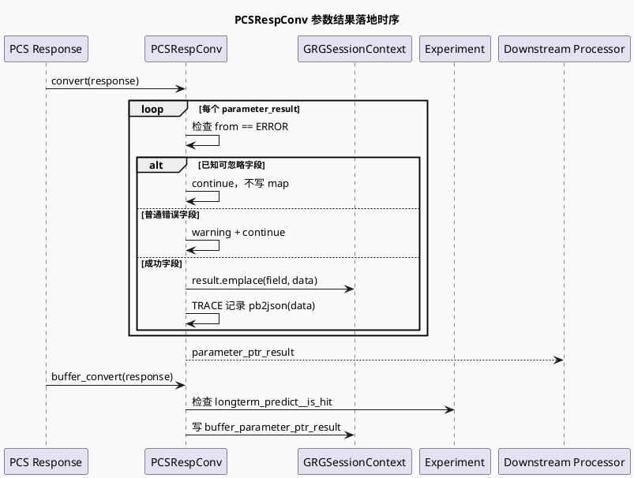

# 2026-10-09 业务库代码理解：GRG PCS 响应转换与实验分叉合同

> 日期：2026-10-09（周五）
> 主题选择：canonical 笔记仓库未发现本周 daily-plan；10-08 已覆盖 GCMS/UMS/Redis parser 配置装配，且 10-03 已覆盖 GRG ResponseProcessor 图尾完成信号。本次回退到更窄的业务边界：`PCSRespConv` 如何把 PCS 参数结果按错误策略、实验开关和结果容器写入 GRG session。
> KU 状态：未读取 KU 正文；PCS 字段业务含义、实验 owner 与线上告警口径需人工补充。本文只依据当前快照源码证据。
> 配对关系：基础库笔记分析 FlowCtlConcurrency 的请求准入与释放；本文分析请求执行中外部 PCS 响应的业务落地。

## 一、架构全景

<div style="font-family:system-ui,-apple-system,BlinkMacSystemFont,'Segoe UI',sans-serif;max-width:1100px;margin:16px auto;padding:16px;background:#f4f8f6;border:1px solid #cfe4d6;border-radius:8px;color:#243b53;line-height:1.45;"><div style="font-size:12px;font-weight:800;color:#52606d;letter-spacing:.06em;">PCS RESPONSE CONVERSION / BUSINESS WRITEBACK</div><div style="display:grid;grid-template-columns:1fr 22px 1.3fr 22px 1.3fr 22px 1fr;gap:8px;align-items:stretch;margin-top:12px;"><div style="background:#fff;border-left:4px solid #3d5a80;border-radius:6px;padding:12px;"><div style="font-weight:750;color:#102a43;">PcsResponse</div><div style="font-size:12px;margin-top:7px;">重复的 parameter_result 列表，每项含 field、from、data。</div></div><div style="text-align:center;font-size:20px;padding-top:30px;color:#64748b;">→</div><div style="background:#fff;border-left:4px solid #0f766e;border-radius:6px;padding:12px;"><div style="font-weight:750;color:#102a43;">错误分类</div><div style="font-size:12px;margin-top:7px;">通用 convert 对部分字段静默忽略，其余错误 warning；buffer_convert 受实验门影响。</div></div><div style="text-align:center;font-size:20px;padding-top:30px;color:#64748b;">→</div><div style="background:#fff;border-left:4px solid #b45309;border-radius:6px;padding:12px;"><div style="font-weight:750;color:#102a43;">二次投影</div><div style="font-size:12px;margin-top:7px;">参数表先写入 map，再按 diversity 实验投影为相似度 map 与点击状态 vector。</div></div><div style="text-align:center;font-size:20px;padding-top:30px;color:#64748b;">→</div><div style="background:#fff;border-left:4px solid #b8432f;border-radius:6px;padding:12px;"><div style="font-weight:750;color:#102a43;">Session 结果</div><div style="font-size:12px;margin-top:7px;">parameter、buffer parameter、buffer GR rank 三类结果容器供后续 processor 读取。</div></div></div><div style="margin-top:13px;padding-top:10px;border-top:1px solid #cfe4d6;font-size:12px;color:#52606d;"><b>核心不变量：</b>转换函数只写入 session 所拥有的结果容器；错误项不应混入成功 map，实验关闭时不应生成对应 diversity 派生状态。</div></div>

## 二、普通参数转换合同

`pcs_respconv.cc:21-98` 的 `PCSRespConv::convert` 遍历 `response->pcs_protocol().parameter_result()`：

- `from() == ERROR` 时，命中一组已知的相似度、满意度、模型和推荐字段会直接 `continue`，不打印 warning；其他错误字段打印 warning 后同样跳过。
- 成功字段通过 `result.emplace(parameter_result.field(), &parameter_result.data())` 写入 session 的 parameter map，并记录字段名和 PB JSON。
- 该函数没有把错误值写入结果 map，因此下游看到“缺字段”时，必须区分 PCS 没返回、PCS 返回错误、还是转换阶段被过滤。

这里的“忽略型错误”不是全局错误开关，而是按字段名硬编码的业务兼容策略。新增 PCS 字段若进入错误列表，需要明确它是可忽略字段还是应该告警，否则会改变线上日志噪声与故障可见性。



## 三、Buffer 与 diversity 分叉

```infographic
infographic sequence-snake-steps-simple
data
  title PCS 响应的三条落地路径
  desc 同一份 parameter_result 根据调用函数进入不同的业务结果容器
  items
    - label convert
      desc 普通参数写入 parameter_ptr_result；已知错误字段静默过滤，其余错误 warning
      icon mdi:table-arrow-down
    - label buffer_convert
      desc 写 buffer_parameter_ptr_result；LongtermInfer 在实验命中时可忽略错误
      icon mdi:buffer
    - label buffer_diversity_convert
      desc 先构造 pcs_res_map，再按 diversity_sim 实验生成 map/vector 派生状态
      icon mdi:vector-polyline
    - label buffer_gr_rank_convert
      desc 写 buffer_gr_rank_parameter_ptr_result，错误统一 warning 后跳过
      icon mdi:chart-box-outline

theme
  palette #3D5A80 #0F766E #B45309
```

### 3.1 buffer_convert：一个实验门改变错误可见性

`pcs_respconv.cc:100-118` 中，`LongtermInfer` 错误只有在命中 `longterm_predict__is_hit` 时才被忽略；其他错误都会 warning。成功值写入 buffer parameter map，最后记录转换耗时、结果数量和 protobuf 字节大小。这些日志是判断“大响应导致转换慢”与“单字段错误导致业务缺失”的关键观测面。

### 3.2 buffer_diversity_convert：先索引，再派生

`pcs_respconv.cc:120-180` 先把成功的参数结果按字段名放入 `pcs_res_map`，再在 `diversity_sim__is_hit` 命中时清空并重建：

1. 读取 `diversity_sim_his__sim_thred` 阈值。
2. `fill_map` 把 prompt pair 转成 `nid_a_nid_b -> sim_cosine`，历史模式则按阈值累计 nid 计数。
3. `fill_vec` 处理时间、nid、相似度和 click status，并受 `diversity_sim_fade_out_v2__is_hit` 与阈值控制。
4. 数据缺失只打印 trace：`data is nullptr`，不会把整个转换判为失败。

这种结构把“PCS 原始返回”与“实验派生业务状态”分成两层，便于同一份响应服务多个策略分支，但也引入了实验关闭/数据缺失时的空容器语义。

## 四、结果容器与错误语义

| 函数 | 成功写入 | 错误处理 | 额外门控 |
|---|---|---|---|
| `convert` | `parameter_ptr_result` | 已知字段静默跳过；其余 warning | 无实验门 |
| `buffer_convert` | `buffer_parameter_ptr_result` | `LongtermInfer` 在命中实验时跳过；其余 warning | `longterm_predict__is_hit` |
| `buffer_diversity_convert` | 临时 `pcs_res_map`，再写 diversity map/vector | 错误统一 warning；缺数据 trace | `diversity_sim__is_hit`、阈值、fade-out 门 |
| `buffer_gr_rank_convert` | `buffer_gr_rank_parameter_ptr_result` | 错误统一 warning | 无额外门 |

```infographic
infographic compare-hierarchy-left-right-circle-node-pill-badge
data
  title 错误结果的四种可见性
  desc “没有进入结果容器”不等于“没有错误日志”，需要结合函数和实验状态判断
  items
    - label 静默过滤
      desc convert 中已知业务字段错误直接 continue，不产生 warning
      value 1
    - label warning 后过滤
      desc 普通错误字段不入 map，但保留字段名 warning
      value 2
    - label trace 缺数据
      desc diversity 派生阶段取不到 key 时只打印 trace
      value 3
    - label 成功写入
      desc data 指针进入对应 session map，后续 processor 负责解释
      value 4
theme
  palette #3D5A80 #0F766E #B45309 #B8432F
```

## 五、Pitfalls 卡片

<div style="font-family:system-ui,-apple-system,BlinkMacSystemFont,'Segoe UI',sans-serif;max-width:1100px;margin:16px auto;padding:17px 19px;background:#fffaf5;border:1px solid #ead7c0;border-left:5px solid #b45309;border-radius:7px;color:#3d2b1f;line-height:1.65;"><div style="font-size:12px;font-weight:800;color:#8a4b20;letter-spacing:.06em;">PITFALLS / PCS 响应转换</div><div style="font-size:20px;font-weight:800;margin:7px 0 12px;color:#1a1a1a;">五个现场判断点</div><div style="display:grid;grid-template-columns:1fr 1fr;gap:12px;font-size:13px;"><div><b>1. 缺字段不等于 PCS 没返回</b><br>错误项会被跳过，已知字段甚至不打 warning。</div><div><b>2. 实验门改变日志与状态</b><br>LongtermInfer、diversity 和 fade-out 门都能改变结果形状。</div><div><b>3. map 是中间索引</b><br>diversity 路径先建 `pcs_res_map`，再生成业务 map/vector。</div><div><b>4. 缺数据只到 trace</b><br>生产日志级别不足时，派生状态为空可能不易察觉。</div><div><b>5. 指针生命周期需确认</b><br>结果容器保存 `parameter_result.data()` 地址，调用方必须保证响应对象存活期覆盖读取期。</div><div><b>6. KU 背景缺失</b><br>字段 owner、实验含义和线上告警策略需人工补充。</div></div><div style="text-align:right;color:#94a3b8;margin-top:13px;">∎</div></div>

## 六、调试 checklist

```infographic
infographic list-column-done-list
data
  title PCS 响应缺字段排障 checklist
  desc 从原始结果到下游容器逐段确认
  items
    - label 确认 parameter_result 是否存在
      done true
    - label 记录 from、field、实验命中状态
      done true
    - label 判断字段是否属于静默忽略列表
      done false
    - label 检查目标结果容器是否为对应 buffer 类型
      done false
    - label diversity 路径检查 key 是否存在及阈值是否命中
      done false
    - label 核对 response 对象生命周期与指针读取时机
      done false

theme
  palette #3D5A80 #0F766E #B45309
```

## 七、证据来源

- `feeda-dc-grg/src/conv/pcs_respconv.cc:21-98`：普通参数转换、已知错误字段过滤与结果 map 写入。
- `feeda-dc-grg/src/conv/pcs_respconv.cc:100-118`：buffer 参数转换、LongtermInfer 实验门与耗时日志。
- `feeda-dc-grg/src/conv/pcs_respconv.cc:120-180`：diversity 临时索引、阈值和 fade-out 派生逻辑。
- `feeda-dc-grg/src/conv/pcs_respconv.cc:258-274`：buffer GR rank 结果容器与统一错误处理。

## 八、结论

`PCSRespConv` 不是简单的 protobuf 搬运器，而是一个把错误可见性、实验配置和多种 session 结果容器绑定在一起的业务边界。排查 PCS 字段缺失时，应先定位进入了哪条 convert 路径，再同时记录 `from`、字段名、实验命中状态和目标容器；否则只看最终 map 很容易把“被策略过滤”误判为“上游未返回”。
