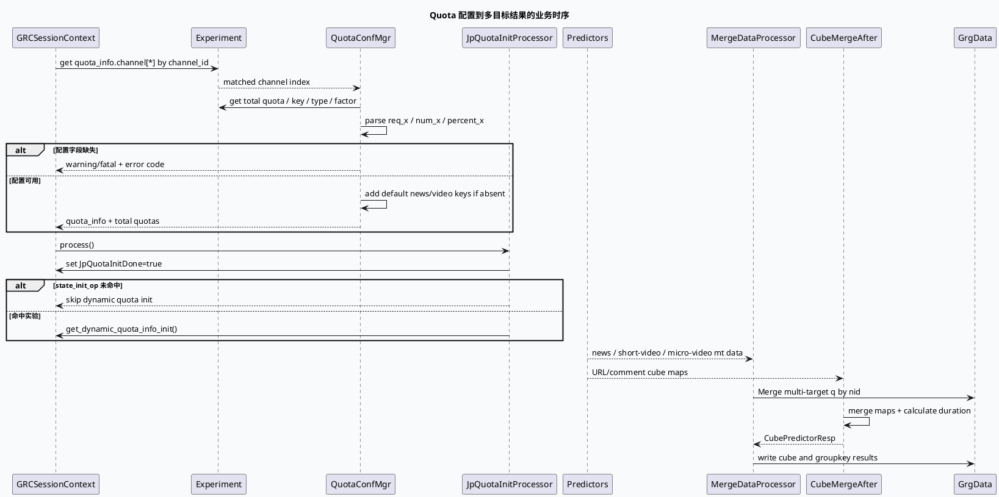

# 2026-10-10 业务库代码理解：Quota 配置到多目标 Merge 的结果合同

> 日期：2026-10-10（周六）
> 主题选择：当前日期未发现 daily-plan；旧计划中的 GCMS、DiversityMerge、quota/video_launch 等宽主题已在近期笔记出现。本次选择同一 DC-GRC 快照中更窄且未覆盖的业务边界：`quota_info` 的实验配置解析、个人配额实验命中，以及 `MergeDataProcessor` / `CubeMergeAfterProcessor` 如何把多目标结果写回 `GrgData`。
> KU 状态：未读取 KU 正文；队列 owner、配额业务含义和线上实验策略需人工补充。本文只依据可核验源码证据。
> 配对关系：基础库笔记描述 GRCProtocol 如何把请求解析并交给 dispatcher；本文从 quota 配置开始，追踪多目标预测和 cube 数据进入业务结果容器的路径。

## 一、架构全景

<div style="font-family:system-ui,-apple-system,BlinkMacSystemFont,'Segoe UI',sans-serif;max-width:1100px;margin:16px auto;padding:16px;background:#f4f8f6;border:1px solid #cfe4d6;border-radius:8px;color:#243b53;line-height:1.45;"><div style="font-size:12px;font-weight:800;color:#52606d;letter-spacing:.06em;">QUOTA CONFIG / MULTI-TARGET RESULT ASSEMBLY</div><div style="display:grid;grid-template-columns:1.1fr 22px 1.3fr 22px 1.35fr 22px 1fr;gap:8px;align-items:stretch;margin-top:12px;"><div style="background:#fff;border-left:4px solid #3d5a80;border-radius:6px;padding:12px;"><div style="font-weight:750;color:#102a43;">Session + Experiment</div><div style="font-size:12px;margin-top:7px;">channel_id、reqnum 和 sid 集合决定配置分支。</div></div><div style="text-align:center;font-size:20px;padding-top:30px;color:#64748b;">→</div><div style="background:#fff;border-left:4px solid #0f766e;border-radius:6px;padding:12px;"><div style="font-weight:750;color:#102a43;">QuotaConfMgr</div><div style="font-size:12px;margin-top:7px;">读取总配额、key、type、cp_q_factor 和 req/num/percent 结果数。</div></div><div style="text-align:center;font-size:20px;padding-top:30px;color:#64748b;">→</div><div style="background:#fff;border-left:4px solid #b45309;border-radius:6px;padding:12px;"><div style="font-weight:750;color:#102a43;">Graph processors</div><div style="font-size:12px;margin-top:7px;">JpQuotaInit 受实验门控制；MergeData 合并 news/short/micro 多目标预测。</div></div><div style="text-align:center;font-size:20px;padding-top:30px;color:#64748b;">→</div><div style="background:#fff;border-left:4px solid #b8432f;border-radius:6px;padding:12px;"><div style="font-weight:750;color:#102a43;">GrgData / strategy info</div><div style="font-size:12px;margin-top:7px;">生成 `PredictMultiTarget`、cube 结果和 groupkey map，供后续结果链读取。</div></div></div><div style="margin-top:13px;padding-top:10px;border-top:1px solid #cfe4d6;font-size:12px;color:#52606d;"><b>核心不变量：</b>配置缺失或格式错误应在 quota 解析阶段显式记录；processor 必须检查依赖、清空输出容器，并保持每个 nid 的多目标结果与 cube 指标可追踪。</div></div>

## 二、Quota 配置解析

`quota_conf_mgr.h:23-48` 定义了 `QuotaInfo`：key、predictor_quota、result_num、type、cp_q_factor，以及 cupai 截断相关字段。`quota_conf_mgr.cc:22-42` 先从 session 的 experiment 中按 `channel_id` 查找 `quota_info.channel[*].name`，只使用命中的第一个 channel 配置；查不到配置时记录 notice 并返回 0，调用方必须区分“没有配置”与“配置格式错误”。

`quota_conf_mgr.cc:44-86` 读取 news/video/min quota，推荐频道额外读取 short_video 和 micro_video 总配额。任一必需字段读取失败会记录 fatal 并返回 -1；这不是业务队列暂时为空，而是配置合同不完整。

`quota_conf_mgr.cc:88-149` 遍历 `key[*]`，读取 name、type、predictor_quota、cp_q_factor 和 result_num。result_num 有三种编码：`req_x` 使用当前 reqnum，`num_x` 使用固定数量，`percent_x` 先解析百分数再乘 reqnum / 100。解析失败的 key 被 warning 后跳过，不会进入 `quota_info`。

最后 `quota_conf_mgr.cc:150-165` 为 news/video 两个默认操作队列补充 `result_num=5` 和 `cp_q_factor=1`，即便配置没有显式提供也会有兜底项。这个行为会让 `quota_info` 非空，因此“启动成功”不能证明所有业务 key 都来自配置文件。

## 三、实验门与 graph processor

`jp_quota_init_processor.cpp:25-49` 创建 `JpQuotaInitDone` 输出并先写 true；只有命中 `state_init_op__is_hit` 才调用 `get_dynamic_quota_info_init()`。因此观察到 quota 没初始化时，要同时记录实验 SID，不能只检查 processor 是否被调度。

`personal_quota_params.cc:22-55` 注册 `grc_personal_quota_params` 字典，从 `monitor_sids` 加载实验 sid 集合；`target_quota_allocation.cc:19-30` 通过 `GET_DICT` 取字典，再用 `GRCSessionContext::_common_info.sid_set` 判断是否命中。个人配额实验是“sid 集合命中”合同，不是 channel quota 的替代品。



## 四、配置与结果路径信息图

```infographic
infographic compare-binary-horizontal-underline-text-vs
data
  title quota 结果数的两种尺度
  desc 配置字符串决定 result_num 如何从请求规模得到
  items
    - label request-relative
      desc req_x 使用当前 common_info.reqnum；percent_x 计算 x% * reqnum / 100
      value 1
      icon mdi:percent
    - label fixed-count
      desc num_x 直接使用固定条数；格式错误的 key 被跳过
      value 2
      icon mdi:numeric

theme
  palette #3D5A80 #0F766E #B45309
```

```infographic
infographic sequence-snake-steps-simple
data
  title 多目标结果装配路径
  desc 结果从多个预测源按 nid 合并，再写入 GraphData
  items
    - label 1. 依赖绑定
      desc setup 绑定 mt3、mt10 news/svideo/mvideo、cube、nids 和 groupkey 依赖
      icon mdi:source-branch
    - label 2. 清空输出
      desc process 检查依赖后 clear GrgData，避免复用 graph context 中的旧结果
      icon mdi:broom
    - label 3. 合并预测
      desc 先装入 news，再插入 shortvideo 和 microvideo；mt3 与 mt10 按 nid MergeFrom
      icon mdi:merge
    - label 4. 合并 cube
      desc CubeMergeAfter 合并 url/comment 字典并计算 duration、duration_v2
      icon mdi:cube-outline
    - label 5. 写回协议对象
      desc 生成 PredictMultiTarget、MtCubeResult 和 groupkey_map
      icon mdi:database-arrow-up

theme
  palette #3D5A80 #0F766E #B45309
```

## 五、关键实现边界

### 5.1 MergeDataProcessor 的合并顺序

`merge_data_processor.cpp:35-51` 在 setup 阶段按名字绑定依赖和 `GrgData` emit。`merge_data_processor.cpp:60-72` 对关键依赖做 null check 并清空输出。`merge_data_processor.cpp:95-112` 先复制 news 的 nid 到 qfield map，再插入 shortvideo、microvideo；相同 nid 的 map insert 不覆盖已经存在的 key，之后 `mt3` 结果优先创建 PB 项并对匹配的 mt10 结果执行 `MergeFrom`。

`merge_data_processor.cpp:116-142` 对 mt3 遍历后再处理剩余 mt10，保证只有 mt10 的 nid 也能进入输出。`merge_data_processor.cpp:144-191` 将 cube map 的大量互动、时长和完成度字段逐个写入 `MtCube`。这条路径是字段合同而不是透明容器拷贝，新增 cube 字段必须同步考虑 producer、PB schema 和 consumer。

### 5.2 CubeMergeAfterProcessor 的数据形状

`cube_merge_after_processor.cpp:19-33` 将 URL/comment feature map 声明为 mutable，并输出 `FlatMap<uint64_t, MtCube*>`。`cube_merge_after_processor.cpp:61-117` 按 nid 分三类处理：两个字典都无则记录缺失并跳过；URL 字典存在则计算平均 duration 并叠加 comment 字典的长期指标；只有 comment 字典存在则补齐 complete/complete_fs 默认长度后输出 comment 指针。

该实现的排查重点是指针和可变数据生命周期：输出 map 保存的是 feature map value 的地址，processor 结束后必须保证 graph data 的 owner 仍然存活。`cube_merge_after_processor.cpp:78-93` 对频次为零做保护，避免平均时长除零，但“没有 predictor 只有 comment”分支仍有独立的默认数组语义。

## 六、调试 checklist

```infographic
infographic list-column-done-list
data
  title quota 与 merge 异常排查 checklist
  desc 先分辨配置、实验门、依赖缺失和字段合并问题
  items
    - label 核对 channel_id 是否命中 quota_info.channel[*]
      done true
    - label 记录总配额字段和每个 key 的 result_num 编码
      done false
    - label 区分 req、num、percent 三种结果数计算
      done false
    - label 检查 state_init_op__is_hit 与个人 quota sid 命中状态
      done false
    - label 确认 MergeDataProcessor 的七类依赖都 ready 且输出已 clear
      done false
    - label 对比 news/svideo/mvideo 的重复 nid 与 MergeFrom 顺序
      done false
    - label 检查 URL/comment cube map 缺失分支和 duration 频次是否为零
      done false
    - label 验证 GrgData 中 multi_target_result、sonar_mtcube、groupkey_map 的数量
      done false

theme
  palette #3D5A80 #0F766E #B45309
```

## 七、Pitfalls 卡片

<div style="font-family:system-ui,-apple-system,BlinkMacSystemFont,'Segoe UI',sans-serif;max-width:1100px;margin:16px auto;padding:17px 19px;background:#fffaf5;border:1px solid #ead7c0;border-left:5px solid #b45309;border-radius:7px;color:#3d2b1f;line-height:1.65;"><div style="font-size:12px;font-weight:800;color:#8a4b20;letter-spacing:.06em;">PITFALLS / QUOTA + MERGE</div><div style="font-size:20px;font-weight:800;margin:7px 0 12px;color:#1a1a1a;">六个容易误读的现象</div><div style="display:grid;grid-template-columns:1fr 1fr;gap:12px;font-size:13px;"><div><b>1. 返回 0 不等于配置完整</b><br>找不到 channel 配置时函数可返回 0，业务层仍需检查 quota_info。</div><div><b>2. 默认 key 会掩盖缺配置</b><br>news/video 操作队列会被补成 5 条和 factor 1。</div><div><b>3. percent 不是浮点百分比文本</b><br>实现按下划线拆分并以整数转换后乘 reqnum / 100。</div><div><b>4. 实验门决定是否初始化</b><br>state_init_op 未命中时 processor 主动跳过动态 quota init。</div><div><b>5. map insert 不覆盖旧 nid</b><br>多目标合并顺序会影响同 nid 数据来源与 MergeFrom 组合。</div><div><b>6. 输出包含内部指针</b><br>cube result 保存 feature map value 地址，必须验证 graph data 生命周期。</div></div><div style="text-align:right;color:#94a3b8;margin-top:13px;">∎</div></div>

## 八、证据来源

- `feeda-dc-grc/src/quota/quota_conf_mgr.h:23-48`：QuotaInfo 字段与动态 quota API。
- `feeda-dc-grc/src/quota/quota_conf_mgr.cc:22-165`：channel 选择、总配额、key 解析、三种 result_num 和默认队列。
- `feeda-dc-grc/src/graph_schedule/jp_quota_init_processor.cpp:21-52`：state_init 实验门与 quota 初始化触发。
- `feeda-dc-grc/src/dict/personal_quota_params.cc:22-55`：monitor_sids 字典加载。
- `feeda-dc-grc/src/rank/target_quota_allocation.cc:19-30`：个人 quota sid 命中判断。
- `feeda-dc-grc/src/processor/grg_data/merge_data_processor.cpp:35-142`：多目标预测依赖、nid 合并和 PB 写回。
- `feeda-dc-grc/src/processor/grg_data/merge_data_processor.cpp:144-218`：cube 与 groupkey 结果写回。
- `feeda-dc-grc/src/processor/grg_data/cube_merge_after_processor.cpp:19-117`：URL/comment map 合并、时长计算和缺失分支。

## 九、结论

DC-GRC 的 quota 业务边界由三层共同决定：Experiment 按 channel 选配置并解释结果数，字典和实验 SID 决定个性化分支是否生效，graph processors 再把多目标预测和 cube 指标按 nid 写入 `GrgData`。排查结果数量或字段缺失时，应先保留配置字符串、实验命中状态和各依赖容器数量，再判断是 quota 计算、processor skip、nid 合并顺序还是 cube 字典缺失。
