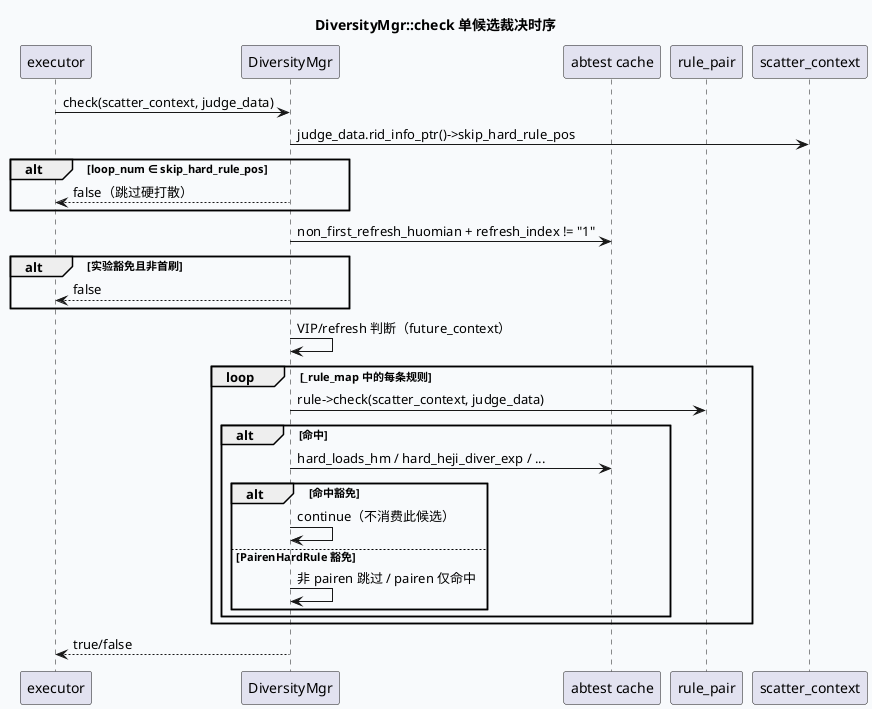

# 2026-10-11 业务库代码理解：DiversityMgr 实验缓存与低清晰度规则合同

> 日期：2026-10-11（周日）
> 主题选择：canonical `/root/cpp-core-notes` 仓库未发现 2026-10-11 的 daily-plan；近期笔记 10-09/10-10 已覆盖 FlowCtlConcurrency、PCSRespConv、quota merge 等边界；09-28/09-27 已覆盖 AIGC / LowClarity / 个性化 fakeid 业务效果。本次回退到更窄的业务边界：`DiversityMgr` 的请求级 abtest 缓存、规则注册机制、check/update 时序，以及 `LowClarityDiversityRule` 展示的“smfw flag → common dict → 窗口配置 → label 产生”五段骨架。
> KU 状态：未读取 KU 正文；rule 注册列表、abtest 实验 owner、低清晰度窗口的命中阈值需人工补充。本文只依据可核验源码证据。
> 配对关系：基础库笔记描述 GRG 入口与 Graph 执行生命周期；本文只分析在该 graph 之上 DiversityMgr 如何裁决每个候选的命中情况。

## 一、架构全景

<div style="font-family:system-ui,-apple-system,BlinkMacSystemFont,'Segoe UI',sans-serif;max-width:1100px;margin:16px auto;padding:16px;background:#f4f8f6;border:1px solid #cfe4d6;border-radius:8px;color:#243b53;line-height:1.45;"><div style="font-size:12px;font-weight:800;color:#52606d;letter-spacing:.06em;">DIVERSITY MGR / RULE EXPERIMENT CACHE + LOW CLARITY WINDOW</div><div style="display:grid;grid-template-columns:1fr 22px 1.35fr 22px 1.25fr 22px 1fr;gap:8px;align-items:stretch;margin-top:12px;"><div style="background:#fff;border-left:4px solid #3d5a80;border-radius:6px;padding:12px;"><div style="font-weight:750;color:#102a43;">DiversityScatterContext</div><div style="font-size:12px;margin-top:7px;">每槽位携带 SidInfo、logid、function_context、refresh_index 与 judge_data。</div></div><div style="text-align:center;font-size:20px;padding-top:30px;color:#64748b;">→</div><div style="background:#fff;border-left:4px solid #0f766e;border-radius:6px;padding:12px;"><div style="font-weight:750;color:#102a43;">init + _init_abtest_cache</div><div style="font-size:12px;margin-top:7px;">请求级一次性写入 huomian_rule/cate/interest/pairen/hard 实验缓存；遍历注册规则并 init。</div></div><div style="text-align:center;font-size:20px;padding-top:30px;color:#64748b;">→</div><div style="background:#fff;border-left:4px solid #b45309;border-radius:6px;padding:12px;"><div style="font-weight:750;color:#102a43;">check + update</div><div style="font-size:12px;margin-top:7px;">每候选走硬/软豁免和 skip_hard_rule_pos，再走每条规则的 check/update。</div></div><div style="text-align:center;font-size:20px;padding-top:30px;color:#64748b;">→</div><div style="background:#fff;border-left:4px solid #b8432f;border-radius:6px;padding:12px;"><div style="font-weight:750;color:#102a43;">judge 决策</div><div style="font-size:12px;margin-top:7px;">命中即窗口更新；不命中则继续；返回 false 让下游 executor 选下一个候选。</div></div></div><div style="margin-top:13px;padding-top:10px;border-top:1px solid #cfe4d6;font-size:12px;color:#52606d;"><b>核心不变量：</b>请求级 abtest 缓存必须 init 一次；规则 init 返回 true 才进入 _rule_map；check 必须按实验缓存顺序跳过豁免分支，并最终用 abtest_cache 决定 continue/return。</div></div>

## 二、DiversityMgr::init 与 abtest 缓存

`diversity_mgr.cpp:29-50` 的 `init()` 先清空 `_rule_map` 与 `_cost_info`，调用 `_init_abtest_cache(scatter_context)`，再遍历 `get_all_diversity_rule` 收集的规则，逐个调用 `rule->init(scatter_context)`；只有 init 返回 true 才把规则放入 `_rule_map`，并打印 `all rule size / hitted rule size / hitted rule` 三段日志。

`diversity_mgr.cpp:53-206` 的 `_init_abtest_cache` 是请求级一次性写入：

- 合集豁免实验（`all_heji_huomian_exp1..exp5`、`new_tgi_deversity_huomian_exp1..exp6`、`new_middle_new_tgi_deversity_huomian_exp1..exp5`）：写入 `huomian_rule`（如 `SubCateGapDiversityRule`/`MiddleDiversityRule`/`FanCateGapDiversityRule`）和 `all_heji_huomian_adjust`（实验名）。
- Interest 豁免实验（`interest_diversity_exp_1..exp_8`）：同时写入 `huomian_rule1` 与 `huomian_rule2`，两者都对应 `InterestDiversityRule` 与 `InterestDiversityGapRule`。
- Cate 豁免实验（`new_cate_new_tgi_deversity_exp1..exp_6`）：写入 `cate_diversity_huomian_rule`（默认 `CateDiversityRule`）与 `cate_diversity_huomian_key`。
- 硬规则豁免：`hard_loads_hm / hard_heji_diver_exp / hard_duanju_diver_exp / hard_duanju_diver_exp2`，四个 bool。
- 拍人豁免：`pairen_hard_rule_v1..v6` 六个 bool；v2/v3/v4/v5 还附带指定规则名集合。
- 非首刷豁免：`non_first_refresh_huomian = hard_rule_fz_0417`。

这种缓存机制让后续每个候选的 `check` 不再重复 `Util::hit_abtest(...)`，把 abtest 调用从“每个候选 × 每个规则”压成“请求级别 × 一次”。这是典型的“hot path 缓存”模式，前提是请求级缓存值在线程内只读一次。

## 三、规则注册与实例化

`diversity_mgr.cpp:208-216` 的 `get_all_diversity_rule`：

1. 从 `DiversityRegister::instance().get_rule_names()` 拿到所有已注册规则名。
2. 对每条规则名调用 `ApplicationContext::instance().get_or_create<BaseDiversityRuleNew>(rule_name)`；这是 babylon ApplicationContext 的工厂式注册：注册时静态变量登记名字，运行期再按名拿实例。
3. 把 rule 实例的 `set_rule_name(rule_name)`，再 push 进 `all_rules`。

注册的入口在各条规则的 `.cpp` 文件末尾：`REGISTER_RULE(LowClarityDiversityRule)`（`low_clarity_diversity_rule.cpp:113`）。因此新增多样性规则时，必须保证：
- 规则类继承 `BaseDiversityRuleNew`。
- 末尾 `REGISTER_RULE(...)` 静态注册到 `DiversityRegister`。
- 应用启动时这些 `.o` 都参与链接（聚合源码树时容易遗漏某些 `.o`）。

## 四、check 与 update 的边界

`diversity_mgr.cpp:218-225` 的 `update()`：每个槽位调用一次，遍历 `_rule_map` 调用 `rule->update(scatter_context, judge_data)`；这是“槽位确认资源后”更新窗口的入口。

`diversity_mgr.cpp:229-241` 的 `check()`：每个槽位对每个候选调用一次。



`diversity_mgr.cpp:259-396` 的 for-loop 主体处理多条规则的 continue/return 路径：

- `SubCateGapDiversityRule` + `hard_loads_hm` + type_set∈{507,509} + `is_loads_hm_for_history`：返回 true（豁免此候选）。
- `CateDiversityRule / SubCateGapDiversityRule` + `hard_heji_diver_exp` + `check_is_heji_rid` + `_is_heji_diversity_valid`：continue（跳过此规则的命中）。
- `hard_duanju_diver_exp / hard_duanju_diver_exp2` 对短剧执行 continue。
- 拍人 v1-v6：v1 全豁免；v2-v5 都列出指定豁免规则名集合；v2/v3/v4/v5 还对 PairenHardRule 做反向处理（非 pairen 时 continue）。

这种基于 abtest cache 的规则 continue/return 矩阵是 DiversityMgr 的主要可配置面。任何变更都应该分两步：先在 `_init_abtest_cache` 写入缓存，再在 `check` 主循环里匹配缓存，否则规则虽注册但 abtest 不会生效。

## 五、LowClarityDiversityRule 的 5-段骨架

`low_clarity_diversity_rule.cpp:18-117`：

1. `rule_is_hit`：`EXPERIMENT_HIT_PARAM(low_clarity_is_hit)` 或 `Util::hit_abtest("low_clarity_is_hit", sid)` 任一为真即命中；任一前置为 nullptr 时返回 false。
2. `init_rule_config`：
   - `mutable_config()->set_label_type(DiversityLabelType::BY_VALUE)`。
   - `set_cross_fresh_type(CROSS_FRESSH_WITH_LAST_SHOWLIST)`。
   - `set_first_refresh_type(ONLY_NON_FIRST_FRESH)`。
   - `low_clarity_smfw = EXPERIMENT_GET_PARAM(low_clarity_smfw)`，拼出 dict key `low_clarity_<flag>`。
   - `GET_COMMON_DICT(VectorValStrDouble, d_cupai_adjust_params_dict, low_clarity_params)`，`vecVal[0]/[1]/[2]` 分别覆盖 `tgi_thred / thred1 / thred2`；缺值时按默认 `tgi_thred=1.2 / thred1=6 / thred2=3`。
3. `low_clarity_tgi` 来自 `HistoryInterestInfoData->low_clarity_tgi`，再按阈值比较：≥ 阈值用 thred1，否则 thred2，最终 `mutable_config()->add_window_conf(SAME_MOST_M_IN_N, thred, 1, true)` 写入窗口配置。
4. `get_labels`：从 `RidTmpInfo._video_info->video_clarity_rank == 1` 时 `label_result.add_value("1")`；否则不产 label。
5. `REGISTER_RULE(LowClarityDiversityRule)`：静态注册到 `DiversityRegister`。

这是一种典型的“5-段式 process 骨架”，在 multi_factor / huge operator 家族中普遍存在：先 `rule_is_hit` 决定是否激活，再 `init_rule_config` 装载窗口/标签配置，然后依赖注入读取候选字段，最后 `get_labels` 产 label 并 `REGISTER_RULE`。每段都和实验参数、common dict 直接绑定，因此参数命名空间和 dict key 必须人工维护。

## 六、配置与裁决路径

```infographic
infographic compare-binary-horizontal-underline-text-vs
data
  title 规则裁决的两类门
  desc 实验门决定 init 是否进入 _rule_map，abtest 缓存决定 check 是否 continue
  items
    - label 实验命中门
      desc rule_is_hit 用 EXPERIMENT_HIT_PARAM 或 sid 命中实验；任一为真才进入 _rule_map
      value 1
      icon mdi:test-tube
    - label abtest 缓存门
      desc 请求级一次性写入豁免实验；check 时按缓存 continue 或 return
      value 2
      icon mdi:shield-key

theme
  palette #3D5A80 #0F766E #B45309
```

```infographic
infographic sequence-snake-steps-simple
data
  title LowClarity 规则 5 段骨架
  desc init→实验→窗口→label→注册
  items
    - label 1. rule_is_hit
      desc 实验参数或 sid 命中 low_clarity_is_hit
      icon mdi:test-tube
    - label 2. set_label_type/cross_fresh/first_refresh
      desc BY_VALUE + CROSS_FRESSH_WITH_LAST_SHOWLIST + ONLY_NON_FIRST_FRESH
      icon mdi:label
    - label 3. smfw + common dict
      desc low_clarity_<flag> 取 vecVal[0..2] 覆盖 tgi/thred1/thred2
      icon mdi:tune
    - label 4. window_conf
      desc tgi>=阈值用 thred1，否则 thred2；SAME_MOST_M_IN_N
      icon mdi:rectangle
    - label 5. get_labels + REGISTER_RULE
      desc video_clarity_rank==1 → "1"；末尾 REGISTER_RULE 静态登记
      icon mdi:content-save

theme
  palette #3D5A80 #0F766E #B45309
```

## 七、配置与现场关系

- `multi_stream_diversity.conf` 中 `DiversityRuleOperator` 仅在 `ua = 85` 时启用，`DiversityScorePkOperator / DiversityIndexPkOperator` 通过 `is_open_dnn_soft_rule / is_hit_searchc_mmr_refresh_exp` 等 condition 选择执行器；不同 UA 走的 graph 与执行器集合不同，因此“低清晰度规则没生效”需要同时确认 ua 走 DiversityRuleOperator 与 graph name 走到 short_micro_video。
- `vertex.conf` 中 `GetHistoryInterestInfoFunction`（emit `HistoryInterestInfoData`）与 `GetLongtermPcsFunction`（emit `LongtermData`）是 LowClarity 规则的依赖输入；如果依赖缺失，`low_clarity_tgi` 退化为 1.0、thred 走 thred2（=3 thred 1 in 3）。
- 上游 DiversityMgr 的 abtest 缓存是进程内单线程读；如果多线程并发 init，需要确认 `_init_abtest_cache` 不被并发触发，否则 huomian_rule 等字段会出现覆盖竞争。

## 八、调试 checklist

```infographic
infographic list-column-done-list
data
  title DiversityMgr / LowClarity 异常排查 checklist
  desc 先排除注册与 abtest 缓存，再看规则 init 与 check 顺序
  items
    - label 核对 DiversityRegister 是否包含目标规则名
      done true
    - label 检查 init 返回值；只有 init 返回 true 才进入 _rule_map
      done true
    - label 记录 _init_abtest_cache 命中的实验名与对应 huomian_rule/cate/pairen 缓存
      done false
    - label 检查 skip_hard_rule_pos 与 non_first_refresh_huomian 是否提前 return false
      done false
    - label 验证 ua→graph 路径走到 DiversityRuleOperator (ua=85) 与 short_micro_video
      done false
    - label 确认 HistoryInterestInfoData 与 LowClarityDiversityRule 的依赖完整
      done false
    - label 对比 smfw flag、dict vecVal 长度与阈值覆盖逻辑
      done false
    - label 对照 5-段骨架逐段打日志，确认漏掉哪一段
      done false

theme
  palette #3D5A80 #0F766E #B45309
```

## 九、Pitfalls 卡片

<div style="font-family:system-ui,-apple-system,BlinkMacSystemFont,'Segoe UI',sans-serif;max-width:1100px;margin:16px auto;padding:17px 19px;background:#fffaf5;border:1px solid #ead7c0;border-left:5px solid #b45309;border-radius:7px;color:#3d2b1f;line-height:1.65;"><div style="font-size:12px;font-weight:800;color:#8a4b20;letter-spacing:.06em;">PITFALLS / DiversityMgr</div><div style="font-size:20px;font-weight:800;margin:7px 0 12px;color:#1a1a1a;">六个易被忽略的边界</div><div style="display:grid;grid-template-columns:1fr 1fr;gap:12px;font-size:13px;"><div><b>1. abtest 缓存只 init 一次</b><br>非首刷豁免、拍人豁免、合集豁免都必须重新 init；线程内复用要确认没有并发覆盖。</div><div><b>2. 注册依赖链接 .o</b><br>新增规则 .o 没被聚合进 binary 时，DiversityRegister 看不到规则名。</div><div><b>3. check 顺序决定豁免优先级</b><br>continue 跳过当前候选不算命中；return true 让 executor 选中。</div><div><b>4. skip_hard_rule_pos 提前 return</b><br>硬打散豁免只在特定 loop_num 触发，错误配置会吃掉中间槽位。</div><div><b>5. dict vecVal 缺值有默认</b><br>vecVal.size() < 3 时 thred1/thred2 走默认 6/3；调试要打印实际值。</div><div><b>6. 依赖缺失让规则降级</b><br>HistoryInterestInfoData 缺失时 tgi 默认 1.0，走 thred2 窗口；不是“没生效”。</div><div><b>7. KU 背景缺失</b><br>实验 owner、smfw flag、阈值变化流程需人工补充。</div></div><div style="text-align:right;color:#94a3b8;margin-top:13px;">∎</div></div>

## 十、证据来源

- `feeda-mv-grg/src/strategy/diversity/diversity_mgr.cpp:29-50`：DiversityMgr::init 流程与 hitted rule 日志。
- `feeda-mv-grg/src/strategy/diversity/diversity_mgr.cpp:53-206`：_init_abtest_cache 写入 huomian / interest / cate / hard / pairen / non_first_refresh 缓存。
- `feeda-mv-grg/src/strategy/diversity/diversity_mgr.cpp:208-216`：get_all_diversity_rule + ApplicationContext get_or_create。
- `feeda-mv-grg/src/strategy/diversity/diversity_mgr.cpp:218-241`：update / check 主体与 skip_hard_rule_pos / non_first_refresh_huomian。
- `feeda-mv-grg/src/strategy/diversity/diversity_mgr.cpp:259-396`：check 主循环与豁免规则名匹配。
- `feeda-mv-grg/src/strategy/diversity/rule/low_clarity_diversity_rule.cpp:18-117`：5-段骨架（rule_is_hit / init_rule_config / window_conf / get_labels / REGISTER_RULE）。
- `feeda-mv-grg/conf/plugins/exec_engine/multi_stream_diversity.conf:84-90`：DiversityRuleOperator ua=85 启用条件。
- `feeda-mv-grg/conf/plugins/exec_engine/multi_stream_diversity.conf:725-766`：effect_pk_executor 各 DiversityPk / DiversityScorePkWithTopnOperatorV2 condition。
- `feeda-mv-grg/conf/plugins/graph/short_micro_video/vertex.conf:1598-1679`：HistoryInterestInfoData / LongtermData / CallbackData / DtLongtermData 等依赖节点。

## 十一、结论

DiversityMgr 是 GRG 多样性裁决的 hot path 边界：它把 abtest 调用集中在请求级别缓存中，再在每个候选的 check 里把命中规则映射为 continue/return。低清晰度等单条规则遵循 “rule_is_hit → init_rule_config → window_conf → get_labels → REGISTER_RULE” 5 段骨架，并把 smfw flag 与 common dict 当作参数源。排查“多样性规则没生效”时，应按注册 → 缓存 → check 顺序逐段验证，否则容易把“依赖缺失导致的规则降级”误判为“规则没生效”。