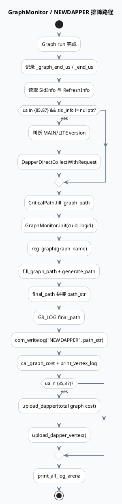

# feeda-mv-gr 到 Dapper Collector 的 NEWDAPPER / ChannelCollector 链路

> 日期：2026-06-02  
> 主题来源：未发现本机 daily-plan 文件；按双 Markdown 工作流补齐业务库主题，选择 `feeda-mv-gr` 中业务可观测链路：GraphMonitor、NEWDAPPER 日志与 `ChannelCollectorManager` 上报。  
> 服务：`feeda-mv-gr` + `dapper-collector`  
> 范围：GR 请求收尾阶段生成 graph path、按 UA 85/87 上报 dapper、写 NEWDAPPER 日志，并由 collector 接入/汇聚/落库。  
> 内网文档：当前任务未提供 KU URL/doc-id；如需字段口径、报表口径或线上 BNS 配置，需人工补充。

---

## 0. 架构全景图

<div class="arch-wrapper gr-dapper-arch"><style scoped>.gr-dapper-arch{font-family:-apple-system,BlinkMacSystemFont,'Segoe UI',Roboto,sans-serif;background:#f8fafc;border:1px solid #dbe4ee;border-radius:14px;padding:22px;margin:16px 0;color:#172033}.gr-dapper-arch .arch-title{font-size:18px;font-weight:900;margin-bottom:14px}.gr-dapper-arch .arch-layer{border-radius:10px;padding:14px;margin:10px 0}.gr-dapper-arch .user{background:#dbeafe;border-left:5px solid #2563eb}.gr-dapper-arch .application{background:#dcfce7;border-left:5px solid #16a34a}.gr-dapper-arch .ai{background:#fef3c7;border-left:5px solid #d97706}.gr-dapper-arch .data{background:#fce7f3;border-left:5px solid #db2777}.gr-dapper-arch .infra{background:#ede9fe;border-left:5px solid #7c3aed}.gr-dapper-arch .arch-layer-title{font-size:13px;font-weight:800;margin-bottom:8px}.gr-dapper-arch .arch-grid{display:grid;grid-template-columns:repeat(4,minmax(0,1fr));gap:8px}.gr-dapper-arch .arch-box{background:rgba(255,255,255,.86);border:1px solid rgba(15,23,42,.08);border-radius:8px;padding:9px;font-size:12px;line-height:1.35}.gr-dapper-arch .arch-box.highlight{border:2px solid #d97706;background:#fff7ed;font-weight:800}.gr-dapper-arch small{display:block;color:#64748b;margin-top:3px}</style><div class="arch-title">业务可观测链路：GR Graph 执行 → Dapper 采集 → Collector 汇聚</div><div class="arch-layer user"><div class="arch-layer-title">① GR 请求上下文</div><div class="arch-grid"><div class="arch-box">`GRSessionContext`<small>uid/cuid/baiduid/ua/sid/logid</small></div><div class="arch-box">`Controller`<small>timeout/local_ip/remote_side</small></div><div class="arch-box">`SidInfo`<small>sid_set 决定 dapper 维度</small></div><div class="arch-box">`RefreshInfo`<small>refresh_state / refresh_index</small></div></div></div><div class="arch-layer application"><div class="arch-layer-title">② Graph 收尾与监控</div><div class="arch-grid"><div class="arch-box highlight">`Closure::get()`<small>等待终点 Response/MicrovideoSampleLogRet</small></div><div class="arch-box">`CriticalPath::fill_graph_path`<small>业务关键路径</small></div><div class="arch-box highlight">`GraphMonitor`<small>final_path / vertex cost</small></div><div class="arch-box">`print_all_log_arena`<small>追加请求级日志</small></div></div></div><div class="arch-layer ai"><div class="arch-layer-title">③ 上报/日志出口</div><div class="arch-grid"><div class="arch-box highlight">`ChannelCollectorManager::DapperDirectCollectWithRequest`<small>UA 85/87 直接上报</small></div><div class="arch-box">`com_writelog("NEWDAPPER")`<small>落本地新 dapper 日志</small></div><div class="arch-box">`graph_monitor.upload_dapper`<small>图耗时上报</small></div><div class="arch-box">`graph_monitor.upload_dapper_vertex`<small>vertex 级成本上报</small></div></div></div><div class="arch-layer data"><div class="arch-layer-title">④ Collector 侧汇聚</div><div class="arch-grid"><div class="arch-box">`dapper_ns_plugin.conf`<small>collector BNS/sender_name</small></div><div class="arch-box">`CltServiceV2Impl::upload`<small>接收 DapperRequest</small></div><div class="arch-box">`CollectorAssemble`<small>logid 聚合、字段清洗</small></div><div class="arch-box">`CollectorConverge`<small>10s time_win 聚合后 store_task</small></div></div></div></div>

---

## 1. 关键结论

1. **业务链路的 dapper 上报发生在 Graph 已执行完成、响应已写回之后**：`closure.get()` 返回后，代码先组装 response / error，再进行 `DapperDirectCollectWithRequest`、`CriticalPath`、`GraphMonitor` 与 NEWDAPPER 日志。
2. **直接上报只覆盖 UA 85/87**：`upload_dapper_uas = {85, 87}`，其他 UA 仍会写常规 MONITOR/FTRACE/NEWDAPPER 路径，但不会走 `ChannelCollectorManager` 的直接 dapper 上报。
3. **UA 会被重编码为 `ua * 100 + 1`**：注释说明 feeda 后缀为 01、feedb 为 02，因此 collector 侧看到的 `from/channel` 不是原始 UA，而是带业务线后缀的编码。
4. **GraphMonitor 与 NEWDAPPER 是排查长尾的两条证据链**：`final_path` 写入 NEWDAPPER 日志；`cal_graph_cost()` 与 `upload_dapper_vertex()` 负责 vertex 级耗时，定位长尾时应同时查日志与 dapper 指标。

---

## 2. 核心流程图

```plantuml
@startuml
skinparam handwritten false
skinparam backgroundColor #f8fafc
skinparam sequenceMessageAlign center
skinparam ParticipantPadding 18

title feeda-mv-gr 请求收尾到 Dapper Collector 时序

actor Upstream as U
participant "GenericGRService::ProcessNsheadRequest" as P
participant "GenericGRService::run" as R
participant "Graph" as G
participant "ChannelCollectorManager" as D
participant "GraphMonitor" as M
participant "NEWDAPPER log" as L
participant "dapper-collector" as C

U -> P: nshead request(log_id)
P -> P: init GRSessionContext + choose graph_name
P -> R: run(cntl, graph, sctx, done, resp_tmp, graph_name)
R -> G: graph->run(end, microvideo_samplelog)
G --> R: Closure
R -> R: closure.get()
R -> U: done->Run() with response or error
R -> D: if ua in {85,87} DapperDirectCollectWithRequest(...)
D ..> C: DapperRequest / RecordType::FEED_GR
R -> M: CriticalPath + GraphMonitor final_path
R -> L: com_writelog("NEWDAPPER", final_path)
R -> M: cal_graph_cost + print_vertex_log
R -> D: if ua in {85,87} upload_dapper/upload_dapper_vertex
P -> P: print_log + func_each_vertex + graph->reset()
@enduml
```

---

## 3. 配置/结构信息图

```infographic
infographic list-grid-badge-card
data
  title Dapper 上报字段结构
  desc `DapperDirectCollectWithRequest` 参数将请求、耗时、版本、sid 与服务名绑定成 FEED_GR 记录
  items
    - label user keys
      desc cuid / uid / baiduid / logid
      icon mdi/account-key
    - label encoded ua
      desc `sctx->ua() * 100 + 1`，feeda 使用 01 后缀
      icon mdi/numeric
    - label timing
      desc begin_ms=`_begin_us/1000`，cost=`_end_us - _begin_us`
      icon mdi/timer-outline
    - label services
      desc sender=`feeda-mv-grf` receiver=`feeda-mv-gr`
      icon mdi/server-network
    - label dimensions
      desc sid_set / product / refresh_state / version
      icon mdi/tag-multiple
    - label record type
      desc `RecordType::FEED_GR` 标识 GR 链路
      icon mdi/chart-timeline-variant
```

### 关键调用参数

| 字段 | 取值 | 说明 | 证据 |
|---|---|---|---|
| `upload_dapper_uas` | `{85, 87}` | 仅这两个 UA 走直接上报 | `src/service/gr_service.cpp:359-360` |
| 上报 UA | `sctx->ua() * 100 + 1` | feeda 01 后缀编码 | `src/service/gr_service.cpp:372-375` |
| sender/receiver | `feeda-mv-grf` → `feeda-mv-gr` | 上游 GRF 到业务 GR | `src/service/gr_service.cpp:375-377` |
| record type | `FEED_GR` | collector 侧区分记录类型 | `src/service/gr_service.cpp:377-378` |
| version | `MAIN` 或 `LITE` | `Util::is_lite_grg` 判定 | `src/service/gr_service.cpp:362-369` |
| collector conf | `sender_name=feeda-mv-gr` | namespace sender 标识 | `conf/dapper_ns_plugin.conf:3-11` |

---

## 4. NEWDAPPER 与 GraphMonitor 路由图



---

## 5. Pitfalls 卡片

<div class="card-frame gr-dapper-card"><style scoped>.gr-dapper-card{font-family:-apple-system,BlinkMacSystemFont,'Segoe UI',Roboto,sans-serif;margin:18px 0}.gr-dapper-card .card{background:#eef6ff;border:1px solid #bfdbfe;border-radius:16px;padding:22px;color:#1f2937;box-shadow:0 8px 24px rgba(15,23,42,.06)}.gr-dapper-card .card-meta{font-size:12px;font-weight:800;letter-spacing:.08em;text-transform:uppercase;color:#1d4ed8}.gr-dapper-card .card-title{font-size:28px;font-weight:900;letter-spacing:-.02em;margin:6px 0 12px}.gr-dapper-card .card-grid{display:grid;grid-template-columns:2fr 1fr;gap:14px}.gr-dapper-card .card-panel{background:rgba(255,255,255,.74);border-top:4px solid #2563eb;border-radius:10px;padding:13px;font-size:14px;line-height:1.65}.gr-dapper-card .card-highlight{border-left:5px solid #2563eb;padding-left:12px;font-weight:800}.gr-dapper-card code{background:#dbeafe;border-radius:4px;padding:1px 4px}</style><div class="card"><div class="card-meta">PITFALLS · OBSERVABILITY</div><div class="card-title">“没有 dapper 数据”不等于 Graph 没跑</div><div class="card-grid"><div class="card-panel"><div class="card-highlight">直接 dapper 上报有 UA 白名单，且依赖 `SidInfo` 非空。</div><p>排查时先确认请求 UA 是否为 85/87；如果不是，应该查 MONITOR/FTRACE/NEWDAPPER 日志而不是直接查 dapper 指标。若 UA 命中但无数据，再检查 `SidInfo`、collector 权限、BNS 配置和 collector 侧窗口延迟。</p></div><div class="card-panel"><b>定位顺序</b><br>① `GR_LOG final_path`<br>② `NEWDAPPER` 文件<br>③ `upload_dapper_uas` 命中<br>④ collector `valid_request_count`<br>⑤ `TaskManager` 队列/上传日志</div></div></div></div>

---

## 6. 调试 checklist

```infographic
infographic list-column-done-list
data
  title GR → Dapper 调试 checklist
  desc 用于排查长尾路径缺失、dapper 指标为空、NEWDAPPER 无日志、collector 延迟
  items
    - label 确认 Graph 已完成
      desc `closure.get()` ret 是否为 0；错误请求可能走 set_error 但仍有部分日志
      done false
    - label 确认 UA 白名单
      desc 直接上报只处理 85/87；其他 UA 查 NEWDAPPER 与常规日志
      done false
    - label 确认 SidInfo
      desc `sid_info != nullptr` 才调用 `DapperDirectCollectWithRequest`
      done false
    - label 确认版本判定
      desc LITE 版本依赖 `DeviceInfo` 与 `Util::is_lite_grg`
      done false
    - label 确认 collector 配置
      desc `dapper_ns_plugin.conf` 的 collector BNS 和 `sender_name` 是否符合环境
      done false
    - label 确认 collector 入口权限
      desc collector 会用 `BnsPermissionController::is_allow_write` 检查来源 IP
      done false
    - label 确认二级窗口延迟
      desc collector2 需要 `now - time_win >= push_diff_time` 才推送计算任务
      done false
```

---

## 7. 证据来源

- `src/service/gr_service.cpp:161-220`：动态超时、TraceInfo、graph log info 初始化。
- `src/service/gr_service.cpp:280-300`：按 UA 选择终点数据并 `closure.get()`。
- `src/service/gr_service.cpp:350-379`：UA 85/87 的 `DapperDirectCollectWithRequest` 上报参数。
- `src/service/gr_service.cpp:381-415`：`CriticalPath`、`GraphMonitor`、NEWDAPPER、vertex cost 与日志 arena。
- `src/service/gr_service.cpp:117-121`：请求外层打印 GraphLog、遍历 vertex、`graph->reset()`。
- `conf/dapper_ns_plugin.conf:3-11`：collector 配置与 `sender_name=feeda-mv-gr`。
- `src/service/collector_v2.cc:110-229`：collector v2 `upload` 入口、权限、抽样、切片。
- `src/processor/collector_assemble.cpp:52-206`：一级 collector 拼接同 key 的 req/chain/path/data_info。
- `src/processor/collector_converge.cpp:30-117`：二级 collector 按 request_time 10s 窗口聚合。
- `src/processor/collector_converge.cpp:128-184`：按 DataType 拆任务并进入 `TaskManager`。
