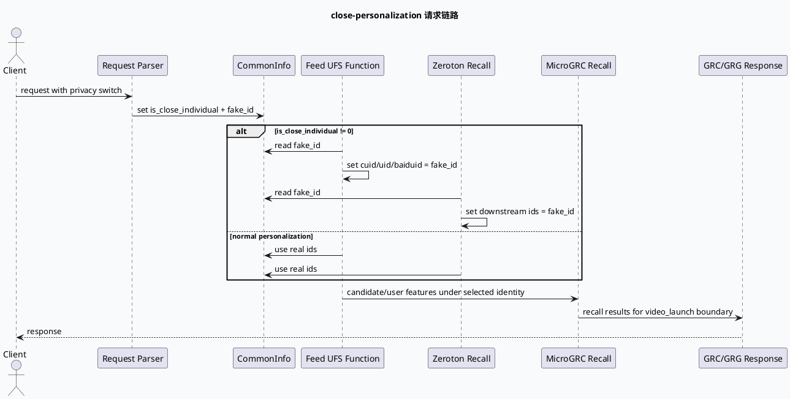

# 微视频 close-personalization：fake_id 与 MicroGRC 跨服务边界

> 日期：2026-07-25  
> 类型：业务库笔记  
> 主题：微视频链路中 `is_close_individual` 如何把真实用户标识替换为 `fake_id`，并影响 GRC/UFS/MicroGRC 召回边界。

<div class="arch-wrapper" style="font-family:Inter,Arial,sans-serif;border:1px solid #d6e2df;background:#f8fafc;border-radius:8px;padding:18px;margin:12px 0;color:#1f2937;">
<style>.mv-title{font-size:20px;font-weight:800;margin-bottom:12px}.mv-row{display:grid;grid-template-columns:1.1fr .9fr 1fr;gap:12px}.mv-zone{border:1px solid #cbd5d9;background:#fff;border-radius:7px;padding:12px}.mv-zone h3{font-size:14px;margin:0 0 8px;color:#285b52}.mv-box{border:1px solid #d7e6e2;background:#f1faf7;border-radius:6px;padding:10px;margin:8px 0;min-height:54px}.mv-box strong{display:block;font-size:13px;color:#164339}.mv-box span{font-size:12px;line-height:1.45;color:#475569}.mv-flow{text-align:center;font-weight:800;color:#64748b;padding-top:54px}@media(max-width:820px){.mv-row{grid-template-columns:1fr}.mv-flow{padding:0}}</style>
<div class="mv-title">close-personalization 全景：真实 ID 到 fake_id 的跨服务替换链</div>
<div class="mv-row"><div class="mv-zone"><h3>请求解析与公共字段</h3><div class="mv-box"><strong>CommonInfo</strong><span>`is_close_individual` 表示关闭个性化，`fake_id` 作为替代身份。</span></div><div class="mv-box"><strong>backup_sign</strong><span>插件日志会输出备份路由标记，便于定位灾备链路。</span></div></div><div class="mv-flow">替换 ID<br>→</div><div class="mv-zone"><h3>下游服务请求</h3><div class="mv-box"><strong>UFS fork request</strong><span>关闭个性化时把 cuid/uid/baiduid 改写为 `fake_id`。</span></div><div class="mv-box"><strong>zeroton recall</strong><span>同样避免真实用户 ID 进入召回请求。</span></div></div></div>
<div class="mv-row" style="margin-top:12px"><div class="mv-zone"><h3>MicroGRC 召回</h3><div class="mv-box"><strong>micro_grc_recall.cpp</strong><span>微视频召回处理器读取公共数据、策略数据和 UMS feature。</span></div></div><div class="mv-flow">候选召回<br>→</div><div class="mv-zone"><h3>GRC / GRG 边界</h3><div class="mv-box"><strong>video_launch</strong><span>短视频 GRC 侧准备请求，GR 侧 MicroGRC 负责召回响应边界。</span></div></div></div>
</div>

## 核心结论

`is_close_individual` 的业务语义不是“跳过所有召回”，而是“把个性化身份降级为 fake_id 后继续走可用链路”。因此排查关闭个性化问题时，要看三个边界：公共字段是否解析出 `is_close_individual/fake_id`；下游 fork 请求是否替换了 cuid/uid/baiduid；MicroGRC/`video_launch` 链路是否仍按非真实身份继续召回和组装。



## 字段与链路结构

```infographic
infographic compare-hierarchy-left-right-circle-node-pill-badge
data
  title 真实 ID 链路 vs fake_id 链路
  desc 关闭个性化时，链路继续执行，但对下游暴露的是替代身份
  items
    - label 常规个性化
      desc cuid/uid/baiduid 使用真实用户标识
      value real-id
      children
        - label UFS
          desc 读取真实公共字段
        - label Recall
          desc 基于真实画像召回
        - label Response
          desc 正常个性化响应
    - label 关闭个性化
      desc is_close_individual != 0 时改写为 fake_id
      value fake-id
      children
        - label UFS
          desc fork_request 三类 ID 全部替换
        - label Zeroton
          desc 下游请求不传真实 ID
        - label MicroGRC
          desc 继续执行召回边界
theme
  palette #285b52 #7a8b3a #c97845
```

## 代码走读

`src/processor/feed_ufs_function.cpp:162-166` 是最直观的身份替换点：当 `common_info->is_close_individual != 0`，fork 出去的 UFS 请求把 `cuid`、`uid`、`baiduid` 都设置为 `common_info->fake_id`。这说明业务侧并不是简单关闭 UFS，而是用替代身份继续请求。

`src/processor/zeroton_user_recall.cpp:232-236` 也出现相同模式：先声明 `fake_id`，再在关闭个性化时把下游 common_info 的 baiduid/cuid/uid 写为 fake_id。这里要特别小心局部变量与 `common_info->fake_id` 的差异，避免误以为空字符串一定是最终业务值。

`src/plugin/grc.cpp:52` 日志打印 `backup_sign`，说明排查微视频 GRC 请求时，除了个性化开关，还要把灾备路由标记纳入请求画像。关闭个性化和灾备路由叠加时，现象可能表现为“召回量下降”而非单纯“无召回”。

`src/processor/micro_grc_recall.cpp:1-23` 显示 MicroGRC 召回处理器依赖 common、base、strategy、UMS feature 和 GRC plugin 相关头文件，说明它位于业务召回和公共策略数据之间，不应只从单个 processor 文件判断身份是否被改写。

`src/strategy/short_micro/prepare_request_cb.cpp:30-40` 收集当前请求候选 nid 对应的二级分类，用于短视频请求准备。它与 `video_launch` 处理器共同构成 GRC 侧请求准备和响应边界，排查时需要和 GR 侧 `micro_grc_recall.cpp` 联合看。

## Pitfalls

<div style="font-family:Inter,Arial,sans-serif;background:#fbfaf5;border:1px solid #ded7bd;border-radius:8px;padding:16px;margin:14px 0;color:#2d2a22;"><div style="font-size:13px;font-weight:800;color:#7a5b1b;text-transform:uppercase;letter-spacing:.04em;">Pitfall Card</div><div style="font-size:22px;font-weight:850;margin:6px 0 8px;">关闭个性化不是关闭召回</div><div style="font-size:14px;line-height:1.65;">看到 `is_close_individual != 0` 时，不要直接推断链路被短路。代码更像是身份替换策略：UFS、Zeroton 等下游仍可能被调用，只是请求身份从真实 ID 变为 `fake_id`。召回少、特征少、响应变化都可能是替代身份画像不足造成的。</div><div style="display:grid;grid-template-columns:repeat(3,minmax(0,1fr));gap:10px;margin-top:12px;"><div style="border-top:3px solid #285b52;padding-top:8px;font-size:13px;">先确认 fake_id 来源</div><div style="border-top:3px solid #7a8b3a;padding-top:8px;font-size:13px;">再看下游请求字段</div><div style="border-top:3px solid #c97845;padding-top:8px;font-size:13px;">最后比对召回和响应</div></div></div>

## 调试 Checklist

```infographic
infographic list-column-done-list
data
  title close-personalization 排查顺序
  desc 从入口字段到下游请求，再到 MicroGRC 响应边界逐层确认
  items
    - label 确认 CommonInfo
      desc 请求中 is_close_individual 与 fake_id 是否同时存在且符合预期
      done true
      icon mdi/account-key
    - label 检查 UFS fork 请求
      desc cuid/uid/baiduid 是否全部替换为 fake_id
      done true
      icon mdi/source-fork
    - label 检查 Zeroton 请求
      desc 下游 common_info 是否仍携带真实身份
      done true
      icon mdi/account-cancel
    - label 检查 backup_sign
      desc 灾备路由与关闭个性化叠加时需要分开看
      done true
      icon mdi/routes
    - label 检查 MicroGRC 输出
      desc video_launch 边界是否有候选、过滤和响应组装变化
      done true
      icon mdi/video-check
theme
  palette #285b52 #7a8b3a #c97845
```

## 证据来源

- `src/processor/feed_ufs_function.cpp:162-166`：关闭个性化时 UFS fork 请求把 cuid/uid/baiduid 改写为 `fake_id`。
- `src/processor/zeroton_user_recall.cpp:232-236`：Zeroton 召回链路中的 fake_id 替换模式。
- `src/plugin/grc.cpp:52`：GRC 插件日志输出 `backup_sign`，辅助定位灾备路由。
- `src/processor/micro_grc_recall.cpp:1-23`：MicroGRC 召回处理器依赖公共数据、策略数据、UMS feature 与 GRC plugin。
- `src/strategy/short_micro/prepare_request_cb.cpp:30-40`：短视频请求准备阶段收集候选二级分类。
