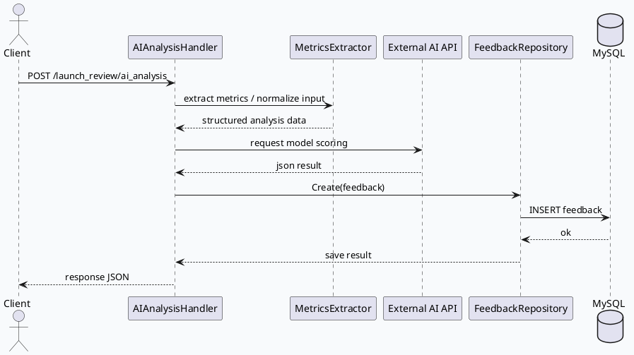

# rec-server `launch_review`：AI 分析、反馈写入与业务处理边界

> 日期：2026-07-28  
> 类型：业务库笔记  
> 主题：`launch_review` 不是单一接口，而是围绕申请分析、指标提取、反馈落库和外部模型调用构成的一条业务链；今天侧重其 handler/DAO 分层、返回值形态和失败边界。

<div class="arch-wrapper" style="font-family:Inter,Arial,sans-serif;border:1px solid #d8e0df;background:#f8fafc;border-radius:8px;padding:18px;margin:14px 0;color:#1f2937;"><style>.lr28-title{font-size:20px;font-weight:800;margin-bottom:12px}.lr28-grid{display:grid;grid-template-columns:1fr 1.15fr 1fr;gap:12px}.lr28-box{background:#fff;border:1px solid #d8e1e0;border-radius:7px;padding:12px}.lr28-box h3{font-size:14px;margin:0 0 8px;color:#285b52}.lr28-box p{font-size:13px;line-height:1.55;margin:0;color:#4b5563}.lr28-pill{display:inline-block;border:1px solid #bfd2cf;background:#eef8f6;border-radius:999px;padding:3px 8px;margin:3px;font-size:12px;color:#2f4f4a}.lr28-flow{display:grid;grid-template-columns:1fr 30px 1fr 30px 1fr 30px 1fr;gap:8px;align-items:center;margin-top:12px}.lr28-arrow{text-align:center;font-weight:800;color:#64748b}</style><div class="lr28-title">业务全景：Handler 负责编排，DAO 负责持久化，外部模型负责语义判断</div><div class="lr28-grid"><div class="lr28-box"><h3>请求入口</h3><p>`AIAnalysisRequest` 只携带 `application_id`，说明接口更像“按申请单驱动的分析任务”，不是一次性提交完整业务体。</p></div><div class="lr28-box"><h3>处理中枢</h3><p>Handler 中组合 `metrics_extractor`、`gjson`、`net/http`、`time` 等能力，说明业务处理同时依赖本地解析和外部 HTTP 推理结果。</p></div><div class="lr28-box"><h3>持久化边界</h3><p>`FeedbackRepository` 直接使用 `resource.OrmClientRecServer` 和 Gorm 保存反馈，数据落库与业务编排分离。</p></div></div><div class="lr28-flow"><div class="lr28-box"><span class="lr28-pill">AIAnalysis</span><span class="lr28-pill">MetricsExtractor</span></div><div class="lr28-arrow">→</div><div class="lr28-box"><span class="lr28-pill">gjson</span><span class="lr28-pill">time</span><span class="lr28-pill">http.Client</span></div><div class="lr28-arrow">→</div><div class="lr28-box"><span class="lr28-pill">FeedbackRepository</span></div><div class="lr28-arrow">→</div><div class="lr28-box"><span class="lr28-pill">MySQL</span></div></div></div>

## 核心流程



## 业务结构图

```infographic
infographic hierarchy-structure
data
  title launch_review 业务链分层
  desc 业务层把模型推理、数据转换和落库拆开，避免 handler 直接膨胀成巨型函数
  items
    - label handler
      desc AIAnalysisRequest / Result，负责编排
      icon mdi/api
      children
        - label metrics_extractor.go
          desc 兼容字符串与数值格式，做字段归一化
          icon mdi/format-list-bulleted
        - label ai_analysis.go
          desc 调外部 AI 接口并组装结果
          icon mdi/brain
        - label approve_stats_handler.go
          desc 处理统计类请求
          icon mdi/chart-line
    - label dao
      desc 负责持久化和查询
      icon mdi/database
      children
        - label feedback.go
          desc Gorm 写入反馈记录
          icon mdi/content-save
        - label approve_stats.go
          desc 审批统计数据访问
          icon mdi/table
theme
  palette #285b52 #3d5a80 #b45309
```

## 业务判断

1. `launch_review` 的核心不是“单次接口返回”，而是“外部 AI 结果 + 本地归一化 + 持久化反馈”的组合流程。
2. `metrics_extractor.go` 里的 `FlexFloat` 说明外部返回格式不稳定，业务代码主动兼容字符串、数字和带百分号的变化值，这是接口韧性的关键点。
3. `FeedbackRepository` 直接写 `common.Feedback`，表明反馈模型与业务 handler 的边界清晰，DAO 不应混入推理逻辑。
4. `AIAnalysisRequest` 只有 `application_id`，意味着大部分上下文要么来自数据库，要么来自外部查询链，接口调用方不应假设它会携带完整分析材料。

## Pitfalls

<div style="font-family:Inter,Arial,sans-serif;background:#fbfaf7;border:1px solid #ded8ca;border-radius:8px;padding:16px;margin:14px 0;color:#2f3136;"><h3 style="font-size:17px;margin:0 0 10px;color:#5b4636;">容易踩空的点</h3><ul style="margin:0;padding-left:18px;"><li><b>只看 handler 不看 DAO：</b> 会误以为反馈没有落库，实际上 `FeedbackRepository` 已经接在 `resource.OrmClientRecServer` 上。</li><li><b>忽略兼容解析：</b> `FlexFloat` 的存在说明外部模型返回并不规整，直接按纯数字处理会丢数据。</li><li><b>把业务输入想得太完整：</b> 这里只有 `application_id`，说明调用方需要接受“服务端补全上下文”的设计。</li></ul></div>

## 调试 Checklist

```infographic
infographic list-column-done-list
data
  title launch_review 排障清单
  desc 先看请求编排，再看外部依赖，再看落库结果
  items
    - label 确认请求体
      desc 检查 application_id 是否存在，是否能关联到目标申请单
      done true
      icon mdi-check-decagram
    - label 确认解析兼容
      desc 查看 FlexFloat / gjson 处理是否覆盖字符串和数字格式
      done true
      icon mdi-code-json
    - label 确认外部接口
      desc AI 调用是否超时、返回码是否异常、JSON 是否缺字段
      done true
      icon mdi-cloud-question
    - label 确认落库
      desc FeedbackRepository 是否能通过 gorm 写入 MySQL
      done true
      icon mdi-database-check
    - label 确认结果字段
      desc 结果结构体是否按预期包含分析、统计和反馈内容
      done true
      icon mdi-list-status
theme
  palette #285b52 #3d5a80 #b45309
```

## 证据来源

- `main.go:15-18`：入口引入 `bootstrap` 与 `httpserver/controller/launch_review/handler`。
- `httpserver/controller/core.go:7-29`：控制器层引入 `core_dao`、`gjson`、`http`、`time` 等通用处理能力。
- `httpserver/controller/launch_review/handler/ai_analysis.go:3-30`：AI 分析请求与结果结构。
- `httpserver/controller/launch_review/handler/metrics_extractor.go:21-29`：`FlexFloat` 兼容多种外部数值格式。
- `httpserver/controller/launch_review/dao/feedback.go:3-25`：反馈仓库写入 Gorm/MySQL。
