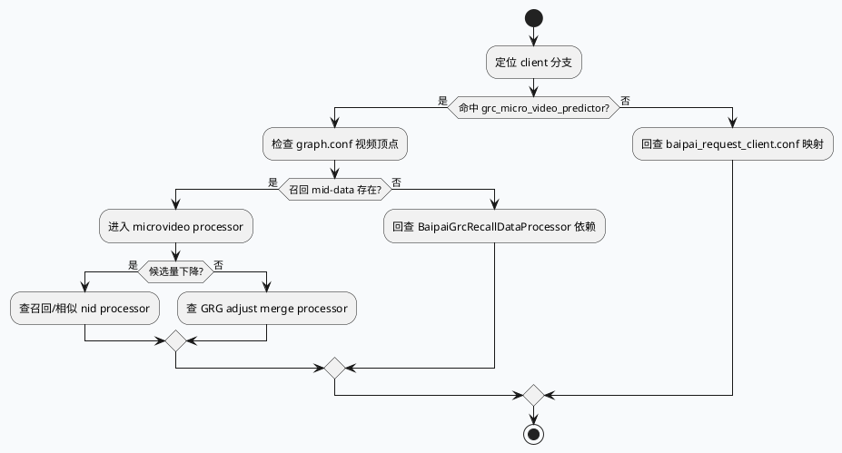

# feeda-pcs MicroVideo 业务链路：从 grc_micro_video_predictor 到召回/融合算子

> 日期：2026-07-31  
> 范围：feeda-pcs 的 MicroVideo client 分支、BaipaiExplorationInterestVideo 顶点、MicroVideo processor 实现  
> 说明：未找到今日 daily-plan，按近期去重策略选择较少覆盖的 feeda-pcs MicroVideo 链路；KU/业务背景需人工补充，本文以代码和配置证据为主。

<style>.biz-arch{font-family:Arial,"Microsoft YaHei",sans-serif;border:1px solid #dbe3ea;background:#f8fafc;padding:18px;border-radius:8px;color:#1f2937}.biz-title{font-size:20px;font-weight:800;margin-bottom:12px;color:#17324d}.biz-flow{display:grid;grid-template-columns:repeat(4,1fr);gap:10px}.biz-node{background:#fff;border:1px solid #d7dee8;border-radius:6px;padding:11px;min-height:96px}.biz-node h3{font-size:14px;margin:0 0 8px 0;color:#0f766e}.biz-node p{font-size:13px;line-height:1.45;margin:0;color:#475569}.biz-band{margin-top:12px;background:#eef6f4;border-left:4px solid #0f766e;padding:10px 12px;font-size:13px;line-height:1.5}</style><div class="biz-arch"><div class="biz-title">架构全景：MicroVideo 请求在 PCS 内的路由面</div><div class="biz-flow"><div class="biz-node"><h3>请求分支</h3><p>baipai_request_client.conf 把 grc_micro_video_predictor 与一组 MicroVideo processor 名称绑定。</p></div><div class="biz-node"><h3>图顶点</h3><p>graph.conf 中 BaipaiExplorationInterestVideoProcessor 依赖召回数据并 emit_result。</p></div><div class="biz-node"><h3>召回扩展</h3><p>microvideo_grg_recall_graph_vec_processor 等处理图向量召回和兴趣相似关系。</p></div><div class="biz-node"><h3>结果融合</h3><p>mv_grg_adjust_result_merge_processor 承接 GRG 调整结果，进入最终候选合并。</p></div></div><div class="biz-band">业务上，MicroVideo 并不是独立绕开 PCS 图引擎，而是在 request-client 配置中选择 client 分支，再落到 graph.conf 的 processor DAG，由具体 microvideo processor 完成召回、预测和融合。</div></div>

## 核心结论

MicroVideo 业务链路的入口不在某个单独的 `main` 分支，而在 `conf/baipai/flows/pcs_protocol/baipai_request_client.conf` 的 client 映射里。配置中同时出现 `grc_video_predictor` 和 `grc_micro_video_predictor`，说明视频类业务按 client 分流，再由 processor 名称映射到图顶点或具体实现。

`graph.conf` 中的 `BaipaiExplorationInterestVideoProcessor` 是一个关键业务顶点：它位于 GRC recall 数据之后，并显式 `emit_result`。这类结构说明兴趣探索视频召回不是末端 response 拼装的小逻辑，而是 PCS DAG 中可观测、可依赖、可开关的图节点。

源码层面，`src/microvideo/processor/` 下的 processor 文件承担 MicroVideo 召回图向量、即时兴趣相似 nid、GRG 调整结果融合等职责。排查线上“召回少、融合异常、预测分支错配”时，先确认 request client 和 graph 顶点是否选中，再进入具体 processor 的业务逻辑。

```plantuml
@startuml
skinparam handwritten false
skinparam backgroundColor #f8fafc
left to right direction
actor "MicroVideo Request" as req
participant "baipai_request_client.conf" as rc
participant "grc_micro_video_predictor" as client
participant "graph.conf" as graph
participant "BaipaiGrcRecallDataProcessor" as recall
participant "BaipaiExplorationInterestVideoProcessor" as interest
participant "microvideo/* processors" as mv
participant "emit_result" as result
req -> rc : resolve client branch
rc -> client : choose MicroVideo predictor path
client -> graph : enter PCS DAG
graph -> recall : build recall mid data
recall -> interest : provide GRC recall data
interest -> mv : run MicroVideo recall / similarity / merge logic
mv --> result : write candidate result
@enduml
```

## 配置与 processor 分布

```infographic
infographic list-grid-badge-card
data
  title MicroVideo PCS 关键节点
  desc 请求分支、图顶点、实现文件的三段定位
  items
    - label grc_micro_video_predictor
      desc request-client 中的 MicroVideo predictor client 分支
      icon mdi/routes
    - label BaipaiExplorationInterestVideoProcessor
      desc graph.conf 中的视频兴趣探索顶点，依赖召回数据并产出结果
      icon mdi/graph-outline
    - label microvideo_grg_recall_graph_vec_processor.cpp
      desc MicroVideo GRG 图向量召回相关实现
      icon mdi/vector-polyline
    - label microvideo_instant_interest_sim_nid_processor.cpp
      desc 即时兴趣相似 nid 相关 processor
      icon mdi/movie-search
    - label mv_grg_adjust_result_merge_processor.cpp
      desc GRG 调整结果融合 processor
      icon mdi/merge
theme
  palette #0f766e #334155 #d97706
```

## 业务排查路径

1. 先查 `baipai_request_client.conf:40-60`，确认请求是否进入 `grc_micro_video_predictor`，以及对应 processor 名称是否和预期一致。
2. 再查 `graph.conf:221-255`，确认 `BaipaiExplorationInterestVideoProcessor` 的上游依赖是否被打开，尤其是 GRC recall mid-data 是否存在。
3. 如果候选量异常，查 `microvideo_grg_recall_graph_vec_processor.cpp` 和 `microvideo_instant_interest_sim_nid_processor.cpp`，判断召回输入、相似度扩展和 nid 过滤是否提前收缩。
4. 如果召回量正常但输出排序或合并异常，查 `mv_grg_adjust_result_merge_processor.cpp`，关注 GRG 调整结果合并、去重和写回字段。



## Pitfalls

<style>.biz-card{font-family:Arial,"Microsoft YaHei",sans-serif;border:1px solid #d9e2ec;background:#fff;padding:16px;border-radius:8px;color:#243447}.biz-card-title{font-size:18px;font-weight:800;margin-bottom:10px;color:#17324d}.biz-card-grid{display:grid;grid-template-columns:1.2fr 1fr;gap:10px}.biz-card-panel{border-top:3px solid #0f766e;background:#f8fafc;border-radius:5px;padding:10px;font-size:13px;line-height:1.55}.biz-card-panel b{display:block;margin-bottom:4px;color:#0f172a}</style><div class="biz-card"><div class="biz-card-title">MicroVideo PCS 业务误判点</div><div class="biz-card-grid"><div class="biz-card-panel"><b>把 predictor client 当成最终实现</b>client 分支只是路由入口，真实业务行为还要继续看 graph.conf 顶点和 src/microvideo/processor。</div><div class="biz-card-panel"><b>只看视频，不分 micro video</b>配置中 video 与 micro_video predictor 分支相邻，排查时要确认命中的是哪一个 client。</div><div class="biz-card-panel"><b>跳过召回 mid-data</b>BaipaiExplorationInterestVideoProcessor 的效果依赖上游 recall 数据；mid-data 缺失会表现成业务 processor 无候选。</div><div class="biz-card-panel"><b>把融合异常归因给召回</b>候选量正常但输出不对时，应转向 mv_grg_adjust_result_merge_processor，而不是继续调召回参数。</div></div></div>

## 调试 Checklist

```infographic
infographic list-column-done-list
data
  title MicroVideo 召回/融合排查 Checklist
  items
    - label client 分支
      desc baipai_request_client.conf 是否命中 grc_micro_video_predictor
      done true
    - label 图顶点
      desc graph.conf 是否包含 BaipaiExplorationInterestVideoProcessor
      done true
    - label 上游依赖
      desc BaipaiGrcRecallDataProcessor 是否产出可用 mid-data
      done true
    - label 召回扩展
      desc microvideo_grg_recall_graph_vec_processor 是否收缩候选
      done true
    - label 即时兴趣
      desc microvideo_instant_interest_sim_nid_processor 是否过滤 nid
      done true
    - label 结果融合
      desc mv_grg_adjust_result_merge_processor 是否改变最终候选集合
      done true
theme
  palette #0f766e #475569 #d97706
```

## 证据来源

- `README.md:1-19`：feeda-mv-pcs / feeda-dc-pcs 服务模块和图引擎入口。
- `conf/baipai/flows/pcs_protocol/baipai_request_client.conf:40-60`：`grc_video_predictor` 与 `grc_micro_video_predictor` client 分支。
- `conf/baipai/flows/pcs_protocol/graph.conf:221-255`：`BaipaiExplorationInterestVideoProcessor` 顶点、依赖和结果产出。
- `src/microvideo/processor/microvideo_grg_recall_graph_vec_processor.cpp:1-160`：MicroVideo GRG 图向量召回 processor。
- `src/microvideo/processor/microvideo_instant_interest_sim_nid_processor.cpp:1-160`：即时兴趣相似 nid processor。
- `src/microvideo/processor/mv_grg_adjust_result_merge_processor.cpp:1-140`：GRG 调整结果融合 processor。
