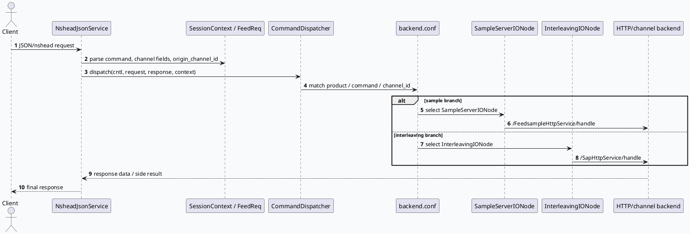

# GRF 前端业务路由：Nshead 请求到 SampleServer 与 Interleaving 后端

> 日期：2026-08-01  
> 范围：GRF gr-front 请求解析、channel/origin_channel_id 归一、CommandDispatcher 分发、SampleServer/Interleaving DAO 后端调用  
> 说明：未找到今日 daily-plan，按近期去重策略选择 GRF 前端业务路由边界；内网 KU 上下文需人工补充，本文以代码库证据为准。

<style>.biz-arch{font-family:Arial,"Microsoft YaHei",sans-serif;border:1px solid #d8e0ea;background:#f8fafc;border-radius:8px;padding:18px;color:#1f2937}.biz-title{font-size:20px;font-weight:800;margin-bottom:12px}.biz-row{display:grid;grid-template-columns:repeat(4,1fr);gap:10px}.biz-col{background:#fff;border:1px solid #d6deea;border-radius:8px;padding:12px}.biz-col h3{font-size:14px;margin:0 0 8px;color:#334155}.biz-box{font-size:13px;line-height:1.45;border-left:4px solid #2d6a4f;background:#fbfdfc;border-radius:6px;padding:8px;margin-top:8px}.biz-box strong{display:block;color:#1f513d;margin-bottom:3px}.biz-band{margin-top:12px;background:#eef5f1;border:1px solid #cfe0d5;border-radius:6px;padding:10px;font-size:13px;line-height:1.55}</style><div class="biz-arch"><div class="biz-title">GRF 请求业务路由全景</div><div class="biz-row"><div class="biz-col"><h3>入口协议</h3><div class="biz-box"><strong>NsheadJsonService</strong>读取 JSON/nshead 请求，填充 FeedReq 和 SessionContext</div></div><div class="biz-col"><h3>字段归一</h3><div class="biz-box"><strong>channel 映射</strong>resou_channel/general_channel 会修正 origin_channel_id，影响后续分流</div></div><div class="biz-col"><h3>调度层</h3><div class="biz-box"><strong>CommandDispatcher</strong>根据 command、product、channel_id 等上下文进入配置树</div></div><div class="biz-col"><h3>后端 DAO</h3><div class="biz-box"><strong>Sample / Interleaving</strong>通过 HttpIO/channel 调用样本服务和穿插后端</div></div></div><div class="biz-band">关键判断：业务路由不是单点 if-else，而是“入口字段归一 + 配置条件命中 + IONode/DAO 后端调用”的组合。排查线上分流问题时，需要同时核对请求字段、backend.conf 条件和 DAO URI/channel。</div></div>

## 核心结论

GRF 前端业务层最容易误判的是 `channel_id` 与 `origin_channel_id` 的关系。`NsheadJsonService` 会根据 `resou_channel`、`general_channel` 等字段修正 `origin_channel_id`，而 `backend.conf` 又按 `product`、`command`、`channel_id` 选择 IONode。也就是说，SampleServer 和 Interleaving 是否被调用，既取决于请求原始字段，也取决于入口层的字段归一与配置条件。



## 业务分流配置视图

```infographic
infographic compare-hierarchy-left-right-circle-node-pill-badge
data
  title GRF 前端两类后端分流
  desc backend.conf 与 tree.conf 共同决定业务请求进入哪个 IONode
  items
    - label SampleServer
      desc 样本/实验信息链路
      value SampleServerIONode
      children
        - label sample_server_tree.conf
          desc 声明 SampleServerIONode 节点
        - label sample_server_dao.cc
          desc 解析 exptinfo 并拼接 sample_sid
        - label URI
          desc /FeedsampleHttpService/handle
    - label Interleaving
      desc feed/channel 穿插链路
      value InterleavingIONode
      children
        - label backend.conf
          desc command=feed/channel 且 channel_id 命中特定集合
        - label interleaving_tree.conf
          desc 声明 InterleavingIONode 节点
        - label URI
          desc /SapHttpService/handle
theme
  palette #2d6a4f #3d5a80 #b86b2d
```

## 代码阅读要点

1. `src/grf/service/nshead_service.cc:80-92` 会根据 `resou_channel` 和 `general_channel` 修改 `origin_channel_id`，这是 PC/Wise 等入口归一的关键。
2. `src/grf/service/nshead_service.cc:102` 调用 `CommandDispatcher::dispatch`，说明业务执行从服务 handler 进入统一调度层。
3. `conf/backend.conf:1-19` 把 `product=0`、`command='feed'/'channel'`、`channel_id` 条件映射到 `InterleavingIONode`、`GRIONode`、`DRRedisGetIONode`、`UnsendSndbGetIONode` 等后端节点。
4. `conf/sample_server_tree.conf:1-4` 声明 `SampleServerIONode`，是样本服务链路的树节点入口。
5. `src/grf/dao/sample_server_dao.cc:57-66` 从后端响应 `exptinfo` 中提取实验 id 并拼接 `sample_sid`，影响后续实验/样本标识。
6. `src/grf/dao/interleaving_dao.cc:80-105` 构造 `/SapHttpService/handle` URI 并发起后端请求，是穿插服务的外部调用边界。

## 请求字段与配置命中链

```infographic
infographic sequence-snake-steps-simple
data
  title 一次 GRF 业务请求的分流链路
  items
    - label 入口解析
      desc NsheadJsonService 解析 JSON/nshead 请求
      icon mdi/file-code-outline
    - label 字段归一
      desc resou_channel/general_channel 影响 origin_channel_id
      icon mdi/tune-variant
    - label 调度分发
      desc CommandDispatcher 读取上下文并进入配置树
      icon mdi/source-branch
    - label 条件命中
      desc backend.conf 使用 product/command/channel_id 选择 IONode
      icon mdi/filter-check
    - label 后端调用
      desc DAO 通过 HttpIO/channel 调用 Sample 或 Interleaving 服务
      icon mdi/server-network
    - label 响应合并
      desc 后端结果回填上下文并影响最终 response
      icon mdi/call-merge
theme
  palette #2d6a4f #3d5a80 #d97706
```

## Pitfalls 与调试卡片

<style>.biz-card{font-family:Arial,"Microsoft YaHei",sans-serif;background:#fbfbf8;border:1px solid #ddd8ce;border-radius:8px;padding:16px;color:#2f3437}.biz-card h3{margin:0 0 8px 0;font-size:18px}.biz-card-grid{display:grid;grid-template-columns:.95fr 1.05fr;gap:12px}.biz-card-panel{border-top:4px solid #2d6a4f;background:#fff;padding:12px;border-radius:6px;font-size:13px;line-height:1.6}.biz-card-panel strong{display:block;margin-bottom:4px;color:#1f513d}</style><div class="biz-card"><h3>调试判断：先看字段，再看树，再看 DAO</h3><div class="biz-card-grid"><div class="biz-card-panel"><strong>常见误区</strong>只看请求里的 channel_id 会漏掉入口层对 origin_channel_id 的修正，也会忽略 backend.conf 中 command/product 条件的二次过滤。</div><div class="biz-card-panel"><strong>排查顺序</strong>先抓入口 JSON 字段，再确认归一后的 SessionContext，随后检查 backend.conf 是否命中预期 IONode，最后看 DAO 的 URI、超时和后端响应。</div></div></div>

```infographic
infographic list-column-done-list
data
  title GRF 业务路由调试 checklist
  items
    - label 请求字段
      desc command、product、channel_id、resou_channel、general_channel 是否符合预期
      done true
    - label 归一结果
      desc origin_channel_id 是否被入口层改写
      done true
    - label 配置条件
      desc backend.conf 是否命中目标 IONode
      done true
    - label 树节点存在
      desc sample_server_tree / interleaving_tree 是否声明对应 IONode
      done true
    - label DAO URI
      desc Sample 使用 /FeedsampleHttpService/handle，Interleaving 使用 /SapHttpService/handle
      done true
    - label 响应字段
      desc sample_sid、穿插结果或错误码是否被正确回填
      done true
theme
  palette #2d6a4f #3d5a80 #d97706
```

## 证据来源

- `src/grf/service/nshead_service.cc:80-92`：入口字段修正 `origin_channel_id`。
- `src/grf/service/nshead_service.cc:102`：进入 `CommandDispatcher::dispatch`。
- `conf/backend.conf:1-19`：按 product / command / channel_id 选择后端 IONode。
- `conf/sample_server_tree.conf:1-4`：声明 `SampleServerIONode`。
- `src/grf/dao/sample_server_dao.cc:57-66`：解析 `exptinfo` 并生成 `sample_sid`。
- `src/grf/dao/interleaving_dao.cc:80-105`：构造 `/SapHttpService/handle` 后端调用。

## 待人工补充

- 今日 daily-plan 文件缺失，主题来自本地代码去重。
- KU/内网业务背景未检索到可用输入，需人工补充调用方、实验含义、Interleaving 策略目标和线上指标。
