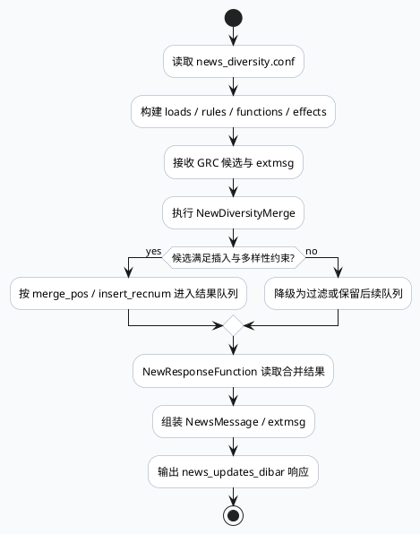

# MV-GRG news_updates_dibar：NewDiversityMerge 到 ResponseFunction 的业务响应边界

> 运行说明：2026-08-07 未发现 daily-plan 文件，本篇按附近未覆盖主题 fallback 生成。当前 cron 环境中 `ku` 命令不可用，KU/业务背景需人工补充；本文结论基于 MV-GRG 代码与配置证据。

<style>.arch-grg-response{font-family:Inter,Arial,sans-serif;background:#f8fafc;border:1px solid #d8e2ef;border-radius:8px;padding:16px;color:#1f2937}.arch-grg-response .title{font-size:20px;font-weight:800;margin-bottom:12px}.arch-grg-response .lane{background:#fff;border:1px solid #cbd5e1;border-radius:8px;padding:10px;margin-bottom:10px}.arch-grg-response h3{font-size:14px;margin:0 0 8px;color:#334155}.arch-grg-response .grid{display:grid;grid-template-columns:repeat(5,minmax(0,1fr));gap:8px}.arch-grg-response .box{border-radius:6px;padding:9px;border:1px solid #dbe4ef;background:#f8fafc;font-size:12px;line-height:1.45}.arch-grg-response .box b{display:block;font-size:13px;color:#0f172a;margin-bottom:3px}.arch-grg-response .merge{background:#ecfdf5;border-color:#86efac}.arch-grg-response .resp{background:#eef6ff;border-color:#93c5fd}.arch-grg-response .warn{background:#fff7ed;border-color:#fdba74}.arch-grg-response .arrow{text-align:center;color:#64748b;font-weight:700;margin:-2px 0 8px}</style><div class="arch-grg-response"><div class="title">架构全景：业务队列、DiversityMerge、响应函数</div><div class="lane"><h3>配置入口：news_diversity.conf</h3><div class="grid"><div class="box"><b>loads</b>加载候选与上下文</div><div class="box"><b>rules</b>规则约束与过滤</div><div class="box merge"><b>functions</b>NewDiversityMerge 等执行函数</div><div class="box"><b>effects</b>写回图数据或输出状态</div><div class="box warn"><b>threshold</b>insert_recnum/merge_pos 控制插入节奏</div></div></div><div class="arrow">↓</div><div class="lane"><h3>运行时业务链路</h3><div class="grid"><div class="box"><b>GRC response</b>上游携带候选与 extmsg</div><div class="box merge"><b>NewDiversityMerge</b>按队列与多样性策略重排</div><div class="box"><b>merge_pos</b>控制候选进入结果位置</div><div class="box resp"><b>NewResponseFunction</b>组装最终响应</div><div class="box resp"><b>NewsMessage</b>输出给端上/下游消费</div></div></div></div>

## 关键判断

`news_updates_dibar` 的业务响应边界不在单个召回函数里，而在 `news_diversity.conf` 描述的 ExecEngine 队列和 `response_function.cpp` 的最终组装之间。GRC 输出的候选和扩展字段进入 GRG 后，先经过 NewDiversityMerge 这类函数做多队列合并与位置控制，再由 NewResponseFunction 把结果落成业务响应。

## 核心流程



## 配置结构信息图

```infographic
infographic sequence-snake-steps-simple
data
  title news_updates_dibar 响应链路
  desc 配置阶段决定运行时的队列、函数和输出边界
  items
    - label loads
      desc 准备候选、上下文和上游响应字段
      icon mdi/download-network
    - label rules
      desc 过滤、约束、业务实验条件
      icon mdi/filter-check
    - label functions
      desc NewDiversityMerge 等核心执行函数
      icon mdi/source-branch
    - label effects
      desc 写回合并结果与响应字段
      icon mdi/export-variant
    - label response
      desc NewResponseFunction 形成最终业务响应
      icon mdi/message-text
theme
  palette #0f766e #2563eb #f97316
```

## 证据解读

`conf/plugins/exec_engine/news_diversity.conf` 中出现 `loads`、`rules`、`functions`、`effects` 等分段，是业务链路配置化的直接证据。它说明 GRG 的业务行为不是固定函数串，而是由 ExecEngine 配置把加载、规则、函数、效果串成闭环。

`conf/plugins/exec_engine/news_diversity.conf` 中的 `NewDiversityMerge`、`insert_recnum_threshold`、`merge_pos` 是多队列合并策略的关键控制点。排查“为什么某类内容没插入/插入位置异常”时，应优先确认这些配置和运行时计数，而不是只追上游召回。

`src/process/response_function.cpp` 中的 `NewResponseFunction` 是最终响应组装边界。它消费 merge 后的候选与扩展字段，承担把内部结果转换为 `NewsMessage`/响应结构的职责；如果 `extmsg` 解析或字段落点不一致，问题会表现为召回有结果但端上响应字段缺失。

<style>.card-grg-response{font-family:Inter,Arial,sans-serif;background:#fff;border:1px solid #d8e2ef;border-radius:8px;padding:16px;margin:14px 0;color:#1f2937}.card-grg-response .meta{font-size:12px;font-weight:800;color:#0f766e;text-transform:uppercase;letter-spacing:.04em}.card-grg-response .title{font-size:22px;font-weight:850;margin:5px 0 10px}.card-grg-response .grid{display:grid;grid-template-columns:1fr 1fr;gap:12px}.card-grg-response .panel{background:#f8fafc;border-top:3px solid #0f766e;padding:10px;border-radius:6px;font-size:13px;line-height:1.55}.card-grg-response b{color:#0f172a}</style><div class="card-grg-response"><div class="meta">Pitfalls</div><div class="title">不要把响应问题误判为召回问题</div><div class="grid"><div class="panel"><b>业务边界：</b>GRC 候选进入 GRG 后还会被 NewDiversityMerge、插入阈值、位置策略和 response function 改写。召回有量不等于最终响应有量。</div><div class="panel"><b>字段边界：</b>`extmsg`、`NewsMessage` 和 merge 后结果结构必须一起看。只检查一个字段，容易漏掉 Parse/Serialize 或响应落点不一致。</div></div></div>

```infographic
infographic list-grid-badge-card
data
  title 调试 checklist
  desc news_updates_dibar 响应异常的最短排查路径
  items
    - label 配置是否生效
      desc 确认 news_diversity.conf 的 functions/effects 被加载
      icon mdi/file-check
    - label 合并是否触发
      desc 观察 NewDiversityMerge 是否执行及候选规模
      icon mdi/source-merge
    - label 插入位置是否受限
      desc 检查 merge_pos 与 insert_recnum_threshold
      icon mdi/format-list-numbered
    - label extmsg 是否可解析
      desc 解析失败会导致响应字段缺失或降级
      icon mdi/code-json
    - label ResponseFunction 输出
      desc 对齐 NewsMessage 字段和下游协议期望
      icon mdi/message-processing
theme
  palette #0f766e #2563eb #f97316
```

## 证据来源

- `conf/plugins/exec_engine/news_diversity.conf`：`loads`、`rules`、`functions`、`effects` 配置化执行结构。
- `conf/plugins/exec_engine/news_diversity.conf`：`NewDiversityMerge`、`insert_recnum_threshold`、`merge_pos` 多队列合并与插入控制。
- `src/process/response_function.cpp`：`NewResponseFunction` 最终响应组装边界。
- `src/process/response_function.cpp`：`extmsg`/`NewsMessage` 响应字段处理入口。
- `src/processor/video_launch/response_for_grg.cpp`：上游 GRC 到 GRG 的响应契约来源。
