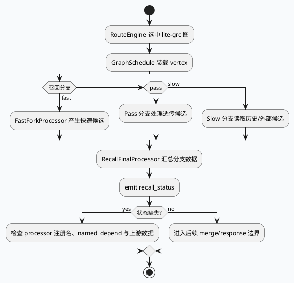

# lite-grc 召回输出边界：fast/pass/slow 分支与业务可观测信号

> 2026-08-11 运行说明：未发现当日 daily-plan，按历史未覆盖主题 fallback 到 lite-grc 召回输出边界。KU/业务背景需人工补充；本文只使用本地代码与配置证据。

<style>.arch{font-family:Inter,Arial,sans-serif;border:1px solid #d8dee9;border-radius:8px;background:#f8fafc;padding:18px;margin:12px 0}.arch h3{margin:0 0 12px;color:#1f2937}.swim{display:grid;grid-template-columns:repeat(4,1fr);gap:10px}.lane{background:#fff;border:1px solid #cbd5e1;border-radius:6px;padding:10px}.lane b{display:block;margin-bottom:8px;color:#334155}.box{background:#eef4f8;border-left:4px solid #2d6a4f;border-radius:4px;padding:8px;margin:6px 0;font-size:13px}.note{font-size:12px;color:#64748b;margin-top:10px}.infocard{font-family:Inter,Arial,sans-serif;background:#fff;border:1px solid #d6d3d1;border-radius:8px;padding:16px;margin:16px 0;color:#292524}.infocard .k{font-size:12px;font-weight:700;color:#2d6a4f;text-transform:uppercase}.infocard h3{margin:6px 0 10px;font-size:20px}.infocard ul{margin:8px 0 0 18px;padding:0}.infocard li{margin:6px 0}</style>
<div class="arch"><h3>架构全景：业务召回输出的四段边界</h3><div class="swim"><div class="lane"><b>请求/场景</b><div class="box">RouteEngine 选择图</div><div class="box">GraphSchedule 承接上下文</div></div><div class="lane"><b>分支召回</b><div class="box">fast 图：快速候选</div><div class="box">pass 图：透传/补召候选</div><div class="box">slow 图：历史/外部候选</div></div><div class="lane"><b>结果收敛</b><div class="box">RecallFinalProcessor</div><div class="box">merge data named depend</div></div><div class="lane"><b>可观测信号</b><div class="box">recall_status</div><div class="box">upload_funnel_processor</div></div></div><div class="note">业务边界不是某个具体队列名称，而是分支 final node 输出到统一 `recall_status` 前后的可观测契约。</div></div>

## 核心结论

lite-grc 的业务召回输出边界可以按 fast/pass/slow 三类图来理解：每类图内部可以有不同候选源、不同 fork processor 和不同依赖数据，但分支末端都要回到 final processor 与 `recall_status`。因此业务排查的关键不是先问“哪个召回源坏了”，而是先定位“哪条分支没有产生可观测完成信号”。

`recall_fast_graph.conf:721-729` 展示了典型末端形态：`SlowForkFinalNode` 绑定 `RecallFinalProcessor`，声明多个 `@named_depend`，并最终 `emit: recall_status`。这类配置把业务候选、历史特征和状态上报压到同一个边界点，适合做灰度验证与漏斗排查。



## 分支与信号信息图

```infographic
infographic compare-hierarchy-left-right-circle-node-pill-badge
data
  title fast/pass/slow 输出边界对比
  desc 三类分支的业务输入不同，但最终都要收敛到 RecallFinalProcessor 和 recall_status
  items
    - label Fast
      desc 快速候选、低延迟路径，重点看 fork 节点是否产出 doc channel
      value recall_status
      icon mdi/flash
    - label Pass
      desc 透传或补召路径，重点看配置是否接入 final processor
      value recall_status
      icon mdi/check-network
    - label Slow
      desc 历史特征、外部候选或成本更高路径，重点看 named_depend 是否齐全
      value recall_status
      icon mdi/timer-outline
theme
  palette #2d6a4f #3d5a80 #b7791f
```

## 业务排查读法

1. 先看入口是否进入 lite-grc 图：`main.cc:77-80` 的 ExecEngine 与 RouteEngine 初始化是运行前提。
2. 再看 GraphSchedule 是否加载对应 vertex：`graph_schedule.conf` 定义 processor 与依赖关系，决定 C++ processor 是否会被图调度。
3. 对分支 final node 做收敛检查：`recall_fast_graph.conf:721-729` 同时包含 `RecallFinalProcessor`、`upload_funnel_processor`、多个 `@named_depend` 和 `emit: recall_status`，是定位业务输出边界的样板。
4. 如果业务侧看到召回为空，不要只查召回源；先确认 `recall_status` 是否被对应分支发出，再回溯缺失的 named depend 或 fork 节点。

<div class="infocard"><div class="k">Pitfalls</div><h3>业务召回为空时最容易查错方向</h3><ul><li>候选源没问题但 final node 没 emit，业务上仍表现为召回链路未完成。</li><li>多个分支共用 `recall_status`，监控聚合后可能掩盖具体是哪条分支异常。</li><li>`upload_funnel_processor` 可以帮助定位漏斗阶段，但不能替代对 `@named_depend` 的逐项核对。</li></ul></div>

```infographic
infographic list-grid-badge-card
data
  title 业务调试 Checklist
  desc 从可观测状态往上游依赖反查，避免直接陷入候选源细节
  items
    - label Step 1
      desc 确认请求命中 lite-grc RouteEngine 图
      icon mdi/routes
    - label Step 2
      desc 检查目标分支 final node 是否 emit recall_status
      icon mdi/access-point-check
    - label Step 3
      desc 核对 RecallFinalProcessor 的 named_depend 是否都有上游产出
      icon mdi/source-branch-check
    - label Step 4
      desc 用 upload_funnel_processor 定位漏斗断点
      icon mdi/filter-check
theme
  palette #2d6a4f #3d5a80 #b7791f
```

## 证据来源

- `src/main.cc:77-80`：ExecEngineInitializer 与 RouteEngine 初始化。
- `src/graph_schedule/recall_processor.cpp:37-64`：GraphSchedule processor 注册与状态声明。
- `src/graph_schedule/recall_data_processor.cpp:37-59`：`recall_status` 输出模式。
- `src/recall_framework/processor/recall_final_processor.cpp`：召回分支 final processor。
- `conf/plugins/graph/graph_schedule.conf`：顶层图调度配置。
- `conf/plugins/graph/new_recall_framework/recall_fast_graph.conf:721-729`：final node 依赖、漏斗 processor 与 `emit: recall_status`。
- `conf/plugins/graph/new_recall_framework/recall_pass_graph.conf`：pass 分支配置。
- `conf/plugins/graph/new_recall_framework/recall_slow_graph.conf`：slow 分支配置。