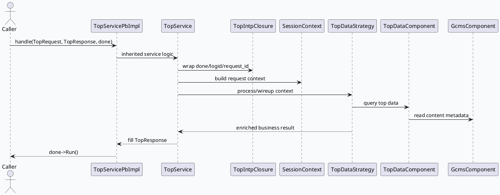

# top-intp 内容生态业务边界：protobuf 入口、SessionContext 与 GCMS 数据装配

> 2026-08-17 运行说明：未发现当日 daily-plan，按历史未覆盖主题 fallback 到 top-intp 的内容生态解释服务链路。KU/业务背景需人工补充；本文只使用本地代码与配置证据。

<style>.arch{font-family:Inter,Arial,sans-serif;border:1px solid #d8dee9;border-radius:8px;background:#f8fafc;padding:18px;margin:12px 0}.arch h3{margin:0 0 12px;color:#1f2937}.swim{display:grid;grid-template-columns:repeat(4,1fr);gap:10px}.lane{background:#fff;border:1px solid #cbd5e1;border-radius:6px;padding:10px}.lane b{display:block;margin-bottom:8px;color:#334155}.box{background:#eef4f8;border-left:4px solid #2d6a4f;margin:7px 0;padding:8px;border-radius:4px;color:#1f2937}.arch-note{font-size:12px;color:#64748b;margin-top:10px}</style><div class="arch"><h3>业务全景：请求解释、上下文转换与内容数据读取</h3><div class="swim"><div class="lane"><b>RPC 入口</b><div class="box">TopServicePbImpl::handle</div><div class="box">feed_gr.pb.h / top.pb.h</div></div><div class="lane"><b>协议转换</b><div class="box">TopService</div><div class="box">pb_to_json + rapidjson</div><div class="box">TopIntpClosure</div></div><div class="lane"><b>业务上下文</b><div class="box">SessionContext</div><div class="box">TopDataStrategy</div><div class="box">TopDataComponent</div></div><div class="lane"><b>外部数据</b><div class="box">GcmsComponent</div><div class="box">content_eco host/path</div><div class="box">SNDB/Redis plugins</div></div></div><div class="arch-note">核心结论：业务链路不是复杂 processor DAG，而是一个轻量解释服务：protobuf 请求进入后转成上下文和 JSON，再通过 TopDataComponent/GcmsComponent 获取内容侧数据。</div></div>

## 请求到响应边界

`TopServicePbImpl` 继承自 `topintp::TopService`，公开 `handle(google::protobuf::RpcController*, const TopRequest*, TopResponse*, google::protobuf::Closure*)`。`TopService` 内部定义 `TopIntpClosure` 管理 `done` 回调、logid、start time 和 request id；头文件依赖 `pb_to_json`、`rapidjson`、`SessionContext`、`TopDataComponent`，说明业务处理会在 protobuf、JSON 和请求上下文之间转换。



## 业务数据装配结构

`TopDataStrategy` 暴露 `initialize()`、`wireup(ApplicationContext&)` 和处理型接口，依赖 Babylon `ApplicationContext`、`TopDataComponent`、`SessionContext` 与转换工具；这说明它是业务策略层，而不是 RPC 基础设施。`TopDataComponent` 依赖 `GcmsComponent` 与 `GcmsData`，对应内容元数据读取和缓存装配。`conf/gflags.conf.template` 中 `content_eco_host`、`content_eco_path`、`content_eco_channel_name` 三个参数给出了内容生态接口边界。

```infographic
infographic compare-hierarchy-left-right-circle-node-pill-badge
data
  title top-intp 业务层分工
  desc 左侧是协议/上下文，右侧是内容数据访问
  items
    - label 请求解释层
      desc TopService + TopIntpClosure
      value 1
      children
        - label TopRequest/TopResponse
          desc protobuf 请求响应对象
        - label pb_to_json/rapidjson
          desc JSON 转换与可读解释
        - label SessionContext
          desc logid、request_id、运行时上下文
    - label 数据装配层
      desc TopDataStrategy + TopDataComponent
      value 2
      children
        - label ApplicationContext
          desc Babylon 依赖注入/装配入口
        - label GcmsComponent
          desc 内容元数据读取组件
        - label content_eco channel
          desc host/path/channel 配置边界
```

## 配置触发点

内容生态接口由 gflags 模板直接给出：`content_eco_host` 指向内容服务主机，`content_eco_path` 指向 `/contentcms/api/interventiondata`，`content_eco_channel_name` 标记 brpc channel 名称。Redis 插件配置包含 timeout、BNS、负载均衡和重试次数；SNDB 与 GCMS 插件配置在 `common_component/` 下单独维护，说明业务数据读取可能同时依赖 HTTP/RPC channel 与存储插件。

```infographic
infographic sequence-snake-steps-simple
data
  title 内容数据读取配置链
  desc 从业务请求到外部内容数据源的最短可观测链路
  items
    - label TopRequest
      desc RPC 输入，携带待解释内容或请求上下文
      icon mdi/message-text-outline
    - label SessionContext
      desc 统一 logid/request_id 与运行时状态
      icon mdi/card-account-details-outline
    - label TopDataStrategy
      desc 决定读取哪些 top/content 数据
      icon mdi/source-branch
    - label TopDataComponent
      desc 管理 channel、缓存、GCMS 数据组件
      icon mdi/database-cog
    - label content_eco / GCMS / SNDB
      desc 外部内容生态和存储插件边界
      icon mdi/cloud-sync-outline
```

## Pitfalls

<style>.pit{font-family:Inter,Arial,sans-serif;background:#f4f8f6;border:1px solid #d6e5dc;border-radius:8px;padding:16px;margin:12px 0;color:#243041}.pit-title{font-size:18px;font-weight:800;margin-bottom:8px;color:#1f3d31}.pit-grid{display:grid;grid-template-columns:1fr 1fr;gap:12px}.pit-card{background:#fff;border-top:4px solid #2d6a4f;border-radius:6px;padding:10px}.pit-card b{display:block;margin-bottom:6px;color:#1f2937}.pit-card span{font-size:13px;line-height:1.55;color:#475569}</style><div class="pit"><div class="pit-title">业务排查注意点</div><div class="pit-grid"><div class="pit-card"><b>不要把它误判为 DAG 处理链</b><span>top-intp 更像内容解释服务，证据集中在服务头文件、SessionContext、TopDataStrategy 和 TopDataComponent，而不是 processor 目录。</span></div><div class="pit-card"><b>协议转换可能遮蔽真实字段</b><span>TopService 同时依赖 protobuf 与 rapidjson/pb_to_json。响应异常时要同时看 TopResponse 填充和 JSON 转换。</span></div><div class="pit-card"><b>内容生态配置是业务关键路径</b><span>host/path/channel 配置不对时，服务启动可能正常，但解释结果会缺少内容侧数据。</span></div><div class="pit-card"><b>KU 背景缺失需人工补齐</b><span>本次未使用内网文档检索，业务语义只能从代码和配置推断，不能替代产品口径。</span></div></div></div>

```infographic
infographic list-column-done-list
data
  title 业务链路调试 checklist
  items
    - label 检查 TopServicePbImpl::handle 是否收到 TopRequest
      desc 先确认 brpc 入口和 done 回调正常
      done true
    - label 对齐 protobuf 字段与 JSON 转换结果
      desc pb_to_json/rapidjson 可能影响可观测文本
      done true
    - label 追踪 SessionContext 中 logid/request_id
      desc 贯穿日志、上下文和异步 closure
      done true
    - label 验证 TopDataStrategy 是否完成 wireup
      desc Babylon ApplicationContext 绑定失败会影响业务策略
      done true
    - label 核对 content_eco 与 GCMS/SNDB 插件配置
      desc 服务可启动不代表内容数据可读取
      done true
```

## 证据来源

- `src/service/top_service_pb.h:21-55`：TopServicePbImpl 的 protobuf RPC handle 入口。
- `src/service/top_service.h:23-94`：TopIntpClosure、TopService 依赖 pb_to_json、rapidjson、SessionContext、TopDataComponent。
- `src/strategy/top_data_strategy.h:19-85`：TopDataStrategy 的 initialize/wireup/业务处理接口。
- `src/component/top_data_component.h:24-120`：TopDataComponent 与 GCMS/Session/Channel 数据依赖。
- `src/component/gcms_component.h:20-120`：GCMS 内容元数据组件边界。
- `conf/gflags.conf.template:5-7`：content_eco host/path/channel 配置。
- `conf/common_component/gcms_plugin_pb.conf:1-120`：GCMS 插件配置入口。
- `conf/common_component/sndb_dalton_plugin.conf:1-120`：SNDB/Dalton 插件配置入口。
