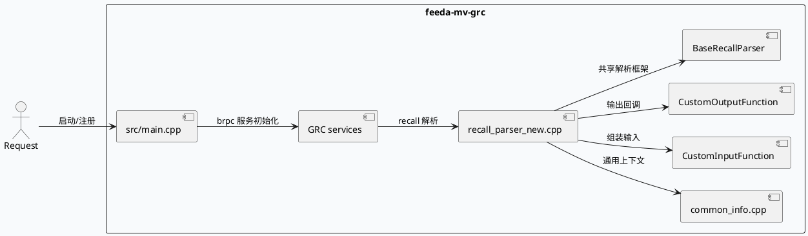
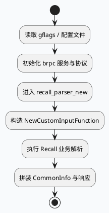

# feeda-mv-grc 请求入口、解析器与响应边界

> 运行说明：2026-08-24 未发现 daily-plan 文件，按历史未覆盖主题 fallback 到 `feeda-mv-grc` 的请求入口与业务解析/响应边界。当前 cron 环境未验证 KU 可用性，KU/业务背景需人工补充；本文只使用本地代码与配置证据。

<div class="arch-wrapper" style="display:flex;gap:12px;align-items:stretch;background:#f8fafc;border:1px solid #d8e2ef;border-radius:8px;padding:14px;color:#1f2937;font-family:Inter,Arial,sans-serif;">
  <div class="arch-main" style="flex:1;min-width:0;">
    <div style="font-size:20px;font-weight:800;margin:0 0 10px 0;">业务请求链路全景</div>
    <div class="arch-layer application" style="background:#fff;border:1px solid #cbd5e1;border-radius:8px;padding:10px;margin-bottom:10px;">
      <b style="display:block;margin-bottom:6px;color:#334155;">入口层</b>
      <div style="display:grid;grid-template-columns:repeat(3,minmax(0,1fr));gap:8px;">
        <div style="background:#eef4f8;border-left:4px solid #3d5a80;padding:8px;border-radius:6px;">`src/main.cpp` 负责 gflags、brpc、服务对象与协议初始化。</div>
        <div style="background:#eef4f8;border-left:4px solid #3d5a80;padding:8px;border-radius:6px;">`src/parser/recall_parser_new.cpp` 处理 recall 输入/输出函数。</div>
        <div style="background:#eef4f8;border-left:4px solid #3d5a80;padding:8px;border-radius:6px;">`src/processor/common_info.cpp` 汇总通用请求上下文。</div>
      </div>
    </div>
    <div class="arch-layer data" style="background:#fff;border:1px solid #cbd5e1;border-radius:8px;padding:10px;margin-bottom:10px;">
      <b style="display:block;margin-bottom:6px;color:#334155;">业务对象</b>
      <div style="display:grid;grid-template-columns:repeat(2,minmax(0,1fr));gap:8px;">
        <div style="background:#f3f8f4;border-left:4px solid #2d6a4f;padding:8px;border-radius:6px;">`CustomInputFunction` / `CustomOutputFunction` 与 `BaseRecallParser` 协同。</div>
        <div style="background:#f3f8f4;border-left:4px solid #2d6a4f;padding:8px;border-radius:6px;">`gflags.conf`、`sid.conf`、`sid_new.conf` 定义运行参数与字典/策略侧配置。</div>
      </div>
    </div>
  </div>
  <div class="arch-sidebar" style="width:260px;min-width:260px;">
    <div class="arch-layer infra" style="background:#fff;border:1px solid #cbd5e1;border-radius:8px;padding:10px;height:100%;">
      <b style="display:block;margin-bottom:6px;color:#334155;">服务形态</b>
      <div style="font-size:13px;line-height:1.55;color:#334155;">`README.md` 只给出“图引擎-静态图/动态图可视化”入口，说明这是小视频业务 grc 层模块。</div>
      <div style="font-size:13px;line-height:1.55;color:#334155;margin-top:8px;">业务链路更偏请求准备、解析与响应拼装，而不是单一计算核。</div>
    </div>
  </div>
</div>

## 核心链路





```infographic
sequence-ascending-steps
  data
    title 请求到响应的四步
    desc 入口初始化、解析准备、业务装配、响应输出
    items
      - label 服务启动
        desc main.cpp 完成 gflags、brpc 与 service 注册
      - label 请求解析
        desc recall_parser_new.cpp 处理输入函数
      - label 通用上下文
        desc common_info.cpp 汇总业务元信息
      - label 响应输出
        desc CustomOutputFunction 将结果写回调用方
```

## 结构信息图

```infographic
compare-hierarchy-left-right-circle-node-pill-badge
  data
    title 入口与配置的职责边界
    items
      - label src/main.cpp
        desc 服务启动、协议与注册
      - label src/parser/recall_parser_new.cpp
        desc recall 输入/输出解析
      - label src/processor/common_info.cpp
        desc 通用信息汇聚
      - label conf/gflags.conf
        desc 运行参数
      - label conf/sid.conf
        desc sid 字典/策略配置
      - label conf/sid_new.conf
        desc 新字典分支
```

## 关键证据

- `src/main.cpp:16-26`：`gflags`、`grc_service.h`、`grc_http_service.h`、`ReusableRpcProtocol` 等服务启动依赖。
- `src/parser/recall_parser_new.cpp:1-19`：`BaseRecallParser`、`CustomInputFunction`、`CustomOutputFunction`、`NewCustomInputFunction`、`NewCustomOutputFunction` 的解析链入口。
- `src/processor/common_info.cpp:1-20`：通用业务信息与请求/响应字段的归并点。
- `README.md:1-5`：小视频业务 grc 层模块定位，以及静态图/动态图可视化入口。
- `conf/gflags.conf`：服务运行参数。
- `conf/sid.conf`、`conf/sid_new.conf`：sid 配置与新旧字典入口。
- `conf/plugins/strategies/sid_strategies/short_micro_default.conf`：业务策略样例。

## Pitfalls

<div style="display:grid;grid-template-columns:repeat(2,minmax(0,1fr));gap:10px;margin-top:8px;">
  <div style="background:#fff;border:1px solid #d8e2ef;border-left:4px solid #b8432f;border-radius:8px;padding:12px;">
    <div style="font-weight:700;color:#1f2937;margin-bottom:6px;">入口文件不是业务核心</div>
    <div style="color:#334155;line-height:1.55;">`main.cpp` 只负责服务装配，真正的业务语义在 parser 和 processor 里。</div>
  </div>
  <div style="background:#fff;border:1px solid #d8e2ef;border-left:4px solid #b8432f;border-radius:8px;padding:12px;">
    <div style="font-weight:700;color:#1f2937;margin-bottom:6px;">sid 配置分支要和解析逻辑同步</div>
    <div style="color:#334155;line-height:1.55;">`sid.conf` 与 `sid_new.conf` 体现的是配置分支，不是简单重复文件；解析器必须按对应字典语义解释。</div>
  </div>
</div>

## 调试 Checklist

```infographic
list-column-done-list
  data
    title 调试 checklist
    items
      - label 先确认 main.cpp 能完成服务启动
        done true
      - label 再确认 recall_parser_new.cpp 的输入输出函数被注册
        done true
      - label 检查 common_info.cpp 是否完整写回通用字段
        done true
      - label 核对 gflags.conf 是否与启动参数一致
        done true
      - label 对照 sid.conf / sid_new.conf 排查策略分支
        done true
```

## 证据来源

- `src/main.cpp`
- `src/parser/recall_parser_new.cpp`
- `src/processor/common_info.cpp`
- `README.md`
- `conf/gflags.conf`
- `conf/sid.conf`
- `conf/sid_new.conf`
- `conf/plugins/strategies/sid_strategies/short_micro_default.conf`
