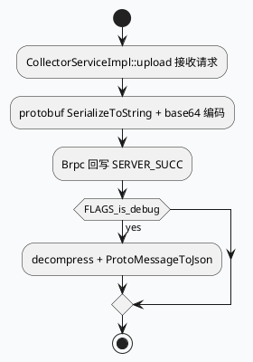
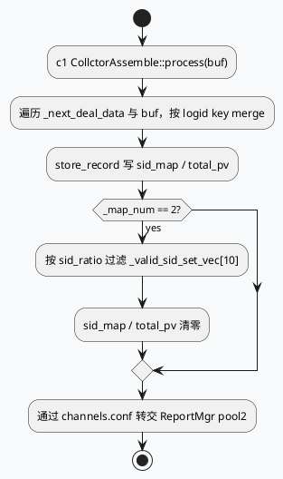
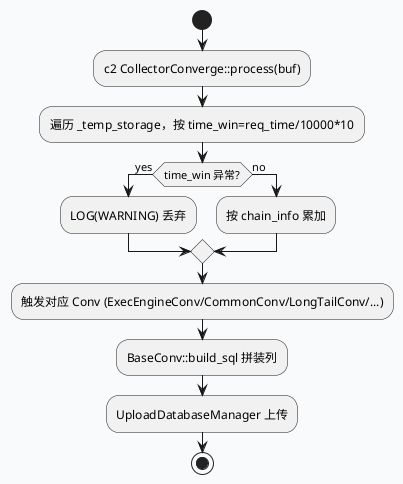

# dapper-collector 业务聚合：CollctorAssemble → CollectorConverge → Conv/ExecEngineConv 写入闭环

> 运行说明：2026-08-26 未发现 `daily-plan-20260826.json` 文件，按历史未覆盖主题 fallback 到 `dapper-collector` 的业务聚合流：c1 拼装、c2 时间窗收敛、Conv/ExecEngineConv 落库。当前 cron 环境未验证 KU 可用性，KU/业务背景需人工补充；本文只使用本地代码与配置证据。

<div class="arch-wrapper" style="display:flex;gap:12px;align-items:stretch;background:#f8fafc;border:1px solid #d8e2ef;border-radius:8px;padding:14px;color:#1f2937;font-family:Inter,Arial,sans-serif;">
  <div class="arch-main" style="flex:1;min-width:0;">
    <div style="font-size:20px;font-weight:800;margin:0 0 10px 0;">业务聚合流水线全景</div>
    <div class="arch-layer application" style="background:#fff;border:1px solid #cbd5e1;border-radius:8px;padding:10px;margin-bottom:10px;">
      <b style="display:block;margin-bottom:6px;color:#334155;">入口与缓冲池</b>
      <div style="display:grid;grid-template-columns:repeat(3,minmax(0,1fr));gap:8px;">
        <div style="background:#eef4f8;border-left:4px solid #3d5a80;padding:8px;border-radius:6px;">`service/collector_v2.cc:70-85`：把 `CollctorAssemble::process` 与 `CollectorConverge::process` 注册到 `ReportMgr` 缓冲池。</div>
        <div style="background:#eef4f8;border-left:4px solid #3d5a80;padding:8px;border-radius:6px;">`collector_v2.cc` 用 `FLAGS_buffer_pool1_size / buffer_pool2_size` 决定 c1/c2 池大小，`FLAGS_buffer_max_count` 决定容量。</div>
        <div style="background:#eef4f8;border-left:4px solid #3d5a80;padding:8px;border-radius:6px;">`collector_assemble.cpp:55-58`：`process()` 进入 `c1` 处理，按 logid/sid 维护 `_sid_map / _total_pv` 计数。</div>
      </div>
    </div>
    <div class="arch-layer ai" style="background:#fff;border:1px solid #cbd5e1;border-radius:8px;padding:10px;margin-bottom:10px;">
      <b style="display:block;margin-bottom:6px;color:#334155;">收敛与采样</b>
      <div style="display:grid;grid-template-columns:repeat(2,minmax(0,1fr));gap:8px;">
        <div style="background:#eef4f8;border-left:4px solid #5b3d80;padding:8px;border-radius:6px;">`collector_assemble.cpp:230-260`：每 2 轮 `_map_num==2` 时按 `sid_ratio` 过滤生成 `_valid_sid_set_vec[10]`。</div>
        <div style="background:#eef4f8;border-left:4px solid #5b3d80;padding:8px;border-radius:6px;">`collector_converge.cpp:30-60`：c2 按 `request_time/10000*10` 取时间窗，并对异常时间戳做防护丢弃。</div>
      </div>
    </div>
    <div class="arch-layer data" style="background:#fff;border:1px solid #cbd5e1;border-radius:8px;padding:10px;margin-bottom:10px;">
      <b style="display:block;margin-bottom:6px;color:#334155;">落库侧</b>
      <div style="display:grid;grid-template-columns:repeat(2,minmax(0,1fr));gap:8px;">
        <div style="background:#f3f8f4;border-left:4px solid #2d6a4f;padding:8px;border-radius:6px;">`conv/base_conv.cc:11-40`：`BaseConv::build_sql` 校验 database/table 后用 column_separator 拼接 SQL 行。</div>
        <div style="background:#f3f8f4;border-left:4px solid #2d6a4f;padding:8px;border-radius:6px;">`conv/exec_engine_conv.cc:23-55`：`ExecEngineConv::conv_aggregate_exec_engine_data` 按 `current_duration_s` 分桶到 `ordinary_cost_*` 表。</div>
      </div>
    </div>
  </div>
  <div class="arch-sidebar" style="width:260px;min-width:260px;">
    <div class="arch-layer infra" style="background:#fff;border:1px solid #cbd5e1;border-radius:8px;padding:10px;height:100%;">
      <b style="display:block;margin-bottom:6px;color:#334155;">业务侧语义</b>
      <div style="font-size:13px;line-height:1.55;color:#334155;">`README.md`：dapper-collector 主仓库，含 brpc + collector + conv + manager 完整链路。</div>
      <div style="font-size:13px;line-height:1.55;color:#334155;margin-top:8px;">`collector_service.cc:84-100`：`CollectorServiceImpl::upload` 走 protobuf + base64 + 自定义 `CompressData` 信封，提供兼容旧版的接口。</div>
      <div style="font-size:13px;line-height:1.55;color:#334155;margin-top:8px;">`conv/common_conv.cc:932` 行、`long_tail_conv.cc:1657` 行：覆盖大多数业务表；`exec_engine_conv.cc:309` 行聚焦执行引擎成本。</div>
    </div>
  </div>
</div>

## 核心链路

```plantuml
@startuml
skinparam handwritten false
skinparam backgroundColor #f8fafc
left to right direction
actor Request
rectangle "dapper-collector v2" {
  component "CltServiceV2Impl" as svc
  component "ReportMgr pool1" as p1
  component "CollctorAssemble (c1)" as c1
  component "ReportMgr pool2" as p2
  component "CollectorConverge (c2)" as c2
  component "ChannelsMgr" as ch
  component "Conv / ExecEngineConv" as conv
  component "BaseConv::build_sql" as sql
  database "UploadDatabaseManager" as udb
}
Request --> svc : DapperRequest
svc --> p1 : register_func(c1.process)
p1 --> c1 : process(buf)
c1 --> c1 : 按 logid merge + sid 采样
c1 --> ch : 通过 channels.conf 转给 c2 池
ch --> p2 : 下一级 ReportMgr
p2 --> c2 : process(buf)
c2 --> c2 : time_win 收敛 + 异常时间戳丢弃
c2 --> conv : 触发业务 Conv (exec_engine/common/long_tail/...)
conv --> sql : BaseConv::build_sql
sql --> udb : upload_result[middle_db]
udb --> Request : DapperResponse
@enduml
```









## 结构信息图

```infographic
sequence-ascending-steps
  data
    title dapper-collector 业务聚合四段
    desc 入口 → c1 拼装 → c2 收敛 → Conv 落库
    items
      - label 入口与压缩
        desc CollectorServiceImpl::upload 走 protobuf + base64 + 自定义 CompressData
      - label c1 拼装
        desc CollctorAssemble 按 logid merge + sid 采样，分流给 c2 池
      - label c2 收敛
        desc CollectorConverge 按 10s 时间窗收敛 + 异常时间戳丢弃
      - label Conv 落库
        desc ExecEngineConv/CommonConv/LongTailConv 等按业务表 build_sql
```

```infographic
compare-hierarchy-left-right-circle-node-pill-badge
  data
    title 业务侧职责划分
    items
      - label collector_service.cc
        desc 旧版 v1 upload/decompress/compress 链路
      - label collector_v2.cc
        desc 注册 c1/c2 到 ReportMgr 缓冲池（pool1/pool2）
      - label collector_assemble.cpp
        desc c1 业务：logid merge + sid 采样
      - label collector_converge.cpp
        desc c2 业务：时间窗收敛 + 异常防护
      - label conv/base_conv.cc
        desc 通用 build_sql：database/table 列校验
      - label conv/exec_engine_conv.cc
        desc ExecEngineConv：ordinary_cost_<duration_s> 落库
      - label conv/common_conv.cc
        desc 业务表最丰富的一份
      - label conv/long_tail_conv.cc
        desc 长尾场景业务卷
```

## 关键证据

- `src/service/collector_service.cc:23-58`：`CollectorServiceImpl::upload` 走 `request->SerializeToString` → `CompressData{set_compress_type(NONE)}` → base64；DEBUG 模式下 `decompress + ProtoMessageToJson` 输出。
- `src/service/collector_v2.cc:66-85`：`CltServiceV2Impl` 用循环创建 `FLAGS_buffer_pool1_size / buffer_pool2_size` 个 `ReportMgr`，分别注册 `CollctorAssemble::process` / `CollectorConverge::process`，再 `report_mgr->init(FLAGS_process_one_loop_time / process_two_loop_time)`。
- `src/processor/collector_assemble.cpp:55-180`：`CollctorAssemble::process` 按 `item.key (logid)` 在 `_next_deal_data` 与 `tail_temp` 之间 merge，调用 `WhiteSidMgr::instance().is_in` / `WhiteSidOnlineMgr::instance().is_in` 决定 sid 是否写入 batch_sids / batch_sids_online。
- `src/processor/collector_assemble.cpp:230-265`：每 2 轮 `_map_num==2` 触发一次 sid 采样，过滤条件 `(1.0 * sid_info.second / _total_pv) > (FLAGS_sid_ratio * 1.0 / 100)`；用 `_valid_sid_set_vec[10]` 做滚动窗，set_num==10 时回到 0。
- `src/processor/collector_converge.cpp:30-60`：`CollectorConverge::process` 按 `request_time / 10000 * 10` 取时间窗；当 `time_win > now` 或 `now - time_win > 10*60` 时记 `LOG(WARNING)` 丢弃。
- `src/processor/collector_converge.cpp:60-90`：基于 `_cur_deal_win` 与 `chain_info_size` 累加收敛窗口内数据，存入 `_temp_storage`。
- `src/conv/base_conv.cc:11-40`：`BaseConv::build_sql` 通过 `UploadDatabaseManager::get_instance().database_info(database_name)` 取元信息，按 `database->table().find(table_name)->second.columns` 顺序拼 SQL 行，缺列时 `LOG(WARNING)` 仍继续拼接。
- `src/conv/exec_engine_conv.cc:23-55`：`ExecEngineConv::conv_aggregate_exec_engine_data` 用 `mid_data.current_duration_s` 拼出 `ordinary_cost_<duration_s>` 表名，按 `req_timestamp` 取 `start_time/end_time`，并合并 `remerge_with_tag({"idc","module_name","parent_name","ua"})` 维度。
- `src/conv/conv.cc:30-80`：汇总层 `Conv`，引入 `WhiteSidMgr`/`WhiteSidOnlineMgr`/`SidSenderReceiverWhitelistMgr`/`WhiteNodeOnlineMgr` 等白名单_mgr 做前置过滤，并把 upload 拆到 `UploadDatabaseManager` + `DownloadDatabaseManager`。
- `conf/0_upload_database.conf`：业务侧表与数据库映射，`build_sql` 会按 `database->table().find(...)` 校验。
- `conf/cache.conf`：c1 滚动窗所需的 sid_set 历史缓存与 tick_task_timeliness 复用。
- `conf/gflags.conf`：`sid_ratio=95`、`buffer_pool1_size`、`buffer_pool2_size`、`process_one_loop_time / process_two_loop_time`、`buffer_max_count` 等运行参数。

## Pitfalls

<div style="display:grid;grid-template-columns:repeat(2,minmax(0,1fr));gap:10px;margin-top:8px;">
  <div style="background:#fff;border:1px solid #d8e2ef;border-left:4px solid #b8432f;border-radius:8px;padding:12px;">
    <div style="font-weight:700;color:#1f2937;margin-bottom:6px;">c1 滚动窗只覆盖最近 10 个 set</div>
    <div style="color:#334155;line-height:1.55;">`_valid_sid_set_vec` 长度固定 10，`_set_num==10` 时回绕 0；当上游采样的轮次快于 10 轮/周期时，旧 set 会被直接覆盖，可能错过罕见长尾 sid 的统计。</div>
  </div>
  <div style="background:#fff;border:1px solid #d8e2ef;border-left:4px solid #b8432f;border-radius:8px;padding:12px;">
    <div style="font-weight:700;color:#1f2937;margin-bottom:6px;">c2 时间窗对异常 request_time 静默丢弃</div>
    <div style="color:#334155;line-height:1.55;">`CollectorConverge` 对 `time_win > now` 或 `now - time_win > 10*60` 直接 `continue`，只写 WARNING；上游时钟回拨或时区错误会大面积丢失，需要 bvar 单独监控 WARN 计数。</div>
  </div>
  <div style="background:#fff;border:1px solid #d8e2ef;border-left:4px solid #b8432f;border-radius:8px;padding:12px;">
    <div style="font-weight:700;color:#1f2937;margin-bottom:6px;">BaseConv::build_sql 缺列仍继续写</div>
    <div style="color:#334155;line-height:1.55;">`build_sql` 在 `data.find(column) == end` 时只 LOG(WARNING) 然后 append 空串，落库表 schema 变更时容易把不完整行写进去。</div>
  </div>
  <div style="background:#fff;border:1px solid #d8e2ef;border-left:4px solid #b8432f;border-radius:8px;padding:12px;">
    <div style="font-weight:700;color:#1f2937;margin-bottom:6px;">ExecEngineConv 的 merge 标签与 gflag 强耦合</div>
    <div style="color:#334155;line-height:1.55;">`exec_engine_data_with_sid_is_allowed` / `exec_engine_data_filter_2ms` 这两个 flag 默认 `true / false`，关闭 sid 时与下游 GCMS 反查协议可能错位；线上变更必须与业务侧同步。</div>
  </div>
</div>

## 调试 Checklist

```infographic
list-column-done-list
  data
    title 调试 checklist
    items
      - label 确认 collector_v2 注册了 pool1/pool2 两个 ReportMgr
        done true
      - label c1 按 logid 命中 store_record（看 LOG(TRACE)）
        done true
      - label sid 采样命中 sid_ratio 阈值（看 LOG(NOTICE) 计数）
        done true
      - label c2 时间窗内数据进入 _temp_storage
        done true
      - label c2 异常时间戳丢弃次数符合预期（看 bvar / LOG(WARNING)）
        done true
      - label BaseConv::build_sql 命中目标 database/table
        done true
      - label ExecEngineConv 落 ordinary_cost_<duration_s> 表成功
        done true
      - label CollectorServiceImpl::upload 回写 SERVER_SUCC
        done true
```

## 证据来源

- `src/service/collector_service.cc`
- `src/service/collector_v2.cc`
- `src/processor/collector_assemble.cpp`
- `src/processor/collector_converge.cpp`
- `src/conv/base_conv.cc`
- `src/conv/exec_engine_conv.cc`
- `src/conv/conv.cc`
- `README.md`
- `conf/0_upload_database.conf`
- `conf/cache.conf`
- `conf/gflags.conf`