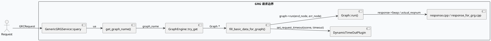
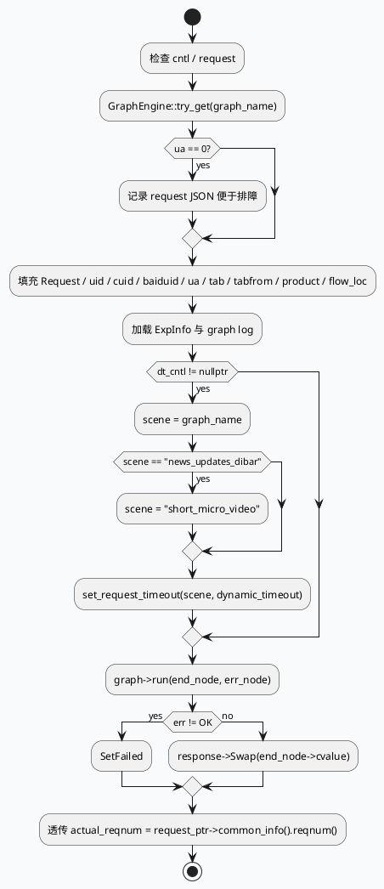

# GRG 请求基础信息注入、图路由与 actual_reqnum 回传边界

> 运行说明：daily-plan 目录里没有 2026-08-27 对应计划文件；按历史未覆盖主题 fallback 到 GRG 的请求基础信息注入与图路由边界。当前 cron 环境未验证 KU 可用性，KU/业务背景需人工补充；本文只使用本地代码证据。

<div class="arch-wrapper" style="display:flex;gap:12px;align-items:stretch;background:#f8fafc;border:1px solid #d8e2ef;border-radius:8px;padding:14px;color:#1f2937;font-family:Inter,Arial,sans-serif;"><div class="arch-main" style="flex:1;min-width:0;"><div style="font-size:20px;font-weight:800;margin:0 0 10px 0;">GRG 请求填充与路由全景</div><div class="arch-layer application" style="background:#fff;border:1px solid #cbd5e1;border-radius:8px;padding:10px;margin-bottom:10px;"><b style="display:block;margin-bottom:6px;color:#334155;">请求入口</b><div style="display:grid;grid-template-columns:repeat(3,minmax(0,1fr));gap:8px;"><div style="background:#eef4f8;border-left:4px solid #3d5a80;padding:8px;border-radius:6px;">`src/service/grg_service.cpp:35-89`：`GenericGRGService::query()` 先检查 `cntl`，再拿 `GraphEngine` 和 `DynamicTimeOutPlugin`。</div><div style="background:#eef4f8;border-left:4px solid #3d5a80;padding:8px;border-radius:6px;">`src/service/grg_service.cpp:113-120`：`get_graph_name()` 只按 `ua` 选择 `short_micro_video / news_updates_dibar / default`。</div><div style="background:#eef4f8;border-left:4px solid #3d5a80;padding:8px;border-radius:6px;">`src/service/grg_service.cpp:121-200`：`fill_basic_data_for_graph()` 把请求基础信息写进图节点与 `MutableFrameworkContext`。</div></div></div><div class="arch-layer ai" style="background:#fff;border:1px solid #cbd5e1;border-radius:8px;padding:10px;margin-bottom:10px;"><b style="display:block;margin-bottom:6px;color:#334155;">路由与超时</b><div style="display:grid;grid-template-columns:repeat(2,minmax(0,1fr));gap:8px;"><div style="background:#eef4f8;border-left:4px solid #5b3d80;padding:8px;border-radius:6px;">`scene = graph_name`，但 `news_updates_dibar` 会改写成 `short_micro_video` 再写入动态超时控制器。</div><div style="background:#eef4f8;border-left:4px solid #5b3d80;padding:8px;border-radius:6px;">`cntl->timeout_ms()`、request `dynamic_timeout` 和默认 800ms 三层兜底。</div></div></div><div class="arch-layer data" style="background:#fff;border:1px solid #cbd5e1;border-radius:8px;padding:10px;margin-bottom:10px;"><b style="display:block;margin-bottom:6px;color:#334155;">结果闭环</b><div style="display:grid;grid-template-columns:repeat(2,minmax(0,1fr));gap:8px;"><div style="background:#f3f8f4;border-left:4px solid #2d6a4f;padding:8px;border-radius:6px;">`run()` 里 `graph->run(end_node, err_node)` 后，成功则 `response->Swap(...)`，失败则 `SetFailed(...)`。</div><div style="background:#f3f8f4;border-left:4px solid #2d6a4f;padding:8px;border-radius:6px;">`src/processor/response.cpp:370-374` / `src/processor/video_launch/response_for_grg.cpp:223-226` 负责把 `common_info->request_ptr->common_info().reqnum()` 透传成 `actual_reqnum`。</div></div></div></div><div class="arch-sidebar" style="width:260px;min-width:260px;"><div class="arch-layer infra" style="background:#fff;border:1px solid #cbd5e1;border-radius:8px;padding:10px;height:100%;"><b style="display:block;margin-bottom:6px;color:#334155;">业务侧语义</b><div style="font-size:13px;line-height:1.55;color:#334155;">`GRCRequest` 的 `common_info`、`device_info`、`pass_through.exp_params` 是 GRG 这条链路的主要输入。</div><div style="font-size:13px;line-height:1.55;color:#334155;margin-top:8px;">`GraphEngine` 选择的图决定了后续 `GRGResponse` 的落点与日志路径。</div><div style="font-size:13px;line-height:1.55;color:#334155;margin-top:8px;">`actual_reqnum` 透传给 GR，说明响应侧保留了原始请求数，而不是只看图内截断后的结果数。</div></div></div></div>

## 核心链路





```infographic
sequence-ascending-steps
  data
    title GRG 请求处理步骤
    desc 从路由到 response 透传的顺序
    items
      - label 路由图名
        desc get_graph_name() 依据 ua 选择 default/short_micro_video/news_updates_dibar
      - label 注入基础字段
        desc 写入 Request、uid、cuid、baiduid、ua、tab、product、flow_loc
      - label 动态超时
        desc 使用 scene 和 timeout 三层兜底
      - label 执行图
        desc graph->run(end_node, err_node)
      - label 透传响应计数
        desc actual_reqnum 从 request_ptr 的 reqnum 原样回传
```

## 结构信息图

```infographic
compare-hierarchy-left-right-circle-node-pill-badge
  data
    title 请求字段与职责划分
    items
      - label common_info
        desc uid / cuid / baiduid / tab / tabfrom / flow_loc / product 的主要来源
      - label device_info
        desc ua 路由的唯一关键输入
      - label pass_through.exp_params
        desc ExpInfo 的加载来源
      - label MutableFrameworkContext
        desc 这里挂载 timeout_cntl
      - label Graph::find_data("Request")
        desc 把原始请求塞入图节点
      - label Graph::find_data("GRGResponse")
        desc 图输出节点
      - label response attachment
        desc actual_reqnum 透传的落点
```

## 关键证据

- `src/service/grg_service.cpp:35-89`：`GenericGRGService::query()` 取 `GraphEngine`、获取 `DynamicTimeOutPlugin`、按 `ua` 路由 `graph_name`、再执行 `fill_basic_data_for_graph()` 与 `run()`。
- `src/service/grg_service.cpp:113-120`：`get_graph_name()` 只把 `ua==85/87/123` 映射到 `short_micro_video`，`ua==102` 映射到 `news_updates_dibar`，其余走 `default`。
- `src/service/grg_service.cpp:121-200`：`fill_basic_data_for_graph()` 写入 `Request`、`log_id`、`uid`、`cuid`、`baiduid`、`ua`、`tab`、`tabfrom`、`is_vip_cuid`、`product`、`flow_loc`、`is_debug`、`ExpInfo`、`graph log`，并把 `timeout_cntl` 装入 `MutableFrameworkContext`。
- `src/service/grg_service.cpp:186-199`：`news_updates_dibar` 的动态超时 scene 会改写为 `short_micro_video`，说明业务场景名和超时场景名存在兼容映射。
- `src/service/grg_service.cpp:203-265`：`run()` 里 `graph->run(end_node, err_node)` 返回后决定 `SetFailed` 或 `response->Swap(...)`。
- `src/service/grg_service.cpp:266-359`：`print_log()` 与 `upload_dapper()` 使用 `uid/cuid/baiduid/sid/ua` 做日志和画像上报，说明请求基础信息会一路流到观测层。
- `src/processor/response.cpp:370-374`：`response->mutable_attachment()->set_actual_reqnum(common_info->request_ptr->common_info().reqnum())`，把原始 reqnum 透传给 GR。
- `src/processor/video_launch/response_for_grg.cpp:223-226`：GRG 业务分支同样把 `reqnum` 填到 `actual_reqnum`，保持响应侧闭环。
- `src/service/grg_service.h:14-64`：`GenericGRGService` 的公开接口只暴露 `query/run/fill_basic_data_for_graph/get_graph_name` 等关键边界。

## Pitfalls

<div style="display:grid;grid-template-columns:repeat(2,minmax(0,1fr));gap:10px;margin-top:8px;"><div style="background:#fff;border:1px solid #d8e2ef;border-left:4px solid #b8432f;border-radius:8px;padding:12px;"><div style="font-weight:700;color:#1f2937;margin-bottom:6px;">ua 为 0 时只打日志，不自动修复</div><div style="color:#334155;line-height:1.55;">`ua` 解析失败会继续走后续流程，但图路由和超时 scene 会退化到默认值，容易把问题伪装成业务召回下降。</div></div><div style="background:#fff;border:1px solid #d8e2ef;border-left:4px solid #b8432f;border-radius:8px;padding:12px;"><div style="font-weight:700;color:#1f2937;margin-bottom:6px;">scene 改写不是直通映射</div><div style="color:#334155;line-height:1.55;">`news_updates_dibar` 会被改成 `short_micro_video` 再写入动态超时控制器，排障时要看最终 scene，而不是原始 graph_name。</div></div><div style="background:#fff;border:1px solid #d8e2ef;border-left:4px solid #b8432f;border-radius:8px;padding:12px;"><div style="font-weight:700;color:#1f2937;margin-bottom:6px;">actual_reqnum 代表原始请求数</div><div style="color:#334155;line-height:1.55;">透传的是 `request_ptr->common_info().reqnum()`，不是图内实际返回条数；二者不一致时要去看中间链路有没有截断。</div></div><div style="background:#fff;border:1px solid #d8e2ef;border-left:4px solid #b8432f;border-radius:8px;padding:12px;"><div style="font-weight:700;color:#1f2937;margin-bottom:6px;">日志与响应是两条线</div><div style="color:#334155;line-height:1.55;">`print_log()` 和 `upload_dapper()` 不等于业务正确；它们只能说明请求字段已进入观测链路，不能替代 response 校验。</div></div></div>

## 调试 Checklist

```infographic
list-column-done-list
  data
    title 调试 checklist
    items
      - label 确认 get_graph_name() 的 ua 路由命中预期图
        done true
      - label 检查 fill_basic_data_for_graph() 写入的 common_info 字段完整
        done true
      - label 确认 ExpInfo load 成功且日志头可读
        done true
      - label 验证动态超时 scene 是否按 news_updates_dibar -> short_micro_video 改写
        done true
      - label 检查 graph->run() 后是 Swap 还是 SetFailed
        done true
      - label 核对 actual_reqnum 是否等于原始 reqnum
        done true
      - label 如果 KU 背景缺失，在业务描述中明确需人工补充
        done true
```

## 证据来源

- `src/service/grg_service.cpp`
- `src/service/grg_service.h`
- `src/processor/response.cpp`
- `src/processor/video_launch/response_for_grg.cpp`
- `baidu/feed/general/framework/graph_engine.h`
- `baidu/feed/general/framework/dynamic_timeout_plugin.h`
- `baidu/feed/general/framework/dynamic_timeout.h`
