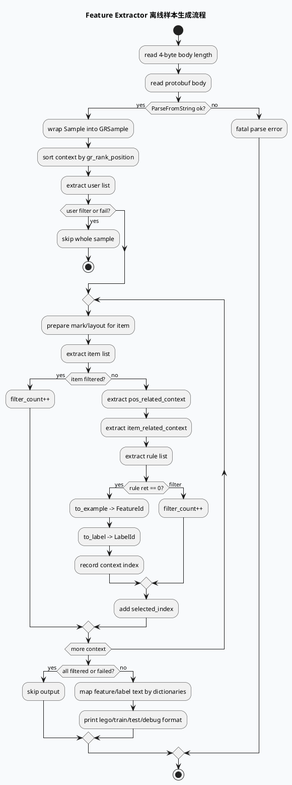

# 2026-09-16 业务库理解：Feature Extractor 离线样本到 Lego 训练样本的生成边界

> 日期：2026-09-16  
> 主题选择：未发现本日有效 daily-plan；为避免重复近期已覆盖的 GRC/GRG 响应、quota、DiversityMerge 和性能归因主题，本次回退到邻近未覆盖的 **feature-extractor 离线样本生成业务链路**，与今日基础库 AEF FeatureOperator 合同配对。KU 正文未读取，业务背景需人工补充；本文只陈述代码可验证的行为。  
> 范围：二进制样本读取、`GRSample` 包装、user/item/context/rule 五段抽取、过滤分支、label 构造、字典映射和 lego 输出。

---

## 0. 架构全景图

<div style="font-family:system-ui,-apple-system,BlinkMacSystemFont,'Segoe UI',sans-serif;background:#f5f7fa;border:1px solid #d8e1ea;border-radius:8px;padding:16px;margin:16px 0;color:#243b53;line-height:1.45;"><div style="display:grid;grid-template-columns:1fr 1.2fr 1fr;gap:12px;align-items:stretch;"><div style="background:#fff;border:1px solid #cbd5e1;border-radius:8px;padding:12px;"><div style="font-size:12px;font-weight:800;color:#52606d;text-transform:uppercase;letter-spacing:.04em;">输入样本</div><div style="margin-top:8px;font-size:15px;color:#102a43;font-weight:700;">length-prefixed Sample</div><div style="margin-top:8px;font-size:12px;color:#52606d;">worker 从 stdin 读取 4 字节长度和 protobuf body，解析为 mlarch::Sample。</div></div><div style="background:#fff;border:1px solid #cbd5e1;border-radius:8px;padding:12px;"><div style="font-size:12px;font-weight:800;color:#52606d;text-transform:uppercase;letter-spacing:.04em;">业务抽取</div><div style="margin-top:8px;font-size:15px;color:#102a43;font-weight:700;">user → item → context → rule</div><div style="margin-top:8px;font-size:12px;color:#52606d;">样本先排序，再逐 item 执行多段 feature list；filter 分支决定是否进入训练样本。</div></div><div style="background:#fff;border:1px solid #cbd5e1;border-radius:8px;padding:12px;"><div style="font-size:12px;font-weight:800;color:#102a43;text-transform:uppercase;letter-spacing:.04em;">输出落地</div><div style="margin-top:8px;font-size:15px;color:#102a43;font-weight:700;">FeatureId + LabelId + Lego</div><div style="margin-top:8px;font-size:12px;color:#52606d;">Example field 经字典映射为 id/value 矩阵，根据 task 输出 train/test/debug 格式。</div></div></div><div style="margin-top:12px;display:grid;grid-template-columns:1fr 42px 1fr 42px 1fr 42px 1fr;gap:8px;align-items:center;"><div style="background:#e0f2fe;border:1px solid #bae6fd;border-radius:6px;padding:10px;text-align:center;color:#075985;font-size:13px;">Parse Sample</div><div style="text-align:center;color:#64748b;font-weight:800;">→</div><div style="background:#ecfdf5;border:1px solid #a7f3d0;border-radius:6px;padding:10px;text-align:center;color:#047857;font-size:13px;">Extract Lists</div><div style="text-align:center;color:#64748b;font-weight:800;">→</div><div style="background:#fff7ed;border:1px solid #fed7aa;border-radius:6px;padding:10px;text-align:center;color:#9a3412;font-size:13px;">Build Labels</div><div style="text-align:center;color:#64748b;font-weight:800;">→</div><div style="background:#f1f5f9;border:1px solid #cbd5e1;border-radius:6px;padding:10px;text-align:center;color:#334155;font-size:13px;">Lego Line</div></div></div>

**一句话结论：** 这条业务链路的核心不是“把 Sample 转成特征”这么简单，而是用 rule 阶段作为训练样本准入门，只有通过 user/item/context/rule 的候选才会进入 `FeatureId`、`LabelId` 和最终 Lego 输出。

## 1. 核心流程图



## 2. 业务阶段信息图

```infographic
infographic sequence-snake-steps-simple
data
  title 离线训练样本的六个业务阶段
  desc 每个阶段都有独立的跳过或失败条件
  items
    - label read sample
      desc stdin 中 4 字节长度前缀加 protobuf body，解析失败直接退出 worker
      icon mdi:tray-arrow-down
    - label normalize order
      desc context 按 gr_rank_position 排序，确保位置相关特征可重复
      icon mdi:sort-ascending
    - label user gate
      desc user list 前置 filter 会跳过整个样本
      icon mdi:account-filter-outline
    - label item chain
      desc item、pos_context、item_context 逐段抽取，filter 只跳过当前 item
      icon mdi:link-variant
    - label rule admit
      desc rule 抽取成功后才写 FeatureId 与 LabelId example
      icon mdi:check-decagram-outline
    - label lego output
      desc 字典映射为 field id/value，再按 train/test/debug 输出
      icon mdi:file-table-outline
theme
  palette #3D5A80 #0F766E #F59E0B
```

## 3. 关键机制拆解

### 3.1 输入协议是长度前缀二进制 protobuf

`src/worker/worker.cc:49-70` 先按大端顺序读 4 字节 body length，再读取对应长度的 buffer；`src/worker/worker.cc:124-129` 用 `ParseFromString` 解析 `mlarch::Sample`。这意味着离线任务上游必须保证 framing 正确；如果只提供裸 protobuf 或文本样本，worker 会在长度读取或 parse 阶段失败。

### 3.2 每条样本先包装为 GRSample 并排序上下文

`src/worker/worker.cc:130-143` 保存 `gr_selected_list_index`、清理 `GRSample`、把 `Sample` 挂到 `GRSample`，再按 `recommend_feature().gr_rank_position()` 排序 context。后续 position 相关特征依赖这个顺序；如果上游位置字段异常，业务链路会稳定地产生错误顺序，而不是随机抖动。

### 3.3 user 阶段是整条样本的前置门

`src/worker/worker.cc:204-225` 先执行 user list。返回 `RET_CODE_FILTER` 时设置 `user_fail` 并跳出当前样本，非零错误也终止样本处理。业务上这相当于用户级过滤；不能把它和 item 级过滤混在一起统计，否则会误判候选特征覆盖率。

### 3.4 item/context/rule 是逐 item 的准入链

`src/worker/worker.cc:226-279` 按 item、pos_related_context、item_related_context、rule 的顺序设置 arg 并抽取。item/context 的 filter 会让当前 item 跳过；rule 返回 0 时才进入 `to_example` 和 `to_label`。因此训练样本数量由 rule 阶段最终决定，而不等于原始 `context_size()`。

### 3.5 配置文件说明 rule 是 filter，不是 feature 输出

`conf/feature-extractor/video_shentou_LTR/extract_offline.conf:12-15` 中 `rule` 的 `feature_conf` 指向 `empty.conf`，`filter_conf` 指向 `rule.conf`；`conf/feature-extractor/video_shentou_LTR/rule.conf:1` 使用 `M_filter_list` 依赖 `sample.context[*]`。这说明 rule 更像训练样本准入过滤器，而不是贡献可见特征字段的阶段。

### 3.6 标签与调试输出从 label example 反推业务指标

`src/worker/worker.cc:291-296` 把 item context list 转成 label example；预测调试分支中 `src/worker/worker.cc:396-520` 从 user_feedback、recommend_feature、content_feature 中抽 click、related_click、duration、real_q、session_q、pred_dur、calibration 等数组。即使该分支被编译屏蔽，它仍暴露了 label 语义来源，便于排查 label 字段与线上反馈的映射关系。

### 3.7 Lego 输出依赖 feature/label 字典的 field 空间

`src/worker/worker.cc:571-603` 根据 feature/label 字典的 field 数创建二维 id/value 容器；`src/worker/worker.cc:584-597` 将 feature_text 映射为 id 并保存 value。`src/worker/worker.cc:672-721` 输出 lego 格式：train 模式使用 `cuid` 和随机 id，test 模式使用 `logkey/hash`，debug 模式使用 `cuid/nid`。同一批样本换 task，会改变主键但不改变特征矩阵。

## 4. 准入与输出对账图

```infographic
infographic compare-hierarchy-left-right-circle-node-pill-badge
data
  title “候选被过滤”与“输出为空”的两侧对账
  desc 训练样本减少可能发生在输入、过滤、字典和输出四个位置
  items
    - label admission side
      desc read/parse、user filter、item/context filter、rule filter
      value 1
      icon mdi:filter-cog-outline
      children
        - label sample
          desc framing 或 protobuf 解析失败会退出 worker
        - label user
          desc user filter 跳过整条样本
        - label item
          desc item/context/rule filter 跳过当前候选
    - label output side
      desc to_example/to_label、dictionary find、lego print flags
      value 2
      icon mdi:file-export-outline
      children
        - label example
          desc rule 成功后才写入 FeatureId 与 LabelId
        - label dictionary
          desc field_id 必须小于 fdict/ldict field_num
        - label format
          desc print_feasign/text/lego 决定最终落地格式
theme
  palette #3D5A80 #0F766E #F59E0B
```

## 5. Pitfalls 卡片

<div style="font-family:Inter,Arial,sans-serif;background:#ffffff;border:1px solid #d7dee8;border-left:6px solid #0f766e;border-radius:8px;padding:18px;margin:18px 0;color:#1f2937;line-height:1.6;"><div style="font-size:12px;letter-spacing:.08em;text-transform:uppercase;color:#0f766e;font-weight:800;">Pitfalls · Offline Feature Pipeline</div><div style="font-size:24px;line-height:1.2;font-weight:900;margin:7px 0 12px;">样本少，不一定是特征没抽出来</div><div style="display:grid;grid-template-columns:1.35fr 1fr;gap:12px;"><div style="background:#f8fafc;border-top:3px solid #0f766e;border-radius:6px;padding:12px;font-size:14px;"><b>四个常见误判：</b><br>① 把 user 级 filter 当成 item 级 filter；② 忽略 rule 是准入过滤器；③ 只看 context_size，不看 FeatureId example_size；④ 换 task 后误以为特征变了，其实只是输出主键变了。</div><div style="background:#fff7ed;border-top:3px solid #f59e0b;border-radius:6px;padding:12px;font-size:14px;color:#7c2d12;"><b>核对顺序</b><br>body length → ParseFromString → sorted context → user filter → item/context filter → rule ret → example_size → dict id → print flag。</div></div><div style="margin-top:12px;font-weight:900;color:#0f766e;">∎ 先对账准入门，再判断特征抽取覆盖率。</div></div>

## 6. 调试 checklist

```infographic
infographic list-column-done-list
data
  title Feature Extractor 离线样本排查清单
  desc 适用于样本量下降、训练字段为空、label 异常和输出格式不一致
  items
    - label 检查输入 framing
      desc 确认上游写入 4 字节长度前缀和 protobuf body
      done true
    - label 检查排序字段
      desc gr_rank_position 是否存在且符合预期顺序
      done true
    - label 区分过滤粒度
      desc user filter 跳整样本，item/context/rule filter 跳单个候选
      done false
    - label 对账 rule 准入
      desc rule ret 为 0 才会进入 to_example/to_label
      done false
    - label 对账 example 数
      desc feaid.example_size、labelid.example_size 与 context_for_feasign 同步
      done false
    - label 检查字典映射
      desc field_id 不越界，feature_text 能被 fdict/ldict 映射
      done false
    - label 固定输出模式
      desc train/test/debug 的 key 不同，比较样本时必须固定 FLAGS_task
      done false
    - label 检查打印开关
      desc print_feasign、print_text、print_lego、print_lego_id_only 会改变输出内容
      done false
theme
  palette #3D5A80 #0F766E #F59E0B
```

## 7. 证据来源

- `src/worker/worker.cc:49-70`：长度前缀读取和 buffer 读取。
- `src/worker/worker.cc:124-143`：解析 Sample、包装 GRSample、按 `gr_rank_position` 排序。
- `src/worker/worker.cc:144-173`：获取 user/item/rule/context feature list。
- `src/worker/worker.cc:204-225`：user 阶段整样本过滤与错误分支。
- `src/worker/worker.cc:226-305`：item、pos、item context、rule 的逐候选准入链。
- `src/worker/worker.cc:291-296`：rule 成功后写入 feature example 与 label example。
- `src/worker/worker.cc:396-520`：预测/调试分支中 label 与线上反馈字段的映射语义。
- `src/worker/worker.cc:571-603`：feature/label 字典映射为 id/value 矩阵。
- `src/worker/worker.cc:672-721`：lego 输出的 train/test/debug 格式分支。
- `conf/feature-extractor/video_shentou_LTR/extract_offline.conf:1-24`：五类 feature list 配置。
- `conf/feature-extractor/video_shentou_LTR/rule.conf:1`：rule 阶段作为 filter list。
- `conf/feature-extractor/video_shentou_LTR/item_related_context.conf:5-18`：上下文特征依赖上一个已选 item 与当前 item 的组合。

> KU 正文未读取，需人工补充离线样本上游来源、训练任务字段规范、rule filter 的业务验收口径、字典发布版本以及 Lego 消费端格式约束。
