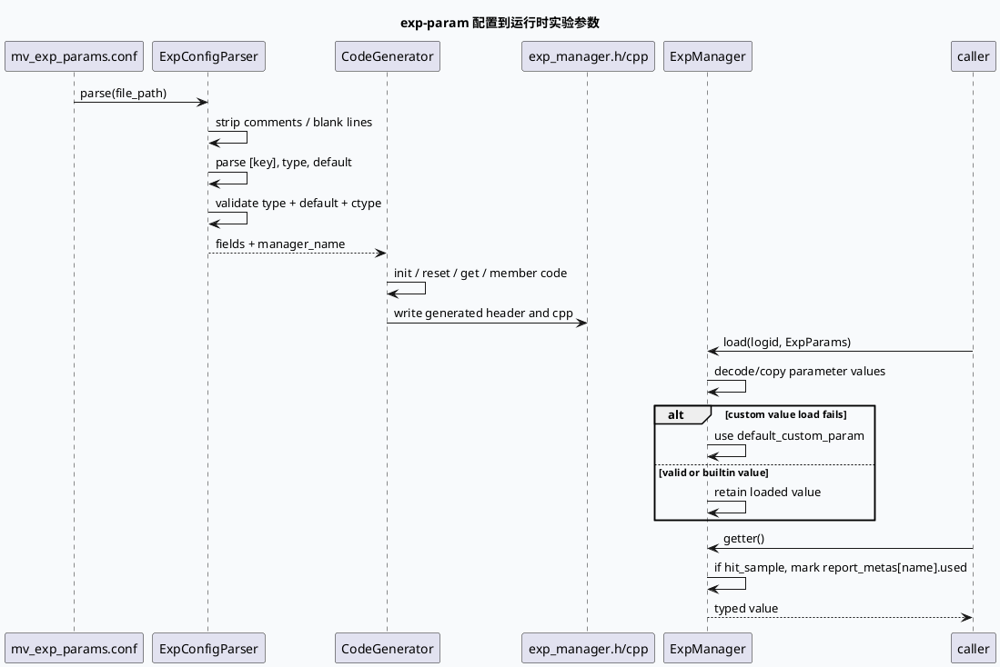

# 2026-09-17 业务库理解：Exp-param 配置到实验 Manager 生成的业务边界

> 日期：2026-09-17  
> 主题选择：未发现本日有效 daily-plan；为配对基础库的 FlatBuffer ComboBuilder，本次回退到邻近未覆盖的 **exp-param 配置驱动实验参数生成链路**。KU 正文未读取，业务背景需人工补充；当前源码索引未找到明确的线上 GR/MV 消费 callsite，因此本文只陈述配置、生成器和运行时 manager 模板可验证的行为。  
> 范围：`mv_exp_params.conf` 的参数声明、`ExpConfigParser` 的类型/default 解析、代码生成器的多配置合并、生成 manager 的 reset/get/hit 语义和自定义类型回退。

---

## 0. 架构全景图

<div style="font-family:system-ui,-apple-system,BlinkMacSystemFont,'Segoe UI',sans-serif;background:#f5f7fa;border:1px solid #d8e1ea;border-radius:8px;padding:16px;margin:16px 0;color:#243b53;line-height:1.45;"><div style="display:grid;grid-template-columns:1fr 1.15fr 1fr;gap:12px;align-items:stretch;"><div style="background:#ffffff;border:1px solid #cbd5e1;border-radius:8px;padding:12px;"><div style="font-size:12px;font-weight:800;color:#52606d;text-transform:uppercase;letter-spacing:.04em;">参数配置</div><div style="margin-top:8px;font-size:15px;color:#102a43;font-weight:700;">[name] + type + default</div><div style="margin-top:8px;font-size:12px;color:#52606d;">配置同时声明 manager_name 和每个实验参数的类型、默认值。</div></div><div style="background:#ffffff;border:1px solid #cbd5e1;border-radius:8px;padding:12px;"><div style="font-size:12px;font-weight:800;color:#52606d;text-transform:uppercase;letter-spacing:.04em;">生成器</div><div style="margin-top:8px;font-size:15px;color:#102a43;font-weight:700;">Parser → CodeGenerator</div><div style="margin-top:8px;font-size:12px;color:#52606d;">内置标量/vector 类型映射到 C++ 类型；custom 类型保留用户给出的 C++ 类型。</div></div><div style="background:#ffffff;border:1px solid #cbd5e1;border-radius:8px;padding:12px;"><div style="font-size:12px;font-weight:800;color:#102a43;text-transform:uppercase;letter-spacing:.04em;">运行时 Manager</div><div style="margin-top:8px;font-size:15px;color:#102a43;font-weight:700;">load / reset / get / hit</div><div style="margin-top:8px;font-size:12px;color:#52606d;">生成的 getter 在命中样本时记录 used；custom 参数加载失败时回退静态默认值。</div></div></div><div style="margin-top:12px;display:grid;grid-template-columns:1fr 42px 1fr 42px 1fr 42px 1fr;gap:8px;align-items:center;"><div style="background:#e0f2fe;border:1px solid #bae6fd;border-radius:6px;padding:10px;text-align:center;color:#075985;font-size:13px;">conf</div><div style="text-align:center;color:#64748b;font-weight:800;">→</div><div style="background:#ecfdf5;border:1px solid #bbf7d0;border-radius:6px;padding:10px;text-align:center;color:#166534;font-size:13px;">typed fields</div><div style="text-align:center;color:#64748b;font-weight:800;">→</div><div style="background:#fff7ed;border:1px solid #fed7aa;border-radius:6px;padding:10px;text-align:center;color:#9a3412;font-size:13px;">generated C++</div><div style="text-align:center;color:#64748b;font-weight:800;">→</div><div style="background:#f1f5f9;border:1px solid #cbd5e1;border-radius:6px;padding:10px;text-align:center;color:#334155;font-size:13px;">experiment decision</div></div></div>

**一句话结论：** 业务侧的稳定边界是“配置字段决定生成的 manager API”，而不是业务代码自行解析字符串；实验参数是否真正命中，要同时看输入 load、默认值、getter 使用标记和生成文件版本。

## 1. 核心流程图



## 2. 参数形态信息图

```infographic
infographic list-grid-badge-card
data
  title mv_exp_params.conf 支持的参数形态
  desc 配置形态决定生成的成员类型、默认初始化和 getter 返回类型
  items
    - label scalar
      desc bool、int、float、double 映射为原生 C++ 标量
      icon mdi:numeric
    - label string
      desc string 默认值转为 C++ 字符串字面量
      icon mdi:format-text
    - label vector
      desc int_vec、float_vec、double_vec、string_vec 转为 std::vector
      icon mdi:vector-line
    - label custom
      desc 未知 type 被视为自定义 C++ 类型，需要实现 CustomParam::load
      icon mdi:code-tags
    - label manager name
      desc manager_name 决定生成类名，默认类名为 ExpManager
      icon mdi:shape-outline
    - label default value
      desc builtin 直接赋值，custom 先加载静态 default 对象
      icon mdi:backup-restore
 theme
  palette #3D5A80 #0F766E #F59E0B
```

## 3. 关键机制拆解

### 3.1 配置 parser 用 section 驱动字段模型

`test/mv_exp_params.conf:1-26` 以 `service_name`、`manager_name` 和 `[my_param_*]` 字段组织配置，并覆盖 int、bool、string、custom、int_vec、string_vec。`scripts/gen_exp_code.py:31-67` 先去注释和空白，再识别 `[key]`，最后按冒号拆分 `type/default`。因此参数名本身来自 section，而不是 `name:` 键值。

### 3.2 内置类型与 custom 类型走不同的默认值路径

`scripts/gen_exp_code.py:19-29` 建立 builtin 类型表，`int` 变为 `int64_t`，vector 类型变为对应 `std::vector`；`scripts/gen_exp_code.py:69-97` 对 string/custom 加引号，对 vector 按逗号拆成初始化列表。未知 type 会保留为 `custom`，其 `ctype` 仍是原始类型名，供生成模板使用。

### 3.3 配置完整性只校验字段存在，不校验业务语义

`scripts/gen_exp_code.py:127-140` 要求每个字段有 `type`、`default` 和 `ctype`，缺失就抛出带文件和参数名的 `ValueError`。从当前代码看，parser 没有验证 default 是否能被 C++ 编译、vector 元素是否可转换、custom 类型是否真的实现 `load`；这些属于生成后编译或运行时责任。

### 3.4 生成器把一个字段展开为完整 manager API

`scripts/gen_exp_code.py:202-220` 生成初始化和 reset；`scripts/gen_exp_code.py:222-246` 生成 getter 与成员；`scripts/gen_exp_code.py:249-267` 为 custom 字段生成静态默认对象及 cpp 定义。`scripts/code_template.py:24-59` 显示 getter 会返回 typed member，custom getter 在 `_field.load_success` 为 false 时返回 `default_field`。

### 3.5 getter 同时是业务取值和命中统计边界

`scripts/code_template.py:24-43` 的 builtin/custom getter 都在 `_hit_sample` 为真时把 `_report_metas[name].used` 设为 1，然后返回参数值。因而“配置存在”不等于“业务使用”：report metadata 的 used 位可以作为参数是否被实际访问的证据，但当前索引没有提供生成 manager 的线上 caller，不能进一步断言哪些实验参数已被哪个场景消费。

### 3.6 多配置生成通过 manager_name 去重

`scripts/gen_exp_code.py:270-309` 接受多个配置路径，逐个生成 header/cpp 内容，并用 `manager_name` 检测重复类名；重复类名的配置会被警告并跳过。最终 `scripts/gen_exp_code.py:311-330` 合并内容写入 `exp_manager.h` 与 `exp_manager.cpp`。批量生成时，类名冲突不是编译期才发现，而是生成阶段已经改变产物集合。

### 3.7 custom 参数的最小运行时合同是 `load()`

`src/custom_param.h:5-15` 定义 `CustomParam`，要求派生类型实现 `load(const std::string&)`，并由 `load_success` 表示解析结果。结合 `scripts/code_template.py:33-43`，custom 参数有两层回退：下发值 load 成功则返回加载值，失败则返回静态 default。业务方若把失败当作零值或空对象处理，就会偏离生成 manager 的既定合同。

## 4. 配置到运行时对账图

```infographic
infographic compare-binary-horizontal-underline-text-vs
data
  title 配置声明与运行时行为的对账
  desc 用四个问题判断实验参数是否真正生效
  items
    - label declared
      desc section、type、default 是否完整，manager_name 是否唯一
      icon mdi:file-check-outline
    - label generated
      desc exp_manager.h/cpp 是否包含字段、getter、reset 和 custom default
      icon mdi:file-cog-outline
    - label loaded
      desc ExpParams 下发值是否成功解析，custom 的 load_success 是否为 true
      icon mdi:download-check-outline
    - label used
      desc caller 是否调用 getter，_hit_sample 时 report_metas[name].used 是否置 1
      icon mdi:chart-line
 theme
  palette #3D5A80 #0F766E #F59E0B
```

## 5. Pitfalls 卡片

<div style="font-family:Inter,Arial,sans-serif;background:#ffffff;border:1px solid #d7dee8;border-left:6px solid #0f766e;border-radius:8px;padding:18px;margin:18px 0;color:#1f2937;line-height:1.6;"><div style="font-size:12px;letter-spacing:.08em;text-transform:uppercase;color:#0f766e;font-weight:800;">Pitfalls · Generated Experiment Manager</div><div style="font-size:24px;line-height:1.2;font-weight:900;margin:7px 0 12px;">配置写了，不等于实验开关被使用</div><div style="display:grid;grid-template-columns:1.35fr 1fr;gap:12px;"><div style="background:#f8fafc;border-top:3px solid #0f766e;border-radius:6px;padding:12px;font-size:14px;"><b>四个常见误判：</b><br>① 把 parser 通过当成 default 可编译；② 把 custom load 失败当成空值而忽略默认对象；③ 多配置同名 manager 被跳过却没注意 warning；④ 只看参数下发，不看 getter 的 used 标记。</div><div style="background:#fff7ed;border-top:3px solid #f59e0b;border-radius:6px;padding:12px;font-size:14px;color:#7c2d12;"><b>核对顺序</b><br>section → type/default → generated file → load_success → getter → used → 业务效果。</div></div><div style="margin-top:12px;font-weight:900;color:#0f766e;">∎ 实验参数排查必须把“声明、生成、加载、使用”分开对账。</div></div>

## 6. 调试 checklist

```infographic
infographic list-column-done-list
data
  title exp-param 生成与运行时排查清单
  desc 适用于参数默认值异常、实验开关不生效和生成文件缺字段
  items
    - label 检查 section 语法
      desc 每个参数使用 [name]，并具备 type 与 default
      done true
    - label 检查类型映射
      desc builtin 类型是否在 builtin_types，custom ctype 是否是可用 C++ 类型
      done true
    - label 单配置生成
      desc python3 scripts/gen_exp_code.py test/mv_exp_params.conf 成功生成 h/cpp
      done true
    - label 检查类名冲突
      desc 多配置的 manager_name 必须唯一，不能依赖被跳过的 warning
      done false
    - label 检查 custom load
      desc 派生 CustomParam 的 load 返回值和 load_success 是否正确
      done false
    - label 检查默认值回退
      desc custom 解析失败时 getter 是否返回 default_field，而不是未初始化成员
      done false
    - label 检查 hit 统计
      desc _hit_sample 开启时 getter 是否把 report_metas[name].used 置 1
      done false
    - label 绑定真实 caller
      desc 在业务服务中确认实际调用的是生成 manager getter，而不是旁路字符串解析
      done false
 theme
  palette #3D5A80 #0F766E #F59E0B
```

## 7. 证据来源

- `test/mv_exp_params.conf:1-26`：`MvExpManager` 示例配置和六种参数形态。
- `scripts/gen_exp_code.py:11-29`：parser 初始化和内置类型映射。
- `scripts/gen_exp_code.py:31-97`：注释处理、section/key-value、type/default 解析。
- `scripts/gen_exp_code.py:99-140`：配置读取和完整性校验。
- `scripts/gen_exp_code.py:202-267`：生成 init/reset/get/member/static member 代码。
- `scripts/gen_exp_code.py:270-330`：多配置处理、manager_name 去重和文件写出。
- `scripts/code_template.py:24-59`：builtin/custom getter、成员和静态默认值模板。
- `src/custom_param.h:5-15`：自定义参数 `load` 与 `load_success` 合同。
- `src/exp_manager_base.h:28-48`：manager 的 `load/reset` 和 bool 参数查询接口。

> KU 正文未读取，需人工补充实验参数下发服务、GR/MV 场景到 manager 的真实绑定、参数命中率验收指标和生成文件发布流程。当前源码索引未找到明确线上消费 callsite，相关业务链路不可由本次证据确认。
