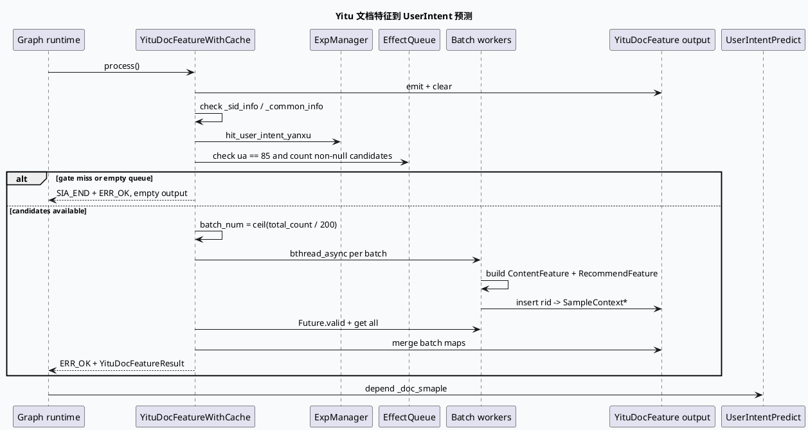

# 业务代码理解：GRC Yitu 文档特征缓存与用户意图分支

> 主题：`YituDocFeatureWithCacheFunction` 在 UA=85 且实验命中时，把有效候选转换为 `SampleContext`，按 batch 并行构造内容/推荐特征，并通过 Graph output 交给后续 `UserIntentPredictFunction`。
> 主题选择说明：daily-plan `daily-plan-20260529.json` 已过期；近期 business-lib 已覆盖 DeepES quota、ContextDNN、response assembly、DiversityMerge 等相邻主题。本次按 fallback 选择未独立覆盖的 `DocFeatureWithCache/Yitu 用户意图延续`，按真实代码边界聚焦 GRC processor 分支。KU 正文未逐篇读取，业务背景需人工补充；以下结论以源码和 graph 配置为主。

## 0. 业务全景图

<style>.yitu-arch{font-family:Inter,Arial,sans-serif;border:1px solid #d8dee9;background:#f8fafc;border-radius:8px;padding:18px;margin:18px 0;color:#243041}.yitu-arch h3{margin:0 0 12px;font-size:20px}.yitu-grid{display:grid;grid-template-columns:repeat(4,minmax(0,1fr));gap:8px}.yitu-box{border:1px solid #c9d3e3;border-left:4px solid #2d6a4f;background:#fff;border-radius:6px;padding:10px;min-height:96px}.yitu-box b{display:block;font-size:13px;color:#1a2f44}.yitu-box span{display:block;font-size:12px;line-height:1.5;color:#526071;margin-top:4px}.yitu-gate{border-left-color:#3d5a80}.yitu-batch{border-left-color:#9a5b28}.yitu-risk{border-left-color:#b8432f}@media(max-width:820px){.yitu-grid{grid-template-columns:repeat(2,minmax(0,1fr))}}@media(max-width:520px){.yitu-grid{grid-template-columns:1fr}}</style><div class="yitu-arch"><h3>Yitu 文档特征业务边界</h3><div class="yitu-grid"><div class="yitu-box yitu-gate"><b>双重门控</b><span>实验 `hit_user_intent_yanxu` 命中且 UA=85，否则清空输出并正常返回。</span></div><div class="yitu-box"><b>候选输入</b><span>遍历 `_effect_queue`，统计非空 RidTmpInfo，0 条候选直接结束。</span></div><div class="yitu-box yitu-batch"><b>批量构造</b><span>默认 batch_size=200，预分配结果 map 与 Sample holder，bthread_async 并行构造。</span></div><div class="yitu-box yitu-risk"><b>下游接线</b><span>`_doc_smaple` 作为 YituDocFeatureWithCacheResult，被 UserIntentPredictFunction 依赖。</span></div></div><div style="margin-top:10px;font-size:12px;line-height:1.5;color:#526071">核心边界：该 processor 只构造内容与推荐特征样本，不直接计算 user intent 分数；预测发生在后续 vertex。</div></div>

## 1. 门控：实验与场景必须同时满足

`src/processor/doc_feature_with_cache_yitu.cpp:21-44` 初始化 `_batch_size = 200`，处理时先创建并清空 `_doc_smaple`，检查 `_sid_info` 与 `_common_info`，随后执行：`hit_user_intent_yanxu` 实验命中且 `_common_info->ua == 85`。

任一条件不满足时，函数执行 `SIA_END` 并返回 0。这是正常的业务旁路，不是失败；因此监控上应把“未命中门控”和“batch 处理失败”分开统计。输出 map 在门控前已 clear，避免复用 graph function 时把上一次请求的样本泄漏给下游。



## 2. batch 并行与生命周期保护

`src/processor/doc_feature_with_cache_yitu.cpp:61-126` 先用 `(total_count + _batch_size - 1) / _batch_size` 计算 batch 数，随后 resize `batch_results` 和 `_sample_holders`，并为 Future vector reserve batch 数。每个异步闭包捕获当前 batch 的 start/count，以及对应结果 map 和 holder 的指针；闭包完成后通过 `future.get()` 汇总失败批次。

这里有三个关键设计：

1. 结果 map 在异步任务启动前完成 resize，闭包拿到稳定的元素地址，避免 vector 扩容导致引用失效。
2. 每个 batch 的 `Sample` 由 `_sample_holders[batch]` 的 shared_ptr 持有，map 内的 `SampleContext*` 只是观察指针；只要 holder 不释放，指针在整个请求处理阶段有效。
3. 所有 Future 都 join 后，才把 batch map insert 到最终 `_doc_smaple`。因此下游不应在 `process()` 返回前读取 output。

`reset()` 在 191-194 行只清空 `_sample_holders`。这与 Graph function 的 output reset 配合使用：业务函数返回后再释放 Sample 所有权，不能在 Future 尚未完成时提前清 holder。

```infographic
infographic sequence-snake-steps-simple
data
  title Yitu batch 处理五步
  desc 从候选统计到稳定输出
  items
    - label 统计有效候选
      desc 只统计非空 RidTmpInfo，total_count=0 直接正常返回
      icon mdi:counter
    - label 计算批数
      desc ceil(total_count / batch_size)，默认 batch_size=200
      icon mdi:calculator-variant
    - label 预分配容器
      desc batch_results 和 sample_holders resize；future_list reserve
      icon mdi:vector-arrange-below
    - label 异步构造样本
      desc 每批写自己的 map 和 shared_ptr Sample，构造 content/recommend feature
      icon mdi:call-split
    - label join 与合并
      desc 所有 Future get 完成后，把 batch map 合并到 _doc_smaple
      icon mdi:source-merge
 theme
  palette #2d6a4f #3d5a80 #9a5b28 #b8432f
```

## 3. 内容特征与推荐特征的业务分工

`process_single_batch()` 位于 `src/processor/doc_feature_with_cache_yitu.cpp:146-188`。每个有效候选创建一个 `SampleContext`：

- `contruct_content_feature()` 从 `MicroVideoInfo` 写入 manual tags、上传者、分类、视频时长、microvideo 标记、vertical type、清晰度、合集信息等；还从 GCMS/衰减数据补充 nid、互动和短剧结构标签。
- `contruct_recommend_feature()` 设置 `gr_rank_position=-1`，并把 `dnn_score_ctr` 与 `dnn_score_playtime` 放入 retrieval feature；大量可选 q 字段当前保持注释状态。
- 最后以 `rid` 为 key 把 `SampleContext*` 放进 batch map。

这个 processor 的输出是“模型输入样本”，不是最终排序结果。把它和 `UserIntentPredictFunction` 的结果 map 混为一层，会导致排查时误以为 Yitu processor 已经产生了用户意图分数。

## 4. Graph wiring：Yitu 输出接到 UserIntent

`conf/plugins/graph/vertex.conf:2603-2649` 给出完整接线：

- `YituDocFeatureWithCacheFunction` emit `_doc_smaple`，类型 `YituDocFeatureWithCacheResult`，并在 UA=85 条件下依赖 `_effect_queue`、`_sid_info`、`_common_info`。
- 紧随其后的 `UserIntentPredictFunction` emit `_user_intent_result_map` 和 `_user_intent_yanxu_success_ratio`。
- UserIntent 的 `_user_response` 与 `_request_response` 只在 UA=85 且 `EXP_hit_user_intent_yanxu` 时依赖；它同时 depend `_doc_smaple`，形成从候选到预测的 typed data 链。

```infographic
infographic list-grid-badge-card
data
  title Yitu → UserIntent 接线清单
  desc C++ interface 与 vertex.conf 必须同时一致
  items
    - label Function 注册
      desc REGISTER_GRC_FUNCTION(YituDocFeatureWithCacheFunction) 与配置 function 同名
      icon mdi:identifier
    - label Yitu 输出
      desc _doc_smaple : YituDocFeatureWithCacheResult
      icon mdi:export
    - label Yitu 条件
      desc UA == 85；输入 effect_queue、sid_info、common_info 同步受门控
      icon mdi:filter-check-outline
    - label UserIntent 输入
      desc UserIntentPredictFunction depend _doc_smaple，并读取 user/request response
      icon mdi:arrow-decision-auto
    - label 实验一致
      desc C++ hit_user_intent_yanxu 与配置 EXP_hit_user_intent_yanxu 必须指向同一实验
      icon mdi:flask-outline
 theme
  palette #2d6a4f #3d5a80 #9a5b28
```

## 5. Pitfalls

<div class="yitu-arch"><h3>Yitu 特征分支排查卡片</h3><div class="yitu-grid"><div class="yitu-box yitu-risk"><b>把旁路当失败</b><span>实验未命中、UA 非 85、候选为空都会返回 0；这三种情况应看作正常空输出。</span></div><div class="yitu-box yitu-risk"><b>batch_size 口径漂移</b><span>init 将 batch_size 设为 200，但成员默认初始化是 100；线上实际值以 init 执行结果为准。</span></div><div class="yitu-box yitu-risk"><b>SampleContext 悬空</b><span>map 保存的是裸指针，真正所有权在 sample_holders；Future join 前不能 clear holder。</span></div><div class="yitu-box yitu-risk"><b>闭包捕获失效地址</b><span>异步任务引用 batch_results 元素，容器必须先 resize，不能在任务运行中继续扩容。</span></div><div class="yitu-box yitu-batch"><b>只看总结果数</b><span>应同时看 batch_num、failed_batch_count、result_size 和三个阶段耗时，定位是 RPC/构造还是 merge 慢。</span></div><div class="yitu-box yitu-gate"><b>下游实验名不一致</b><span>C++ 使用 hit_user_intent_yanxu，配置条件使用 EXP_hit_user_intent_yanxu，实验别名漂移会造成“有输出但不预测”。</span></div></div></div>

```infographic
infographic list-column-done-list
data
  title Yitu 分支调试 Checklist
  desc 按门控、批处理、生命周期、接线顺序核对
  items
    - label 确认 UA=85
      desc _common_info->ua 必须命中场景条件
      done true
      icon mdi:cellphone-cog
    - label 确认实验命中
      desc C++ 与 graph conf 的 user intent yanxu 实验名一致
      done true
      icon mdi:flask-check-outline
    - label 检查有效候选数
      desc effect_queue 中非空 RidTmpInfo 数量决定 batch_num
      done true
      icon mdi:counter
    - label 检查批次结果
      desc failed_batch_count、result_size 和 cost_before/after_batch 是否异常
      done true
      icon mdi:chart-timeline-variant
    - label 检查 Sample 所有权
      desc 所有 Future get 完成后才能清 sample_holders
      done true
      icon mdi:lifebuoy
    - label 检查 Graph typed data
      desc _doc_smaple 的 emit/depend 类型与 UserIntentPredictFunction 接线一致
      done true
      icon mdi:graph-outline
 theme
  palette #2d6a4f #3d5a80 #9a5b28
```

## 证据来源

- `feeda-mv-grc/src/processor/doc_feature_with_cache_yitu.cpp:21-44`：初始化、SIA、实验/UA 双门控。
- `feeda-mv-grc/src/processor/doc_feature_with_cache_yitu.cpp:46-143`：候选统计、batch 预分配、bthread_async、Future join 和合并。
- `feeda-mv-grc/src/processor/doc_feature_with_cache_yitu.cpp:146-199`：单批 Sample 生命周期、reset 和结果 map。
- `feeda-mv-grc/src/processor/doc_feature_with_cache_yitu.cpp:201-321`：视频内容特征字段和 GCMS/衰减数据适配。
- `feeda-mv-grc/src/processor/doc_feature_with_cache_yitu.cpp:348-399`：推荐特征构造与 Graph function interface。
- `feeda-mv-grc/conf/plugins/graph/vertex.conf:2603-2649`：Yitu output 与 UserIntentPredictFunction 的 graph wiring。
