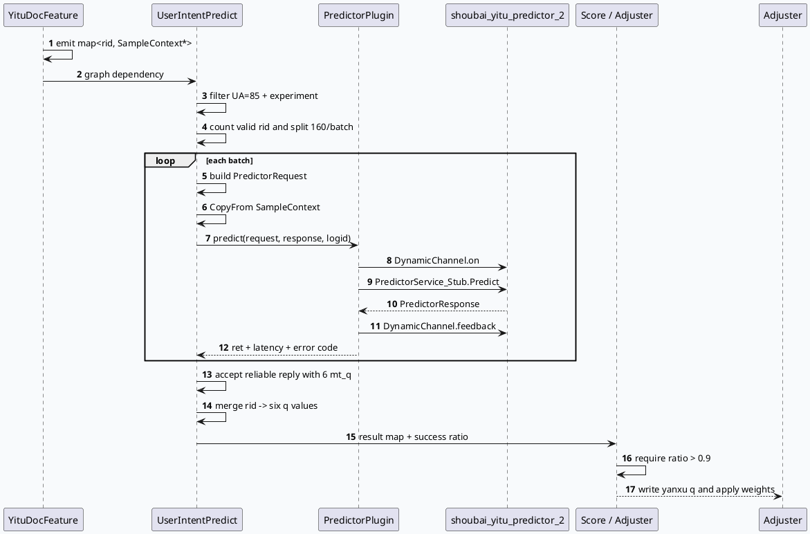

# 2026-09-25 业务代码理解：GRC Yitu 样本所有权到 UserIntent Predictor 的推理闭环

> 日期：2026-09-25（周五）  
> 主题选择：未发现目标日期有效 daily-plan；仓库中仅有已过期的 2026-05-29 计划。本次按邻近未覆盖边界回退，承接 2026-09-24 已记录的 Yitu 文档特征 batch，继续追踪 **SampleContext 所有权、Graph 依赖接线、UserIntent Predictor 批量 RPC、结果可靠性门控与后续调权消费**。KU 正文未读取，业务背景需人工补充；以下只陈述源码和 graph 配置可验证的行为。  
> 范围：`src/processor/doc_feature_with_cache_yitu.cpp`、`src/processor/video_launch/user_intent_predict.cpp`、`src/plugin/user_intent_predictor.cpp`、`src/processor/video_launch/user_intent_score.cpp`、`src/operator/adjuster/precise/user_intent_pre_adjuster.cpp`、`conf/plugins/graph/vertex.conf`。

## 0. 架构全景图

<div style="font-family:system-ui,-apple-system,BlinkMacSystemFont,'Segoe UI',sans-serif;background:#f5f7fa;border:1px solid #d8e1ea;border-radius:8px;padding:16px;margin:16px 0;color:#243b53;line-height:1.45;"><div style="display:grid;grid-template-columns:1fr 1.25fr 1fr 1fr;gap:10px;align-items:stretch;"><div style="background:#fff;border:1px solid #cbd5e1;border-left:4px solid #3d5a80;border-radius:6px;padding:11px;"><div style="font-size:11px;font-weight:800;color:#52606d;text-transform:uppercase;">候选输入</div><div style="margin-top:7px;font-size:15px;color:#102a43;font-weight:700;">effect_queue</div><div style="margin-top:7px;font-size:12px;color:#52606d;">过滤空指针，按有效 rid 统计候选；仅 UA=85 且命中实验时继续。</div></div><div style="background:#fff;border:1px solid #cbd5e1;border-left:4px solid #2d6a4f;border-radius:6px;padding:11px;"><div style="font-size:11px;font-weight:800;color:#52606d;text-transform:uppercase;">样本构造层</div><div style="margin-top:7px;font-size:15px;color:#102a43;font-weight:700;">YituDocFeatureWithCache</div><div style="margin-top:7px;font-size:12px;color:#52606d;">每个 batch 创建一个 shared Sample，把 ContentFeature/RecommendFeature 写入 SampleContext，并返回 rid 到指针的 map。</div></div><div style="background:#fff;border:1px solid #cbd5e1;border-left:4px solid #9a5b28;border-radius:6px;padding:11px;"><div style="font-size:11px;font-weight:800;color:#52606d;text-transform:uppercase;">推理请求层</div><div style="margin-top:7px;font-size:15px;color:#102a43;font-weight:700;">UserIntentPredict</div><div style="margin-top:7px;font-size:12px;color:#52606d;">复制 request/user/session 特征，拼接当前 batch 的 nid 与 SampleContext，序列化为 PredictorRequest。</div></div><div style="background:#fff;border:1px solid #cbd5e1;border-left:4px solid #b8432f;border-radius:6px;padding:11px;"><div style="font-size:11px;font-weight:800;color:#52606d;text-transform:uppercase;">结果消费层</div><div style="margin-top:7px;font-size:15px;color:#102a43;font-weight:700;">Score / Adjuster</div><div style="margin-top:7px;font-size:12px;color:#52606d;">要求成功率大于 0.9，再把 6 个 q 写回候选，供用户意图打分和精准调权。</div></div></div><div style="margin-top:12px;border-top:1px solid #d8e1ea;padding-top:10px;font-size:12px;color:#52606d;"><b style="color:#243b53;">关键合同：</b>map 中的 SampleContext 指针并不独立拥有 Sample；`_sample_holders` 的 shared_ptr 生命周期必须覆盖后续 predictor vertex 的执行窗口。</div></div>

## 1. 主题判断与代码边界

前一篇笔记已经覆盖 `YituDocFeatureWithCacheFunction` 的候选遍历、batch 拆分和内容特征构造。本篇把边界向下游推进：确认它的输出如何被 graph 接线、如何被复制进 predictor 请求，以及预测结果怎样通过成功率门控进入调权链路。这里没有把 `FeatureServicePlugin` 或 Yitu 文档特征构造重新展开，避免重复主题。

源码证据显示：

- `YituDocFeatureWithCacheFunction::process()` 先 `emit()` 并清空 `_doc_smaple`，再以 `_batch_size=200` 创建 batch；每个 batch 用 `std::shared_ptr<Sample>` 保存 protobuf owner，map 保存 `rid -> SampleContext*`（`src/processor/doc_feature_with_cache_yitu.cpp:21-75`、`149-199`）。
- `UserIntentPredictFunction` 在 graph 初始化时读取 `channel_name`，从 `ApplicationContext` 获取 `UserIntentPredictorPlugin`；其本地 batch 上限为 160（`src/processor/video_launch/user_intent_predict.cpp:34-43`）。
- `vertex.conf` 将两个 vertex 连接起来：Yitu 节点 emit `YituDocFeatureWithCacheResult`，预测节点 depend 同一类型，并配置 `channel_name: shoubai_yitu_predictor_2`（`conf/plugins/graph/vertex.conf:2603-2651`）。
- 预测结果只有在 reply 可靠性为 `FULLY_RELIABLE` 或 `PARTIALLY_RELIABLE`、且 `mt_q_size == 6` 时才进入结果 map（`src/processor/video_launch/user_intent_predict.cpp:415-447`）。

## 2. Graph 接线与所有权

### 2.1 生产者输出不是值拷贝

`YituDocFeatureWithCacheFunction` 的输出类型是 `std::unordered_map<uint64_t, SampleContext*>`。`process_single_batch()` 在局部 `Sample` 中调用 `add_context()`，然后把返回的 protobuf 指针放入 batch map。这个 map 只保存裸指针，真正的 owner 是 `_sample_holders[current_batch_index]`。

因此，这条链路的生命周期规则是：

1. 每个 batch 先创建 `shared_ptr<Sample>`。
2. `SampleContext*` 只在对应 `Sample` 存活期间有效。
3. graph 下游读取 `_doc_smaple` 并把 context `CopyFrom()` 到 predictor 请求自己的 `Sample`。
4. vertex reset 时清空 `_sample_holders`，请求结束后释放 owner。

这解释了为什么实现使用 `std::vector<std::shared_ptr<Sample>>`，而不是让 `SampleContext` 指针指向临时对象；也解释了为什么下游应复制 protobuf 内容，而不是把裸指针跨请求缓存。

### 2.2 配置条件与代码条件是双重门控

配置层在 Yitu vertex 的 emit/depend 上声明 `UA == 85`；代码层还检查 `hit_user_intent_yanxu` 和 `ua == 85`。预测节点对用户、请求特征的依赖又增加了 `UA == 85 && EXP_hit_user_intent_yanxu` 条件。因此一次请求至少要同时满足：graph 条件生效、代码实验命中、候选和依赖对象有效。

这类双重门控的收益是异常请求不会进入 predictor，但排障时不能只看函数是否注册；需要同时检查 graph 条件、实验参数和运行时日志。

## 3. Predictor 请求流水线



### 3.1 请求字段组装

每个 predictor batch 创建独立的 `PredictorRequest`、`PredictorResponse` 和 `Sample`。请求头携带 uid/cuid/baiduid、logid、sid、`INTENT_LONGTERM` queue 和 `intent_longterm` token；`Sample` 复制 request feature、user feature、sequence feature、session feature，再把当前 batch 的候选 nid 和对应文档 context 加入 `sample.context`。最后执行 `SerializeToString()` 写入 `pass_through_sample`，设置 `rank_type=1`、`ua=2` 和 `dnn_num=nid_size`（`src/processor/video_launch/user_intent_predict.cpp:249-364`）。

### 3.2 RPC 与观测

`UserIntentPredictorPlugin::predict()` 用动态通道包裹同步 `PredictorService_Stub::Predict()`，在调用前后执行 `DynamicChannel::on/feedback`，并输出 channel、uid、远端地址、超时、backup 和耗时信息（`src/plugin/user_intent_predictor.cpp:24-73`）。业务 vertex 另外用 Dapper 记录 `call_user_intent_predict_batch`，把 predictor 返回码和 RPC 耗时关联到 logid（`src/processor/video_launch/user_intent_predict.cpp:366-385`）。

## 4. 结果可靠性与业务消费

```infographic
infographic sequence-ascending-steps
data
  title UserIntent 结果准入链
  desc 从候选到调权的四道可观测门槛
  items
    - label 实验与 UA
      desc UA=85 且 hit_user_intent_yanxu，否则清空输出并跳过 RPC
      icon mdi/experiment
    - label 有效候选
      desc effect_queue 中必须存在可关联的 SampleContext
      icon mdi/filter-check
    - label Reply 结构
      desc 仅接受 reliable reply，且 mt_q 数量必须为 6
      icon mdi/message-check
    - label 成功率
      desc success_ratio > 0.9 才允许后续 Score / Adjuster 使用延续 q
      icon mdi/speedometer
  theme
    palette #3d5a80 #2d6a4f #b8432f #9a5b28
```

预测函数先清空输出 map，将成功率初始化为 `-1.0`。所有 batch 完成后，把 `rid -> vector<float>` 合并，再要求每个候选至少有 6 个 q，按固定下标写入 rel、playrate、playlen、kuaihua、wanbo、bkt 六类延续意图分数。成功率按 effect queue 总量计算；大于 0.9 时标记预测成功并 emit 成功率（`src/processor/video_launch/user_intent_predict.cpp:163-224`）。

`UserIntentScoreFunction` 进一步要求结果 map 非空且成功率至少 0.9，再读取 32 个实验参数，按资源类型和内容时长选择 ratio/weight，输出候选的 user-intent score（`src/processor/video_launch/user_intent_score.cpp:37-121`）。精准调权器在同样的命中和成功率条件下，将结果 map 中的六类 q 写回 item，再进入后续权重计算（`src/operator/adjuster/precise/user_intent_pre_adjuster.cpp:1132-1167`）。

```infographic
infographic list-grid-badge-card
data
  title 关键数据合同
  desc 本链路跨越的输入、输出和诊断字段
  items
    - label 样本索引
      desc rid -> SampleContext*；owner 在 _sample_holders
      icon mdi/key-chain
    - label 请求批次
      desc 文档构造默认 200，预测请求默认 160
      icon mdi/view-grid
    - label Predictor 输出
      desc 每个有效 nid 需要 6 个 mt_q
      icon mdi/numeric-6-box
    - label 观测指标
      desc batch cost、predict_ret、reply parse、success_ratio
      icon mdi/chart-line
  theme
    palette #2d6a4f #3d5a80 #9a5b28 #64748b
```

## 5. 关键风险与排障卡片

<div style="font-family:system-ui,-apple-system,BlinkMacSystemFont,'Segoe UI',sans-serif;background:#fffaf5;border:1px solid #ead7c2;border-left:6px solid #b8432f;border-radius:6px;padding:15px;margin:14px 0;color:#3f2d22;line-height:1.55;"><div style="font-size:12px;font-weight:800;color:#9a3d2a;text-transform:uppercase;letter-spacing:.04em;">Pitfall 01 · 生命周期</div><div style="margin-top:6px;font-size:16px;font-weight:750;color:#3f2d22;">裸指针 map 不能脱离 Sample owner</div><div style="margin-top:6px;font-size:13px;color:#6b5141;">如果 reset 或 batch holder 清理早于下游读取，SampleContext 会失效。排查时同时确认 `_doc_smaple` 的生产时间、`_sample_holders` size 和 graph 执行顺序。</div></div>
<div style="font-family:system-ui,-apple-system,BlinkMacSystemFont,'Segoe UI',sans-serif;background:#f7faf5;border:1px solid #d7e5d0;border-left:6px solid #2d6a4f;border-radius:6px;padding:15px;margin:14px 0;color:#243126;line-height:1.55;"><div style="font-size:12px;font-weight:800;color:#2d6a4f;text-transform:uppercase;letter-spacing:.04em;">Pitfall 02 · 成功率语义</div><div style="margin-top:6px;font-size:16px;font-weight:750;color:#243126;">RPC 成功不等于业务结果准入</div><div style="margin-top:6px;font-size:13px;color:#52615a;">Predictor 返回 0 仍需通过 reply 可靠性、6 个 mt_q 和全局 success_ratio > 0.9。应分别观察 predict_ret、reply 数、解析丢弃数和最终成功率。</div></div>
<div style="font-family:system-ui,-apple-system,BlinkMacSystemFont,'Segoe UI',sans-serif;background:#f5f7fa;border:1px solid #d6dee8;border-left:6px solid #3d5a80;border-radius:6px;padding:15px;margin:14px 0;color:#243b53;line-height:1.55;"><div style="font-size:12px;font-weight:800;color:#3d5a80;text-transform:uppercase;letter-spacing:.04em;">Pitfall 03 · 配置漂移</div><div style="margin-top:6px;font-size:16px;font-weight:750;color:#243b53;">代码默认值与配置文案需要以运行时为准</div><div style="margin-top:6px;font-size:13px;color:#52606d;">实现注释出现“150”，实际赋值为 160；Yitu holder 初始成员默认值为 100，init 后设置为 200。排障和容量评估应以 init 后值和实际日志为准。</div></div>

## 6. 调试 Checklist

```infographic
infographic list-column-done-list
data
  title UserIntent Predictor 调试清单
  desc 从 graph 接线到业务调权逐层确认
  items
    - label 检查 vertex.conf 的 UA 条件、实验条件和 channel_name
      done false
    - label 检查 Yitu 输出 map size、sample holder 数量和 batch_num
      done false
    - label 检查 predictor request 的 nid_size、dnn_num 与序列化成功
      done false
    - label 检查 DynamicChannel 的远端地址、timeout、backup 和 predict_ret
      done false
    - label 检查 reply 可靠性、mt_q_size=6 和 response.err_no
      done false
    - label 检查 success_ratio 是否超过 0.9，以及 Score/Adjuster 是否实际消费
      done false
  theme
    palette #3d5a80 #2d6a4f #b8432f
```

## 7. 结论

这条链路的核心不是单纯的“调用一个 predictor”，而是一个由 graph 条件、样本所有权、批量 protobuf 组装、动态 RPC、结果可靠性和成功率共同组成的业务合同。最值得关注的两个工程约束是：第一，`SampleContext*` 的裸指针必须由 batch 级 `shared_ptr<Sample>` 维持到下游复制完成；第二，预测输出只有在结构和整体成功率都达标时才会影响调权。出现“没有意图分数”时，应按上述门槛逐层定位，而不是只检查 RPC 是否返回成功。

## 证据来源

- `src/processor/doc_feature_with_cache_yitu.cpp:21-75`、`149-199`、`388-399`：Yitu batch、Sample owner、输出类型和注册。
- `src/processor/video_launch/user_intent_predict.cpp:34-224`、`227-412`、`415-480`：预测 vertex、请求构造、并行 batch、reply 过滤、成功率和 graph interface。
- `src/plugin/user_intent_predictor.cpp:24-73`：动态通道、Predict RPC、错误与 latency 观测。
- `src/plugin/user_intent_predictor.h:24-40`：predictor plugin 状态和 stub 生命周期。
- `src/processor/video_launch/user_intent_score.cpp:37-121`、`361-370`：成功率门控、实验参数和输出 score map。
- `src/operator/adjuster/precise/user_intent_pre_adjuster.cpp:1132-1167`：六类 q 的后续调权消费。
- `conf/plugins/graph/vertex.conf:2603-2651`：Yitu 与 UserIntentPredict 两个 graph vertex 的依赖和 channel 配置。

> 说明：本次没有读取 KU 业务背景文档，业务背景需人工补充；文档中的结论均限定在上述源码和配置证据范围内。
