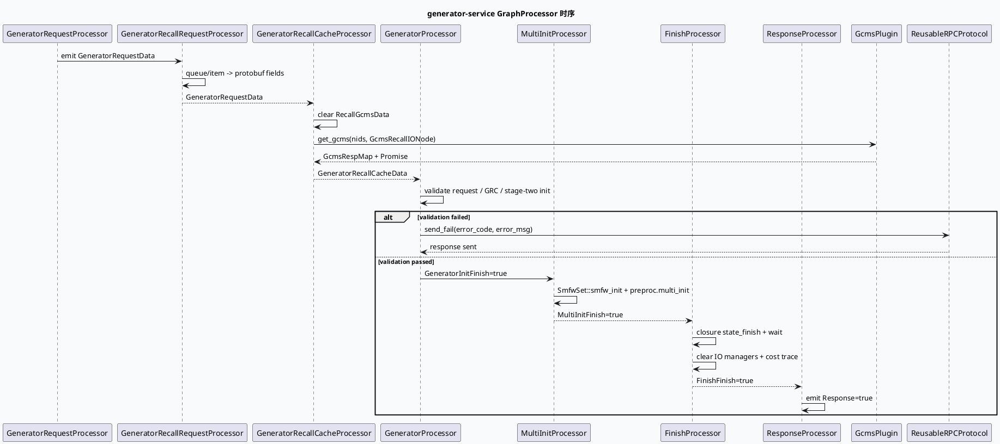

# 2026-09-29 业务代码理解：generator-service GraphProcessor 请求到响应链

> 日期：2026-09-29（周二）
> 主题选择：未发现当日 daily-plan；近期计划文件也未在本地快照中找到。本次按邻近未覆盖主题回退到 generator-service 中可直接验证的 **请求物化、GeneratorRecallCache、GeneratorProcessor、MultiInit、Finish 与 ResponseProcessor 链**。KU 正文未读取，业务背景与收益需人工补充；本文只依据当前代码快照。
> 配对关系：基础库笔记分析 GraphEngine 的构图、池化和双缓冲热加载；本文只分析业务 processor 如何通过 GraphData / GraphDependency 串起一次 generator 请求。
> 范围：`baidu/feed-gr/generator-service/src/processor/generator_recall_request_processor.cpp`、`generator_recall_processer.cpp`、`generator_processor.cpp`、`get_data/multi_init_processor.cpp`、`get_data/finish_processor.cpp`、`response_processor.cpp`。

## 0. 架构全景图

<div style="font-family:system-ui,-apple-system,BlinkMacSystemFont,'Segoe UI',sans-serif;background:#f5f7fa;border:1px solid #d8e1ea;border-radius:8px;padding:16px;margin:16px 0;color:#243b53;line-height:1.45;"><div style="font-size:12px;font-weight:800;color:#52606d;text-transform:uppercase;letter-spacing:.05em;">generator-service 的 GraphProcessor 数据流</div><div style="display:grid;grid-template-columns:1.05fr 24px 1.25fr 24px 1.25fr 24px 1.15fr;gap:8px;align-items:center;margin-top:12px;"><div style="background:#fff;border:1px solid #cbd5e1;border-left:4px solid #3d5a80;border-radius:6px;padding:11px;"><div style="font-size:15px;color:#102a43;font-weight:700;">请求物化</div><div style="margin-top:7px;font-size:12px;color:#52606d;">GeneratorRecallRequestProcessor 从 GeneratorRequestData 的队列与 item 结构生成 protobuf 侧请求数据。</div></div><div style="text-align:center;color:#64748b;font-size:20px;">→</div><div style="background:#fff;border:1px solid #cbd5e1;border-left:4px solid #2d6a4f;border-radius:6px;padding:11px;"><div style="font-size:15px;color:#102a43;font-weight:700;">召回缓存</div><div style="margin-top:7px;font-size:12px;color:#52606d;">GeneratorRecallCacheProcessor 检查 GRC 成功状态，收集 nids，并通过 GcmsPlugin 生成 Promise 结果。</div></div><div style="text-align:center;color:#64748b;font-size:20px;">→</div><div style="background:#fff;border:1px solid #cbd5e1;border-left:4px solid #9a5b28;border-radius:6px;padding:11px;"><div style="font-size:15px;color:#102a43;font-weight:700;">业务准入</div><div style="margin-top:7px;font-size:12px;color:#52606d;">GeneratorProcessor 检查 request、GRC、stage-two init 与 access，失败时经 ReusableRPCProtocol 回包。</div></div><div style="text-align:center;color:#64748b;font-size:20px;">→</div><div style="background:#fff;border:1px solid #cbd5e1;border-left:4px solid #b8432f;border-radius:6px;padding:11px;"><div style="font-size:15px;color:#102a43;font-weight:700;">完成与响应</div><div style="margin-top:7px;font-size:12px;color:#52606d;">MultiInit / Finish 处理多任务初始化、IO 清理和 closure；ResponseProcessor emit 最终完成标志。</div></div></div><div style="margin-top:10px;font-size:12px;color:#52606d;">共享合同：setup 绑定 named dependency/emit，process 只消费 GraphData；失败分支必须保持 response closure 可达。</div></div>

## 1. 核心结论

1. **请求侧先把队列结构物化为稳定的 GeneratorRequestData。** `GeneratorRecallRequestProcessor` 在 `process` 中遍历 queue/item，把 queue_name、rec_src、response_key、merge_method 以及多项 item 扩展字段写入 protobuf 结构；`opintp` 队列还会使用固定 response key（`generator_recall_request_processor.cpp:41-94`、`:196-215`、`:237-245`）。
2. **召回缓存处理器是 GRC 成功状态到 GCMS Promise 的边界。** 它先清空 emit 的 `RecallGcmsData`，若 GRC 调用失败或 response 为空则提前返回；成功时按请求构造 nids，创建 Promise 和 GcmsRespMap，调用 `GcmsPluginInterface::get_gcms` 并设置 promise（`generator_recall_processer.cpp:47-73`、`:98-107`）。
3. **GeneratorProcessor 把多个依赖收束为业务准入。** setup 阶段绑定 `GrgData`、`PassthroughData`、`GrcData`、`GeneratorRecallCacheData`；process 阶段依次检查 graph session、请求指针、GRC 成功状态，初始化 stage two，再挂接 passthrough 与 GCMS promise（`generator_processor.cpp:41-65`、`:67-102`）。
4. **MultiInit、Finish、Response 是显式的状态节点。** MultiInit 只有在 `GeneratorInitFinish` 为 true 时才执行 SMFW 与 preproc 初始化；Finish 等待 closure finish condition，清理 IO manager 并设置完成标志；ResponseProcessor 最终 emit `Response=true`（`multi_init_processor.cpp:36-70`、`finish_processor.cpp:48-98`、`response_processor.cpp:21-52`）。
5. **失败路径不是异常抛出，而是 GraphData 状态和 closure 回包合同。** GeneratorProcessor 的 request/GRC/init/access 失败都会调用 `send_fail`，设置错误码和错误信息后通过 ReusableRPCProtocol closure 发送响应（`generator_processor.cpp:67-148`）。这意味着排查“无回包”时要同时看 GraphDependency 是否 emit、错误分支是否命中和 closure 类型转换是否成功。

## 2. 请求到响应时序



## 3. GraphDependency 连接合同

```infographic
infographic sequence-snake-steps-simple
data
  title GraphDependency 连接顺序
  desc setup 阶段建立命名连接，process 阶段只读依赖并写 emit
  items
    - label RequestData
      desc GeneratorRequestProcessor -> GeneratorRecallRequestProcessor
      icon mdi-database-arrow-right
    - label RecallCacheData
      desc GeneratorRecallCacheProcessor emit RecallGcmsData + Promise
      icon mdi-cached
    - label GeneratorInitFinish
      desc 初始化完成标志驱动 MultiInit 与 Finish
      icon mdi-flag-checkered
    - label MultiInitFinish
      desc SMFW 与 preproc 初始化后的状态输出
      icon mdi-tune-variant
    - label FinishFinish
      desc closure、IO 清理、耗时记录完成
      icon mdi-check-network
    - label Response
      desc ResponseProcessor emit true 作为最终输出
      icon mdi-send-check
 theme
  palette #3d5a80 #2d6a4f #b56b32
```

`setup` 中使用 `named_dependency` 表示上游必须已经 emit，使用 `named_emit` 表示当前 processor 负责写出状态。比如 `GeneratorRecallCacheProcessor` 把 `GeneratorRecallCacheData` 作为 emit，而 `GeneratorProcessor` 将其作为 dependency；`FinishProcessor` 消费 `GeneratorInitFinish` 并 emit `FinishFinish`（`generator_recall_processer.cpp:38-44`、`generator_processor.cpp:41-46`、`finish_processor.cpp:40-45`）。这类命名是图配置与 C++ 之间的隐式接口，改名会导致运行时图连接失败或得到空依赖。

## 4. 关键分支与性能观察

### 4.1 GRC 失败短路

`GeneratorRecallCacheProcessor` 不会在 GRC 失败时继续访问 `grc_response`，而是直接返回；`GeneratorProcessor` 之后再次检查 `call_succ` 并发送失败响应。这是双层防护，但也意味着日志要区分“recall 阶段短路”和“generator 阶段准入失败”，否则容易只看到最终错误码而漏掉上游根因。

### 4.2 GCMS Promise 的所有权

代码创建 Promise 后将其保存到 `RecallGcmsData`，随后 `generator_recall_data.release()`，并把 promise 指针继续交给 session context。这里的所有权和生命周期必须与 GraphPool / GraphSession 生命周期一致；新增异步分支时不能只复制 shared_ptr，而要确认 promise 的 set_value 与 closure finish 的先后关系（`generator_recall_processer.cpp:98-107`、`generator_processor.cpp:99-102`）。

### 4.3 Finish 等待点

FinishProcessor 使用 `ClosureFinishCond` 加锁等待 `cond.is_finish`，随后清理 `_io_mgr` 与 `_buffer_io_mgr`，并计算总 critical path（`finish_processor.cpp:71-98`）。线上延迟异常时，应把 closure finish、IO manager clear 和 response emit 分开观察；不能把所有耗时归因于召回。

<div style="font-family:system-ui,-apple-system,BlinkMacSystemFont,'Segoe UI',sans-serif;background:#fffaf5;border:1px solid #ead7c0;border-left:5px solid #b56b32;border-radius:6px;padding:14px;margin:16px 0;color:#3d2b1f;"><div style="font-size:12px;font-weight:800;color:#8a4b20;text-transform:uppercase;letter-spacing:.05em;">Pitfalls / 调试卡片</div><div style="margin-top:9px;font-size:14px;line-height:1.65;"><strong>命名连接：</strong> `named_dependency` / `named_emit` 是图合同，C++ 两侧的字符串必须完全一致。<br><strong>重复短路：</strong> recall 和 generator 都检查 GRC 状态，日志需标记所在层，避免误判。<br><strong>异步所有权：</strong> Promise、GcmsRespMap、session context 和 closure 的生命周期要一起审视。<br><strong>Finish 阻塞：</strong> closure finish condition 未置位会阻塞最终响应，即使前序 processor 已完成。<br><strong>范围限制：</strong> 本文未读取 KU 正文，业务背景、部署拓扑和收益需人工补充。</div></div>

```infographic
infographic list-column-done-list
data
  title generator-service 排查 checklist
  items
    - label 核对 RequestData 是否已 emit
      desc 先看请求物化 processor 的 queue/item 遍历
      done true
    - label 核对 GRC call_succ 与 response 指针
      desc 区分 recall cache 短路和 generator 准入失败
      done true
    - label 核对 named dependency / emit 名称
      desc 检查 GeneratorRecallCacheData、GeneratorInitFinish 等连接
      done true
    - label 核对 Promise 与 GCMS 返回时序
      desc 观察 get_gcms、set_value 和 session 挂接
      done false
    - label 核对 Finish closure 与 IO 清理
      desc 关注 cond.is_finish、IO manager clear 和总耗时
      done false
    - label 核对 Response=true 是否 emit
      desc 最终状态不等于业务字段全部正确，只代表响应节点完成
      done false
 theme
  palette #2d6a4f #3d5a80 #b8432f
```

## 5. 证据来源

- `baidu/feed-gr/generator-service/src/processor/generator_recall_request_processor.cpp:41-94`、`:196-215`、`:634-644`：请求队列与 item 字段物化、组件注册。
- `baidu/feed-gr/generator-service/src/processor/generator_recall_processer.cpp:38-73`、`:98-112`：GRC 检查、GCMS recall、Promise 与 emit。
- `baidu/feed-gr/generator-service/src/processor/generator_processor.cpp:41-110`、`:136-151`：依赖绑定、业务准入、失败回包和组件注册。
- `baidu/feed-gr/generator-service/src/processor/get_data/multi_init_processor.cpp:22-75`：多任务初始化状态节点。
- `baidu/feed-gr/generator-service/src/processor/get_data/finish_processor.cpp:34-98`、`:122-124`：closure 等待、IO 清理、完成标志。
- `baidu/feed-gr/generator-service/src/processor/response_processor.cpp:21-52`：最终 Response emit。
