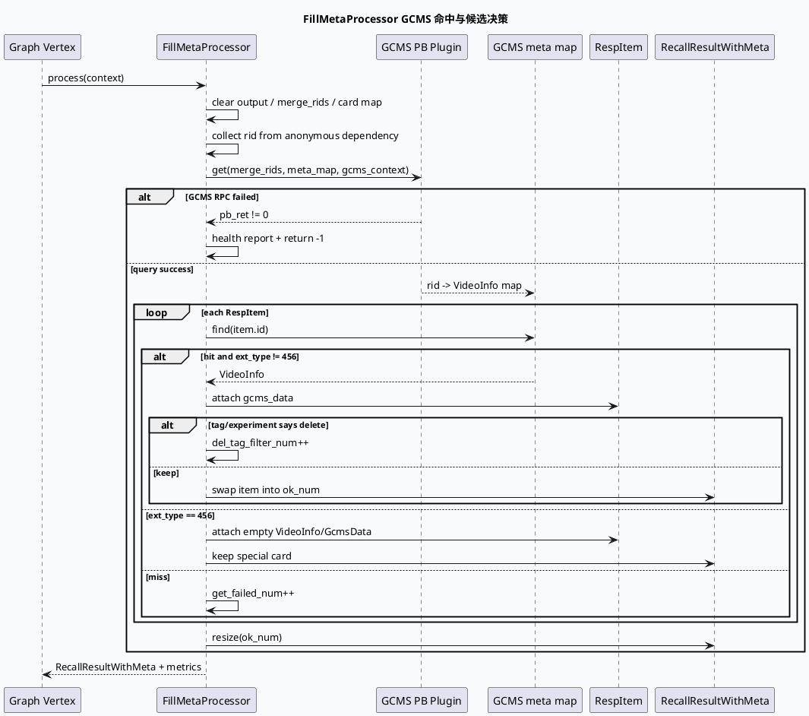

# 2026-09-30 业务库代码理解：GRC FillMeta 的 GCMS 命中与候选删除决策门

> 日期：2026-09-30（周三）
> 主题选择：canonical 笔记仓库未发现今日 daily-plan；本地仅找到过期的 `daily-plan-20260529.json`。计划中周三/周五候选已经被近期笔记覆盖，本次按同一源码快照回退到更窄的业务边界：**FillMetaProcessor 如何把批量 GCMS 查询结果转成“保留、过滤、特殊卡保留”三类候选决策**。
> 配对关系：基础库笔记分析 PipelineGraphFunction 的批量消费、channel 发布和完成信号；本文分析业务 processor 在候选发布前的内容元数据门控。
> KU 状态：未读取 KU 正文；IFCS/GCMS 业务口径、字段治理和线上收益需人工补充。本文只依据当前代码快照。
> 范围：`baidu/feed-gr/feeda-mv-gr/src/processor/fill_meta.cpp`，以及其 `gcms_common_pb_plugin.conf` 组件接线和 `FillMetaProcessor` 注册。

## 0. 架构全景图

<div style="font-family:system-ui,-apple-system,BlinkMacSystemFont,'Segoe UI',sans-serif;background:#f4f8f6;border:1px solid #cfe4d6;border-radius:8px;padding:16px;margin:16px 0;color:#243b53;line-height:1.45;"><div style="font-size:12px;font-weight:800;color:#52606d;text-transform:uppercase;letter-spacing:.05em;">FillMetaProcessor：GCMS 查询到候选决策</div><div style="display:grid;grid-template-columns:1.05fr 24px 1.25fr 24px 1.2fr 24px 1.05fr;gap:8px;align-items:stretch;margin-top:12px;"><div style="background:#fff;border:1px solid #cbd5e1;border-left:4px solid #3d5a80;border-radius:6px;padding:11px;"><div style="font-size:15px;color:#102a43;font-weight:700;">召回输入</div><div style="margin-top:7px;font-size:12px;color:#52606d;">从 anonymous dependency 读取 RespItemPtr 列表，抽取 rid，形成 merge_rids 批量查询键。</div></div><div style="text-align:center;color:#64748b;font-size:20px;padding-top:34px;">→</div><div style="background:#fff;border:1px solid #cbd5e1;border-left:4px solid #2d6a4f;border-radius:6px;padding:11px;"><div style="font-size:15px;color:#102a43;font-weight:700;">GCMS 批量查询</div><div style="margin-top:7px;font-size:12px;color:#52606d;">以 log_id、ua、SID 条件构造 GCMS context，调用 PB 插件将 rid 映射到 VideoInfo。</div></div><div style="text-align:center;color:#64748b;font-size:20px;padding-top:34px;">→</div><div style="background:#fff;border:1px solid #cbd5e1;border-left:4px solid #9a5b28;border-radius:6px;padding:11px;"><div style="font-size:15px;color:#102a43;font-weight:700;">三路决策门</div><div style="margin-top:7px;font-size:12px;color:#52606d;">普通命中进入字段过滤；fc_tag/del_tag 可能删除；ext_type 456 无 GCMS 仍可保留为空对象。</div></div><div style="text-align:center;color:#64748b;font-size:20px;padding-top:34px;">→</div><div style="background:#fff;border:1px solid #cbd5e1;border-left:4px solid #b8432f;border-radius:6px;padding:11px;"><div style="font-size:15px;color:#102a43;font-weight:700;">RecallResultWithMeta</div><div style="margin-top:7px;font-size:12px;color:#52606d;">压缩 complete_result，记录 get_failed_num、del_tag_filter_num 和保留的 common_card_cnt。</div></div></div><div style="margin-top:12px;font-size:12px;color:#62748a;">核心边界：GCMS 查询成功不等于候选必然保留；命中后的内容标签、关注关系、实验开关和特殊卡白名单仍会改变输出集合。</div></div>

## 1. 核心结论

1. **FillMetaProcessor 先把召回结果转成批量 rid 查询，不逐条调用 GCMS。** setup 把匿名依赖声明为 `vector<RespItemPtr>`，process 清空 `merge_rids` 后 reserve 并遍历输入收集 `rid_item->id`（`src/processor/fill_meta.cpp:69-85`、`:105-123`）。
2. **GCMS 请求的上下文包含 log_id 和 ua，但正排小流量列表显式为空。** 代码创建 `gcms_context`，把 `small_flow_list` 同时作为 `gcms_smfw_columns_str_vec` 与 `sids_str_vec`，再添加 `ua` 条件，随后调用 `_gcms_video_info_pb_plugin->get`（`src/processor/fill_meta.cpp:127-150`）。因此不能把该节点当成任意 SMFW 字段查询器。
3. **普通候选的保留前提是“map 命中 + 非 456 卡 + GcmsData 非空”。** 命中后将 `VideoInfo` 包装进 `item->gcms_data`，再依据 follow 关系、实验开关和 `fc_tag/del_tag` 判断是否删除（`src/processor/fill_meta.cpp:173-212`、`:241-263`）。
4. **ext_type 456 是显式的无 GCMS 特殊保留分支。** 未命中 map 的 456 卡会创建空 `VideoInfo` 并包装成 `GcmsData`，加入 `card_no_gcms_map` 后保留；其他未命中项只增加 `get_failed_num`，最终不会进入 `complete_result`（`src/processor/fill_meta.cpp:268-289`）。
5. **输出采用原地压缩，而不是重新构造全新列表。** 保留项通过 `swap` 移到 `ok_num` 位置，循环结束后 `complete_result->resize(ok_num)`；因此排查顺序/索引变化时要区分“原始 recall_result 位置”和“压缩后的输出位置”。
6. **监控指标直接对应三类损失。** `handle_name_get_failed_num` 表示 GCMS 未命中/无法保留的普通项，`handle_name_del_tag_filter_num` 表示标签决策删除项，`common_card_cnt` 表示无 GCMS 特殊卡保留量（`src/processor/fill_meta.cpp:287-292`）。

## 2. GCMS 查询与决策时序



## 3. 结构与决策信息图

```infographic
infographic compare-binary-horizontal-underline-text-vs
data
  title GCMS map 命中与否的业务结果
  desc 同一个 map 查找结果，在 ext_type 456 白名单下拥有不同的保留语义
  items
    - label 普通候选
      desc 命中 VideoInfo 才能挂 GcmsData；未命中计入 get_failed_num 并从输出消失
      value 1
    - label 456 特殊卡
      desc 即使没有 GCMS 记录，也创建空 VideoInfo/GcmsData 并保留
      value 1
theme
  palette #3d5a80 #b8432f #2d6a4f
```

```infographic
infographic sequence-snake-steps-simple
data
  title 普通候选的字段过滤路径
  desc 命中 GCMS 后仍要经过关注关系与标签实验决策
  items
    - label Attach
      desc VideoInfo -> GcmsData -> item
      icon mdi/link-variant
    - label Follow
      desc author、siteAccountId、tb_fid、displaytype_exinfo_uid 参与关注判断
      icon mdi/account-check-outline
    - label Experiment
      desc ua/flow_loc 与 sid_info 决定 del_tag_update 及豁免实验
      icon mdi/ab-testing
    - label Tag gate
      desc fc_tag / del_tag / fc_tag_reason 决定删除或跳过删除
      icon mdi/filter-variant
    - label Compact
      desc 保留项 swap 到 ok_num，末尾 resize 输出
      icon mdi/arrow-collapse
theme
  palette #2d6a4f #3d5a80 #b56b32
```

## 4. 关键分支与排障口径

### 4.1 GCMS RPC 失败和 map 未命中不是同一类问题

`_gcms_video_info_pb_plugin->get` 返回非零时，processor 直接健康上报并返回 `-1`；而 RPC 成功但某些 rid 不在 `gcms_common_meta_map` 时，流程继续处理其他候选，只增加 `get_failed_num`。监控和日志必须区分“整批查询失败”和“局部内容未命中”。

### 4.2 del_tag_update 改变的是标签删除规则，不是 GCMS 查询条件

代码先完成 GCMS 查询和 `GcmsData` 包装，再以 `ua == 85` 或 `ua == 87 && flow_loc == 69` 且命中 `new_del_tag_exp2` 判断 `is_del_tag_exp`。后续才进入 `fc_tag` / `del_tag` 分支。排查“某个端内容少了”时，不能只检查 GCMS 返回，应同时打印 ua、flow_loc、实验命中和 tag 来源。

### 4.3 456 卡的空对象是有意的占位合同

`ext_type == 456` 且没有 GCMS 命中时，代码创建空 `VideoInfo`，这让下游仍能持有 `gcms_data`，但字段内容并不代表真实正排命中。下游新增字段读取时应区分“真实 GCMS 对象”和“特殊卡空对象”。

<div style="font-family:system-ui,-apple-system,BlinkMacSystemFont,'Segoe UI',sans-serif;background:#fffaf5;border:1px solid #ead7c0;border-left:5px solid #b56b32;border-radius:6px;padding:14px;margin:16px 0;color:#3d2b1f;"><div style="font-size:12px;font-weight:800;color:#8a4b20;text-transform:uppercase;letter-spacing:.05em;">Pitfalls / FillMeta 决策门</div><div style="margin-top:9px;font-size:14px;line-height:1.65;"><strong>查询成功不等于候选保留：</strong> RPC 成功后还要经过 map 命中、456 白名单、follow、实验和 tag 过滤。<br><strong>指标拆分：</strong> `get_failed_num` 与 `del_tag_filter_num` 对应不同损失原因，不能合并解读。<br><strong>空 GcmsData：</strong> 456 特殊卡的空对象是显式兼容路径，不应当当作 GCMS 解析失败。<br><strong>原地压缩：</strong> `swap + resize` 会改变输出索引；调试时同时保留原始 rid 和 ok_num。<br><strong>范围限制：</strong> KU 正文未读取，字段治理和线上业务解释需人工补充。</div></div>

```infographic
infographic list-column-done-list
data
  title FillMeta 排障 checklist
  desc 从整批失败、局部缺失、标签过滤和特殊卡四个方向定位
  items
    - label 确认 anonymous dependency 输入
      desc 检查 vector<RespItemPtr> 是否为空以及 rid 是否正确收集
      done true
    - label 确认 merge_rids 批量规模
      desc 对照 handle_name 日志，避免把空输入误判为 GCMS 失败
      done false
    - label 确认 GCMS PB 返回值
      desc 非零直接走健康上报和 -1 返回路径
      done false
    - label 区分 map miss 与 tag delete
      desc 分别观察 get_failed_num 和 del_tag_filter_num
      done false
    - label 核对 ua / flow_loc / 实验
      desc 重点检查 del_tag_update 和各类豁免实验是否命中
      done false
    - label 核对 ext_type 456
      desc 空 VideoInfo/GcmsData 是特殊卡保留，不代表普通内容命中
      done false
    - label 检查压缩后的输出
      desc 关注 ok_num、complete_result resize 以及下游索引语义
      done false
theme
  palette #2d6a4f #3d5a80 #b8432f
```

## 5. 证据来源

- `baidu/feed-gr/feeda-mv-gr/src/processor/fill_meta.cpp:40-92`：配置读取、匿名依赖、`RecallResultWithMeta` emit、GCMS 组件获取。
- `baidu/feed-gr/feeda-mv-gr/src/processor/fill_meta.cpp:94-123`：输出清理、456 特殊卡标记和 `merge_rids` 收集。
- `baidu/feed-gr/feeda-mv-gr/src/processor/fill_meta.cpp:127-156`：GCMS context 构造、ua 条件和批量 PB 查询。
- `baidu/feed-gr/feeda-mv-gr/src/processor/fill_meta.cpp:173-224`：命中 map 后挂接 `GcmsData`、关注关系和标签字段读取。
- `baidu/feed-gr/feeda-mv-gr/src/processor/fill_meta.cpp:241-263`：实验控制下的 `fc_tag` / `del_tag` 删除分支。
- `baidu/feed-gr/feeda-mv-gr/src/processor/fill_meta.cpp:268-299`：456 空对象保留、普通 miss 统计、输出压缩和组件注册。
