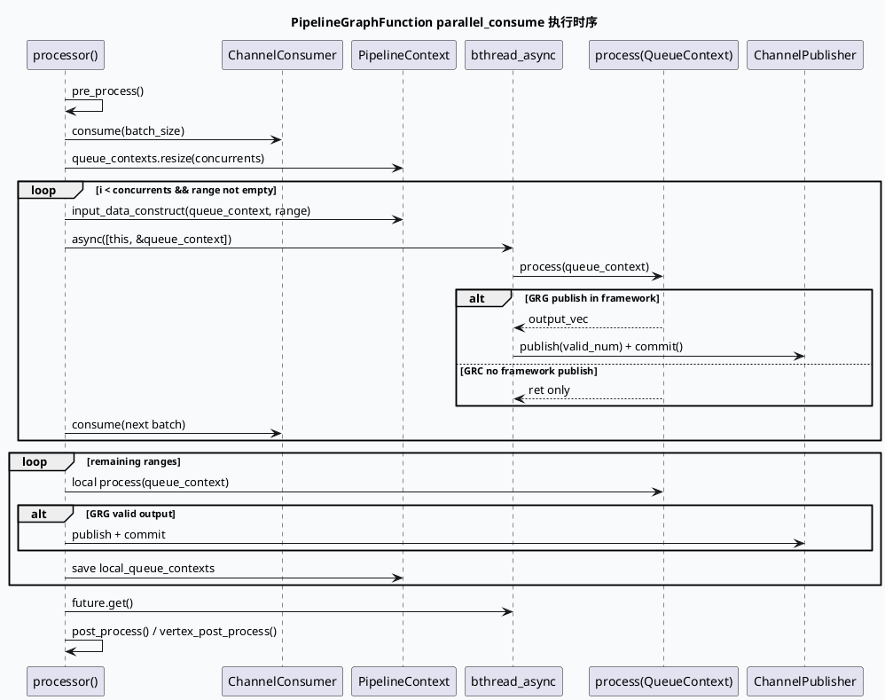

# 2026-06-12 基础库代码理解：PipelineGraphFunction parallel_consume 批消费框架
<!-- topic-nav:start -->
> 主题：`base/pipeline-consume` · 同题补充 / 历史版本 · [主题目录](README.md) · [先读主文](20260612-pipelinegraphfunction-parallel-consume.md)
<!-- topic-nav:end -->


> 今日主题来源：周五自动选题，沿用周计划中的基础库主题 `PipelineGraphFunction parallel_consume 批消费框架`。KU/内网检索未参与，需人工补充 GraphEngine Channel/Publisher 规范；本笔记以 GRC/GRG 代码库检索结果为准。

## 架构全景图

<style>.arch-pipe{font-family:-apple-system,BlinkMacSystemFont,"Segoe UI",sans-serif;border:1px solid #cbd5e1;border-radius:18px;padding:18px;background:#f8fafc;color:#1f2937}.arch-pipe .title{font-size:22px;font-weight:900;margin-bottom:6px}.arch-pipe .sub{font-size:13px;color:#64748b;margin-bottom:16px}.arch-pipe .grid{display:grid;grid-template-columns:1fr 1fr;gap:12px}.arch-pipe .lane{background:#fff;border:1px solid #dbeafe;border-radius:14px;padding:12px}.arch-pipe h3{margin:0 0 10px;font-size:15px;color:#1d4ed8}.arch-pipe .box{border-radius:12px;padding:10px;margin:8px 0;border:1px solid #e5e7eb;background:#f9fafb}.arch-pipe .box b{display:block;font-size:13px;margin-bottom:4px}.arch-pipe .box span{font-size:12px;color:#64748b;line-height:1.45}.arch-pipe .hot{background:#eff6ff;border-color:#93c5fd}.arch-pipe .note{margin-top:12px;padding:10px;border-radius:10px;background:#eef6ff;border-left:4px solid #3b82f6;font-size:13px;color:#334155}</style><div class="arch-pipe"><div class="title">PipelineGraphFunction 批消费框架</div><div class="sub">GRC 与 GRG 都用 `ConcurrentTransientQueue` + `bthread_async` 把 Channel 消费拆成多个 QueueContext，但发布时机和完成信号不同。</div><div class="grid"><div class="lane"><h3>GRC：先处理，后汇总上下文</h3><div class="box hot"><b>consumer.consume(batch_size)</b><span>按 batch_index 取不同批大小，构造 `QueueContext`。</span></div><div class="box"><b>bthread_async process</b><span>并发区只调用 `process(queue_context)`，不在框架层 publish。</span></div><div class="box"><b>local_queue_contexts</b><span>超过 concurrents 的剩余 range 在本地同步处理，再 move 回 `context.queue_contexts`。</span></div><div class="box"><b>post_process / vertex_post_process</b><span>输出、日志和 vertex 后处理由派生类或框架后续阶段承接。</span></div></div><div class="lane"><h3>GRG：处理后立即发布</h3><div class="box hot"><b>parallel_consume(input, publisher)</b><span>同时传入 ChannelPublisher，框架层负责输出。</span></div><div class="box"><b>output_vec publish</b><span>每个 QueueContext `process` 成功后 publish valid_num 并 commit。</span></div><div class="box"><b>_pipeline_done</b><span>processor 尾部可 emit 完成标记，供下游图节点依赖。</span></div><div class="box"><b>post_process</b><span>主要处理日志打印，返回 `ERR_OK`。</span></div></div></div><div class="note">核心差异：GRC 框架保留更多“派生类自行发布/后处理”的空间；GRG 框架把 publish 作为 parallel_consume 的固定步骤。</div></div>

## 核心流程图



## 配置/结构信息图

```infographic compare-binary-horizontal-underline-text-vs
data
  title GRC 与 GRG PipelineGraphFunction 对照
  desc 相同点是批消费和 bthread 并行；差异点集中在发布职责、完成信号和上下文持有位置
  left
    label GRC Pipeline
    desc `context.queue_contexts` 挂在 Context 内，`parallel_consume` 只返回 ret，不直接 publish output
  right
    label GRG Pipeline
    desc `queue_contexts` 为成员变量，`parallel_consume` 接收 publisher 并 commit `output_vec`
  items
    - label 输入抽象
      desc MutableChannelConsumer / ChannelConsumer
    - label 并发抽象
      desc Future<int32_t, bthread::Mutex> + bthread_async
    - label 批处理抽象
      desc ConcurrentTransientQueue::ConstConsumeRange
    - label 下游信号
      desc GRC post/vertex_post_process vs GRG `_pipeline_done`
```

## 关键结论

- `parallel_consume` 是“批次拆分 + QueueContext 构造 + bthread fan-out + future join”的框架模板，不负责业务逻辑本身。
- GRC 版本并发任务只返回 `process` 结果，输出语义留给派生类、publisher 成员或后处理；GRG 版本在框架中直接发布 `queue_context.output_vec`。
- 两个版本都把前 `concurrents` 个批次放进预分配 vector，剩余批次同步处理并 move 回上下文，避免异步引用局部对象悬挂。
- 捕获安全的关键点是 `queue_contexts.resize(concurrents)` 后异步 lambda 捕获稳定元素引用；不要把异步任务绑定到 while 循环里的临时 `QueueContext`。
- 调参时要同时看 `concurrents()`、`batch_size()`、消费队列大小和下游 publish 成本，否则并发数增加可能只是在转移排队点。

## Pitfalls 卡片

<style>.pit-pipe{font-family:-apple-system,BlinkMacSystemFont,"Segoe UI",sans-serif;max-width:980px;border-radius:20px;background:#f5f7fa;border:1px solid #c7d2fe;padding:20px;color:#1e293b}.pit-pipe .meta{font-size:12px;letter-spacing:.08em;text-transform:uppercase;color:#1d4ed8;font-weight:900}.pit-pipe .headline{font-size:28px;line-height:1.15;font-weight:900;margin:8px 0 12px}.pit-pipe .grid{display:grid;grid-template-columns:1.2fr .9fr;gap:14px}.pit-pipe .panel{background:#fff;border-top:4px solid #3b82f6;border-radius:12px;padding:12px}.pit-pipe .panel b{display:block;margin-bottom:6px}.pit-pipe .panel p{margin:0;font-size:14px;line-height:1.65;color:#334155}.pit-pipe .end{margin-top:12px;font-weight:900;color:#1d4ed8}</style><div class="pit-pipe"><div class="meta">pitfall · pipeline</div><div class="headline">parallel_consume 的安全边界在 QueueContext 生命周期，而不是 bthread 本身</div><div class="grid"><div class="panel"><b>不要捕获临时上下文</b><p>异步分支捕获的是预先 resize 后的 vector 元素引用；本地剩余批次没有异步化。如果改成对局部 `QueueContext` 起 bthread，future get 前对象可能已失效。</p></div><div class="panel"><b>不要混淆发布职责</b><p>GRG 框架层 publish，GRC 版本没有。迁移代码时若照搬派生类 publish 逻辑，可能重复输出或漏输出。</p></div></div><div class="end">∎ 改 batch/concurrent 前，先确认 output ownership。</div></div>

## 调试 checklist

```infographic list-column-done-list
data
  title PipelineGraphFunction 排查清单
  desc 从消费、上下文、异步、发布和完成信号逐层确认
  items
    - label 确认 consumer 类型
      desc mutable_input 与 input 的消费语义不同，先看 processor 选择哪个分支
      done true
    - label 核对 batch_size
      desc GRC 首批使用 batch_index，GRG 使用固定 batch_size
      done true
    - label 核对 QueueContext 生命周期
      desc 异步任务只能引用稳定存储中的 queue_context
      done true
    - label 核对 process 返回码
      desc 任一 future 返回非 OK 会覆盖最终 ret
      done true
    - label 核对发布职责
      desc GRG 看 output_vec publish；GRC 看派生类和 post/vertex_post_process
      done false
    - label 核对完成信号
      desc GRG 如配置 `_pipeline_done`，processor 尾部会 emit true
      done false
```

## 证据来源

- `src/processor/base/pipeline_function.h:51-88`（GRC）：`parallel_consume` 清理队列上下文、按 concurrents 起 bthread、future join 后 move 本地上下文。
- `src/processor/base/pipeline_function.h:63-65`（GRC）：异步 lambda 捕获 `this` 与预分配 `queue_context` 引用，只调用 `process`。
- `src/processor/base/pipeline_function.h:70-87`（GRC）：剩余 range 使用本地同步处理，再归并到 `context.queue_contexts`。
- `src/process/base/pipeline_function.h:58-113`（GRG）：`parallel_consume` 同时接收 `ChannelPublisher`，成功后 publish `output_vec` 并 commit。
- `src/process/base/pipeline_function.h:69-80`（GRG）：异步分支内执行 `process` 后立即 publish/commit 有效输出。
- `src/process/base/pipeline_function.hpp:51-67`（GRG）：`processor` 调用 `pre_process`、选择 mutable/input 消费、emit `_pipeline_done`、再 `post_process`。
