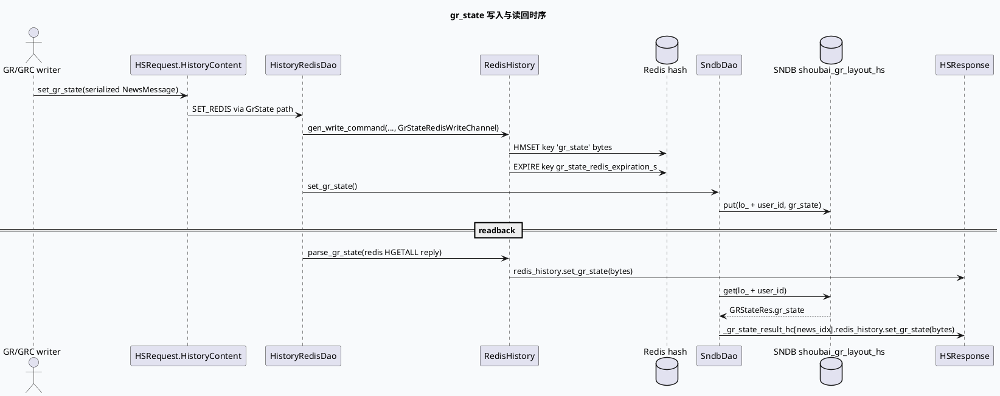

# 2026-06-14 基础库代码理解：HS gr_state 点展状态的存取与透传链路
<!-- topic-nav:start -->
> 主题：`base/history-state-io` · 同题补充 / 历史版本 · [主题目录](README.md) · [先读主文](20260726-hs-gr-state-dual-channel-consistency.md)
<!-- topic-nav:end -->


> 今日主题来源：未发现本机 daily-plan 文件；按周日 fallback 选择 History Service 的 `gr_state` 点展状态透传机制。内网 KU 未提供 URL/doc-id，本篇以代码库检索结果为准；平台规范与业务口径需人工补充。

## 架构全景图

<style>.arch-hs{font-family:-apple-system,BlinkMacSystemFont,"Segoe UI",sans-serif;border:1px solid #cbd5e1;border-radius:18px;padding:18px;background:#f8fafc;color:#1f2937}.arch-hs .title{font-size:22px;font-weight:900;margin-bottom:6px}.arch-hs .sub{font-size:13px;color:#64748b;margin-bottom:16px}.arch-hs .grid{display:grid;grid-template-columns:1fr 1.1fr 1fr;gap:12px}.arch-hs .lane{background:#fff;border:1px solid #dbeafe;border-radius:14px;padding:12px}.arch-hs h3{margin:0 0 10px;font-size:15px;color:#1d4ed8}.arch-hs .box{border-radius:12px;padding:10px;margin:8px 0;border:1px solid #e5e7eb;background:#f9fafb}.arch-hs .box b{display:block;font-size:13px;margin-bottom:4px}.arch-hs .box span{font-size:12px;color:#64748b;line-height:1.45}.arch-hs .hot{background:#eff6ff;border-color:#93c5fd}.arch-hs .note{margin-top:12px;padding:10px;border-radius:10px;background:#eef6ff;border-left:4px solid #3b82f6;font-size:13px;color:#334155}</style><div class="arch-hs"><div class="title">HS gr_state 基础存储全景</div><div class="sub">点展状态不跟普通 IssuedItem 字段同生命周期处理，而是作为序列化 NewsMessage 独立写入 gr_state 字段，再在读路径透传回上游。</div><div class="grid"><div class="lane"><h3>协议层</h3><div class="box hot"><b>HistoryContent.gr_state</b><span>HS 请求/响应携带用户状态 bytes；写入时只接受非空 gr_state。</span></div><div class="box"><b>NewsMessage.state[]</b><span>与 nids[] 按下标对应，表达 NO_ACTUAL_ISSUED / ISSUED / UNSHOW / SHOWED / CLICKED。</span></div><div class="box"><b>IdmContent.gr_state</b><span>IDM 侧作为 bytes 透传字段，不参与 IssuedItem 普通字段解析。</span></div></div><div class="lane"><h3>存储层</h3><div class="box hot"><b>GrStateRedisWriteChannel</b><span>Redis 专用分支只 HMSET `gr_state` 字段，TTL 默认 `gr_state_redis_expiration_s`。</span></div><div class="box"><b>SndbDao::set_gr_state</b><span>按 `lo_ + user_id` 写入 `shoubai_gr_layout_hs`，日志中可解析为 NewsMessage。</span></div><div class="box"><b>gflag gate</b><span>`-is_open_gr_state=true` 控制 gr_state 读写节点是否启用。</span></div></div><div class="lane"><h3>读回层</h3><div class="box hot"><b>RedisHistory::parse_gr_state</b><span>HGETALL 结果中查找 field `gr_state`，写入独立 `_gr_state_result_hc`。</span></div><div class="box"><b>SndbDao::get_gr_state</b><span>仅 `provider == shoubai-gr` 且请求含 `ne_` prefix 时读取 SNDB。</span></div><div class="box"><b>HistoryContext.redis_history</b><span>读回后以 HistoryContent.gr_state 形态留给 merge/response 阶段透传。</span></div></div></div><div class="note">关键边界：普通 Redis 历史与 gr_state 历史是两条通道；排查时必须先确认命中了 GrState 节点，而不是只看 NewsRedisReadChannel。</div></div>

## 核心流程图



## 配置/结构信息图

```infographic hierarchy-structure
data
  title gr_state 配置到代码路径映射
  desc 读写节点、gflag、DAO 和 RedisHistory 共同构成状态透传基础设施
  items
    - label gflags.conf
      desc `-is_open_gr_state=true` 打开 gr_state 读写分支
      children
        - label get_data_tree.conf
          desc `GrStateSndbGetIONode` 使用 `sndb_gr_state_get_pre_handler` / `after_handler`
          children
            - label SndbDao::get_gr_state
              desc provider 必须是 `shoubai-gr`，请求中必须存在 `ne_` prefix
        - label set_data_tree.conf
          desc `GrStateSndbSetIONode` 使用 `sndb_gr_state_set_pre_handler` / `after_handler`
          children
            - label SndbDao::set_gr_state
              desc 找到非空 `HistoryContent.gr_state` 后写入 SNDB
    - label RedisHistory
      desc GrStateRedisWriteChannel 只存 field `gr_state`，parse_gr_state 只读该 field
```

## 关键结论

- `HistoryContent.gr_state` 是基础库存取入口：`history_service.proto` 中请求内容和响应内容都支持 bytes 形态的 gr_state。
- Redis 专用写路径会跳过普通 `issued_items/other` 组合逻辑，只向 hash 写 `gr_state` 字段，并使用独立 TTL `gr_state_redis_expiration_s`。
- SNDB 路径按 `lo_ + user_id` 组织 key，组名固定为 `shoubai_gr_layout_hs`；读路径还要求 `provider == shoubai-gr` 且请求中存在 `ne_` 历史前缀。
- `parse_gr_state()` 与 `new_parse_history()` 是两套解析：前者把 Redis hash field `gr_state` 写入 `_gr_state_result_hc`，不是普通 `_result_hc`。
- `-is_open_gr_state=true` 是第一层开关；如果关闭，`GrStateRedisReadChannel` 直接不发起请求，SNDB get 也提前返回。

## Pitfalls 卡片

<style>.pit-hs{font-family:-apple-system,BlinkMacSystemFont,"Segoe UI",sans-serif;max-width:980px;border-radius:20px;background:#f5f7fa;border:1px solid #c7d2fe;padding:20px;color:#1e293b}.pit-hs .meta{font-size:12px;letter-spacing:.08em;text-transform:uppercase;color:#1d4ed8;font-weight:900}.pit-hs .headline{font-size:28px;line-height:1.15;font-weight:900;margin:8px 0 12px}.pit-hs .grid{display:grid;grid-template-columns:1.15fr .9fr;gap:14px}.pit-hs .panel{background:#fff;border-top:4px solid #3b82f6;border-radius:12px;padding:12px}.pit-hs .panel b{display:block;margin-bottom:6px}.pit-hs .panel p{margin:0;font-size:14px;line-height:1.65;color:#334155}.pit-hs .end{margin-top:12px;font-weight:900;color:#1d4ed8}</style><div class="pit-hs"><div class="meta">pitfall · history service</div><div class="headline">查不到点展状态时，先确认是不是走错了历史通道</div><div class="grid"><div class="panel"><b>普通历史不等于 gr_state</b><p>NewsRedisReadChannel 读到的是普通下发历史；点展状态在 GrStateRedis/SNDB 专用路径中，以 `gr_state` bytes 透传。</p></div><div class="panel"><b>SNDB 读有业务门禁</b><p>`SndbDao::get_gr_state` 会检查 `is_open_gr_state`、provider 和 `ne_` prefix，任一不满足都会跳过。</p></div></div><div class="end">∎ 先看开关和节点，再看 bytes 解析。</div></div>

## 调试 checklist

```infographic list-column-done-list
data
  title gr_state 基础链路排查清单
  desc 从协议字段、节点配置、存储命令、读回容器到状态解析逐层确认
  items
    - label 确认请求字段
      desc `HistoryContent.gr_state` 是否非空，是否是序列化 `NewsMessage`
      done true
    - label 确认全局开关
      desc `gflags.conf` 中 `-is_open_gr_state=true`
      done true
    - label 确认写通道
      desc Redis 写是否命中 `GrStateRedisWriteChannel`，SNDB 写是否命中 `GrStateSndbSetIONode`
      done true
    - label 确认读条件
      desc SNDB 读要求 provider 为 `shoubai-gr` 且请求含 `ne_` prefix
      done false
    - label 确认返回容器
      desc gr_state 结果在 `_gr_state_result_hc`，不要只检查普通 `_result_hc`
      done false
    - label 确认 protobuf 解析
      desc 用 `NewsMessage.ParseFromString(gr_state)` 检查 `nids[]` 与 `state[]` 是否等长
      done false
```

## 证据来源

- `gr-proto/proto/history_service.proto:31-154`：`IssuedItem` 字段定义，`show_tss`、`click_tss` 等透传/不存储字段位于普通 item 定义中。
- `gr-proto/proto/history_service.proto:165-175`：`HistoryContent.gr_state` 是用户状态数据 bytes。
- `gr-proto/proto/history_service.proto:195-219`：`HSRequest.gr_state_read_sndb` 与 `HSResponse.gr_state` 支持响应级状态透传。
- `gr-proto/proto/redisprotocol.proto:168-320`：`NewsMessage` 定义，`state = 129` 表达点展状态枚举值。
- `gr-proto/proto/idm_service.proto:11-27`：`IdmContent.gr_state = 15` 作为 IDM 透传字段。
- `src/history/redis_history.cc:86-145`：`parse_gr_state()` 从 Redis hash 中提取 field `gr_state`。
- `src/history/redis_history.cc:412-428`：`gen_write_command()` 对 `GrStateRedisWriteChannel` 的非空 gr_state 检查。
- `src/history/redis_history.cc:605-681`：GrState 写路径只 HMSET `gr_state` 并设置独立 TTL。
- `src/dao/history_redis_dao.cc:52-54`：`is_open_gr_state` 控制 GrStateRedisReadChannel 是否启用。
- `src/dao/history_redis_dao.cc:288-297`：读回时进入 `parse_gr_state()` 并写入 `_gr_state_result_hc`。
- `src/dao/sndb_dao.cc:96-121`：SNDB 写入 `gr_state` 的实现。
- `src/dao/sndb_dao.cc:234-273`：SNDB 读取 `gr_state` 的 provider/prefix 门禁和结果写回。
- `conf/gflags.conf:35`：默认打开 `-is_open_gr_state=true`。
- `conf/get_data_tree.conf:44-54`、`conf/set_data_tree.conf:38-48`：SNDB gr_state get/set IONode 配置。
