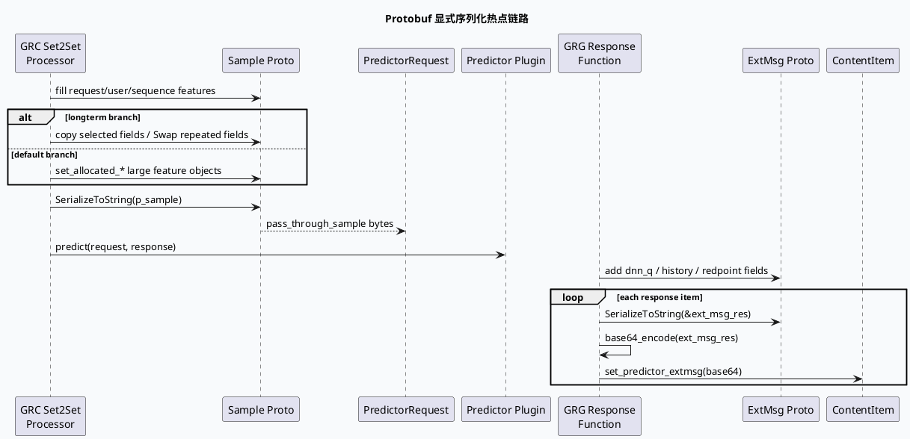

# Protobuf SerializeToString 热点与 FlatBuffers 替代方向
<!-- topic-nav:start -->
> 主题：`base/protobuf-hotspots` · 同题补充 / 历史版本 · [主题目录](README.md) · [先读主文](20260707-protobuf-serialize-flatbuffers-hotspots.md)
<!-- topic-nav:end -->


> 今日主题来源：`daily-plan-20260529.json` 周二基础库主题：`Protobuf SerializeToString 热点与 FlatBuffers 替代方向`。内网 KU 未提供可检索 URL/doc-id；FlatBuffers 平台落地规范需人工补充。本篇以 GRC/GRG 代码证据为准，聚焦请求透传样本、响应 extmsg 与后续替代方向。

## 架构全景图

<style>.pb-arch{font-family:Inter,Arial,sans-serif;background:#f8fafc;border:1px solid #dbe4ef;border-radius:18px;padding:18px;margin:16px 0;color:#1f2937}.pb-arch .title{font-size:22px;font-weight:850;margin-bottom:4px}.pb-arch .sub{font-size:13px;color:#64748b;margin-bottom:16px}.pb-arch .layers{display:grid;grid-template-columns:1fr 1.2fr 1fr;gap:12px}.pb-arch .layer{background:white;border:1px solid #dbe4ef;border-radius:14px;padding:14px}.pb-arch h3{margin:0 0 10px;font-size:15px;color:#315072}.pb-arch .box{background:#f8fbff;border:1px solid #e2e8f0;border-radius:10px;padding:10px;margin:8px 0;font-size:13px;line-height:1.45}.pb-arch .hot{background:#fff7ed;border-color:#f59e0b}.pb-arch .next{background:#eef6ff;border-color:#7aa7d9}.pb-arch .arrow{font-weight:800;color:#64748b;text-align:center;margin:8px 0;font-size:12px}</style><div class="pb-arch"><div class="title">GRC/GRG Protobuf 序列化成本全景</div><div class="sub">热点不只在 RPC 框架层：业务代码会把大对象样本、extmsg、落盘字段显式序列化成 string/base64，再进入网络或响应结构。</div><div class="layers"><div class="layer"><h3>请求侧样本</h3><div class="box hot">GRC Set2Set：从 request/user/sequence feature 组装 sample</div><div class="arrow">SerializeToString</div><div class="box">pass_through_sample 注入 PredictorRequest</div></div><div class="layer"><h3>中间业务结构</h3><div class="box">正排/UMS/PCS 字段填充 repeated message</div><div class="box hot">字段越宽，ByteSize 与 heap allocation 越敏感</div><div class="box next">候选替代：FlatBuffers / schema-stable packed payload</div></div><div class="layer"><h3>响应侧 extmsg</h3><div class="box hot">GRG ResponseFunction：extmsg → string → base64</div><div class="arrow">per item loop</div><div class="box">predictor_extmsg 写回 content item</div></div></div></div>

## 核心调用链



## 配置/结构信息图

```infographic
infographic list-grid-badge-card
data
  title 序列化热点结构面
  desc 从对象宽度、循环位置、编码方式、监控归因四个维度观察
  items
    - label 样本对象宽
      desc request_feature / user_feature / sequence_feature 聚合后一次序列化
      icon mdi/package-variant
    - label 响应循环内
      desc 每个 content item 都可能 extmsg SerializeToString + base64
      icon mdi/repeat
    - label repeated 字段
      desc dnn_q、show_item、session 等增长会直接放大 CPU 与内存
      icon mdi/format-list-bulleted
    - label 二次编码
      desc protobuf bytes 后再 base64，额外增加长度与 CPU
      icon mdi/code-braces
    - label 监控切点
      desc SIA / DapperDirectCollect 可用于 RPC 耗时，但需补充序列化局部耗时
      icon mdi/chart-timeline-variant
    - label 替代方向
      desc FlatBuffers 适合稳定 schema 与少拷贝读；迁移需兼容双写/灰度
      icon mdi/arrow-decision
    - label 字段裁剪
      desc 优先删除响应不消费字段，比替换协议更低风险
      icon mdi/filter-outline
    - label 预分配
      desc string reserve / repeated reserve 适合短期热点缓解
      icon mdi/database-cog
  
theme
  palette #3D5A80 #F59E0B #2D6A4F
```

## 关键机制拆解

### 1. Set2Set 样本序列化发生在 Predictor RPC 前

`src/processor/set2set_predict_function.cpp:548-597` 会按实验分支组装 `sample`：

- longterm 分支选择性复制 request/user/sequence 字段，并对部分 repeated 字段使用 `Swap()`；
- 默认分支通过 `set_allocated_request_feature()`、`set_allocated_user_feature()`、`set_allocated_sequence_feature()` 挂接大对象；
- `sample.SerializeToString(p_sample)` 将完整样本写入 `request.mutable_pass_through_sample()`。

这类热点的本质不是“Predictor RPC 慢”本身，而是 RPC 前已经发生一次大对象遍历、编码和 string 写入。

### 2. Predictor RPC 监控覆盖下游耗时，但不天然拆分序列化成本

`src/processor/set2set_predict_function.cpp:609-638` 在调用 Predictor 前后使用 `SIA_START(set2set_predict_rpc)` 和 `DapperDirectCollect("call_set2set_predict")` 记录整体耗时。若 CPU 升高但 RPC 耗时不变，需要额外在 `SerializeToString` 前后打点，否则序列化成本容易被归入业务处理总耗时。

### 3. GRG 响应侧 extmsg 是 per-item 显式编码

`src/process/response_function.cpp:4207-4222` 要求“落盘 sample 必须在 extmsg encode 前”，随后对 `extmsg` 执行：

- `SerializeToString(&ext_msg_res)`；
- `base64_encode(ext_msg_res_b64, ext_msg_res)`；
- `content_item_ptr->mutable_ext()->set_predictor_extmsg(ext_msg_res_b64)`。

这是典型循环内序列化热点：候选数、`dnn_q` 数量、历史 show item 数量都会线性放大 CPU 与响应体积。

### 4. FlatBuffers 替代要从“读多写少、字段稳定”的 payload 开始

当前代码中 `pass_through_sample` 和 `predictor_extmsg` 都是跨模块 payload。迁移时建议优先选择字段稳定、下游只读、无需频繁增删 optional 语义的子结构；保留 PB 外壳做灰度兼容，新增 FlatBuffers bytes 字段进行双写对比，而不是一次性替换整个 RPC message。

### 5. 短期优化优先级：字段裁剪 > 局部打点 > reserve > 协议替换

协议替换收益大但风险也高。更实际的排查顺序是：先确认下游真正消费哪些 extmsg/sample 字段；再补充局部 `SerializeToString` cost 与 bytesize；最后对 repeated/string 做预分配和裁剪。只有当字段语义稳定且热点长期存在时，再推进 FlatBuffers。

## Pitfalls 卡片

<style>.pb-card{font-family:Inter,Arial,sans-serif;background:#F5F7FA;border-radius:18px;padding:20px;margin:18px 0;border-left:8px solid #3D5A80;color:#1f2937;box-shadow:0 10px 26px rgba(31,41,55,.08)}.pb-card .meta{font-size:12px;letter-spacing:.08em;text-transform:uppercase;color:#64748b;font-weight:800}.pb-card h3{font-size:25px;line-height:1.15;margin:8px 0 12px}.pb-card .grid{display:grid;grid-template-columns:2fr 1fr;gap:14px}.pb-card p,.pb-card li{font-size:14px;line-height:1.65}.pb-card ul{margin:0 0 0 18px}.pb-card .side{border-left:3px solid #F59E0B;padding-left:12px;color:#374151}.pb-card code{background:#e8edf3;border-radius:5px;padding:1px 5px}</style><div class="pb-card"><div class="meta">Pitfalls / Serialization</div><h3>不要只看 RPC 耗时；序列化热点经常藏在 RPC 调用前或响应循环内。</h3><div class="grid"><div><ul><li><b>整体耗时误判：</b><code>SIA_START(set2set_predict_rpc)</code> 包住 RPC，但样本编码在此之前。</li><li><b>循环内放大：</b>extmsg 每个 item 编码一次，候选数增长会线性放大。</li><li><b>base64 二次成本：</b>protobuf bytes 再 base64 会增加 CPU 和响应长度。</li><li><b>替换协议不是第一步：</b>先证明字段消费、bytesize 与耗时分布，再谈 FlatBuffers。</li></ul></div><div class="side">判断标准：同一请求下 RPC latency 稳定但进程 CPU 上升时，优先补 `SerializeToString` 局部耗时和 payload bytesize。</div></div></div>

## 调试 checklist

```infographic
infographic list-column-done-list
data
  title Protobuf 热点排查顺序
  desc 从证据采样到替代协议灰度，避免直接大改
  items
    - label 统计 SerializeToString 前后耗时
      desc 对 sample/extmsg 分别打局部耗时和 bytesize
      done true
    - label 统计 repeated 字段规模
      desc dnn_q、session、show_item、sample feature 分开计数
      done true
    - label 确认下游字段消费
      desc 未消费字段优先裁剪，减少协议迁移范围
      done true
    - label 检查循环内编码次数
      desc response item 数量乘以 extmsg 大小是主要放大器
      done true
    - label 评估 string/repeated reserve
      desc 适合短期降低 realloc 成本
      done true
    - label 设计 PB 外壳 + FlatBuffers bytes 双写
      desc 先灰度对比语义和体积，再切读路径
      done true
theme
  palette #3D5A80 #F59E0B #2D6A4F
```

## 证据来源

- `src/processor/set2set_predict_function.cpp:548-597`：Set2Set 样本字段填充与 `sample.SerializeToString(p_sample)`。
- `src/processor/set2set_predict_function.cpp:609-638`：Predictor RPC SIA/Dapper 耗时统计边界。
- `src/process/response_function.cpp:4207-4222`：GRG 响应 `extmsg.SerializeToString`、base64 与 `predictor_extmsg` 写入。
- `src/process/response_function.cpp:4187-4205`：响应侧 show history 进入 extmsg 的字段增长来源。
- `daily-plan-20260529.json:321-324`：周二基础库主题选择。

## 需人工补充

- KU/设计文档中的 FlatBuffers 统一 schema、兼容字段命名、灰度开关与跨服务版本约束需人工补充。
- 当前 cron 环境未进行生产 perf/flamegraph 采样；本文定位的是代码热点和应补观测点，不替代线上 CPU 归因数据。
