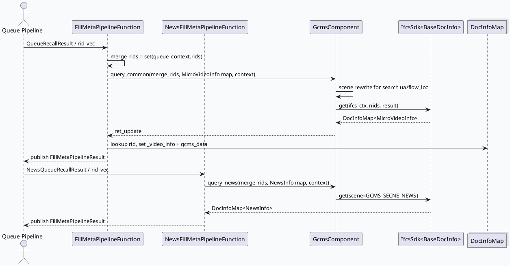

# GRC GCMS/IFCS 正排补全：同一组件支撑视频与图文双场景
<!-- topic-nav:start -->
> 主题：`base/gcms-fillmeta` · 同题补充 / 历史版本 · [主题目录](README.md) · [先读主文](20260619-gcms-ifcs-dual-scene-fillmeta-architecture.md)
<!-- topic-nav:end -->


> 日期：2026-06-18  
> 今日主题来源：未发现显式 `daily-plan-20260618.json`；按近期双 Markdown 工作流 fallback 到 `GcmsComponent + FillMetaPipeline` 基础库主题。已按要求设置 `BAIDU_CC_USERNAME=hujiyang`；本次未提供 KU URL/doc-id，内网业务背景需人工补充，本文以代码库检索结果为准。  
> 范围：`GcmsComponent::query_common/query_news`、`FillMetaPipelineFunction`、`NewsFillMetaPipelineFunction` 与图配置依赖关系。

<style>.arch{font-family:-apple-system,BlinkMacSystemFont,"Segoe UI",sans-serif;background:#f8fafc;border:1px solid #dbe4ef;border-radius:18px;padding:18px;margin:16px 0;color:#1f2937}.arch-title{font-weight:800;font-size:22px;margin-bottom:12px}.arch-sub{color:#64748b;font-size:13px;margin-bottom:14px}.arch-grid{display:grid;grid-template-columns:1fr 1fr 1fr;gap:12px}.arch-box{background:white;border:1px solid #e5e7eb;border-radius:14px;padding:12px}.arch-box h3{font-size:15px;margin:0 0 8px;color:#334155}.arch-box p{font-size:13px;line-height:1.55;margin:0;color:#475569}.arch-flow{display:flex;gap:8px;align-items:stretch;margin-top:12px}.arch-step{flex:1;background:#eef6ff;border-left:4px solid #3d5a80;border-radius:12px;padding:10px;font-size:13px}.card-frame{font-family:-apple-system,BlinkMacSystemFont,"Segoe UI",sans-serif;margin:18px 0}.card{background:#f5f7fa;border:1px solid #dbe4ef;border-radius:18px;padding:20px;color:#1f2937}.card-meta{font-size:12px;font-weight:800;letter-spacing:.08em;text-transform:uppercase;color:#3d5a80}.card-title{font-size:28px;line-height:1.15;font-weight:850;margin:6px 0 12px}.card-grid{display:grid;grid-template-columns:2fr 1fr;gap:14px}.card-panel{background:white;border-top:5px solid #3d5a80;border-radius:12px;padding:12px;font-size:14px;line-height:1.65}.card-panel b{color:#1e3a5f}.card-endmark{font-weight:900;color:#3d5a80}</style>
<div class="arch"><div class="arch-title">架构全景图：召回候选如何变成可过滤/排序的正排对象</div><div class="arch-sub">基础库视角关注“统一 IFCS SDK + 双场景封装 + Pipeline 发布”的边界，而不是单个业务策略。</div><div class="arch-grid"><div class="arch-box"><h3>输入层：QueueContext</h3><p>`DsToRidInfoPipelineVertex` 把召回输出拆成 `QueueRecallResult` 与 `NewsQueueRecallResult`，每个 batch 进入 `QueueContext.rid_vec/rids`。</p></div><div class="arch-box"><h3>组件层：GcmsComponent</h3><p>`init()` 创建 `IfcsSdk<BaseDocInfo>`，`query_common()` 使用 `MicroVideoInfo`，`query_news()` 使用 `NewsInfo`，对外隐藏 IFCS SDK 细节。</p></div><div class="arch-box"><h3>输出层：ChannelPublisher</h3><p>命中正排的 item 被压缩到前缀区，再 publish 到 `FillMetaPipelineResult`，供 Filter、Sketchy、Merge 等下游复用。</p></div></div><div class="arch-flow"><div class="arch-step">1. 收集 rid：`unordered_set` 去重</div><div class="arch-step">2. 构造 context：logid、scene、sids、cache 策略</div><div class="arch-step">3. IFCS get：返回 DocInfoMap</div><div class="arch-step">4. 回填指针：`_video_info/_news_info`</div></div></div>

## 核心流程图



## 配置/结构信息图

```infographic list-grid-badge-card
data
  title FillMeta 双通路结构
  desc 同一个 IFCS SDK 被视频正排和图文正排复用，差异主要落在 scene、DocInfo 类型、下游数据字段
  items
    - label Video common
      value 1
      desc query_common → MicroVideoInfo；可按 ua/flow_loc 改写为 search scene
      icon mdi/video
    - label News scene
      value 2
      desc query_news → NewsInfo；固定 GCMS_SECNE_NEWS
      icon mdi/newspaper
    - label Small flow sids
      value 3
      desc gcms_context.sids_str_vec 透传小流量字段选择
      icon mdi/source-branch
    - label Channel publish
      value 4
      desc 命中正排后压缩 rid_vec 并发布给后续节点
      icon mdi/publish

theme
  palette #3D5A80 #98C1D9 #E0FBFC
```

## 关键观察

1. `GcmsComponent::init()` 只初始化一个 `_ifcs_sdk`，但查询接口通过模板 `DocInfoMap<MicroVideoInfo>` / `DocInfoMap<NewsInfo>` 分离视频与图文返回类型。  
2. `query_common()` 默认 `server_cache_only=true`，但在特定 UA/flow_loc 或 `searchc_query_title` 小流量下切到 `GCMS_SECNE_SEARCH` 并关闭 server cache only。  
3. `FillMetaPipelineFunction` 在进入 IFCS 前缓存多个 `hit_abtest` 结果，并把 `autor_level_sm` 预转换成 `uint64_t`，避免在 rid 循环中重复字符串拼接与转换。  
4. `NewsFillMetaPipelineFunction` 的错误处理与视频类似：IFCS 失败只结束当前 channel SIA 并返回 `ERR_OK`，避免单个 batch 把整条 graph 拉失败，但这也要求监控看 `ret_update` 与 after_gcms 数量。

## Pitfalls 卡片

<div class="card-frame"><div class="card"><div class="card-meta">Pitfalls · GCMS/IFCS</div><div class="card-title">正排补全不是“查到就完事”，真正风险在场景、缓存与类型边界</div><div class="card-grid"><div class="card-panel"><b>场景误配：</b>`query_common()` 会因 UA/flow_loc 改写 scene；排查搜索落地页或二跳场景时，不能只看调用方传入的默认 `GCMS_SECNE_RECALL`。</div><div class="card-panel"><b>类型错位：</b>图文链路拿的是 `NewsInfo`，但 `news_updates_dibar` 配置里输出仍叫 `FillMetaPipelineResult`；读配置时要跟数据内容而不是只跟名字。</div></div><div class="card-endmark">∎</div></div></div>

## 调试 checklist

```infographic list-column-done-list
data
  title GCMS FillMeta 排障清单
  items
    - label 确认 graph 使用的 queue_vertex 文件
      desc 默认视频链路看 queue_vertex.conf；图文场景看 news_queue_vertex.conf 或 news_updates_dibar/queue_vertex.conf
      done true
    - label 对比 total nid size 与 after gcms rpc nid size
      desc 开启 open_gcms_statistics 后可采样输出缺失 nid
      done true
    - label 检查 scene/cache 改写
      desc ua=69/77/86/123/155/156 或 ua=85 特定 flow_loc 会走 search scene
      done true
    - label 检查 sid 小流量字段
      desc sids_str_vec 会影响 IFCS 字段/列选择
      done true
    - label 验证 publish 前 rid_vec.resize(keep_num)
      desc 避免未命中正排的 item 继续进入过滤/排序
      done true
```

## 证据来源

- `src/plugin/gcms_component.h:19-44`：`GcmsScene` 与 `query_common/query_news` 接口类型。  
- `src/plugin/gcms_component.cpp:18-31`：IFCS SDK 初始化。  
- `src/plugin/gcms_component.cpp:40-78`：`query_common()` scene 改写、sids 透传、server_cache_only 与 IFCS get。  
- `src/plugin/gcms_component.cpp:80-101`：`query_news()` 固定 news scene。  
- `src/processor/video_launch/fill_meta_pipeline.cpp:51-124`：视频 pipeline 收集 rid、构造 context、调用 `query_common()`。  
- `src/processor/video_launch/fill_meta_pipeline.cpp:155-186`：正排命中后回填 `MicroVideoInfo/GcmsData`。  
- `src/processor/video_launch/news_fill_meta_pipeline.cpp:33-87`：图文 pipeline 调 `query_news()`。  
- `src/processor/video_launch/news_fill_meta_pipeline.cpp:89-158`：图文正排过滤、压缩并 publish。  
- `output/conf/plugins/graph/queue_vertex.conf:24-57`：视频 FillMetaPipelineFunction 节点声明。  
- `output/conf/plugins/graph/news_queue_vertex.conf:1-13`：图文 NewsFillMetaPipelineFunction 节点声明。

## 需人工补充

- IFCS 字段集、GCMS 列配置与线上缓存策略变更记录需从 KU/变更单补齐；本次任务未提供可检索 URL/doc-id。
