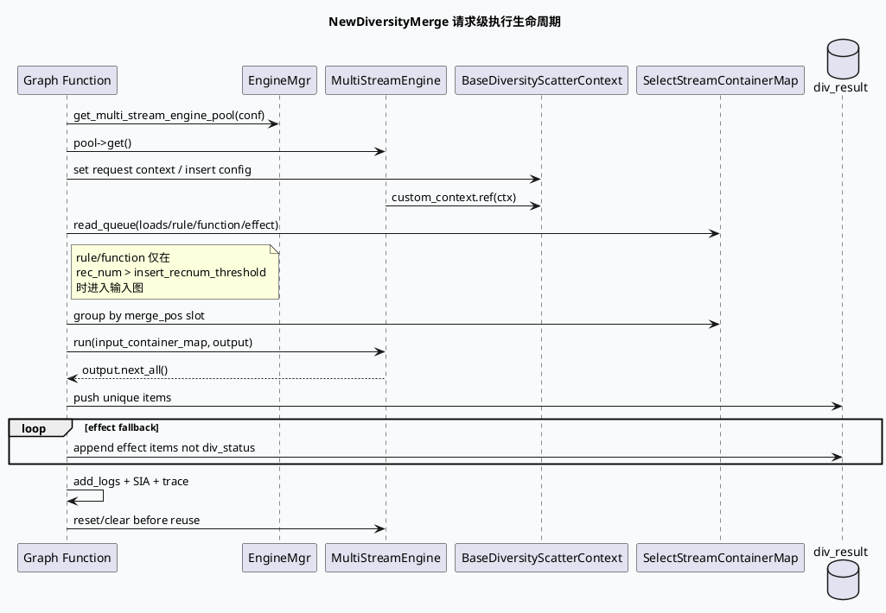

# NewDiversityMerge：MultiStreamEngine 多队列打散基础框架（2026-06-24）
<!-- topic-nav:start -->
> 主题：`base/multistream-binding` · 同题补充 / 历史版本 · [主题目录](README.md) · [先读主文](20260529-exec-engine-multistreamengine-graphdependency-deep-dive.md)
<!-- topic-nav:end -->


> 今日主题来源：本机未发现可用 `daily-plan` 文件；按周三 fallback 选择 GRG 多流打散基础库主题。已设置 `BAIDU_CC_USERNAME=hujiyang`；当前未提供 KU URL/doc-id，内网背景需人工补充，本文以代码库检索结果为准。

<style>.arch240624{font-family:-apple-system,BlinkMacSystemFont,"Segoe UI",sans-serif;background:#f8fafc;border:1px solid #dbe4ef;border-radius:18px;padding:18px;margin:16px 0;color:#1f2937}.arch240624 .title{font-size:22px;font-weight:850;margin-bottom:5px}.arch240624 .sub{font-size:13px;color:#64748b;margin-bottom:14px}.arch240624 .grid{display:grid;grid-template-columns:1fr 1.15fr 1fr;gap:12px}.arch240624 .layer{background:#fff;border:1px solid #dbe4ef;border-radius:14px;padding:14px}.arch240624 h3{margin:0 0 10px;font-size:15px;color:#315072}.arch240624 .box{background:#eef6ff;border:1px solid #bfdbfe;border-radius:10px;padding:9px;margin:8px 0;font-size:13px;line-height:1.45}.arch240624 .hot{background:#fff7ed;border-color:#f59e0b}.arch240624 .warn{background:#fff1f2;border-color:#fda4af}.arch240624 .arrow{text-align:center;color:#64748b;font-size:12px;font-weight:800;margin:8px 0}</style><div class="arch240624"><div class="title">架构全景：NewDiversityMerge 是图函数到 MultiStreamEngine 的协议适配层</div><div class="sub">图侧提供 loads/rule/function/effect 四类队列；ExecEngine 配置决定 stream DAG；函数负责按槽位组织输入、执行引擎、去重并写回结果。</div><div class="grid"><div class="layer"><h3>图函数入口</h3><div class="box hot">NewDiversityMergeFunction</div><div class="box">GRAPH_FUNCTION_DEPEND_MUTABLE_CHANNEL</div><div class="box">loads / rule / function / effect</div><div class="box warn">Reqnum 与 insert_recnum_threshold 控制是否插入</div></div><div class="layer"><h3>引擎适配</h3><div class="box hot">EngineMgr::get_multi_stream_engine_pool(conf)</div><div class="arrow">↓</div><div class="box">BaseDiversityScatterContext</div><div class="box">bind_graph_dependency()</div><div class="box">SelectStreamContainerMap</div></div><div class="layer"><h3>配置执行层</h3><div class="box">loads_select</div><div class="box">rule_select</div><div class="box">function_select</div><div class="box">final_select / effect_pk</div><div class="box hot">merge_pk</div></div></div></div>

## 核心结论

- `init()` 先从图函数配置读取 `plugin/conf/context_name`，再通过 `EngineMgr` 获取 `MultiStreamEngine`，并把 `BaseDiversityScatterContext` 绑定到 engine 的 custom context：`src/process/new_diversity_merge.cpp:43-76`。
- `process()` 每次请求都会重建执行上下文：写入 logid/cuid/ua、field accessor、sid、trace 采样，以及 `ua/channel_id/is_open_dnn_soft_rule` 等条件值：`src/process/new_diversity_merge.cpp:124-174`。
- 输入不是单列表，而是按 `merge_pos` 落到 slot 的四类队列：`loads`、`rule`、`function`、`effect`；其中 `rule/function` 只有在 `rec_num > insert_recnum_threshold` 时才读取：`src/process/new_diversity_merge.cpp:203-220`。
- 输出阶段先取 `MultiStreamEngine::run()` 的结果，再把未命中的 effect 队列追加，并通过 `_div_nid_set` 去重：`src/process/new_diversity_merge.cpp:266-321`、`src/process/new_diversity_merge.cpp:376-421`。
- `reset()` 必须清理 engine/context、输入 map、容器、去重集合与统计 map；否则 pooled function/object 会把上一请求状态泄漏到下一请求：`src/process/new_diversity_merge.cpp:573-604`。

## 核心流程图



## 配置/结构信息图

```infographic
infographic hierarchy-structure
data
  title MultiStreamEngine 配置骨架
  desc conf/plugins/exec_engine/multi_stream_diversity_new.conf 将队列选择拆为 stream + executor + rule 三层
  items
    - label Stream DAG
      desc loads_select、rule_select、function_select、final_select、effect_pk、merge_pk
      children
        - label 插入类
          desc loads/rule/function 产出各槽位候选
        - label 效果类
          desc final_select 与 effect_pk 负责效果队列筛选和打分
    - label Executor
      desc select_executor / loads_select_executor / effect_select_executor
      children
        - label exec_type
          desc 控制输入与算子并发/串行/有序
        - label generator
          desc CostGenerator 读取 cost_generator 配置
    - label Rule
      desc RuleSelectOperator 等业务算子挂在 executor 下
      children
        - label condition
          desc 由 exec_context.add_condition_value 注入
        - label depend
          desc 由 MultiStreamEnginePlugin.bind_graph_dependency 绑定图依赖

theme
  palette #3D5A80 #F59E0B #2D6A4F
```

## 关键机制拆解

### 1. `context_name` 不是普通字符串，而是请求上下文对象入口

`src/process/new_diversity_merge.cpp:64-68` 通过 `ApplicationContext::get_or_create<BaseDiversityScatterContext>(context_name)` 构造业务上下文，再把它 ref 到 engine 的 `custom_context`。如果配置中的 `context_name` 变更但上下文类型未注册，初始化会失败；如果上下文未在 `reset()` 中清理，请求间状态会污染。

### 2. `insert_recnum_threshold` 会让 rule/function 队列整体失效

`src/process/new_diversity_merge.cpp:214-219` 只有在 `rec_num > _insert_recnum_threshold` 时才读取 `rule_queue` 和 `function_queue`。这类线上现象常被误判为“RuleSelectOperator 没执行”，实际是入口阈值把插入队列短路了。

### 3. 数据结构靠 `reinterpret_cast` 接入 ExecEngine，字段 accessor 必须稳定

`src/process/new_diversity_merge.cpp:247-258` 把 `std::vector<RidTmpInfo*>` reinterpret 成 `std::vector<DynamicStruct*>*` 并包装为 `SelectStreamContainer`；同时 `src/process/new_diversity_merge.cpp:135-144` 把 nid/result/rectype/reason/log 等字段 accessor 交给 exec_context。新增/调整 `RidTmpInfo` 字段时，要优先确认 DynamicStruct 映射和 FieldAccessor 是否兼容。

### 4. 输出结果由“引擎结果 + effect 兜底追加”组成

`src/process/new_diversity_merge.cpp:283-311` 先把 engine output 写入结果，再遍历 effect 队列追加未命中的候选。结果中 `queue_type` 由 `div_reason` 推断：`loads`、`rule_select`、`function_select`、其他视为 effect（`src/process/new_diversity_merge.cpp:388-401`）。排查条数时不要只看 engine output，还要看 effect append。

<style>.card240624{font-family:-apple-system,BlinkMacSystemFont,"Segoe UI",sans-serif;background:#F5F7FA;border-radius:18px;padding:20px;margin:18px 0;border-left:8px solid #3D5A80;color:#1f2937;box-shadow:0 10px 26px rgba(31,41,55,.08)}.card240624 .meta{font-size:12px;letter-spacing:.08em;text-transform:uppercase;color:#64748b;font-weight:800}.card240624 h3{font-size:24px;line-height:1.18;margin:8px 0 12px}.card240624 .grid{display:grid;grid-template-columns:2fr 1fr;gap:14px}.card240624 li{font-size:14px;line-height:1.65}.card240624 ul{margin:0 0 0 18px}.card240624 .side{border-left:3px solid #F59E0B;padding-left:12px;color:#374151;font-size:14px;line-height:1.65}.card240624 code{background:#e8edf3;border-radius:5px;padding:1px 5px}</style><div class="card240624"><div class="meta">Pitfalls / MultiStreamEngine</div><h3>多流打散问题往往不是“某条规则没跑”，而是输入 slot、阈值、condition 或 reset 边界错位。</h3><div class="grid"><div><ul><li><b>阈值短路：</b><code>rec_num <= insert_recnum_threshold</code> 时 rule/function 队列不读。</li><li><b>slot 丢弃：</b><code>merge_pos >= reqnum</code> 的候选直接跳过，不会进入 engine。</li><li><b>condition 缺失：</b>配置里依赖 <code>ua/channel_id/is_open_dnn_soft_rule</code> 等条件，必须确认 add_condition_value 已注入。</li><li><b>状态泄漏：</b>context/engine/input_map/_div_nid_set 未清理会导致跨请求污染。</li></ul></div><div class="side">排障建议：同时抓 SIA 的 input_size、div_succ_size、div_insert_size、r_div_queue_*，再对照 trace 里的 Queue 与 Result。</div></div></div>

## 调试 checklist

```infographic
infographic list-column-done-list
data
  title NewDiversityMerge 调试 checklist
  desc 从图配置、队列输入、引擎执行到结果追加逐层定位
  items
    - label 确认入口 main.cpp 与函数注册
      desc src/main.cpp 注册服务；NewDiversityMergeFunction 通过 REGISTER_GRG_FUNCTION 暴露给图函数
      done true
    - label 确认 conf/plugin/context_name
      desc init 必须能获取 engine pool、ExecEnginePlugin、BaseDiversityScatterContext
      done true
    - label 确认 rec_num 与 insert 阈值
      desc rec_num 小于等于 insert_recnum_threshold 时 rule/function 不读
      done true
    - label 确认 merge_pos 分布
      desc 候选按 merge_pos 放入 slot，越界候选被丢弃
      done true
    - label 确认 stream/executor/rule 条件
      desc multi_stream_diversity_new.conf 的 condition 与 depend 是否满足
      done true
    - label 确认输出构成
      desc engine output 加 effect append，并由 _div_nid_set 去重
      done true
    - label 确认 reset 清理
      desc context、engine、containers、input_map、统计 map 均需清理
      done true

theme
  palette #3D5A80 #F59E0B #2D6A4F
```

## 证据来源

- `src/main.cpp`：GRG 服务入口（存在 `main.cpp`，不要只找 `main.cc`）。
- `src/process/new_diversity_merge.cpp:43-76`：读取配置、获取 engine pool、绑定 graph dependency。
- `src/process/new_diversity_merge.cpp:124-174`：请求级 exec_context、sid、trace、condition 初始化。
- `src/process/new_diversity_merge.cpp:203-220`：四类输入队列与 `insert_recnum_threshold` 分支。
- `src/process/new_diversity_merge.cpp:247-275`：转换 `SelectStreamContainerMap` 并运行 MultiStreamEngine。
- `src/process/new_diversity_merge.cpp:283-321`：引擎输出与 effect 追加。
- `src/process/new_diversity_merge.cpp:376-421`：结果去重与 queue_type 统计。
- `src/process/new_diversity_merge.cpp:573-604`：请求结束状态清理。
- `conf/plugins/exec_engine/multi_stream_diversity_new.conf:1-66`：stream DAG。
- `conf/plugins/exec_engine/multi_stream_diversity_new.conf:70-220`：select executor、RuleSelectOperator 与依赖列表。
