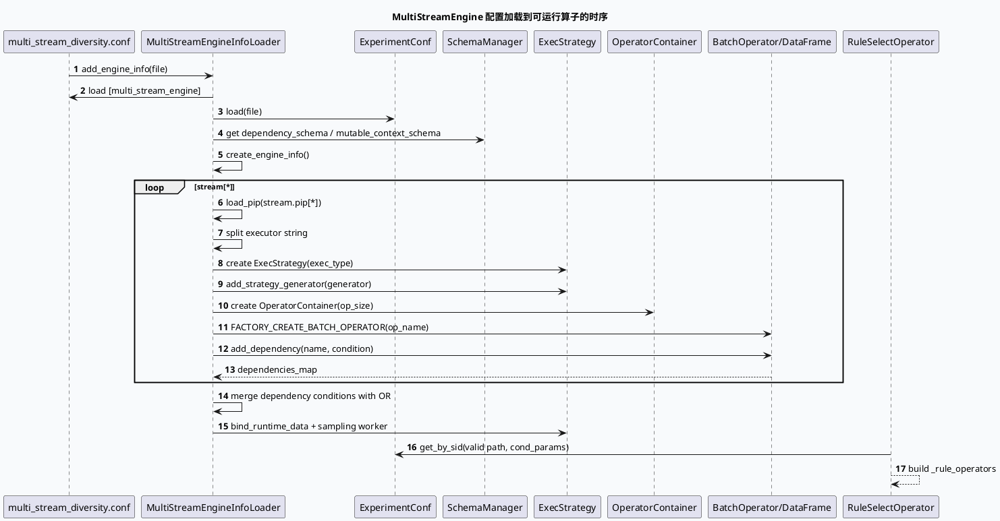

# 2026-07-08 基础库代码理解：MultiStreamEngine 从配置到运行时装配的执行框架
<!-- topic-nav:start -->
> 主题：`base/multistream-binding` · 同题补充 / 历史版本 · [主题目录](README.md) · [先读主文](20260529-exec-engine-multistreamengine-graphdependency-deep-dive.md)
<!-- topic-nav:end -->


> 日期：2026-07-08｜类型：基础库笔记  
> 今日主题来源：本机未发现可用 `daily-plan` 文件；按周三 fallback 选择 GRG `MultiStreamEngine` 配置装配框架，并与业务侧 `news_updates_dibar` NewDiversityMerge 配对。  
> 内网 KU：本次任务未提供 KU URL/doc-id；如流知识库检索需人工补充。本文以本地代码库证据为准。  
> 范围：`multi_stream_diversity.conf` 的 stream/pip/executor/operator 配置树，`MultiStreamEngineInfoLoader` 对配置的加载、依赖汇总、策略生成器注册，以及 `RuleSelectOperator` 的小流量/条件化算子筛选。

## 架构全景图

<style>.arch-0708-base{font-family:-apple-system,BlinkMacSystemFont,"Segoe UI",sans-serif;background:#f8fafc;border:1px solid #cbd5e1;border-radius:20px;padding:18px;color:#1e293b}.arch-0708-base .title{font-size:25px;font-weight:900;margin-bottom:6px}.arch-0708-base .sub{font-size:13px;color:#64748b;margin-bottom:16px}.arch-0708-base .grid{display:grid;grid-template-columns:1fr 1.15fr 1fr;gap:12px}.arch-0708-base .lane{background:#fff;border:1px solid #dbeafe;border-radius:16px;padding:12px}.arch-0708-base h3{font-size:15px;margin:0 0 10px;color:#1d4ed8}.arch-0708-base .box{background:#f9fafb;border:1px solid #e5e7eb;border-radius:12px;padding:10px;margin:8px 0}.arch-0708-base .box b{display:block;font-size:13px;margin-bottom:4px}.arch-0708-base .box span{font-size:12px;color:#64748b;line-height:1.5}.arch-0708-base .hot{background:#eff6ff;border-color:#93c5fd}.arch-0708-base .warn{background:#fff7ed;border-color:#fdba74}.arch-0708-base .note{margin-top:12px;border-left:4px solid #3b82f6;background:#eef6ff;border-radius:10px;padding:10px;font-size:13px;color:#334155}</style><div class="arch-0708-base"><div class="title">MultiStreamEngine：把“多队列插入策略”编译成可执行流图</div><div class="sub">配置层声明 stream → pip → executor → operator；加载层创建 ExecStrategy、OperatorContainer 和 DataFrame 依赖；运行层按请求 Sid/条件筛选可执行算子。</div><div class="grid"><div class="lane"><h3>配置描述层</h3><div class="box hot"><b>stream/pip DAG</b><span>`multi_stream_diversity.conf:10-65` 声明 loads_select、rule_select、function_select、final_select、effect_pk、merge_pk 六段 stream。</span></div><div class="box"><b>executor 模板</b><span>`multi_stream_diversity.conf:70-124` 中 `select_executor` 使用 exec_type、stages、generator、rule 列表描述执行方式。</span></div></div><div class="lane"><h3>加载与绑定层</h3><div class="box hot"><b>MultiStreamEngineInfoLoader</b><span>`multi_stream_engine.cc:55-108` 加载 conf/econf/schema，并进入 `create_engine_info()`。</span></div><div class="box"><b>load_pip / load_executor</b><span>`multi_stream_engine.cc:203-249` 将 pip 的 executor 字符串拆成 executor_vec；`251-373` 创建 ExecStrategy 和 OperatorContainer。</span></div><div class="box warn"><b>strategy_map</b><span>`multi_stream_engine.cc:340-370` 用 engine+stream+pip+executor 保存/复用策略；重复 key 会 FATAL。</span></div></div><div class="lane"><h3>运行时筛选层</h3><div class="box hot"><b>RuleSelectOperator</b><span>`multi_stream_diversity_operator.cc:496-566` 按 Sid 与 cond_params 计算可运行规则算子。</span></div><div class="box"><b>依赖聚合</b><span>`multi_stream_engine.cc:163-198` 把 operator DataFrame 依赖合并到 engine_info.dependencies_map。</span></div></div></div><div class="note">核心理解：MultiStreamEngine 不是“硬编码多样性逻辑”，而是一个配置驱动的执行图加载器；业务只需要接入配置、上下文和输入容器，框架负责算子实例化、依赖声明、策略采样和条件化启停。</div></div>

## 核心流程图



## 配置结构信息图

```infographic hierarchy-structure
data
  title multi_stream_diversity.conf 的执行树
  desc stream 选择输入来源，pip 绑定 executor，executor 决定 stages/generator/rule
  items
    - label loads_select
      desc `multi_stream_diversity.conf:10-16` loads 队列，支持回退
      children
        - label pip loads
          desc executor loads_select_executor
    - label rule_select
      desc `multi_stream_diversity.conf:17-23` 规则队列，产出符合规则的最小下标
      children
        - label pip rule
          desc executor select_executor
    - label function_select
      desc `multi_stream_diversity.conf:24-30` 功能队列，产出符合规则的最小下标
      children
        - label pip function
          desc executor select_executor
    - label final_select
      desc `multi_stream_diversity.conf:31-37` 效果队列，输出资源并做软打散打分
      children
        - label pip effect
          desc executor effect_select_executor
    - label effect_pk
      desc `multi_stream_diversity.conf:38-44` 提前分值 PK 缩小候选
      children
        - label pip final_select
          desc executor effect_pk_executor
    - label merge_pk
      desc `multi_stream_diversity.conf:45-65` trival=1，本地串行 PK loads/rule/function/effect_pk
      children
        - label pips
          desc score_pk_executor / index_pk_executor / effect_pk_executor
```

```infographic list-grid-badge-card
data
  title Loader 关键职责拆解
  items
    - label 配置加载
      desc `multi_stream_engine.cc:55-79` 读取 comcfg 与 ExperimentConf，校验 [multi_stream_engine]
      icon mdi/file-cog
    - label Schema 绑定
      desc `multi_stream_engine.cc:95-101` dependency_schema 与 mutable_context_schema 通过 SchemaManager 获取
      icon mdi/schema
    - label Executor 装配
      desc `multi_stream_engine.cc:251-373` 创建 ExecStrategy、generator、OperatorContainer
      icon mdi/source-branch
    - label Operator 依赖
      desc `multi_stream_engine.cc:376-445` 工厂创建 operator/conf，并写入 DataFrame depend/mutable_data
      icon mdi/link-variant
```

## 关键结论

- `multi_stream_diversity.conf:10-65` 把多样性合并拆成六个 stream，其中 `merge_pk` 明确 `trival: 1`，表示最终 PK 阶段在本地串行执行，而不是继续并发扩散。
- `multi_stream_engine.cc:55-108` 是配置入口：先加载 `comcfg::Configure`，再加载 `ExperimentConf`，然后读取 `conf_instance/conf_file/dependency_schema/mutable_context_schema`，最后调用 `create_engine_info()`。
- `multi_stream_engine.cc:130-178` 遍历 stream 和 pip；每个 pip 的 executor 字符串会在 `multi_stream_engine.cc:221-248` 被逗号拆分成 executor_vec，这意味着一个 pip 可以挂多个 executor。
- `multi_stream_engine.cc:271-301` 在首次创建时初始化 `ExecStrategy` 并挂载 generator；策略生成器通过采样线程周期运行，配置变更和实验参数会影响运行时策略。
- `multi_stream_engine.cc:323-337` 依据 stages 创建 OperatorContainer 并把 operator 的 DataFrame 依赖收集到 executor；`multi_stream_engine.cc:180-198` 再把同一依赖的多个 condition 合并成 OR 条件。
- `multi_stream_diversity_operator.cc:496-566` 的 `RuleSelectOperator::get_runable_operators()` 用 Sid 与 cond_params 查询 ExperimentConf，只有 valid 且小流量命中的规则才会进入 `_rule_operators`。

## Pitfalls 卡片

<style>.pit-0708-base{font-family:-apple-system,BlinkMacSystemFont,"Segoe UI",sans-serif;max-width:1040px;border-radius:20px;background:#f5f7fa;border:1px solid #c7d2fe;padding:20px;color:#1e293b}.pit-0708-base .meta{font-size:12px;letter-spacing:.08em;text-transform:uppercase;color:#1d4ed8;font-weight:900}.pit-0708-base .headline{font-size:28px;line-height:1.15;font-weight:900;margin:8px 0 12px}.pit-0708-base .grid{display:grid;grid-template-columns:1.25fr 1fr;gap:14px}.pit-0708-base .panel{background:#fff;border-top:4px solid #3b82f6;border-radius:12px;padding:12px}.pit-0708-base .panel b{display:block;margin-bottom:6px}.pit-0708-base .panel p{margin:0;font-size:14px;line-height:1.65;color:#334155}.pit-0708-base .end{margin-top:12px;font-weight:900;color:#1d4ed8}</style><div class="pit-0708-base"><div class="meta">pitfall · config-driven engine</div><div class="headline">算子没跑，不一定是代码没注册；更常见是 valid path、Sid 或 condition 没命中</div><div class="grid"><div class="panel"><b>三层门禁</b><p>operator 先要被配置加载，再要被 DataFrame 依赖满足，最后还要通过 `ExperimentConf` 的 valid path 与 cond_params。`runable_operators` 日志为空时，先查配置 path 与 Sid，而不是直接怀疑 operator 实现。</p></div><div class="panel"><b>重复 key 会致命</b><p>`engine+stream+pip+executor` 组成 strategy_map key；配置复制时若 stream/pip/executor 名称组合重复，初始化阶段会 FATAL。</p></div></div><div class="end">∎ 排查顺序：配置树 → 工厂注册 → DataFrame 依赖 → valid path/Sid。</div></div>

## 调试 checklist

```infographic list-column-done-list
data
  title MultiStreamEngine 装配排查清单
  items
    - label 检查 [multi_stream_engine] 基础字段
      desc conf_instance、conf_file、dependency_schema、mutable_context_schema 必须存在
      done true
    - label 检查 stream/pip/executor 名称链
      desc pip.executor 字符串会被逗号拆分，任一 executor 缺配置都会加载失败
      done true
    - label 检查 stages 与 stage 下 operator 列表
      desc op_size 来源于 stages 指向的配置数组，不在 stages 中的 operator 不会执行
      done true
    - label 检查 operator 工厂注册
      desc FACTORY_CREATE_BATCH_OPERATOR / CONF 任一为空都会初始化失败
      done true
    - label 检查 depend condition 是否被 OR 聚合
      desc 同一依赖多个条件会合并；空条件会覆盖为无条件依赖
      done true
    - label 检查 runable_operators 日志
      desc valid path、小流量配置、Sid、cond_params 都会影响最终可运行算子
      done true
```

## 证据来源

- `conf/plugins/exec_engine/multi_stream_diversity.conf:10-65`：六段 stream/pip 拓扑。
- `conf/plugins/exec_engine/multi_stream_diversity.conf:70-124`：`select_executor` 的 exec_type、generator、RuleSelectOperator 配置入口。
- `src/multi_stream_engine.cc:55-108`：`add_engine_info()` 加载 conf/econf/schema。
- `src/multi_stream_engine.cc:130-198`：遍历 stream/pip 并聚合 operator 依赖条件。
- `src/multi_stream_engine.cc:203-249`：`load_pip()` 拆分 executor 并收集依赖。
- `src/multi_stream_engine.cc:251-373`：`load_executor()` 创建策略、generator、OperatorContainer、strategy_map。
- `src/multi_stream_engine.cc:376-445`：`load_op()` 工厂创建 operator/conf，并注入 depend/mutable_data。
- `src/operator/multi_stream_diversity_operator.cc:496-566`：`RuleSelectOperator` 按 Sid 与 cond_params 选择可运行规则算子。
