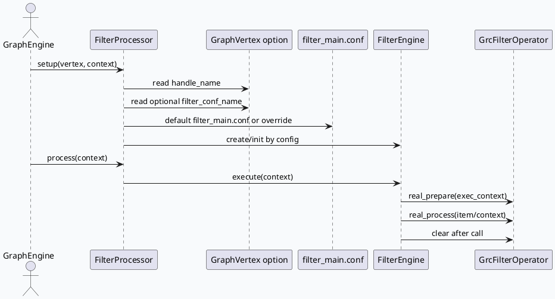
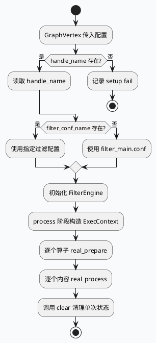

# lite-grc FilterProcessor 与 ExecEngine 过滤生命周期
<!-- topic-nav:start -->
> 主题：`base/filter-lifecycle` · 同题补充 / 历史版本 · [主题目录](README.md) · [先读主文](2026-06-23-lite-grc-filterprocessor-exec-engine-lifecycle.md)
<!-- topic-nav:end -->


> 主题来源：本机未发现可用 `daily-plan` 文件，按周二兜底主题生成。内网 KU 检索未参与，本篇以代码库检索证据为准，线上策略背景需人工补充。

## 架构全景

<style>.arch20260714{font-family:Inter,Arial,sans-serif;background:#f8fafc;border:1px solid #d6dee8;border-radius:8px;padding:18px;margin:16px 0;color:#1f2937}.arch20260714 .title{font-size:20px;font-weight:850;margin-bottom:12px}.arch20260714 .grid{display:grid;grid-template-columns:1fr 34px 1fr 34px 1fr;gap:8px;align-items:stretch}.arch20260714 .box{background:#fff;border:1px solid #cbd5e1;border-radius:8px;padding:12px}.arch20260714 .arrow{display:flex;align-items:center;justify-content:center;font-weight:900;color:#64748b}.arch20260714 .label{font-size:12px;font-weight:800;color:#475569;margin-bottom:6px}.arch20260714 .name{font-size:16px;font-weight:850;color:#0f172a;margin-bottom:6px}.arch20260714 .txt{font-size:13px;line-height:1.55;color:#334155}.arch20260714 .foot{margin-top:12px;display:grid;grid-template-columns:1fr 1fr;gap:8px}.arch20260714 .mini{background:#eef6f3;border:1px solid #b7d6ca;border-radius:8px;padding:10px;font-size:12px;line-height:1.5}</style><div class="arch20260714"><div class="title">FilterProcessor 把 GraphVertex 配置翻译成 ExecEngine 过滤流水线</div><div class="grid"><div class="box"><div class="label">Graph 层</div><div class="name">vertex option</div><div class="txt">读取 `handle_name` 与可选 `filter_conf_name`，没有 handle 直接 setup 失败。</div></div><div class="arrow">→</div><div class="box"><div class="label">配置层</div><div class="name">filter_main.conf</div><div class="txt">默认过滤配置声明 generator/filter，配置文件决定运行时装配的算子集合。</div></div><div class="arrow">→</div><div class="box"><div class="label">执行层</div><div class="name">FilterEngine</div><div class="txt">从对象池取执行引擎，按 ExecContext 驱动 prepare/process/clear 生命周期。</div></div></div><div class="foot"><div class="mini"><b>接口边界</b><br/>`FilterProcessor` 只暴露 `setup()` 与 `process()`，自身不承载业务规则。</div><div class="mini"><b>扩展点</b><br/>业务过滤通过继承 `GrcFilterOperator` 实现 `real_prepare()`、`real_process()` 和清理逻辑。</div></div></div>

## 核心调用链



## 配置结构

```infographic
infographic list-grid-badge-card
data
  title FilterProcessor 配置契约
  desc setup 阶段只做配置入口解析，运行期行为由 FilterEngine 与算子配置决定
  items
    - label handle_name
      desc 必填；缺失时 setup 返回失败，决定本次图节点的过滤 handle
      icon mdi/key-variant
    - label filter_conf_name
      desc 可选；缺省使用 filter_main.conf，支持按节点覆盖过滤配置
      icon mdi/file-cog-outline
    - label generator
      desc filter_main.conf 前段声明 part_fixed_count_strategy、cost_strategy 等生成器
      icon mdi/source-branch
    - label filter
      desc 后续 [.@filter] 列表声明具体 FilterOperator 名称与参数
      icon mdi/filter-cog-outline
```

## 关键观察

1. `FilterProcessor` 的头文件很薄，只有 `setup()` 和 `process()` 两个入口，说明过滤框架的主要复杂度在配置解析与 ExecEngine 内部执行，而不是 Processor 类本身。
2. `setup()` 默认使用 `filter_main.conf`，只有当 `filter_conf_name` 在 vertex 配置中存在时才覆盖；这意味着线上图配置漏配时不会空跑，而是退到主过滤配置。
3. `GrcFilterOperator` 基类要求子类实现 `real_prepare()`，默认实现会 fatal；业务算子必须显式声明依赖读取和条件预计算。
4. `filter_main.conf` 先声明 generator，再声明 filter，调试时要同时看计数/截断生成器和过滤算子，不能只查业务 operator 源码。

## 生命周期拆解



## Pitfalls

<style>.pit20260714{font-family:Inter,Arial,sans-serif;background:#fff;border:1px solid #d6dee8;border-radius:8px;padding:16px;margin:16px 0;color:#1f2937}.pit20260714 .head{font-size:18px;font-weight:850;margin-bottom:10px}.pit20260714 .cards{display:grid;grid-template-columns:repeat(3,1fr);gap:10px}.pit20260714 .card{border-top:4px solid #2d6a4f;background:#f8fafc;border-radius:6px;padding:10px}.pit20260714 .k{font-size:13px;font-weight:850;margin-bottom:6px}.pit20260714 .v{font-size:12px;line-height:1.55;color:#475569}</style><div class="pit20260714"><div class="head">调试时最容易误判的三件事</div><div class="cards"><div class="card"><div class="k">默认配置掩盖漏配</div><div class="v">`filter_conf_name` 缺失会回落到 `filter_main.conf`，问题可能表现为“过滤逻辑不符合预期”而非初始化失败。</div></div><div class="card"><div class="k">算子名不等于文件名</div><div class="v">配置里的 filter name 可能和源码类名/文件名存在大小写或注册名差异，需要按配置和注册链双向确认。</div></div><div class="card"><div class="k">prepare 状态要清理</div><div class="v">`real_prepare()` 中缓存的 sid、common_info 或开关状态必须在单次执行后清理，否则复用上下文会带来串扰。</div></div></div></div>

## 调试 Checklist

```infographic
infographic list-column-done-list
data
  title FilterProcessor 排查顺序
  items
    - label 先查图节点配置是否存在 handle_name
      desc setup 失败优先看 GraphVertex option
      done true
    - label 再确认 filter_conf_name 是否覆盖默认配置
      desc 缺省路径是 conf/plugins/graph/micro_frame/filter_main.conf
      done true
    - label 对照 filter_main.conf 的 generator 与 filter 顺序
      desc generator 影响截断和计数，filter 决定具体过滤规则
      done true
    - label 进入目标 GrcFilterOperator 看 real_prepare 依赖
      desc 依赖 index 不匹配会导致规则短路或误杀
      done true
    - label 复查 clear 是否覆盖本次请求状态
      desc 对象池复用场景尤其需要确认
      done true
```

## 证据来源

- `src/main.cpp:16-23`：服务入口包含 gflags、service、initializer 和 opt 初始化依赖。
- `src/processor/filter.h:23-26`：`FilterProcessor` 对外只声明 `setup()` 与 `process()`。
- `src/processor/filter.cpp:13-24`：`setup()` 读取 `handle_name` 与 `filter_conf_name`，默认 `filter_main.conf`。
- `src/processor/filter/grc_filter_base.h:26-43`：`ExecContext` 类型别名与 `GrcFilterOperator::real_prepare()` 默认 fatal。
- `conf/plugins/graph/micro_frame/filter_main.conf:1-23`：filter engine 基础配置与 generator 声明。
- `conf/plugins/graph/micro_frame/filter_main.conf:28-65`：过滤算子列表开始，体现配置驱动装配。