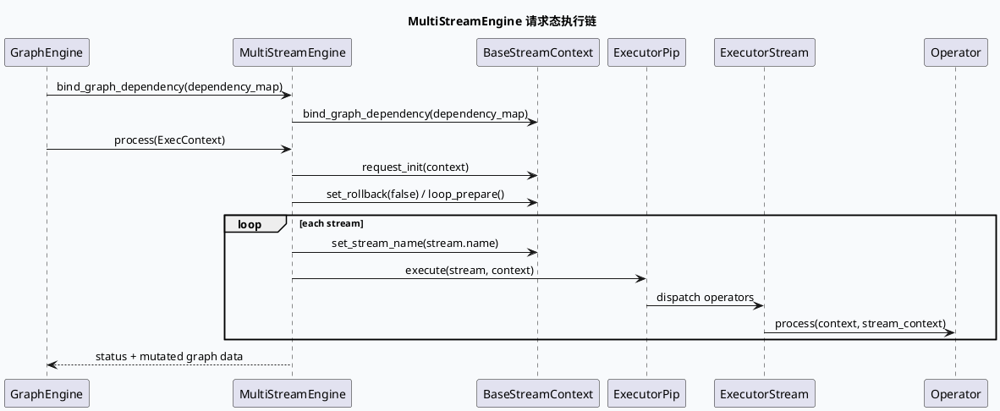

# 2026-07-23 基础库代码理解：MultiStreamEngine 的运行时绑定与执行闭包
<!-- topic-nav:start -->
> 主题：`base/multistream-binding` · 同题补充 / 历史版本 · [主题目录](README.md) · [先读主文](20260529-exec-engine-multistreamengine-graphdependency-deep-dive.md)
<!-- topic-nav:end -->


> 日期：2026-07-23｜类型：基础库笔记  
> 今日主题来源：本机未发现可用 `daily-plan` 文件；按周四 fallback 选择 ExecEngine/MultiStreamEngine 运行时依赖绑定主题。  
> 内网 KU：本次任务未提供 KU URL/doc-id；如流知识库检索需人工补充。本文以本地代码库证据为准。  
> 范围：`MultiStreamEngine` 初始化、`ExecStrategy`/generator 装配、`BaseStreamContext` 生命周期，以及 `bind_graph_dependency()` 将 GraphDependency 注入到 stream context 的边界。

## 架构全景

<style>.arch723{font-family:Inter,Arial,sans-serif;border:1px solid #d9e2ec;border-radius:8px;background:#f8fafc;color:#1f2937;padding:18px}.arch723 h3{margin:0 0 12px;font-size:18px}.arch723 .grid{display:grid;grid-template-columns:1fr 1.25fr 1fr;gap:12px}.arch723 .layer{border:1px solid #cbd5e1;border-radius:8px;background:#fff;padding:12px}.arch723 .layer b{display:block;margin-bottom:8px;color:#23415f}.arch723 .box{border:1px solid #d7dee8;border-radius:6px;padding:8px;margin:7px 0;background:#f7fbff;font-size:13px;line-height:1.45}.arch723 .hot{background:#eef6f1;border-color:#91b89c}.arch723 .arrow{text-align:center;font-weight:700;color:#58708a;margin:8px 0}.arch723 .foot{margin-top:10px;font-size:12px;color:#667085}</style>
<div class="arch723"><h3>MultiStreamEngine 运行时全景</h3><div class="grid"><div class="layer"><b>配置装配</b><div class="box">multi_stream_engine.conf</div><div class="box">generator / executor / stream 配置</div><div class="box">ExecStrategy 与 OperatorFactory</div></div><div class="layer"><b>执行核心</b><div class="box hot">MultiStreamEngine</div><div class="box">BaseStreamContext：请求态、loop、rollback、stream name</div><div class="box">ExecutorPip / ExecutorStream：按 stream 串联执行</div></div><div class="layer"><b>Graph 依赖</b><div class="box">GraphDependency map</div><div class="box hot">bind_graph_dependency()</div><div class="box">stream_context 统一持有依赖句柄</div></div></div><div class="arrow">配置解析 -> 策略闭包 -> 请求态绑定 -> stream 执行</div><div class="foot">关键点：依赖不是散落在 operator 中硬查，而是在 engine 边界一次性绑定进 stream context。</div></div>

## 核心判断

`MultiStreamEngine` 的价值不只是多 stream 调度，而是把配置态的 generator/executor/stream 结构转为请求态可复用的执行闭包。`multi_stream_engine.cc` 在初始化阶段解析 `generator` 段并创建 `ExecStrategy`，`multi_stream_engine.h` 在请求阶段从 `ExecContext.custom_context` 取出 `BaseStreamContext`，完成 request init、loop prepare、stream name 切换和 rollback 标记管理。

`bind_graph_dependency()` 是 GraphEngine 与 ExecEngine 的低耦合连接点：上游只提供 `unordered_map<string, GraphDependency*>`，MultiStreamEngine 再把这张表交给 `stream_context`。这使 operator 可以从统一上下文读取请求特征、召回结果或中间状态，同时避免每个 operator 直接耦合 graph vertex 名称。

## 调用链



## 配置与结构信息图

```infographic
infographic list-grid-badge-card
data
  title MultiStreamEngine 装配面
  desc 从配置态进入请求态时需要同时看三类对象
  items
    - label generator
      desc `multi_stream_engine.cc:280-287` 解析 name / instance / conf_file，决定策略输入如何生成。
      icon mdi/cog-outline
    - label ExecStrategy
      desc `multi_stream_engine.cc:278` 将 executor 与 exec_type 封装为策略对象。
      icon mdi/source-branch
    - label BaseStreamContext
      desc `multi_stream_engine.h:236-324` 持有请求态、loop、rollback 与 stream name。
      icon mdi/database-outline
    - label GraphDependency
      desc `multi_stream_engine.h:448-451` 统一绑定到 stream context，供 operator 后续读取。
      icon mdi/vector-link

theme
  palette #2f5d7c #4f8f6f #d97706
```

## 读代码时的边界感

`MultiStreamEngine` 不是业务召回逻辑本身。它不应该解释某个业务场景为什么召回、过滤或融合，而应该负责把“可执行策略”和“请求态依赖”连接起来。业务含义通常在上游 graph 配置和 operator 实现中，基础库这一层只保证可配置、可复用、可注入。

另一个容易混淆的点是 `custom_context`。它不是普通参数透传，而是 ExecEngine 在请求生命周期内复用的状态容器。缺失 `BaseStreamContext` 时，后续 stream 执行不会有稳定的依赖读取入口，所以排障时应先确认 context 创建与绑定，再看单个 operator。

## Pitfalls

<style>.card723{font-family:Inter,Arial,sans-serif;border:1px solid #d6dee8;border-radius:8px;background:#fff;padding:16px;margin-top:12px;color:#263238}.card723 .meta{font-size:12px;font-weight:700;color:#2f5d7c;text-transform:uppercase}.card723 .title{font-size:22px;font-weight:800;margin:6px 0 10px}.card723 .cols{display:grid;grid-template-columns:1.2fr .8fr;gap:12px}.card723 .panel{border-top:4px solid #4f8f6f;background:#f8fafc;padding:10px;border-radius:6px;font-size:13px;line-height:1.55}.card723 code{background:#eef2f7;padding:1px 4px;border-radius:4px}</style>
<div class="card723"><div class="meta">Debug Notes</div><div class="title">先查绑定，再查 operator</div><div class="cols"><div class="panel">如果某个 stream operator 读不到请求特征或中间结果，不要先改 operator。先确认 GraphEngine 是否传入了依赖表，`MultiStreamEngine::bind_graph_dependency()` 是否被调用，以及 `stream_context` 是否已接收这张表。</div><div class="panel">配置排障顺序：generator 段 -> ExecStrategy 创建 -> BaseStreamContext 初始化 -> GraphDependency 绑定 -> stream 内 operator 执行。</div></div></div>

## 调试 checklist

```infographic
infographic list-column-done-list
data
  title MultiStreamEngine 排障 checklist
  items
    - label 确认配置被加载
      desc 检查 multi_stream_engine.conf 中 generator / executor / stream 段是否完整。
      done true
    - label 确认 ExecStrategy 创建
      desc 关注 `multi_stream_engine.cc:278` 附近 executor 与 exec_type 是否匹配。
      done true
    - label 确认 BaseStreamContext 存在
      desc `multi_stream_engine.h:236-237` 和 `268-269` 是请求态入口检查点。
      done true
    - label 确认依赖表注入
      desc `multi_stream_engine.h:448-451` 是 GraphDependency 传入 stream context 的边界。
      done true
    - label 再看具体 operator
      desc 只有上下文和依赖都正常时，才进入业务 operator 逻辑排障。
      done false

theme
  palette #2f5d7c #4f8f6f #d97706
```

## 证据来源

- `exec-engine/src/multi_stream_engine.h:208-451`：`MultiStreamEngine` 请求态 context、stream 执行和 `bind_graph_dependency()`。
- `exec-engine/src/multi_stream_engine.cc:278-287`：`ExecStrategy` 与 generator 配置解析入口。
- `exec-engine/test/conf/multi_stream_engine.conf`：测试配置中的 multi-stream engine 装配样例。
- `notes/base-lib/2026-07-16-multistream-engine-plugin-graphdependency-binding.md`：同主题历史笔记，用于对齐 fallback 主题和文档结构。
