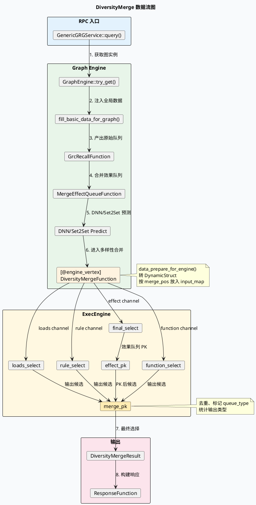
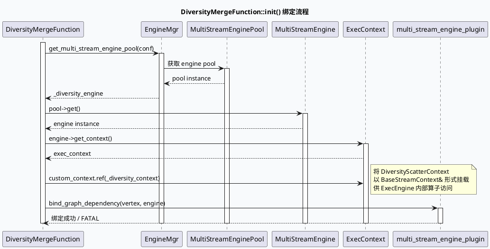
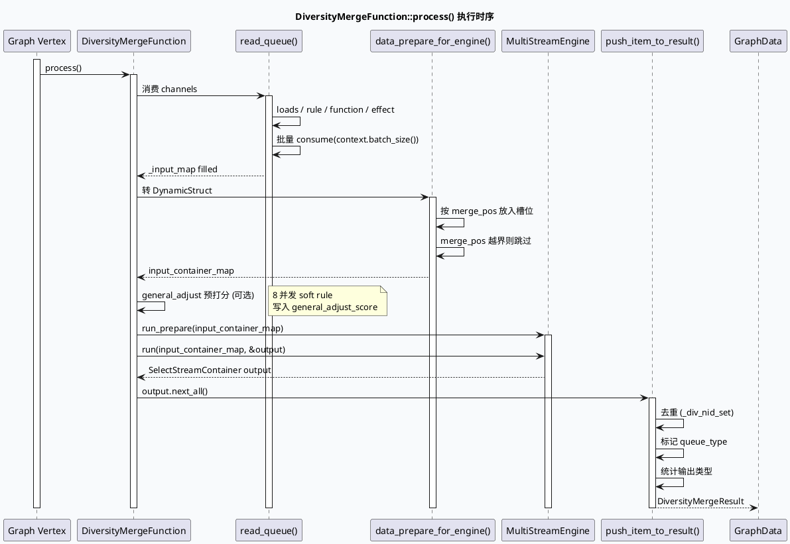

# MultiStreamEngine 绑定 GraphDependency：图解补充
<!-- topic-nav:start -->
> 主题：`base/multistream-binding` · 同题补充 / 历史版本 · [主题目录](README.md) · [先读主文](20260529-exec-engine-multistreamengine-graphdependency-deep-dive.md)
<!-- topic-nav:end -->


> 共同 API、绑定路径和配置说明见[主题主文](20260529-exec-engine-multistreamengine-graphdependency-deep-dive.md)；本页保留增强图解及未重复的说明。已移除 18 段完全相同的正文。[原始增强版](https://github.com/1998-program/cpp-core-notes/blob/5738832bab4b13ba26356af0a37a0a32e477b675/notes/base-lib/20260529-exec-engine-multistreamengine-graphdependency-deep-dive-enhanced.md)。

> 日期：2026-05-29  
> 主题来源：`notes/weekly-topic-selection/daily-plan-20260529.json` 的 `fri.base_lib` 计划项  
> 范围：只分析 GRG 中 `DiversityMergeFunction` 如何把图引擎 GraphData / Channel 依赖绑定到 ExecEngine `MultiStreamEngine`，不泛化到所有 brpc / graph-engine 用法。

---

## 0. 架构全景图

<div style="position: relative; font-family: -apple-system, BlinkMacSystemFont, 'Segoe UI', Roboto, sans-serif; background: #f8fafc; border-radius: 12px; padding: 24px; margin: 16px 0;">
<style scoped>
.arch-wrapper { display: flex; gap: 16px; }
.arch-main { flex: 1; }
.arch-layer { border-radius: 8px; padding: 16px; margin-bottom: 12px; }
.arch-layer.user { background: #dbeafe; border-left: 4px solid #3b82f6; }
.arch-layer.application { background: #dcfce7; border-left: 4px solid #22c55e; }
.arch-layer.ai { background: #fef3c7; border-left: 4px solid #f59e0b; }
.arch-layer.data { background: #fce7f3; border-left: 4px solid #ec4899; }
.arch-layer.infra { background: #f3e8ff; border-left: 4px solid #a855f7; }
.arch-box { background: rgba(255,255,255,0.8); border-radius: 6px; padding: 8px 12px; margin: 4px; font-size: 12px; display: inline-block; }
.arch-box.highlight { background: #fff; border: 2px solid #f59e0b; font-weight: 600; }
.arch-grid { display: flex; flex-wrap: wrap; gap: 8px; margin-top: 8px; }
.arch-layer-title { font-size: 14px; font-weight: 700; margin-bottom: 8px; color: #1e293b; }
</style>
<div class="arch-wrapper">
<div class="arch-main">
<div class="arch-layer user">
<div class="arch-layer-title">👤 用户层 (RPC 入口)</div>
<div class="arch-grid">
<div class="arch-box">GenericGRGService::query()</div>
<div class="arch-box">GraphEngine::try_get()</div>
<div class="arch-box">fill_basic_data_for_graph()</div>
</div>
</div>
<div class="arch-layer application">
<div class="arch-layer-title">⚙️ 图引擎层 (Graph Engine)</div>
<div class="arch-grid">
<div class="arch-box">GrcRecallFunction</div>
<div class="arch-box">MergeEffectQueueFunction</div>
<div class="arch-box">DNN/Set2Set Predict</div>
<div class="arch-box highlight">[@engine_vertex] DiversityMergeFunction</div>
</div>
</div>
<div class="arch-layer ai">
<div class="arch-layer-title">🧠 ExecEngine 层 (MultiStreamEngine)</div>
<div class="arch-grid">
<div class="arch-box">loads_select</div>
<div class="arch-box">rule_select</div>
<div class="arch-box">function_select</div>
<div class="arch-box">final_select</div>
<div class="arch-box">effect_pk</div>
<div class="arch-box highlight">merge_pk</div>
</div>
</div>
<div class="arch-layer data">
<div class="arch-layer-title">💾 数据流层 (Channels)</div>
<div class="arch-grid">
<div class="arch-box">LoadsQueue</div>
<div class="arch-box">RuleQueue</div>
<div class="arch-box">FunctionQueue</div>
<div class="arch-box">EffectQueue</div>
<div class="arch-box">DiversityMergeResult</div>
</div>
</div>
<div class="arch-layer infra">
<div class="arch-layer-title">🔧 基础设施层</div>
<div class="arch-grid">
<div class="arch-box">GraphPool</div>
<div class="arch-box">EngineMgr</div>
<div class="arch-box">MutableChannel</div>
<div class="arch-box">bind_graph_dependency()</div>
</div>
</div>
</div>
</div>
</div>

---

## 1. API 模型：Graph Engine 外层 vertex + ExecEngine 内层 multi-stream

### 关键 API / 宏

---

## 2. 数据流图



---

## 3. MultiStreamEngine 配置语义

### Stream 结构一览

```infographic
infographic list-grid-badge-card
data
  title MultiStreamEngine 6 大 Stream
  desc multi_stream_diversity.conf 核心配置
  items
    - label loads_select
      desc loads 兜底/插入队列 | executor: loads_select_executor
    - label rule_select
      desc 规则队列 | executor: select_executor
    - label function_select
      desc 功能队列 | executor: select_executor
    - label final_select
      desc 效果队列 | executor: effect_select_executor
    - label effect_pk
      desc 效果队列提前 PK | executor: effect_pk_executor
    - label merge_pk
      desc 最终槽位选择 | 合并所有 stream 输出
```

多流结构由五个 stream 组成：

| stream | 配置行 | 输入 pip | executor | 业务含义 |
|---|---|---:|---|---|
| `loads_select` | `multi_stream_diversity.conf:10-16` | `loads` | `loads_select_executor` | loads 兜底/插入队列。 |
| `rule_select` | `multi_stream_diversity.conf:17-23` | `rule` | `select_executor` | 规则队列。 |
| `function_select` | `multi_stream_diversity.conf:24-30` | `function` | `select_executor` | 功能队列。 |
| `final_select` | `multi_stream_diversity.conf:31-37` | `effect` | `effect_select_executor` | 效果队列，执行硬/软规则与打分。 |
| `effect_pk` | `multi_stream_diversity.conf:38-44` | `final_select` | `effect_pk_executor` | 对效果队列提前 PK，缩小候选集。 |
| `merge_pk` | `multi_stream_diversity.conf:45-64` | `loads_select/rule_select/function_select/effect_pk` | score/index/effect pk executor | 将各 stream 输出做最终槽位选择。 |

---

## 4. 绑定 GraphDependency 的真实代码路径



---

## 5. 调度与阻塞语义



---

## 6. 真实服务使用示例

### 6.1 Effect 队列如何进入 DiversityMerge

### 6.2 General adjust 预打分如何嵌入 engine 前

在正式 `MultiStreamEngine::run()` 之前，如果 `is_open_dnn_soft_rule && !is_searchc_immersive_request && ua != 87 && enable_general_adjust`，代码会从 `_general_adjust_rule_conf` 中筛出可运行的 soft rule operator，8 并发切分 `effect_input`，调用 `operator_ptr->run_soft_rule(exec_context, &scatter_context, item_sublist)`，等待所有 future 完成后把 `div_res_score` 写入 `general_adjust_score` 并将 `exec_context->_ori_score_key` 切换到 `_general_adjust_score_key`（`/home1/code_read/code-read-mv-grg/baidu/feed-gr/feeda-mv-grg/src/process/diversity_merge.cpp:730-794`）。这说明"软规则"并不全在 `MultiStreamEngine::run()` 内部执行，GRG 在 engine 前还有一段显式预处理。

### 6.3 输出如何回到 GraphData

---

## 7. Pitfalls

<div style="font-family: -apple-system, BlinkMacSystemFont, 'Segoe UI', Roboto, sans-serif; background: #fef2f2; border-radius: 12px; padding: 24px; margin: 16px 0; border-left: 4px solid #ef4444;">
<style scoped>
.pitfall-card { background: #fff; border-radius: 8px; padding: 16px; margin-bottom: 12px; box-shadow: 0 1px 3px rgba(0,0,0,0.1); }
.pitfall-title { font-size: 14px; font-weight: 700; color: #dc2626; margin-bottom: 8px; }
.pitfall-desc { font-size: 13px; color: #374151; line-height: 1.6; }
.pitfall-ref { font-size: 11px; color: #6b7280; margin-top: 6px; font-family: monospace; }
</style>

<div class="pitfall-card">
<div class="pitfall-title">⚠️ 1. 不要只看 multi_stream_select_soft_rule.conf</div>
<div class="pitfall-desc">它只是软规则列表；真正的 stream/executor 结构在 multi_stream_diversity.conf，而 GraphData 入口在 vertex.conf 的 [@engine_vertex]</div>
<div class="pitfall-ref">vertex.conf:798-934 | multi_stream_diversity.conf:8-66</div>
</div>

<div class="pitfall-card">
<div class="pitfall-title">⚠️ 2. Graph condition 与 ExecEngine condition 是两层条件</div>
<div class="pitfall-desc">Graph vertex 依赖中有 condition: is_open_set2set 等条件，ExecEngine operator 也有 condition: ua = 85 等。排查未执行时要分层确认。</div>
<div class="pitfall-ref">vertex.conf:849-858 | multi_stream_diversity.conf:85-88, 602-607</div>
</div>

<div class="pitfall-card">
<div class="pitfall-title">⚠️ 3. Channel 消费是批量 drain</div>
<div class="pitfall-desc">read_queue() 会一直 consume(context.batch_size()) 到空，不能假设只消费一批。</div>
<div class="pitfall-ref">diversity_merge.cpp:1257-1274</div>
</div>

<div class="pitfall-card">
<div class="pitfall-title">⚠️ 4. merge_pos 越界会静默跳过候选</div>
<div class="pitfall-desc">data_prepare_for_engine() 在 slot_index >= input_vec.size() 时 continue，这会导致输入候选未进入 engine。</div>
<div class="pitfall-ref">diversity_merge.cpp:1295-1298</div>
</div>

<div class="pitfall-card">
<div class="pitfall-title">⚠️ 5. custom_context 是共享上下文入口</div>
<div class="pitfall-desc">exec_context->custom_context.ref(...) 把业务上下文暴露给 operator，修改其字段会影响后续 operator 与统计。</div>
<div class="pitfall-ref">diversity_merge.cpp:80-85</div>
</div>

</div>

---

## 8. 调试 checklist

```infographic
infographic list-column-done-list
data
  title DiversityMerge 调试 Checklist
  items
    - label 入口是否选中了预期图
      desc 检查 get_graph_name() 中 UA 映射
      done false
    - label Graph 全局依赖是否注入
      desc 检查 Request/log_id/uid/cuid/ua/ExpInfo
      done false
    - label vertex 是否启用
      desc 检查 [@engine_vertex] 依赖、condition、plugin/conf
      done false
    - label ExecEngine 配置是否存在
      desc 检查 exec_engine.conf 与 multi_stream_diversity.conf
      done false
    - label 输入 channel 是否为空
      desc 检查 read_queue() 的 input_size 和 [fsq_test] 日志
      done false
    - label 软规则是否被 condition 跳过
      desc 检查 exec_context condition values 和 operator condition
      done false
    - label 输出是否被去重或类型过滤
      desc 检查 push_item_to_result() 的 _div_nid_set 和 div_reason
      done false
```

---

## 9. 证据 / 来源

---

## 10. 未确认问题

> 内容整理：仅有分析时间与目标库信息的空附录，已移出正文。[查看原始版本及附录](https://github.com/1998-program/cpp-core-notes/blob/5738832bab4b13ba26356af0a37a0a32e477b675/notes/base-lib/20260529-exec-engine-multistreamengine-graphdependency-deep-dive-enhanced.md)。
