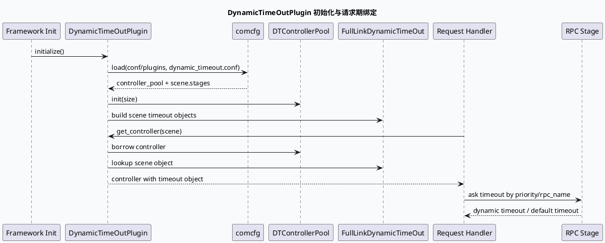

# DynamicTimeOutPlugin：全链路预算控制与并发 stage 裁剪
<!-- topic-nav:start -->
> 主题：`base/dynamic-timeout` · 主文 · [主题目录](README.md)
<!-- topic-nav:end -->


> 日期：2026-07-25  
> 类型：基础库笔记  
> 主题：`feed-general/framework` 中 DynamicTimeOutPlugin 如何把配置、控制器池和 RPC stage 预算绑定到一次请求生命周期。

<div class="arch-wrapper" style="font-family:Inter,Arial,sans-serif;border:1px solid #d8dee9;background:#f8fafc;border-radius:8px;padding:18px;margin:12px 0;color:#1f2937;">
<style>.dto-title{font-size:20px;font-weight:800;margin-bottom:12px}.dto-layer{border:1px solid #cbd5e1;background:#fff;border-radius:7px;padding:12px;margin:10px 0}.dto-layer h3{font-size:14px;margin:0 0 8px;color:#334155}.dto-grid{display:grid;grid-template-columns:repeat(4,minmax(0,1fr));gap:10px}.dto-box{border:1px solid #d7e3f3;background:#f1f7ff;border-radius:6px;padding:10px;min-height:70px}.dto-box strong{display:block;font-size:13px;color:#0f3557;margin-bottom:4px}.dto-box span{font-size:12px;line-height:1.45;color:#475569}.dto-arrow{text-align:center;color:#64748b;font-weight:700}@media(max-width:760px){.dto-grid{grid-template-columns:1fr}}</style>
<div class="dto-title">DynamicTimeOutPlugin 全景：配置驱动的全链路时间预算</div>
<div class="dto-layer"><h3>初始化层</h3><div class="dto-grid"><div class="dto-box"><strong>gflags 路径</strong><span>`dynamic_timeout_conf_path` / `dynamic_timeout_conf_file` 指向插件配置。</span></div><div class="dto-box"><strong>comcfg 加载</strong><span>插件启动时读取 `dynamic_timeout.conf`，失败只告警并返回。</span></div><div class="dto-box"><strong>controller_pool</strong><span>根据配置初始化 `ObjectPool&lt;FullLinkDynamicTimeOutController&gt;`。</span></div><div class="dto-box"><strong>scene map</strong><span>按场景名构造 `FullLinkDynamicTimeOut` 对象并缓存。</span></div></div></div>
<div class="dto-arrow">配置对象注入到请求期 controller</div>
<div class="dto-layer"><h3>请求期控制层</h3><div class="dto-grid"><div class="dto-box"><strong>get_controller</strong><span>从池中获取 controller，绑定当前 scene 的 timeout object。</span></div><div class="dto-box"><strong>stage priority</strong><span>通过 p0-p4 rate 与 stage priority 计算剩余预算比例。</span></div><div class="dto-box"><strong>concurrent RPC</strong><span>同一个 stage 下的 B1/B2/B3/B4 共享 stage 预算。</span></div><div class="dto-box"><strong>bvar 延迟</strong><span>周期性刷新 RPC latency 统计，作为动态裁剪依据。</span></div></div></div>
<div class="dto-layer"><h3>风险层</h3><div class="dto-grid"><div class="dto-box"><strong>默认值兜底</strong><span>配置缺项或 scene 未命中时依赖 default_timeout。</span></div><div class="dto-box"><strong>最小 timeout</strong><span>`min_timeout` 避免动态裁剪把 RPC 压到不可用。</span></div><div class="dto-box"><strong>全局开关</strong><span>`is_use_dynamic_timeout` 关闭时应回到静态 timeout 行为。</span></div><div class="dto-box"><strong>池大小</strong><span>请求并发高于 pool size 时要关注对象复用和等待。</span></div></div></div>
</div>

## 核心结论

DynamicTimeOutPlugin 不是单个 RPC 的 timeout 包装器，而是把“场景配置 → stage DAG → 请求期 controller → RPC 延迟统计”串起来的全链路预算控制器。它的关键边界在两处：初始化时从 `dynamic_timeout.conf` 构造每个 scene 的 stage 结构；请求期从 `DTControllerPool` 取 controller，再把 scene 对应的 `FullLinkDynamicTimeOut` 注入进去。



## 配置结构

```infographic
infographic hierarchy-structure
data
  title dynamic_timeout.conf 结构
  desc scene 维度组织 stage，每个 stage 可直接绑定 rpc_name，也可包含并发 RPC 列表
  items
    - label controller_pool
      desc size 控制 controller 池容量
      icon mdi/database-cog
      children
        - label size
          desc 示例值 12
    - label scene
      desc name 区分业务场景
      icon mdi/source-branch
      children
        - label stages
          desc window_size + 多个 stage
        - label stage
          desc priority/default_timeout/rpc_name/min_timeout
        - label concurrent
          desc B1/B2/B3/B4 共享并发 stage
    - label gflags
      desc 控制全局开关、reload 周期和 priority rate
      icon mdi/tune
      children
        - label is_use_dynamic_timeout
          desc 动态 timeout 总开关
        - label rpc_latency_reload_sleep_s
          desc RPC 延迟统计刷新周期
theme
  palette #315c7d #4f8f79 #d0833f
```

## 代码走读

`src/dynamic_timeout_plugin.cpp:9-18` 定义配置路径和文件名，并在 `initialize()` 中用 `comcfg::Configure::load()` 读取配置。这里的失败策略值得注意：加载失败时记录 warning 后返回 `0`，因此上层如果没有额外校验，可能以“插件初始化成功但动态 timeout 为空配置”的形式继续运行。

`include/dynamic_timeout_plugin.h:16-24` 把 `ObjectPool<FullLinkDynamicTimeOutController>` typedef 为 `DTControllerPool`，插件公开 `get_controller()`，说明请求期并不直接 new controller，而是通过池化对象复用控制器状态。

`src/dynamic_timeout.cpp:9-18` 定义全局开关、请求量限制、链路传输时间和 p0-p4 priority rate。这个设计意味着 stage 的 priority 并不是纯配置字段，它还要受进程级 gflags 影响。

`test/conf/plugins/dynamic_timeout.conf:1-31` 给出最小可读样例：`controller_pool.size=12`，`scene.name=quanmin`，`stages.window_size=1000`，stage A/C/D 是直接 RPC stage，stage B 则通过多个 `concurrent` 子项表达并发 RPC。

## Pitfalls

<div style="font-family:Inter,Arial,sans-serif;background:#fffdf7;border:1px solid #e6d6b8;border-radius:8px;padding:16px;margin:14px 0;color:#2f2a23;"><div style="font-size:13px;font-weight:800;color:#8a5a18;text-transform:uppercase;letter-spacing:.04em;">Pitfall Card</div><div style="font-size:22px;font-weight:850;margin:6px 0 8px;">初始化成功不等于动态 timeout 生效</div><div style="font-size:14px;line-height:1.65;">`initialize()` 在配置加载失败时返回 `0`，这会让“插件正常启动”和“配置真实生效”之间出现观测错位。排查线上 timeout 异常时，应同时看配置加载日志、scene 命中率、controller pool 指标和 RPC latency reload 状态。</div><div style="display:grid;grid-template-columns:repeat(3,minmax(0,1fr));gap:10px;margin-top:12px;"><div style="border-top:3px solid #b7791f;padding-top:8px;font-size:13px;">配置缺失：默认值掩盖问题</div><div style="border-top:3px solid #4f8f79;padding-top:8px;font-size:13px;">scene 未命中：controller 可能退化</div><div style="border-top:3px solid #315c7d;padding-top:8px;font-size:13px;">并发 stage：共享预算需统一看</div></div></div>

## 调试 Checklist

```infographic
infographic list-column-done-list
data
  title DynamicTimeout 排查顺序
  desc 从配置加载到请求期预算，逐层确认是否真正生效
  items
    - label 检查 gflags
      desc is_use_dynamic_timeout、rpc_latency_reload_sleep_s、p0-p4 rate 是否符合预期
      done true
      icon mdi/toggle-switch
    - label 检查配置加载日志
      desc fail to load dynamic_timeout conf 出现时不要只看进程是否启动
      done true
      icon mdi/file-alert
    - label 检查 scene 名称
      desc 请求使用的 scene 必须能命中 dynamic_timeout.conf 中的 name
      done true
      icon mdi/source-branch-check
    - label 检查并发 stage
      desc concurrent RPC 共享 stage 预算，单看一个 RPC timeout 容易误判
      done true
      icon mdi/call-split
    - label 检查 pool size
      desc 高并发下确认 controller_pool.size 是否匹配请求峰值
      done true
      icon mdi/database-sync
theme
  palette #315c7d #4f8f79 #d0833f
```

## 证据来源

- `src/dynamic_timeout_plugin.cpp:9-18`：配置路径、配置文件名与加载失败策略。
- `src/dynamic_timeout_plugin.cpp:12-40`：插件初始化入口和配置解析主流程。
- `include/dynamic_timeout_plugin.h:16-24`：controller pool typedef 与 `get_controller()` 边界。
- `src/dynamic_timeout.cpp:9-18`：动态 timeout 全局开关、priority rate 和链路传输时间参数。
- `test/conf/plugins/dynamic_timeout.conf:1-31`：controller pool、scene、stage、concurrent 配置样例。
