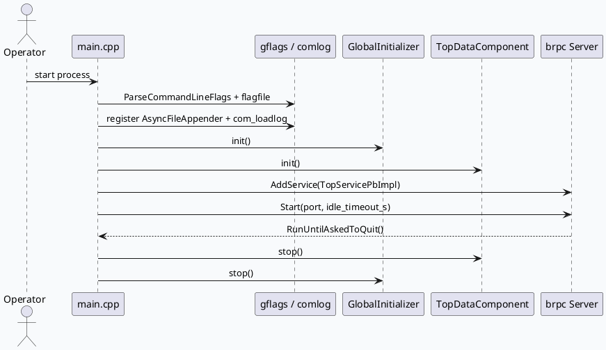

# top-intp brpc 启动与组件生命周期：gflags、日志、组件单例到服务注册
<!-- topic-nav:start -->
> 主题：`base/top-intp-bootstrap` · 主文 · [主题目录](README.md)
<!-- topic-nav:end -->


> 2026-08-17 运行说明：未发现当日 daily-plan，按历史未覆盖主题 fallback 到 top-intp 的 brpc 启动链与组件生命周期。KU/业务背景需人工补充；本文只使用本地代码与配置证据。

<style>.arch{font-family:Inter,Arial,sans-serif;border:1px solid #d8dee9;border-radius:8px;background:#f8fafc;padding:18px;margin:12px 0}.arch h3{margin:0 0 12px;color:#1f2937}.arch-grid{display:grid;grid-template-columns:1fr 1fr 1fr;gap:10px}.arch-layer{background:#fff;border:1px solid #cbd5e1;border-radius:6px;padding:10px}.arch-layer b{display:block;color:#334155;margin-bottom:8px}.arch-box{border-left:4px solid #3d5a80;background:#eef4f8;margin:7px 0;padding:8px;border-radius:4px;color:#1f2937}.arch-note{font-size:12px;color:#64748b;margin-top:10px}</style><div class="arch"><h3>启动全景：从进程参数到 brpc 服务暴露</h3><div class="arch-grid"><div class="arch-layer"><b>进程入口</b><div class="arch-box">ParseCommandLineFlags</div><div class="arch-box">flagfile=./conf/gflags.conf</div><div class="arch-box">AsyncFileAppender + comlog</div></div><div class="arch-layer"><b>基础组件</b><div class="arch-box">StackDump</div><div class="arch-box">MBvarRecord</div><div class="arch-box">GlobalInitializer</div><div class="arch-box">TopDataComponent</div></div><div class="arch-layer"><b>服务暴露</b><div class="arch-box">TopServicePbImpl</div><div class="arch-box">server.AddService</div><div class="arch-box">server.Start(port)</div><div class="arch-box">RunUntilAskedToQuit</div></div></div><div class="arch-note">核心结论：top-intp 的基础库边界非常集中，main.cpp 同时承载配置装载、运行时单例初始化、brpc 服务注册和退出清理。</div></div>

## 入口链路

`main.cpp` 在解析命令行后显式设置 `./conf/gflags.conf`，再注册 Babylon 异步日志 appender、加载 comlog、初始化 StackDump 和 mbvar。真正决定服务可用性的两个单例初始化是 `GlobalInitializer::get_instance().init()` 与 `TopDataComponent::get_instance().init()`；服务退出时按相反方向调用 `TopDataComponent::stop()` 与 `GlobalInitializer::stop()`。



## 组件分层

`GlobalInitializer` 是窄接口单例，只暴露 `init()` 和 `stop()`；`TopDataComponent` 是数据组件单例，头文件依赖 `GcmsComponent`、`SessionContext`、`GcmsData`、`baidu::rpc::Channel`、`atomic` 和 `shared_ptr`，说明它既承担远端数据访问，也承担进程内缓存/状态装配。由于仓库只有 `main.cpp` 一个 `.cpp`，多数行为以 header contract 形式暴露，分析时应把头文件当作主要实现证据。

```infographic
infographic hierarchy-structure
data
  title 基础库生命周期对象
  desc 入口只直接管理少量单例，复杂度集中在数据组件依赖
  items
    - label main.cpp
      desc 参数、日志、单例初始化、brpc 生命周期
      icon mdi/application-brackets
      children
        - label GlobalInitializer
          desc 全局资源 init/stop 窄接口
          icon mdi/cog-outline
        - label TopDataComponent
          desc GCMS/Session/Channel 数据组件
          icon mdi/database-cog
        - label TopServicePbImpl
          desc brpc 注册对象
          icon mdi/server-network
```

## 配置与运行参数

`gflags.conf.template` 将线上端口设为 `6688`，同时配置内容生态接口 host/path/channel、Redis 插件超时/BNS/负载均衡/重试、dual buffer cache dump 和 Babylon async appender buffer。`main.cpp` 的默认 `DEFINE_int32(port, 8900)` 只是编译期默认值，实际运行通常被 gflags 文件覆盖。

```infographic
infographic list-grid-badge-card
data
  title 配置入口速览
  desc gflags 模板决定端口、外部接口和基础设施插件开关
  items
    - label port
      desc gflags.conf.template:1 覆盖 main.cpp 默认 8900
      icon mdi/lan-connect
    - label content_eco
      desc host/path/channel 三元组描述内容生态接口
      icon mdi/cloud-outline
    - label redis_plugin
      desc timeout、BNS、rr、max_retry=0
      icon mdi/database-clock
    - label dual_buf_cache
      desc dump_switch、dump_path、dump_period
      icon mdi/buffer
    - label async_appender
      desc 大 buffer 降低日志写入阻塞风险
      icon mdi/file-clock
```

## Pitfalls

<style>.pit{font-family:Inter,Arial,sans-serif;background:#f4f7fb;border:1px solid #d7e0ea;border-radius:8px;padding:16px;margin:12px 0;color:#243041}.pit-title{font-size:18px;font-weight:800;margin-bottom:8px;color:#243b53}.pit-grid{display:grid;grid-template-columns:1.2fr 1fr;gap:12px}.pit-card{background:#fff;border-top:4px solid #3d5a80;border-radius:6px;padding:10px}.pit-card b{display:block;margin-bottom:6px;color:#1f2937}.pit-card span{font-size:13px;line-height:1.55;color:#475569}</style><div class="pit"><div class="pit-title">调试时最容易误判的点</div><div class="pit-grid"><div class="pit-card"><b>默认端口不是线上端口</b><span>main.cpp 的 8900 会被 gflags 文件覆盖。排查监听端口时优先看运行目录下的 conf/gflags.conf，而不是只看 DEFINE_int32。</span></div><div class="pit-card"><b>header-heavy 不是无实现</b><span>该仓库只有一个 main.cpp，服务和组件契约主要在头文件。继续寻找不存在的 .cc 会浪费时间。</span></div><div class="pit-card"><b>初始化失败会阻断服务注册</b><span>GlobalInitializer 或 TopDataComponent 任一 init 返回失败，CHECK_RET 会提前终止，不会进入 AddService/Start。</span></div><div class="pit-card"><b>退出顺序有隐含依赖</b><span>stop 顺序先 TopDataComponent 后 GlobalInitializer，说明数据组件可能依赖全局资源。</span></div></div></div>

```infographic
infographic list-column-done-list
data
  title 基础链路排查 checklist
  items
    - label 确认实际 flagfile 是否存在
      desc 运行目录应有 conf/gflags.conf
      done true
    - label 对比 main.cpp 默认端口与 gflags 端口
      desc 监听异常先看覆盖关系
      done true
    - label 检查 comlog 与 AsyncFileAppender 初始化
      desc 日志失败会在业务之前暴露
      done true
    - label 单独定位 GlobalInitializer 和 TopDataComponent init
      desc 任一失败都会阻断 AddService
      done true
    - label 服务退出后确认 stop 顺序
      desc 防止全局资源先释放导致组件清理异常
      done true
```

## 证据来源

- `src/main.cpp:29-72`：gflags、日志、StackDump、mbvar、GlobalInitializer、TopDataComponent、brpc Server 生命周期。
- `src/initializer/global_initializer.h:17-25`：全局初始化单例接口。
- `src/component/top_data_component.h:9-24`：TopDataComponent 依赖 rapidjson、brpc channel、SessionContext、GcmsComponent。
- `src/service/top_service_pb.h:21-55`：TopServicePbImpl 作为 brpc service 实现入口。
- `conf/gflags.conf.template:1-31`：端口、内容生态接口、Redis 插件、dual buffer、异步日志配置。
